# 旺旺竞品监控 · Xpert 业务应用插件

面向电商运营人员，将竞品变化采集、证据查看、AI 分析和人工审核集中在 Xpert 工作台中，减少反复查看商品页面、手动对比和分散记录建议的工作。

**业务流程：添加监控商品 → 采集基线 → 再次采集产生差异 → AI 基于证据生成建议 → 人工采纳或驳回 → 服务端保存并再次查询。**

当前采集源为固定 Mock，未连接淘宝；模型分析通过 Xpert 配置的模型执行。AI 不负责生成价格事实，也不会自动修改店铺价格、标题或促销。采纳表示运营审核通过，不等于店铺动作已执行。

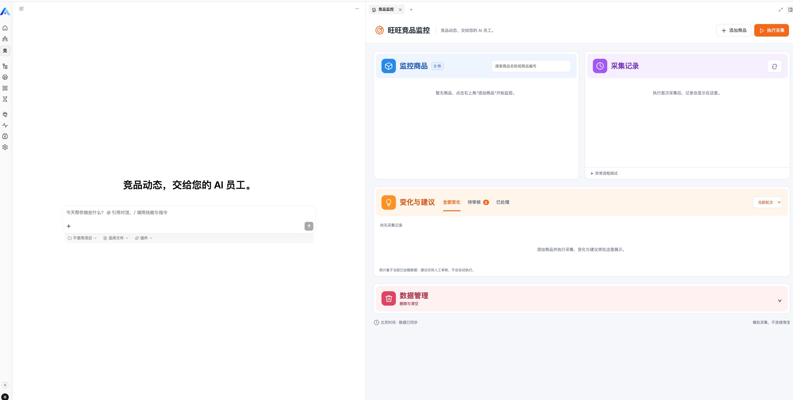

核心代码阅读说明见 [核心代码导读](docs/核心代码导读.md)，源码中的“【核心逻辑】”注释标出业务方法的处理步骤。

## 交付文档

- [产品说明](docs/产品说明.md)：用户、痛点、业务流程、页面与 AI 取舍。
- [运行说明](docs/运行说明.md)：实现、依赖、构建安装、配置与使用。
- [功能说明书 HTML](docs/功能说明书.html)：下载后可在浏览器打开。
- [测试报告](docs/测试报告.md)：四层测试、命令、实际结果与未验证项。
- [AI 协作说明](docs/AI%20协作说明.md)：使用的工具与模型、代表性协作过程、人工选择与工具限制。
- [限制边界](docs/限制边界.md)：适用范围、未完成项与改进优先级。
- [核心代码导读](docs/核心代码导读.md)：关键调用链与实现逻辑。

## 实现与职责

| 层面 | 实现 |
| --- | --- |
| 插件入口 | `src/index.ts` 注册模块、能力和助手模板 |
| 服务与持久化 | `src/lib/service.ts`、`entities.ts`：商品、轮次、快照、变化和建议，TypeORM 持久化 |
| Agent 中间件 | `src/lib/middleware.ts` 提供五个业务工具，服务端验证证据与状态 |
| Workbench | `src/lib/view.provider.ts` 提供视图、查询和操作，`src/remote/App.tsx` 与 `bridge.ts` 经宿主桥接访问数据 |
| 助手模板 | `src/lib/templates.ts` 与 `src/competitor-monitor-assistant.yaml` |
| 删除 | `src/lib/deletion.ts`：组织范围、关联数据预览、确认与事务删除 |
| 验证 | `tests/`，构建及产物检查脚本位于 `scripts/` |

五个工具：`monitor_get_round_changes`、`monitor_record_change`、`monitor_create_advice`、`monitor_report_analysis_issue`、`monitor_finish_analysis`。事实差异由服务端计算；模型读取事实、判断严重程度并生成建议；人工决定采纳或驳回。

复用 Xpert Plugin SDK 的模块、中间件、View Provider 与模板契约，NestJS/TypeORM 提供服务和持久化，LangChain/Zod 提供工具和参数校验。没有将独立预览网页作为平台插件交付。

## 环境与版本记录

本次截图由操作人在 2026-11-04 的本地 Xpert 平台提供，页面时间为北京时间。截图显示助手配置模型为 `glm-5.3`；这不是模型供应商账单或请求日志审计。

- 宿主 API：`http://localhost:3000`；Web：`http://localhost:4200`。
- 本地验证使用 Node.js 24.21.0、Corepack/pnpm；依赖版本以两个仓库的锁文件为准。
- 先按宿主仓库说明准备数据库、缓存、环境配置、测试账号与可用模型凭证，再启动平台。
- 两个项目分别安装依赖；插件在 `xpert-plugins/community` 工作区构建。

| 版本项 | 已知值与边界 |
| --- | --- |
| 平台最近核对 HEAD | `3ddc380ca20373f9113a77411090de3c3da75e37` |
| 插件仓库当前本地 HEAD | `a1cd22da42448c3d7dc0aadc716ee9924d9f6335`，旧版插件已提交 |
| 应用包版本 | `0.1.0` |
| 开发开始时 main 基线 | 尚缺历史证据；上述 HEAD 不自动视作开发基线 |
| 最新迁移的实际测试版本 | 当前 HEAD 加未提交 React 迁移；最终验证快照及结果见测试报告，尚无包含迁移的提交 SHA |

旧版应用已于 `dfd94a541240978f700877f49844c7e1285d7f62` 首次提交，后续提交为当前 HEAD。本地远程跟踪引用 `origin/feature/competitor-monitor` 与 HEAD 一致（本次未联网 fetch）。最新 React 迁移尚未提交，需提交并推送到同一 PR 分支，再记录该提交的验证结果；28 项测试不能归属于未包含迁移的旧提交。

## 构建、安装与启动

以下路径变量均为示例，请替换为自己的检出目录和测试租户；凭证仅在本地配置。

```bash
export XPERT_HOST_DIR="$HOME/xpert-dev/xpert"
export XPERT_PLUGIN_REPO="$HOME/xpert-dev/xpert-plugins"
export XPERT_API_URL="http://localhost:3000"
export XPERT_TENANT_ID="<测试租户 UUID>"
```

分别按仓库说明准备依赖：

```bash
cd "$XPERT_HOST_DIR"
corepack pnpm install --frozen-lockfile

cd "$XPERT_PLUGIN_REPO/community"
corepack pnpm install --frozen-lockfile
corepack pnpm --filter @community/apps-competitor-monitor build
corepack pnpm --filter @community/apps-competitor-monitor test
corepack pnpm --filter @community/apps-competitor-monitor verify:dist
```

部署脚本须在 API 已运行时使用。认证采用已配置的 macOS 钥匙串，或宿主脚本支持的本地进程环境变量 `XPERT_USERNAME` / `XPERT_PASSWORD`；不在 README、截图或仓库中填写真实凭证。

```bash
cd "$XPERT_HOST_DIR"
corepack pnpm plugin:deploy:local \
  --plugin-dir "$XPERT_PLUGIN_REPO/community/apps/competitor-monitor" \
  --force-install \
  --scope tenant \
  --tenant-id "$XPERT_TENANT_ID" \
  --api-url "$XPERT_API_URL"
```

出现 `installed and staged successfully` 后，在原 API 终端停止旧进程再执行：

```bash
cd "$XPERT_HOST_DIR"
corepack pnpm start:api
```

前端按宿主运行说明启动，并访问 4200 平台。不要同时启动两个 API 进程。部署后的模板创建与助手发布仍需独立完成；本项目不需要 npm 发布。

## 六步操作与截图验收

以下“实际结果”只陈述所提供截图与操作人确认能支持的事实；不将模拟预览结果替代真实平台验收。

### 1. 安装插件

操作：运行上方 `plugin:deploy:local` 命令。

预期：构建、测试及安装成功。实际：截图显示 24 项测试通过、0 项失败，目标插件安装并暂存成功，提示重启 API。此步骤通过，暂存成功不代表已经加载。

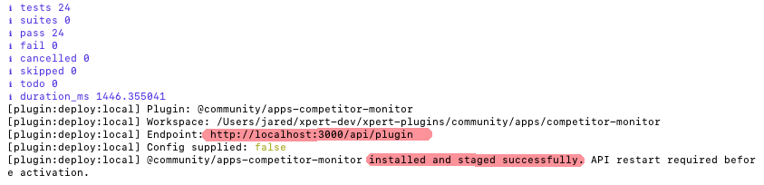

补充平台证据：已安装插件列表显示“旺旺竞品监控”、版本 `0.1.0` 及界面“全局”标记。该截图证明插件已出现在安装列表；不单独证明运行时加载成功，也不替代助手模板列表。

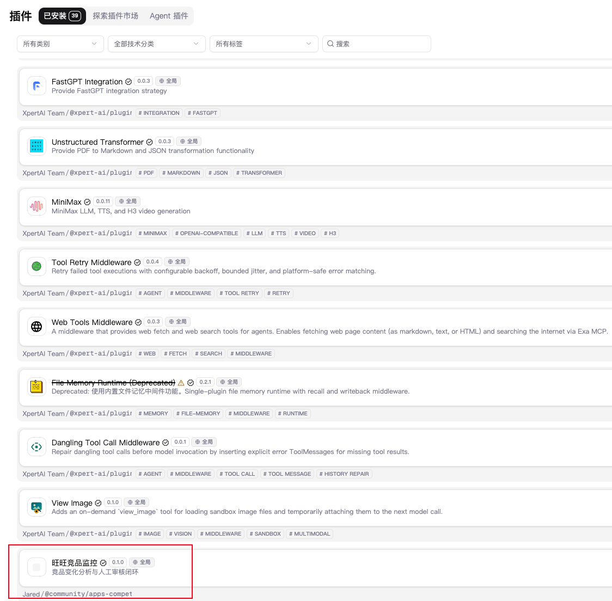

### 2. 重启并验证插件加载

操作：停止旧 API 进程、重新启动，启动前端并打开竞品监控。

实际：操作人确认已重启；原始 API 日志显示 Nest 启动成功及激活该插件的运行时重启完成，前端显示 4200 地址；工作台实际可用（见页面首图及后续交互）。原始 API 日志含本机标识，未复制到提交材料。平台只显示首页不构成插件加载证明，应结合工作台与工具运行截图判断。

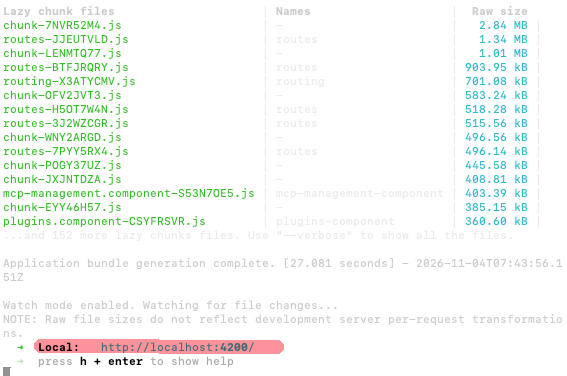

### 3. 展示插件提供的助手模板

操作：在平台模板入口查找“竞品分析助手”（`competitor-monitor-assistant`），查看描述及依赖。

实际：源码已注册模板，下一步截图展示了模板安装表单及“重新打开该模板”的说明；**独立模板列表或详情截图尚待补充**，不能把创建表单当作全部模板展示证据。

### 4. 基于模板创建并发布助手

操作：选择目标工作空间，填写助手名称，选择可用模型，再点击“安装并发布”。

实际：截图显示“竞品分析助手”、组织工作空间、`glm-5.3` 模型及安装发布入口；后续 Studio 截图显示已发布 v1。创建与发布有前后截图支持。

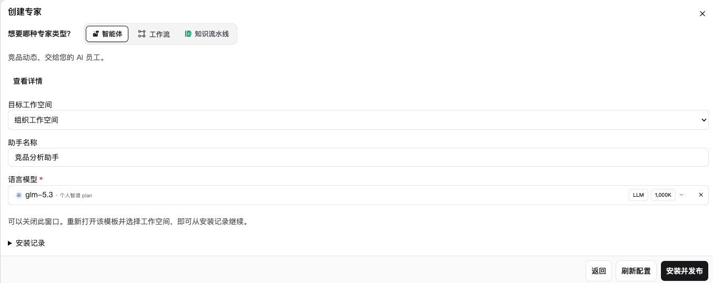

### 5. 绑定工具与工作台

操作：在助手 Studio 核对竞品监控中间件与助手连线，确认五个业务工具可用；进入助手对话，打开“竞品监控”工作台。

实际：发布截图展示助手连接竞品监控中间件及五个工具；页面首图展示宿主中的工作台，后续工具调用与建议保存证明运行链路可用。没有单独的手动工作台绑定配置截图，不声称必须手动绑定才能运行。

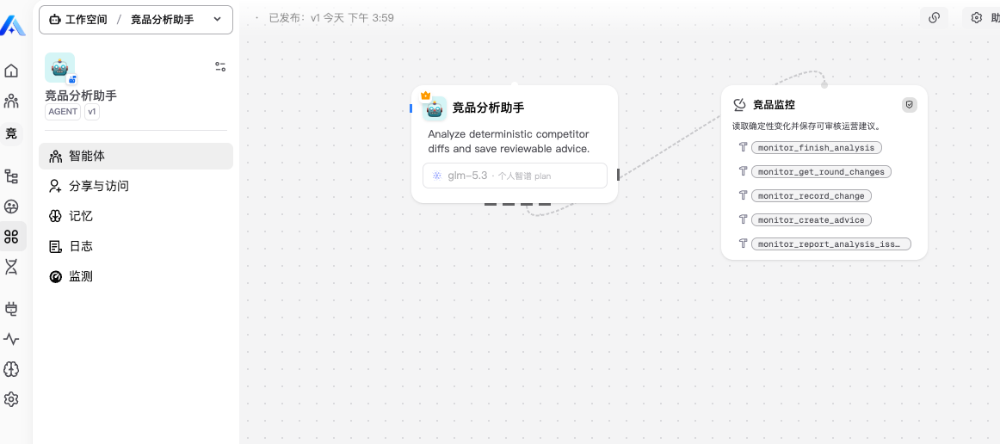

### 6. 真实模型处理、人工确认与保存

#### 输入与采集

操作：添加固定 Mock 商品，首次采集建立基线，再次采集查看价格、标题和促销差异。建议演示商品 `6543210` 无线蓝牙耳机。

实际：输入截图展示另一个可用商品 `6543218` 的添加表单，不是耳机输入过程；后续采集截图以 `6543210` 为主，16:11:01 为 0 条变化、16:11:24 为 3 条变化。证据显示价格 199 → 179、直降30元 → 直降50元、标题新增“2026新款”。

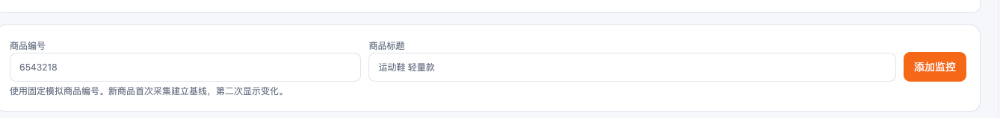
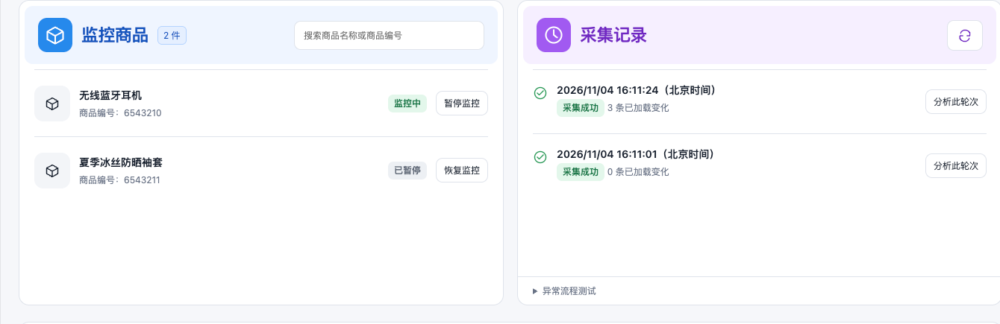
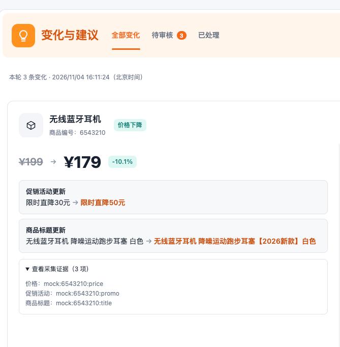

#### AI 分析与建议

操作：选择有变化的轮次，点击“交给 AI 分析”，等待模型读取服务端证据并保存建议。

实际：轮次 `6beed3d5-1b7d-43bf-b12b-15f25cc41006` 的对话展示工具调用、三条变化和三条建议；工作台显示两条促销调整建议、一条标题优化建议，均为待审核。属于操作人提供的真实平台模型交互证据；采集事实仍是 Mock。

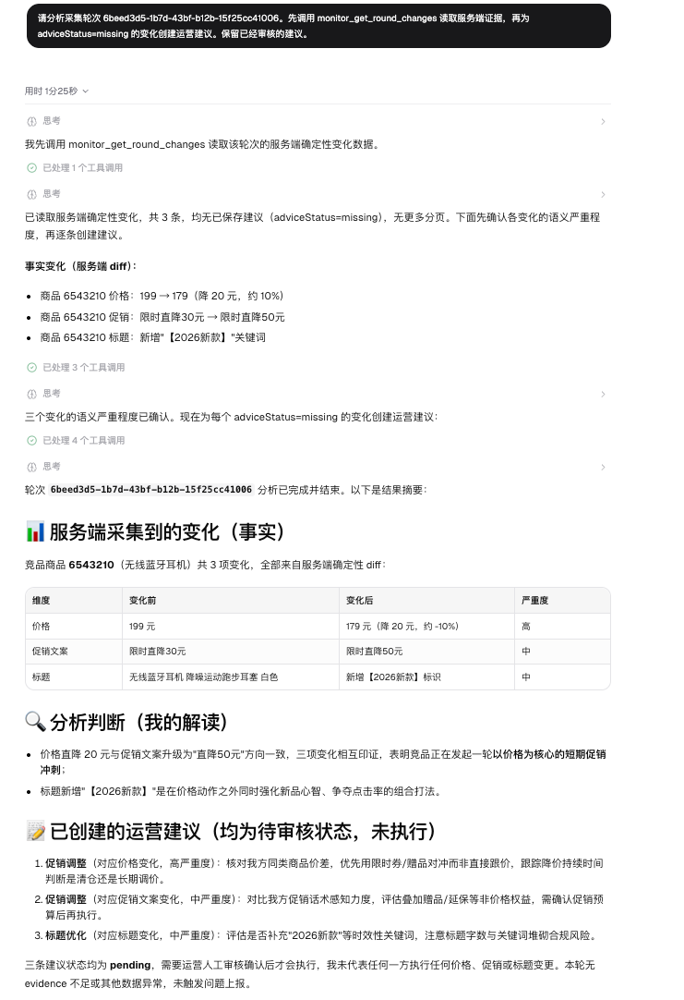
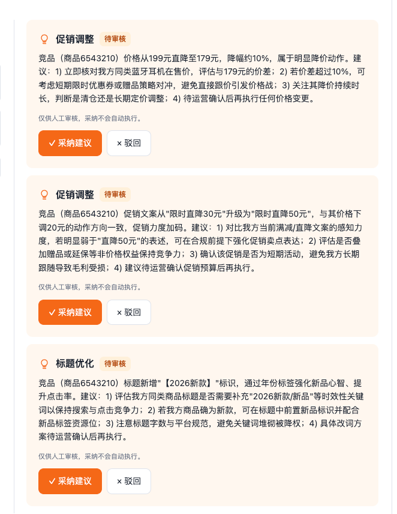

#### 人工审核与结果回读

操作：采纳价格和标题建议，驳回促销文案建议；再次分析同一轮次。另应刷新整个页面并重新进入相同轮次验证恢复。

实际：工作台显示“已采纳／已驳回／已采纳”；再次分析对话显示读取到 `approved/rejected/approved`，没有新建建议，完成版本为 revision 3。这支持审核结果被后续服务端查询读取；**尚缺明确的整页刷新后截图或录屏，刷新恢复不据此单独标记通过**。

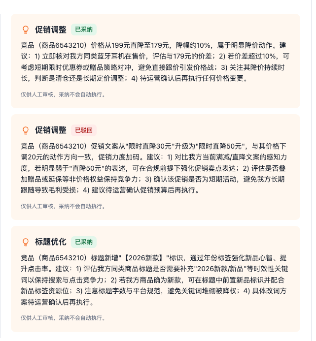
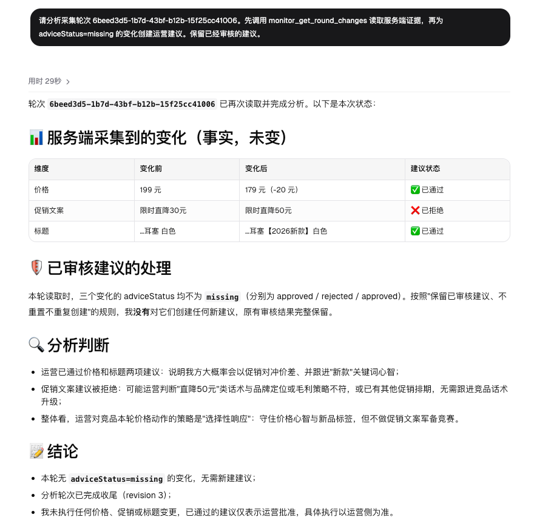

## 异常流程与数据管理

操作：在“异常流程测试”中填写监控商品 `6543210`，执行采集触发超时。继续注入失败至自动暂停，清空故障输入，点击原轮次“恢复采集”及“重试”。

实际：截图展示可理解的超时原因、商品及轮次暂停、恢复后商品监控中及采集成功。16:24:46 的记录在暂停及恢复截图中时间一致，支持该记录恢复；**截图未显示 roundId，不能仅凭时间认定已完成 ID 级同轮核验**。连续失败的完整三次计数过程未完整展示，阈值规则另由自动测试覆盖。

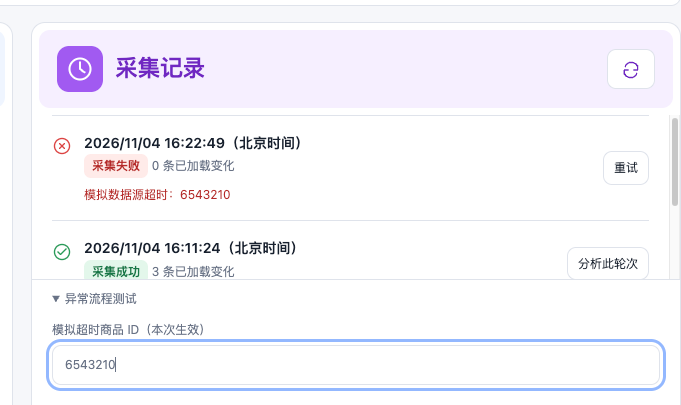
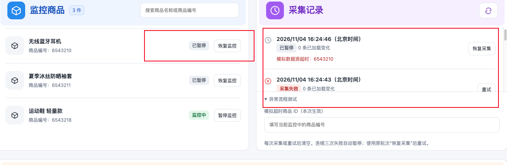
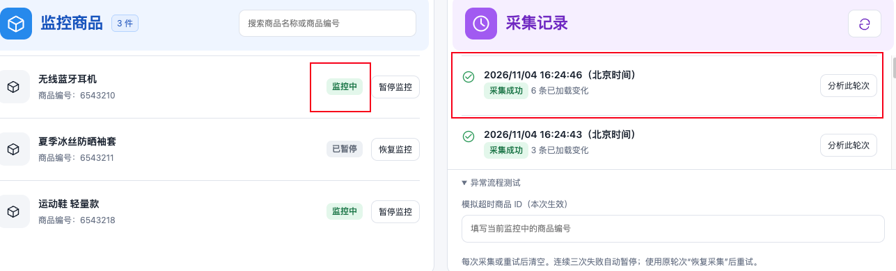

数据管理操作：展开管理区，选单条或多条记录，核对服务端返回的关联数量，输入“删除”再确认。

实际：截图显示运动鞋删除确认，涉及商品 1、快照 4、变化 9、建议 0。**这是删除前确认状态，不证明真实平台删除已成功。**

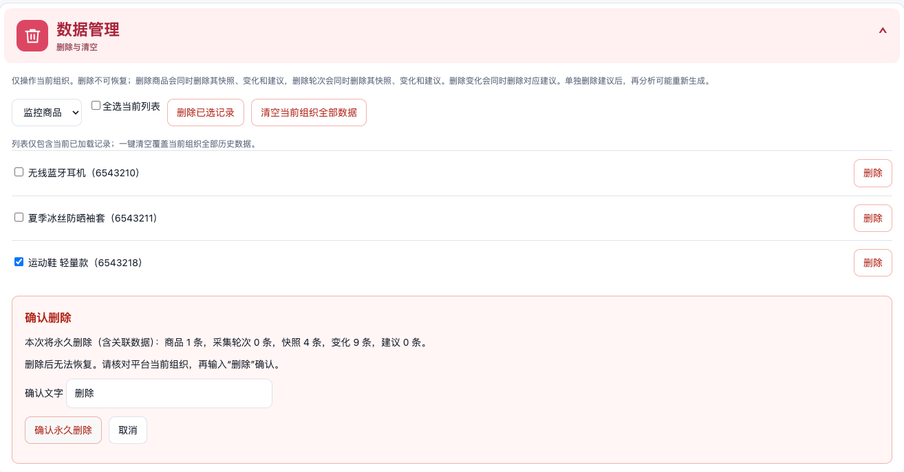

## 自动验证与验收边界

在 `community` 执行：

```bash
corepack pnpm --filter @community/apps-competitor-monitor build
corepack pnpm --filter @community/apps-competitor-monitor test
corepack pnpm --filter @community/apps-competitor-monitor verify:dist
```

按 `plugin-dev-harness/README.md` 准备并构建工具后，在插件仓库根目录执行：

```bash
node plugin-dev-harness/dist/index.js \
  --workspace ./community --plugin @community/apps-competitor-monitor
```

| 验证层 | 已记录结果 | 边界 |
| --- | --- | --- |
| 业务及契约测试 | 28/28 通过，覆盖 Mock、重试、暂停、分析、审核、删除隔离与回滚 | SQL.js／测试替身，不是生产数据库或真实账号权限验收 |
| 构建与产物检查 | build、verify:dist 通过 | 不代表宿主已加载 |
| 插件生命周期 | Harness 加载与关闭成功 | 默认数据库和权限模拟对象 |
| 实际平台流程 | 本页截图支持采集、模型分析、人工审核、结果回读及异常恢复 | 无模型供应商请求日志、无数据库逐条核验 |
| 待补证据 | 模板列表／详情、整页刷新恢复、重试前后 roundId、实际测试提交 SHA | 未补齐前不标记完整复现验收通过 |
| 未验证 | 两个真实组织账号的非法读写隔离、多 API 进程并发、真实平台删除完成结果 | 不用服务层测试替代平台权限验收 |

## AI 协作与已知限制

开发过程中使用 Codex 协助实现服务、Mock 场景、工作台 UI、测试与文档；操作人选择业务方向、确认界面方案，并在真实 Xpert 平台执行模型分析、人工审核及截图取证。未记录开发助手的确切模型版本，不推测填写。

代表性取舍：将差异计算留在服务端，避免模型虚构事实；以固定模拟数据重现异常与变化，不接入受限竞品抓取；建议只进入审核状态，不自动执行店铺动作；真实截图与自动测试分别记录，不将 Harness 或预览冒充平台验收。

限制与后续改进：

- Mock 不代表真实商品；生产适配需独立接入授权数据源并处理限流、认证与证据质量。
- 当前并发保护面向单 API 进程，多实例需数据库级统一锁。
- 当前列表有加载上限（商品 50、轮次 20、变化及建议各 100）；全选只选择已加载列表，一键清空则处理组织全量数据。
- 工作台已迁移为 React/TypeScript、共享 shadcn 和 typed i18n；迁移后尚未重新在真实宿主验收。
- 下一优先项：固定可复现提交、补齐上述证据、真实账号隔离验证，再推进生产数据源和远程分页。

## Mock 采集规则

仅接受固定商品 ID 6543210 至 6543219。每个商品独立按历史快照数量在两组数据间交替；首次建立基线，同轮重试复用已保存快照。已移除 demo 和任意 ID 的默认价格规则。已有清单外记录不会删除，请先暂停后再采集。

| ID | 商品 | 首轮 → 次轮 |
|---|---|---|
| 6543210 | 蓝牙耳机 | 199 → 179，标题、促销变化 |
| 6543211 | 防晒袖套 | 29.9 不变，促销取消 |
| 6543212 | 便携保温杯 500ml | 99 → 89；无 → 模拟限时优惠10元；标题不变 |
| 6543213 | 机械键盘 87键 | 199 → 229；无 → 无；标题不变 |
| 6543214 | 纯棉短袖 白色 | 59 → 59；无 → 无；标题变化 |
| 6543215 | 洗衣液 2kg | 39.9 → 39.9；无 → 第二件半价；标题不变 |
| 6543216 | 抽纸 24包 | 49.9 → 49.9；满99减20 → 无；标题不变 |
| 6543217 | 桌面收纳盒 | 29.9 → 29.9；无 → 无；标题不变 |
| 6543218 | 运动鞋 轻量款 | 299 → 259；满300减20 → 限时直降40元；标题变化 |
| 6543219 | 中性笔 10支 | 9.9 → 9.8；无 → 无；标题不变 |

### 数据管理与删除

工作台底部“数据管理 · 删除与清空”支持商品、采集记录、变化记录、建议的单条及勾选批量删除；“清空当前组织全部数据”覆盖全部历史记录，不受当前列表加载数量限制。批量全选仅选择当前已加载的列表。

确认前由服务端计算包含关联数据的数量，输入“删除”后提交。商品删除关联快照、变化和建议（保留历史轮次）；轮次删除关联快照、变化和建议；变化删除关联建议；单独删除建议保留事实变化，再分析可能重新生成建议。删除不可恢复。

删除仅使用宿主提供的租户及组织上下文，缺少组织时拒绝操作。五类数据在同一数据库事务删除；确认期间数据变化须重新确认。采集或分析中的组织不能删除。分析活动通过轮次的可空字段 `analysisStartedAt` 持久化，完成分析或上报失败后释放；中断的分析需重新分析完成或报告失败后再删除。部署需要宿主正常同步该新增可空字段。

当前与采集功能一样面向单 API 进程，本进程内操作互斥；多 API 实例部署前需升级为数据库级统一业务锁并验证并发。SQL.js 测试验证数据隔离、关联删除、回滚和运行中拦截，不替代真实平台权限验收。

## React 迁移与独立复现（2026-11-04）

工作台已拆分为 React/TypeScript 组件，使用当前仓库共享 shadcn、typed i18n 和宿主主题适配；同轮重试、人工审核及删除确认保留。正式插件不再借用相邻包的依赖目录。

新依赖目录与新 pnpm store 的冻结安装、构建、类型检查、28 项测试、产物一致性和 Harness 安装／构建／生命周期均通过。完整命令、版本、结果与未验证部分见 [测试报告](docs/测试报告.md)。在仓库根目录运行 `node community/apps/competitor-monitor/scripts/verify-clean.mjs` 可复验。

下图是**模拟宿主预览**，不是迁移后的真实平台运行证据；真实宿主需要重新部署并验收。

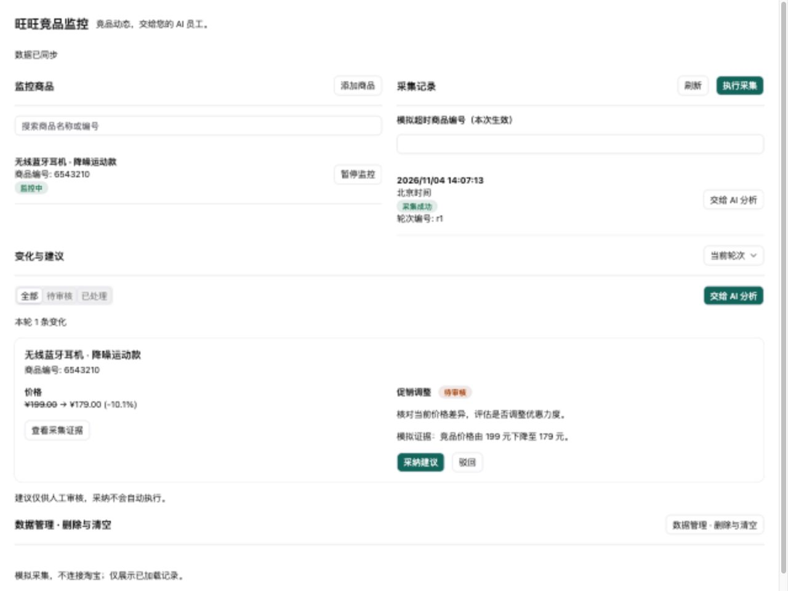
