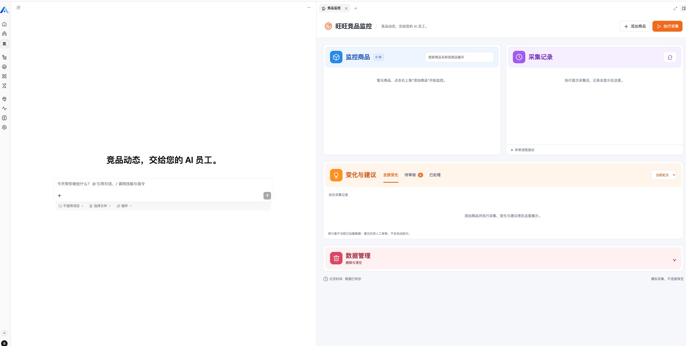
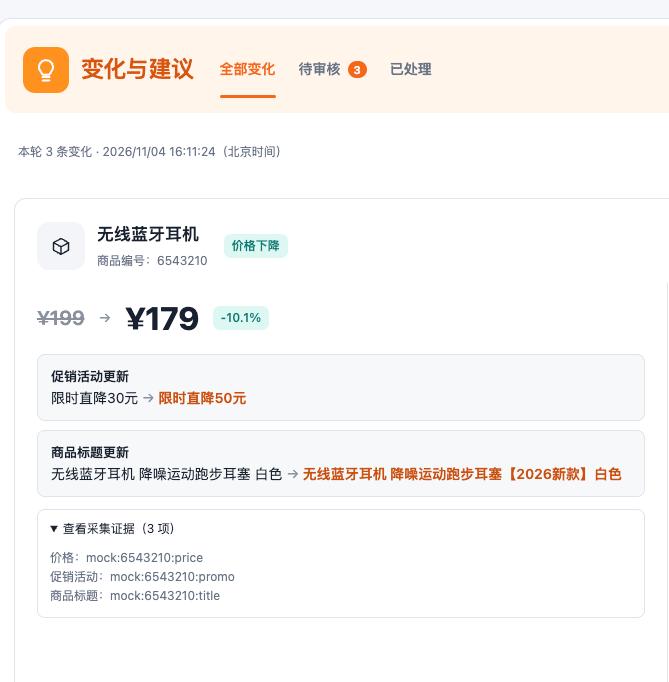
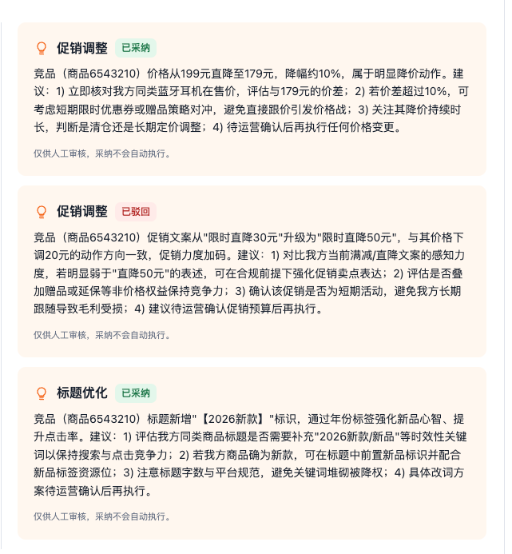
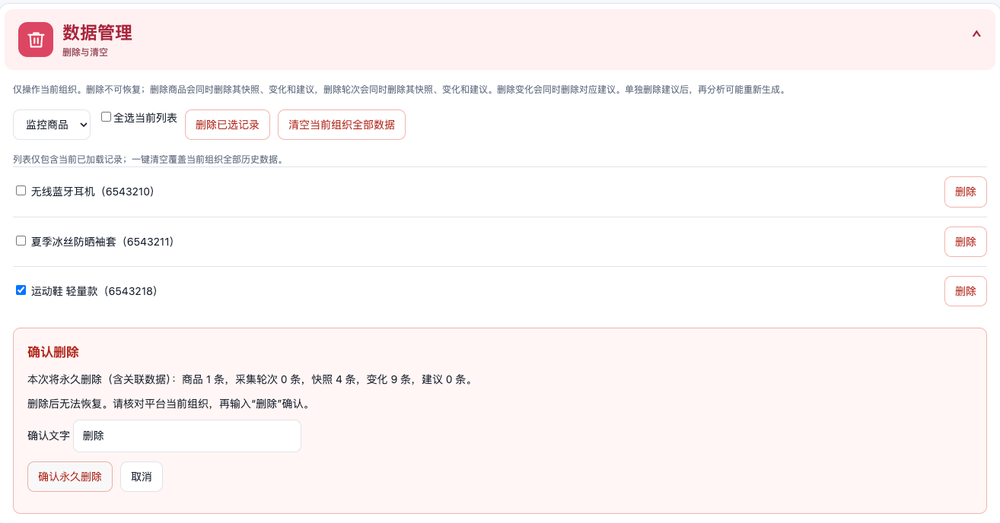

# 产品说明

## 1. 目标用户

面向需要跟踪竞品价格、标题和促销的中小电商商家、店铺运营人员，以及负责审核运营建议的主管。当前交付是 Xpert 中的可运行业务插件 MVP，使用固定模拟商品验证闭环。

## 2. 原有工作方式与痛点

运营人员逐个查看竞品页面、截图或抄写价格，在表格中比较历史信息，再通过聊天工具讨论促销和标题调整。变化容易漏记，事实与推测混在一起，建议分散、审核结果难追溯，采集失败后也不容易确认重试是否重复生成结果。这些是本应用拟解决的工作场景，不是已完成用户调研的统计结论。

## 3. 业务流程

1. 添加固定清单中的商品并开启监控。
2. 首次采集保存基线，再次采集与历史快照比较。
3. 服务端生成价格、标题、促销的确定性变化，并保留 Mock 证据。
4. 运营选择轮次发起 AI 分析，模型读取事实并保存待审核建议。
5. 人工采纳或驳回，服务端保存审核结果；再次分析保留已有审核状态。
6. 采集失败时展示原因，使用原轮次重试；连续失败达到阈值后暂停，恢复后继续。

## 4. 关键页面原型与实际实现

当前交付采用已实现的工作台截图说明布局，不将截图描述为未落地的设计原型。

- 顶部并列：蓝色监控商品区、紫色采集记录区。
- 下方整行：橙色变化与建议区，按轮次和审核状态筛选，事实与建议分列。
- 底部：红色数据管理区，支持单条、勾选批量删除及当前组织全量清空。
- 助手对话：展示事实、分析判断和待确认建议；工作台负责人工审核。

## 5. AI 的作用与功能取舍

1. **识别与分析内容**：AI 对商品标题、描述、价格、促销信息及评价等内容进行基础识别与分析，发现商品与竞品的关键变化。

2. **输出运营建议**：将监控结果转化为可执行的运营建议，例如商品信息优化、促销调整或美工素材需求。

| 能力 | 归属与取舍 |
| --- | --- |
| 事实采集与差异计算 | 服务端负责，不让模型创造价格和证据 |
| 变化解释、严重程度与建议 | 模型通过受控工具读取变化、确认严重程度、生成建议 |
| 运营决策 | 人工审核；采纳不自动执行店铺修改 |
| 数据源 | 固定 Mock 支持可重复测试；本期不抓取淘宝，不宣称真实市场洞察 |
| 故障治理 | 同轮重试、暂停与恢复优先于自动调度等扩展能力 |
| 数据清理 | 明确组织范围、影响数量与人工确认；删除不可恢复 |

### 功能取舍

**真实数据接入与定时采集（未完成）**
本次 MVP 使用固定 Mock 数据模拟商品价格、标题和促销变化，通过人工点击触发采集。尚未接入官方接口、授权数据源或其他符合平台规则的数据获取方式，也未实现定时采集任务。优先验证“采集 → 变化识别 → AI 分析 → 人工审核 → 保存”的完整业务流程。

**真实采集风险控制（部分完成）**
已实现业务层的幂等控制、同轮重试证据复用、失败原因记录、连续失败达到三次自动暂停及人工恢复。尚未接入真实数据源，因此未实现或验证面向外部接口的访问频率控制、退避重试、限流及反爬响应识别等机制。后续将根据数据源的授权范围、调用配额和平台规则补齐。
