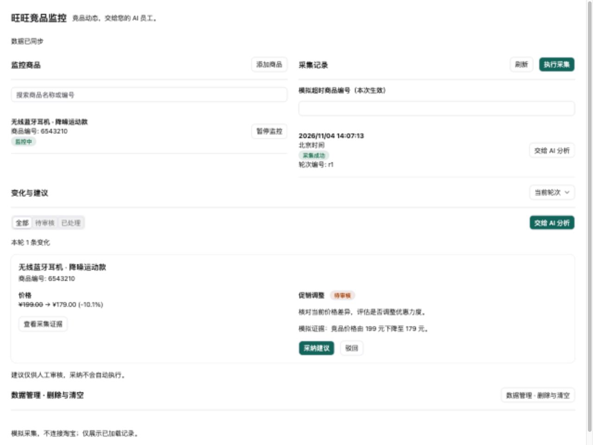

# 前端迁移与干净环境验证

验证日期：2026-11-04。此次变更将工作台迁移到 React / TypeScript，复用**本仓库** `packages/shadcn-ui`，通过 `workspace:*` 声明依赖。未改变服务端数据表或既有监控数据。

## 实现与复用

- `src/remote/main.tsx`：React 入口、RemoteI18nProvider 和主题安装；自包含 iframe 无需从 CDN 加载依赖。
- `App.tsx`：操作互斥、最新查询优先、组织上下文变更清理、采集与分析编排。
- `bridge.ts`：父窗口／频道／协议／实例校验，Zod 数据校验，请求关联和超时；只在明确拒绝助手消息时取消分析标记。
- `components/`：商品、轮次、变化建议、数据管理。Button、Input、Select、Checkbox、Tabs、Dialog、AlertDialog 等均来自共享组件。
- `i18n.ts` 与 `locales/`：共享 typed i18n，中英文语义键、插值参数、人民币与北京时间格式化。语言更新不清空表单，也不重新查询。
- `styles.css`：布局、滚动、窄屏单列与业务语义状态色。主题适配使用共享 `installShadcnThemeVars`；不访问浏览器 Web Storage。
- `scripts/build-remote.mjs`：esbuild 生成同源 `app.js`、`app.css` 与自包含 `index.html`；`verify:dist` 在内存重新构建、检查 JS/CSS/HTML/YAML 一致性。
- 原有同轮重试、审核版本、删除预览摘要和组织级服务端权限检查保留。删除确认现在使用 AlertDialog，并要求按界面语言输入“删除”（中文）或 `DELETE`（英文）。

## 如何重跑

在插件仓库根目录执行（需 Git、tar、Node.js 24 与 Corepack，可访问 npm）：

```bash
nvm use 24
node community/apps/competitor-monitor/scripts/verify-clean.mjs
```

脚本从当前 HEAD 导出提交基线，将当前插件非忽略文件及 community 锁文件覆盖到临时副本。它不复制 node_modules、dist、环境配置和凭证；创建独立 pnpm store，从锁文件安装依赖。报告与完整日志保存在终端输出的临时目录，不加入 Git。

依次执行：

```bash
# 临时副本的 community 目录
corepack pnpm --filter @community/apps-competitor-monitor... install --frozen-lockfile --store-dir <新建的空缓存目录>
corepack pnpm --filter @community/apps-competitor-monitor build
corepack pnpm --filter @community/apps-competitor-monitor typecheck
corepack pnpm --filter @community/apps-competitor-monitor test
corepack pnpm --filter @community/apps-competitor-monitor verify:dist
# 工具按自身 packageManager 安装、构建，再回到临时仓库根目录
node plugin-dev-harness/dist/index.js --workspace ./community --plugin @community/apps-competitor-monitor
```

Harness 的 pnpm 11 要求显式构建许可；验证脚本仅在临时副本创建独立工作区，允许 `@nestjs/core` 构建，不修改仓库中的 Harness 设置。脚本固定子进程使用当前 Node 的 Corepack，避免全局 pnpm 串版本。

## 本次实际结果

| 操作 | 预期 | 实际 |
| --- | --- | --- |
| 冻结安装，独立 store | 不借用其他应用 node_modules | 退出 0；正式插件原借用软链接也已移除 |
| build | 共享 UI、服务入口、声明、JS/CSS/HTML、助手 YAML 完整 | 退出 0 |
| typecheck | 服务端与 React 类型检查通过 | 退出 0 |
| test | 行为断言通过 | **28 通过，0 失败、0 跳过** |
| verify:dist | 重建产物一致 | 退出 0 |
| Harness 独立安装和构建 | 不使用旧 dist | 均退出 0 |
| Harness 生命周期 | 初始化、加载和关闭成功 | Plugin loaded successfully；Application context closed |

环境：macOS arm64，Node.js v24.21.0；community 使用 pnpm 8.15.8，Harness 使用其声明的 pnpm 11.15.1。

验证基于 PR 分支 HEAD `a1cd22da42448c3d7dc0aadc716ee9924d9f6335` 加本次未提交迁移；这不是开发开始时的 main 基线。验证快照（不含 docs）的 SHA-256 为 `b3210967b5b4e4414ca94ffb4680fad965bde990a433ceb934ae73f284c671f9`；验证后只补充了文档和截图，README 的补充会改变下一次快照摘要。请提交后再次运行该命令记录最终提交结果。

28 项测试包括：5 项契约、7 项采集恢复（含真实回执契约）、1 项模型失败、7 项删除事务／范围、8 项真实构建页面测试。页面测试在 JSDOM 运行构建后的 React JS，覆盖 Web Storage 抛 SecurityError 的沙箱、内容转义、审核版本和刷新回读、同轮重试、语言变更保持输入、拒绝消息后的取消标记、删除取消及确认摘要。

最终校验修正了采集动作精简 DTO 与完整列表 DTO 的字段差异，并新增真实 SQL.js 服务回执测试。此修正后在同一干净安装副本重新执行 build、typecheck、28 项测试、verify:dist 和 Harness，全部退出 0；依赖清单和锁文件未变化。

## 浏览器验证（模拟宿主）

使用仓库共用 `tools/remote-view-preview` 和同一套构建资源；配置在 `scripts/preview.config.mjs`。预览只实现审核、暂停和清空演示动作，其他动作明确返回未支持，不假装调用真实 AI。

```bash
# 构建后，在插件仓库根目录
node tools/remote-view-preview/cli.mjs \
  --config community/apps/competitor-monitor/scripts/preview.config.mjs --port 8770
```

实际检查：中文浅色、英文暗色／紧凑主题；390 像素窄屏单列；采纳后刷新仍为已采纳；AlertDialog 显示删除影响、默认聚焦取消、取消后焦点返回发起按钮。浅色边框 `--border=#dfe3eb`，暗色 `--border` / `--input=#334155`、`--ring=#2dd4bf`，行边框计算值分别为 `rgb(223, 227, 235)` 与 `rgb(51, 65, 85)`。这只证明模拟 iframe 的主题映射。



## 未验证部分

- 这是同一台 Mac 上的新源码目录、新依赖目录、新 pnpm store 验证；不是另一台机器、Linux 或全新操作系统验收。
- 此次未重新部署、重启真实 Xpert；迁移后真实宿主的主题、消息发送、真实模型、持久化和账号权限隔离仍需安装后复验。README 中旧平台截图保留为历史证据，不冒充新界面验收。
- Harness 使用默认数据库、权限和运行能力模拟；浏览器预览使用内存数据，均不能证明真实数据库或权限通过。
- 未新增远程分页、多 API 进程锁或真实采集源；这些仍是既有边界。
- 原锁文件中 SDK/Contracts 相关 peer 版本警告未在本次做跨包升级；安装、类型检查和生命周期通过不等同所有宿主组合兼容。
