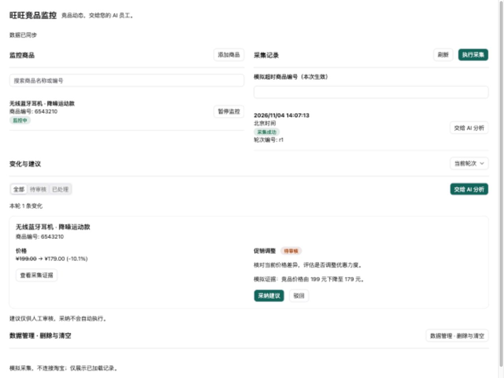

# 测试报告

记录日期：2026-11-04（北京时间）。对象：`@community/apps-competitor-monitor` 0.1.0。本报告结合本会话实际自动检查和操作人提供的平台截图；没有重新执行或声称通过全部真实平台流程。

## 最新迁移验证

2026-11-04：React/共享 shadcn/typed i18n 迁移后，干净目录安装、构建、类型检查、28 项测试、产物一致性及独立准备的 Harness 均通过。详细版本和命令见 [前端迁移与干净环境验证](前端迁移与干净环境验证.md)。本节更新自动检查结论；下方平台截图是迁移前历史证据，新界面尚未部署验收。

## 操作人完整复跑验证（2026-11-04）

操作人重新执行 `verify:clean` 后，已实际读取本次 `report.json`、`test.log` 和 `harness.log`。8 个步骤全部完成且退出码均为 0；本节为最新完整复跑记录，下方较早验证记录保留供追溯。

```bash
cd /Users/jared/xpert-dev/xpert-plugins/community
nvm use 24
corepack pnpm --filter @community/apps-competitor-monitor verify:clean
```

| 记录项            | 实际值                                                                                    |
| -------------- | -------------------------------------------------------------------------------------- |
| 环境             | macOS（darwin）arm64，Node.js v24.21.0                                                    |
| 提交基点           | `a1cd22da42448c3d7dc0aadc716ee9924d9f6335`                                             |
| 本次源码摘要 SHA-256 | `162de3a105179fd512b8bf508928a942d5d4ffeb046a94d8bc0ab5e64b4a9f17`                     |
| 本机报告路径         | `/var/folders/yl/r8zz29r964dgcftrksmmkqbh0000gn/T/competitor-clean-MwxJgg/report.json` |
| 隔离方式           | 独立源码和依赖目录；全新 `store` 与 `harness-store`，使用 frozen-lockfile 安装                           |

本机临时路径仅用于追溯，不是其他机器可访问的交付链接。源码摘要按脚本计算（不含 docs，但包含 README）；测试对象为提交基点叠加当前工作区插件修改及锁文件，不能表述为仅验证上述 Git 提交。

| 操作              | 预期                     | 实际结果                   |
| --------------- | ---------------------- | ---------------------- |
| install         | 锁定依赖在独立目录和新 store 安装成功 | 退出码 0                  |
| build           | 共享 UI、服务端和工作台构建成功      | 退出码 0                  |
| typecheck       | 服务端与前端无类型错误            | 退出码 0                  |
| test            | 行为断言全部通过               | 28 项通过，0 失败、0 跳过；退出码 0 |
| verify-dist     | 构建资源与源码一致              | 退出码 0                  |
| harness-install | Harness 独立安装成功         | 退出码 0                  |
| harness-build   | Harness 构建成功           | 退出码 0                  |
| harness         | 插件加载及关闭无异常             | 退出码 0；加载成功，应用上下文正常关闭   |

本次日志摘录：

```text
ℹ tests 28
ℹ suites 0
ℹ pass 28
ℹ fail 0
ℹ cancelled 0
ℹ skipped 0
ℹ todo 0
ℹ duration_ms 2694.4485
[plugin-dev-harness] mocks: enabled
[plugin-dev-harness] Plugin loaded successfully.
[plugin-dev-harness] Application context closed
```

结论：本机隔离安装与自动验证通过。“空缓存”指全新 pnpm 依赖存储目录，不代表清空整台电脑缓存。尚未验证另一台机器、Linux 或全新操作系统；Harness 使用模拟依赖，不代表真实数据库、权限隔离、模型调用及完整平台业务流程通过。最新迁移提交并推送后，仍需按最终提交复验及完成真实平台验收。

## 四项差距验收（2026-11-04）

本轮核验代码、Git 状态和已有实际日志；未重复执行未变化的全套测试，也未新增真实平台验收。

| 差距       | 验收结论               | 已有证据                                                                            | 尚需完成                                         |
| -------- | ------------------ | ------------------------------------------------------------------------------- | -------------------------------------------- |
| 界面工程规范   | 本地实现已补齐；提交与平台验收未闭环 | React/TypeScript 分模块；当前仓库共享 shadcn、RemoteI18nProvider、typed i18n、主题适配；构建及页面测试通过 | 提交迁移，重新部署，检查真实宿主 iframe 的主题与动作               |
| 干净环境可复现性 | 同机隔离复现通过；新机器未验证    | 独立源码、依赖、空 store 安装；构建、类型、28 项测试、产物及 Harness 通过；正式依赖目录不再是相邻包软链接                  | 在另一台机器或干净 CI 环境按最终提交复验；完整宿主安装另行验收            |
| 完整平台验收   | 未通过：证据不足           | 有历史平台截图及服务层隔离、恢复、去重测试                                                           | 真实 A/B 账号越权读写、整页刷新恢复、重试前后 roundId 及记录去重对照    |
| 版本记录     | 已更正旧描述；迁移版本仍待提交    | 旧应用已有两次提交；当前 HEAD 与本地 origin 跟踪引用一致                                             | 最新 React 迁移进入新提交后记录实际测试 SHA；开发起始 main 基线保留未知 |

本次逐字节比较 36 个源码、脚本、测试及配置文件，均与最终隔离验证副本一致；community 锁文件也一致。文档后续更新不改变已有代码测试的适用范围。

旧版初次提交：`dfd94a541240978f700877f49844c7e1285d7f62`；当前本地 HEAD：`a1cd22da42448c3d7dc0aadc716ee9924d9f6335`。检查该 HEAD 的工作台入口仍是原生 HTML，React 文件目前为未跟踪文件，其余迁移文件为未提交修改。因此“旧代码已提交”属实，“最新迁移已提交”不成立。本次仅检查本地远程跟踪引用，没有 fetch 或核验 GitHub 最新状态。

真实平台补验须记录以下结果，不能以服务层测试代填：

| 操作                           | 通过标准                                        | 当前状态                      |
| ---------------------------- | ------------------------------------------- | ------------------------- |
| A 组织创建唯一商品，B 账号尝试读取及修改 A 的记录 | B 无法列出或访问 A 的数据；写入被拒绝，A 的原记录不变              | 待验证                       |
| 在平台采集、分析并人工审核，再整页刷新或重新进入     | 原商品、轮次、证据及审核状态均从服务端恢复                       | 待验证；模拟宿主刷新不作为此项证据         |
| 注入超时，记下 roundId 和失败原因，再重试    | 重试后的 roundId 与失败时相同，成功状态可见，快照／变化／建议无不应出现的重复 | 待验证；历史截图只有时间一致，缺 ID 与数量对照 |
| 部署迁移后检查主题、语言和助手动作            | 真实宿主中界面可用、消息正确发送、审核能保存                      | 待验证                       |

## 环境、版本与证据范围

| 项目           | 本次记录                                                                                       |
| ------------ | ------------------------------------------------------------------------------------------ |
| 系统与运行时       | macOS arm64，Node.js v24.21.0                                                               |
| 包管理器         | community：pnpm 8.15.8；Harness：pnpm 11.15.1                                                 |
| 插件测试基准       | PR 分支 HEAD `a1cd22da42448c3d7dc0aadc716ee9924d9f6335` 加未提交的前端迁移改动                          |
| 验证快照 SHA-256 | `b3210967b5b4e4414ca94ffb4680fad965bde990a433ceb934ae73f284c671f9`，按验证脚本计算，不含 docs；之后仅补充文档 |
| 干净环境范围       | 同一台 Mac 的独立源码目录、node_modules 和新 pnpm store；未复制旧依赖或产物                                       |
| 业务测试数据       | SQL.js 隔离数据库、固定 Mock 商品数据；不访问淘宝或真实模型                                                       |
| 界面自动测试       | JSDOM 执行实际构建的 React 页面，宿主响应为明确的测试替身                                                        |
| 浏览器检查        | 共享预览宿主，中文浅色及英文暗色／紧凑主题；不等于真实 Xpert                                                          |

平台旧截图对应的历史核对 HEAD 为 `3ddc380ca20373f9113a77411090de3c3da75e37`；旧插件核对 HEAD 为 `dfad5423205811b3251628ee9bf59a79a4bcbd87`。这些不是此次迁移的测试版本，也不能冒充开发开始时的 main 基线。截图模型配置为 glm-5.3，未核验供应商调用日志或账单。迁移后没有重新部署、重启真实平台。

## 干净环境复验命令与结论

在插件仓库根目录执行：

```bash
nvm use 24
node community/apps/competitor-monitor/scripts/verify-clean.mjs
```

脚本导出 HEAD、覆盖当前插件非忽略源码及锁文件，在临时目录使用空 pnpm store 安装，依次运行构建、类型检查、测试、产物校验及 Harness 独立安装、构建和生命周期检查。终端输出 report.json 与日志目录。该命令不需要本插件预先安装 node_modules。

| 操作                 | 预期                     | 实际结果                                                                                     |
| ------------------ | ---------------------- | ---------------------------------------------------------------------------------------- |
| frozen-lockfile 安装 | 独立解析和安装锁定依赖，无相邻包目录借用   | 退出 0；正式插件借用相邻包的软链接已移除                                                                    |
| 初次完整隔离验证           | 安装、构建、类型、测试、产物和生命周期都成功 | 8 个步骤均退出 0                                                                               |
| 精简 DTO 修正后复验       | 最终源码在同一隔离依赖环境仍通过       | build、typecheck、test、verify:dist、Harness 共 5 个步骤均退出 0；依赖与锁文件未变                           |
| 发布依赖检查             | 当前 manifest 与锁文件一致     | `node scripts/check-release-dependencies.mjs --workspace community` 通过，使用 Node 24 的 PATH |
| 差异格式检查             | 无空白错误                  | `git diff --check` 通过                                                                    |

最终隔离测试日志摘录（不是重新估算）：

```text
ℹ tests 28
ℹ suites 0
ℹ pass 28
ℹ fail 0
ℹ cancelled 0
ℹ skipped 0
ℹ todo 0
ℹ duration_ms 1910.580875
[plugin-dev-harness] Plugin loaded successfully.
[plugin-dev-harness] Application context closed
```

## 第一层：业务逻辑、单元测试与构建

在插件仓库的 `community` 目录执行：

```bash
corepack pnpm --filter @community/apps-competitor-monitor build
corepack pnpm --filter @community/apps-competitor-monitor typecheck
corepack pnpm --filter @community/apps-competitor-monitor test
corepack pnpm --filter @community/apps-competitor-monitor verify:dist
```

| 操作／脚本       | 预期                             | 实际结果                                |
| ----------- | ------------------------------ | ----------------------------------- |
| typecheck   | 类型检查无错误                        | 迁移后在隔离目录重新执行，退出 0                   |
| build       | 服务入口、声明、HTML 与 YAML 均生成        | 迁移后共享 UI、服务端与 React 构建成功            |
| test        | 业务结果断言全部通过                     | 28 项通过，0 失败、0 跳过                    |
| verify:dist | 重新构建的 JS、CSS、HTML 及 YAML 与产物一致 | 退出 0                                |
| 冻结锁文件校验     | manifest 与锁记录一致                | 新临时源码／依赖目录与独立空 store 冻结安装通过；见迁移验证报告 |
| lint        | 如已定义则执行                        | package.json 未定义 lint，不标记为通过        |

现有可运行测试文件：

| 文件                            | 数量 | 断言及实际覆盖                                                                       |
| ----------------------------- | -- | ----------------------------------------------------------------------------- |
| `tests/contracts.test.ts`     | 5  | 命名空间、工具集合、先读证据、桥接契约、审核结果保留                                                    |
| `tests/recovery.test.ts`      | 7  | 非法商品拒绝、不同范围、状态变化、部分失败证据复用、分页、同轮幂等、三次暂停与恢复、固定场景具体差异、真实服务完整列表及精简采集回执符合前端 schema |
| `tests/model-failure.test.ts` | 1  | 模型失败只记录最新明确轮次，并保留原始错误；使用测试替身                                                  |
| `tests/remote-entry.test.ts`  | 8  | 真实 React 构建资源、沙箱、文案完整性、审核回读、同轮重试、拒绝回执、语言和主题、删除取消与确认                           |
| `tests/deletion.test.ts`      | 7  | 五类删除路径、范围拒绝、陈旧确认、在途拦截、事务中途失败回滚；检查实际剩余记录                                       |

测试数据由测试文件建立 SQL.js schema 和业务记录，结束后销毁；无需真实模型或淘宝服务。服务中的两组固定商品证据按每个商品历史快照数量交替：6543210 多维变化，6543211 取消促销，6543212 降价促销，6543213 涨价，6543214 改标题，6543215 新增促销，6543216 撤销促销，6543217 无变化，6543218 多维变化，6543219 小幅降价。同轮重试不推进已采集证据。

## 第二层：插件加载与生命周期

先按本地 `plugin-dev-harness/README.md` 准备工具：

```bash
# 插件仓库根目录；首次准备工具时执行
corepack pnpm -C plugin-dev-harness install
corepack pnpm -C plugin-dev-harness build
# 应用先完成上一层构建
node plugin-dev-harness/dist/index.js \
  --workspace ./community --plugin @community/apps-competitor-monitor
```

需要测试配置时可追加 `--config <test-config.json>`；本插件配置为空 schema，本次未传自定义配置。

| 操作        | 预期                 | 实际结果                                                       |
| --------- | ------------------ | ---------------------------------------------------------- |
| 加载构建入口及配置 | 插件形状、默认配置可接受，依赖能装配 | Harness 成功启动并加载插件，无退出错误                                    |
| 初始化与关闭    | 容器生命周期无异常          | 输出 Plugin loaded successfully 和 Application context closed |
| 模拟边界      | 明确运行对象性质           | 日志为 mocks: enabled；不证明真实数据库、真实权限或完整业务通过                    |
| 工具准备      | 使用已构建 Harness      | 迁移验证已在隔离目录重新安装、构建并运行 Harness                               |

真实安装截图另显示 24 项测试通过并安装暂存成功；操作人确认重启，平台工作台及工具实际运行提供后续证据。暂存状态不能单独当作加载通过。

## 第三层：界面集成

以下自动测试随 `test` 执行；浏览器操作另行标注，不能混同真实平台验收。

| 操作                            | 预期                          | 实际结果／证据类型                                                                        |
| ----------------------------- | --------------------------- | -------------------------------------------------------------------------------- |
| View Provider 加载构建入口          | 返回实际打包 HTML                 | 自动测试通过                                                                           |
| 中英文文案校验                       | 键及插值参数一致                    | 自动测试通过                                                                           |
| Web Storage 访问抛 SecurityError | 沙箱仍能初始化及显示业务数据              | 自动测试通过                                                                           |
| 用户内容与价格证据                     | 文本转义、北京时间、价格比例正确            | 自动测试通过，未执行用户提供的 HTML                                                             |
| 审核后宿主刷新                       | 携带 expectedRevision，回显已审核状态 | 自动测试通过；浏览器模拟宿主采纳后整页刷新仍为已采纳                                                       |
| 失败轮次重试                        | 提交原 roundId，不增加重复轮次         | 页面模拟回执测试通过；SQL.js 服务测试另验证快照和变化去重                                                 |
| 助手拒绝消息                        | 不显示发送成功，取消未发送分析标记           | 自动测试通过；不代表真实模型故障验收                                                               |
| 只更新宿主语言                       | 表单草稿保留，不重复查询                | 自动测试通过                                                                           |
| 删除预览与取消                       | 显示关联数量，取消不提交删除              | 自动测试通过；浏览器确认取消后焦点返回发起按钮                                                          |
| 确认删除                          | 需正确确认文字，提交服务端摘要，刷新为空状态      | 自动测试通过；真实平台删除仍未验收                                                                |
| 主题和语言展示                       | 中文浅色、英文暗色／紧凑主题可读            | 浏览器模拟 iframe 检查通过                                                                |
| 主题变量映射                        | 边框、输入与焦点色来自宿主               | 浅色 `--border=#dfe3eb`；暗色 `--border/--input=#334155`、`--ring=#2dd4bf`，行边框计算值对应宿主色 |
| 390 像素窄屏                      | 两栏变单列，布局不横向溢出               | 浏览器检查单列与滚动宽度；不声称已覆盖所有窗口、缩放和无障碍场景                                                 |

页面自动测试为 `tests/remote-entry.test.ts`，共 8 项。浏览器检查是本会话实际操作记录，没有独立的全平台浏览器自动化脚本。预览数据存于模拟宿主内存；其刷新回读不能证明平台数据库持久化。



## 第四层：平台业务流程（迁移前历史证据）

| 场景／操作               | 预期                 | 实际结果及证据                                            |
| ------------------- | ------------------ | -------------------------------------------------- |
| 完整业务：采集两次 → AI → 审核 | 事实、建议与保存状态一致       | 截图显示 0→3 条变化，三条建议及采纳／驳回；09、10、11 截图支持              |
| 保存回读：再次分析原轮次        | 读取已有审核状态，不重复创建     | 12 截图显示 approved/rejected/approved，revision 3      |
| 保存恢复：刷新整个页面重进       | 记录与结果仍存在           | 未有明确刷新过程证据，不用再次分析代替刷新验收                            |
| 输入与空状态              | 无数据有提示；非法／缺失输入可纠正  | 05 空状态及 06 输入截图存在；非法 ID 有服务测试，真实必填纠错未完整验证          |
| 超时、暂停与恢复            | 原因清晰，恢复原轮次，不产生重复结果 | 13、14、15 展示失败、暂停及相同时间记录恢复；未显示 roundId，真实数据库重复快照未核验 |
| 模型失败                | 清晰报告失败，允许重分析       | 自动中间件测试通过；本次截图未覆盖真实模型故障                            |
| 权限与范围               | B 不能读写 A 组织数据      | 服务层隔离测试通过；两个真实账号的越权访问未验证                           |
| 删除与清空               | 确认范围正确，完成后关联数据移除   | 16 仅展示删除前确认；真实删除完成未验证                              |

详细截图直接展示在 [README](../README.md#六步操作与截图验收)，相对链接均指向 `screenshots/`。轮次示例：`6beed3d5-1b7d-43bf-b12b-15f25cc41006`。

