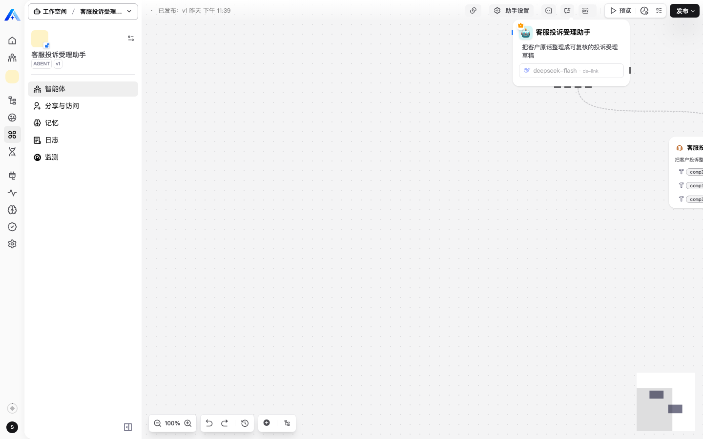
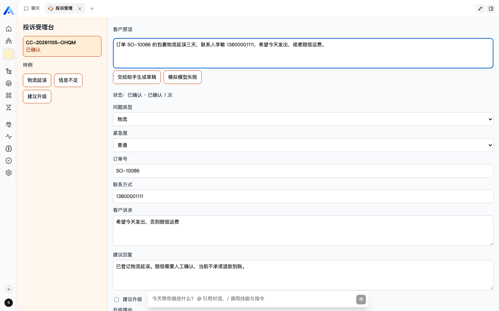
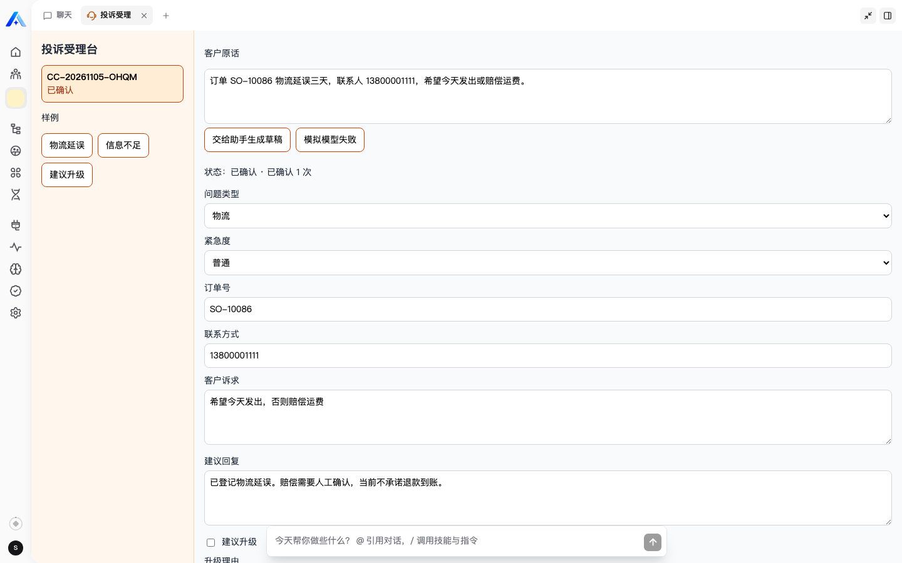
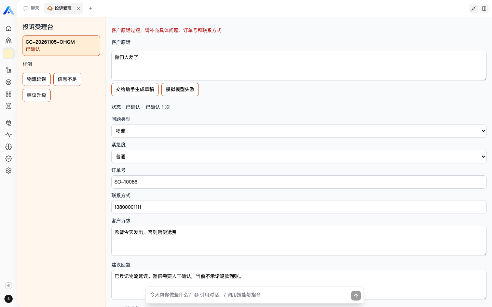

# 客服投诉受理

一线客服把一段客户原话收成一张可复核的受理记录。助手只生成草稿，确认受理和退回补充由客服在受理台完成。

## 用户和原来的做法

用户是一线客服专员。投诉原来散落在聊天和邮件里，分类、紧急度、客户诉求和回复口径靠人临时判断，交接时容易丢，升级也没有统一标准。

这个插件把流程收成一条记录：

1. 客服粘贴客户原话。
2. 助手提取问题类型、紧急度、诉求、缺失信息、建议回复，以及是否建议升级。
3. 客服可以改字段。
4. 信息足够时确认受理；关键信息缺失时退回补充。
5. 刷新后原话、草稿和结论仍在。
6. 模型失败时同一条记录变为失败，重试不会再产生一张已确认记录。

助手不能承诺退款，也不能关闭投诉。

## 页面原型

受理台分成左右两栏。

- 左侧是受理单列表。没有记录时提示先粘贴客户原话，并提供三条样例。
- 右侧上方是客户原话和两个动作：交给助手生成草稿、模拟模型失败。
- 右侧下方是可编辑草稿：问题类型、紧急度、订单号、联系方式、客户诉求、建议回复、是否升级。
- 底部动作是保存修改、确认受理、退回补充。
- 原文过短、缺少字段或模型失败时，在右侧用红色文字说明原因。

## 功能取舍

做了：一段文字输入、一次真实模型调用所需的工具和助手模板、草稿编辑、确认或退回、保存与恢复、失败重试、租户和组织范围过滤。

没有做：多渠道接入、真实工单系统、退款、客户门户、知识库、多级审批、文件上传、多账号隔离演练。

## 智能体工具

- `complaint_save_intake_draft`：按 `caseId` 更新同一条草稿。
- `complaint_get_case`：读取一条受理单。
- `complaint_search_cases`：按状态或关键词查询当前组织内的受理单。

确认和退回只在 Workbench 动作里：`confirm_intake`、`return_for_supplement`。

## 运行

基线：

- 平台 `xpert-ai/xpert` `main`：`3f387ffbb059c37e0aaf8bbd22b7222fda476fbc`
- 插件 `xpert-ai/xpert-plugins` `main`：`8996a1a4c996354d8d92cae4ea4be034c87c57d3`

在 `community/` 目录：

```bash
corepack pnpm install
corepack pnpm --filter @xpert-ai/plugin-customer-complaint-intake test
corepack pnpm --filter @xpert-ai/plugin-customer-complaint-intake build
```

插件声明为 `tenant`。在平台仓库根目录安装到测试租户：

```bash
corepack pnpm plugin:deploy:local \
  --plugin-dir <plugin-repo>/community/apps/customer-complaint-intake \
  --scope tenant \
  --tenant-id <tenant-id> \
  --api-url http://localhost:3000
```

安装成功后需要重启 API，再确认插件已加载。然后使用模板「客服投诉受理助手」创建并发布助手。模板会带上 `CustomerComplaintMiddleware`。模型在创建助手时选择测试环境里已经配置的模型。

环境变量只控制调试开关，不要写入真实密钥：

```bash
CUSTOMER_COMPLAINT_DEBUG=false
```

模型凭证放在 Xpert 平台的模型配置里。

## 运行截图

截图来自本地正在运行的 Xpert。相对路径放在本说明里，GitHub 上可以直接看到。

已发布助手，模型是 deepseek-flash，并挂了三个投诉受理工具：



对话入口。客服从这里进入助手，再打开投诉受理台：


关键界面。打开助手后的投诉受理台，左侧是已保存的受理单 `CC-20261105-OHQM`，状态为已确认：


用户输入。客服把一段客户原话贴进输入框。下面仍是这条已确认记录的草稿：



AI 处理结果。同一条记录上的草稿：问题类型是物流，紧急度是普通，订单号和联系方式来自原文。建议回复写明当前不承诺退款到账。客服确认后，状态是已确认，已确认 1 次：



异常。只输入「你们太差了」再交给助手时，受理台拒绝生成草稿，并提示原文过短：



## 演示脚本

1. 打开投诉受理台，确认空列表有提示。
2. 填入物流延误样例，交给助手生成草稿，在对话里看到真实模型调用，回到受理台确认。
3. 刷新页面，原记录和确认结论还在。
4. 填入「你们太差了」，界面提示原话过短。
5. 对一条未确认记录点击「模拟模型失败」，状态变为处理失败；再次生成草稿后仍是同一条，已确认次数不变。
6. 填入提到多次投诉和监管部门的样例，草稿标出建议升级，由客服决定是否确认。

## 验证记录

| 检查 | 操作 | 预期 | 实际 |
| --- | --- | --- | --- |
| 规则测试 | `pnpm --filter @xpert-ai/plugin-customer-complaint-intake test` | 6 项通过 | 6 项通过 |
| 构建 | 同一包的 `build` | 服务端入口、界面脚本、助手模板进入 `dist` | 已生成 `dist/index.js`、`dist/lib/remote-components/customer-complaint/app.js`、`dist/xpert-customer-complaint-assistant.yaml` |
| 实体命名 | `node community/scripts/check-entity-names.mjs` | 表名以 `plugin_` 开头 | 通过 |
| 生命周期 | `node plugin-dev-harness/dist/index.js --workspace ./community --plugin @xpert-ai/plugin-customer-complaint-intake` | 能加载、启动和销毁 | 2026-11-05 通过。Harness 使用模拟数据库，不能代替真实流程 |
| 平台流程 | 安装、重启、模板、创建助手、真实调用、失败重试、确认 | 同一条记录最终已确认 | 已完成。助手已发布，受理单 `CC-20261105-OHQM`，最终 1 条 `confirmed` |
| 界面截图 | 关键界面、用户输入、AI 结果、过短原文 | README 用相对路径显示 | 已放在 `docs/screenshots/`。过短原文会拒绝生成草稿 |
| 多账号隔离 | 两个组织交叉读取 | 不能读到对方数据 | 未演练。代码按当前租户和组织过滤 |

## 复用

仓库许可证是 AGPL-3.0，本插件沿用该许可证。工程结构参考同仓库 `community/apps/smart-maintenance`：插件入口、Nest 模块、中间件工具、Workbench 远程界面、Assistant YAML。业务规则、受理单模型和界面文案是这次新写的，没有复制维保领域数据。

## AI 协作

下面是几次实际改过方向的地方。

产品范围先收成一线客服的一条闭环：粘贴原话、生成草稿、人工确认或退回。报销没有选，因为使用者不熟悉那条业务。确认和退回留在受理台，不交给模型，避免助手承诺退款或关闭投诉。工程结构参考同仓库的维保示例，受理单、规则和界面文案是新写的。

第一次安装被平台拒绝：带数据表的插件不能声明为 `organization`。随后改成 `tenant`，并补上 `artifactNamespace`，部署范围改成对应租户，插件才加载成功。

截运行画面时，投诉受理这个标签已经打开，中间却是空白。远程页面的标题到了，脚本没有执行。检查后发现界面脚本的 `React.createElement` 调用少了一个收尾括号。补上之后，受理台才画出来，才截到输入、草稿和过短原文。

已确认的记录上还留着旧的「模型调用失败」。确认时把失败原因写成了 `undefined`，TypeORM 不会因此把这一列更新成空。代码改成写入 `null`。截图用的这条本地记录也清掉了旧原因，所以确认结果里不再显示失败提示。

拉取仓库时直连 GitHub 中断，随后用本机 `proxy_on` 走本地代理完成克隆。登录凭证放在系统钥匙串，没有写进仓库或说明。

这次的收获是：接口返回成功、标签也能打开，仍要打开真实页面。远程脚本只要解析失败，界面就会是一片空白。

## 已知限制

下一步最值得做的，是把「真正缺失的业务字段」和「模型补充建议」分开。现在两类内容都进 `missingFields`，建议性提示也会挡住确认受理。

- 失败重试可以由界面上的「模拟模型失败」触发，也可以由助手在明确要求时设置 `simulateModelFailure`。成功重试或确认后，失败原因会写成空。
- 只在一个租户和一个组织里验证过，没有做多账号对照。
- 不发布 npm 包。插件安装级别是 `tenant`，因为当前平台要求带数据表的插件使用 `system` 或 `tenant`。
- 没有空列表的单独截图。本地已经有一条已确认记录，打开受理台会直接看到它。没有记录时，左侧文案是「还没有受理记录。先在右侧粘贴一段客户原话。」
