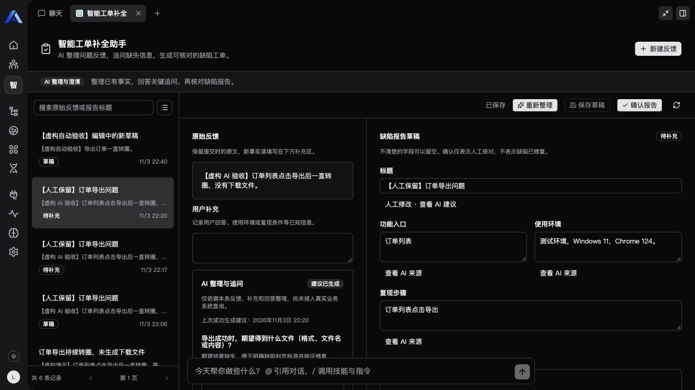

# 智能工单补全助手

面向测试与技术支持，把零散用户反馈整理为可核对、可保存、可恢复的缺陷报告。使用 Xpert 的组织身份、领域中间件、Workbench Remote View 和 PostgreSQL 持久化，作为独立插件开发。

当前版本 0.2.1 支持 AI 自动整理、最多三条针对性追问、保存回答后再次分析，以及分析失败后重试。原始反馈、人工补充、报告编辑、确认快照与分析记录均在服务端保存。AI 仅整理用户提供的材料，未知字段留空；人工修改的字段受到保护，确认仅表示人工核对。



录入反馈 → AI 整理 → 回答关键追问并保存 → 重新整理 → 核对并人工确认。展开“查看 AI 来源”可查看原文引用；引用存在不代表推断必然正确，仍需核对含义。

## 本地开发

从本仓库的 `community` 工作区运行，使用其指定的 pnpm 版本：

```sh
corepack pnpm --filter @community/apps-defect-intake... install --frozen-lockfile
corepack pnpm --filter @community/apps-defect-intake build
corepack pnpm --filter @community/apps-defect-intake test
corepack pnpm --filter @community/apps-defect-intake verify:dist
```

React 控件使用同仓库共享的 `@xpert-ai/plugin-shadcn-ui`。构建先生成共享 UI，再检查服务端与远程组件类型并生成独立 JS/CSS。运行包不依赖源码目录、共享 UI 源文件或 CDN。SDK 与契约使用已发布的 3.30.2 版本，SDK 为宿主提供的 peer dependency。

## 安装和入口

插件声明为 `system`，在 Default tenant 以 tenant scope 安装。通过所选 Xpert 宿主的 `plugin:deploy:local --plugin-dir <本插件目录> --scope tenant` 安装，凭证使用宿主支持的 Keychain 或当前进程环境变量；按部署结果重启 API。不要手工修改宿主插件暂存目录。

在组织工作空间安装本插件提供的“智能工单补全助手”模板，选择可用且已获授权的模型，再发布到本地组织。为领域中间件的“分析模型”选择已授权连接并保存发布；未指定时依赖组织已有默认模型，无可用模型会明确失败。插件通过平台模型运行时调用模型，不读取 API 密钥。打开助手菜单中的“智能工单补全”。模板已连接领域中间件、Todo 和 Context Compression，并提供领域自己的列表、详情和启动分析工具；人工确认仅在工作台执行。

安装插件、安装模板、发布助手是三个独立步骤。模板不包含实际租户、组织、用户、模型连接 ID 或密钥。

## 验证

`test` 包含 13 项测试，覆盖输入边界、引用校验、回答、人工保护、过期结果、失败状态、翻译目录及模板一致性；`verify:dist` 重新生成并比较正式远程资产。仓库 `plugin-dev-harness` 用实际 dist 进行加载与生命周期检查，其数据库 mock 不代表持久化通过。

真实平台验收脚本为 `tests/live.mjs`。先在当前进程配置 `XPERT_USERNAME`、`XPERT_PASSWORD`、`XPERT_ORG_ID`、`XPERT_ASSISTANT_ID`，可选 `XPERT_API_URL`（默认 `http://localhost:3000/api`），然后执行 `node tests/live.mjs`。脚本仅允许 loopback 地址，会留下明确标记的虚构验收记录；凭证、JWT 和部署身份不写入源码或输出。

在同样的环境配置下执行 `node tests/analysis-live.mjs`，会通过已发布助手启动两轮真实模型分析，检查分析请求去重、来源、回答补全和人工字段保护。此测试调用已配置的模型并消耗其额度；可选 `XPERT_AI_LIVE_RECEIPT` 将验收回执保存到仓库外私有目录。

模拟宿主使用正式资产与单独的 fixture：在仓库根目录运行 `node tools/remote-view-preview/cli.mjs --config community/apps/defect-intake/preview.config.mjs --port 4417`。这是模拟交互验证，不等同于真实平台数据库验收。

当前实现及真实验收范围见 [第二阶段记录](docs/phase-two.md)，人工闭环历史见 [第一阶段记录](docs/phase-one.md)，需求见 [产品规格](docs/product-spec.md)。
