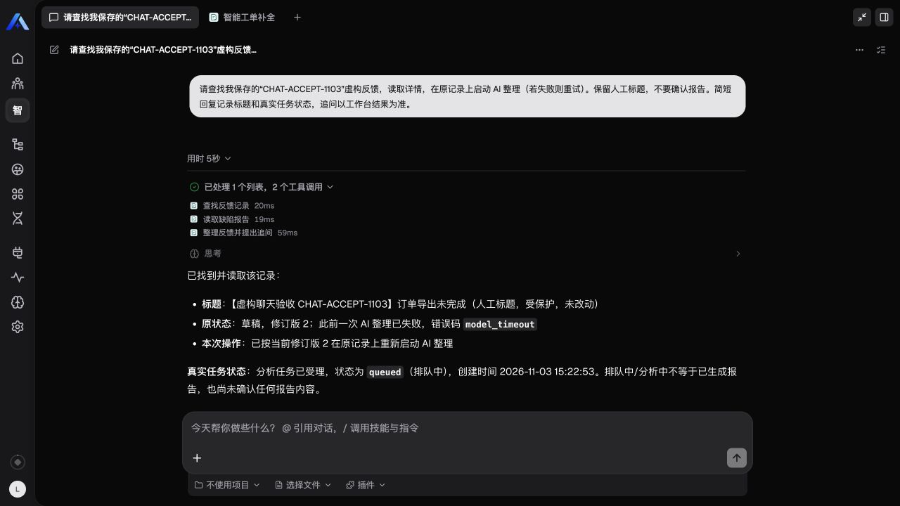
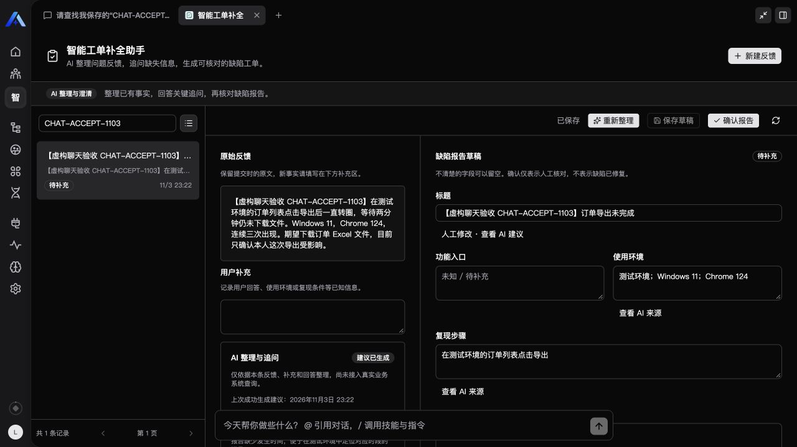

# 第三阶段：完整聊天工具链与双用户验收

本阶段在本机真实 Xpert 中验证自然语言工具调用与记录权限，使用独立标记的虚构记录，不修改体验者录入的反馈。版本 0.2.2；具体回执保留在仓库外私有运行目录。

## 聊天工具链与运行步数

在真实聊天页面输入：查找标记为 CHAT-ACCEPT-1103 的已保存反馈，读取详情，再启动 AI 整理，不确认报告。初次执行时，查找和详情工具均成功，第三个分析工具调用已生成，但运行在执行前触发 20 步上限。已保存的 thread 状态和 UI 工具轨迹一致，未观察到重复失败循环。

平台的图步骤包含模型、工具和基线中间件节点，20 步不足以覆盖这条正常链路。模板及同一专用助手改为有界 64 步，保留模型、连接、助手标识和人工确认权限。复测已依次调用三个领域工具，并如实返回排队中，而非宣称报告已经生成。

## 推理模型输出截断

后台曾多次返回 `invalid_output`，人工标题和草稿均保留。对同一虚构输入进行单独诊断，官方响应的 `finish_reason` 为 `length`，2,500 completion tokens 中有 2,337 个 reasoning tokens，JSON 因剩余额度不足被截断。该诊断只用于定位，不能替代实际平台运行验收。

模型调用的 completion 上限调整为 8,192，仍保留 90 秒调用期限、180 秒任务期限、64,000 字符响应限制、严格 schema、来源和版本校验。显式的 `length` 响应归类为 `output_truncated`，界面明确说明截断，整份响应不写入报告。新增测试覆盖：即使前缀为合法 JSON，明确截断也必须拒绝；完整 JSON 仍须通过来源校验。

仅增大额度的中间版本仍发生超时，不能作为修复成功。继续检查发现，分析器构建模型客户端时丢弃了实例的 provider options，使用户无法为整理任务选择非思考模式。最终修复透传已配置选项（保留显式 `false`），仅将最大输出限制在 8,192、SDK 自动重试限制为零；15 项测试包含该回归。

本机专用领域分析模型使用 DeepSeek 插件已支持的 `thinking: false`、`response_format: json_object`、`streaming: false` 和 `max_tokens: 4096`，保持原模型连接、主助手和共享默认值。非思考模式参数依据 [DeepSeek 官方文档](https://api-docs.deepseek.com/guides/thinking_mode/)；这是实例配置，不在可移植模板中假定所有提供商都支持这些选项。

该修复减少额度导致的失败，不保证任何模型输出都可通过。提供商失败、超时和内容校验失败仍可能发生，应保留内容并允许用户重试。



最终 0.2.2 复测中，真实聊天再次依次成功调用列表、详情和启动分析工具；随后从服务端与浏览器工作台读取到同一记录 `succeeded`，revision 从 2 变为 3，人工标题保留，生成七项带来源建议及三条追问。该次生成未确认报告，聊天中的 queued 回执与最终后台成功分别核对。



## 同一组织的双真实用户

使用现有管理员与新建普通 `APP_USER` 两个真实登录身份，处于同一租户与组织。普通用户通过平台标准分享获得本课题助手的使用权，不授予管理权限，也不修改角色权限或共享模型默认值。正向操作先证明普通用户可以使用同一 Workbench，再检查拒绝路径，避免把整站无权限误认为领域隔离有效。

`tests/access-live.mjs` 覆盖两个方向：

- 列表和搜索只返回本人记录。
- 直接读取他人记录失败，状态与随机不存在的 ID 一致，响应不包含该记录原文或标题。
- 对他人记录保存、分析和确认均返回 `not_found`。
- 越权请求后，两条记录与请求前一致，分析未启动、确认未产生。
- 伪造 `ownerId` 被严格输入 schema 拒绝。
- 普通用户自己的保存、真实模型分析和人工确认可成功，人工标题与实际结果保留。

验收脚本仅允许 loopback 地址，凭证从当前进程环境获取，不输出密钥、JWT、用户或记录标识。除原有四项环境变量外，设置 `XPERT_SECOND_USERNAME`、`XPERT_SECOND_PASSWORD`；可选 `XPERT_ACCESS_LIVE_RECEIPT` 将回执写到仓库外私有目录。执行会调用真实模型并留下虚构记录；最多进行一次显式重试。它不创建账号、不授予权限，账号和助手使用权需通过正常平台管理预先准备。

本阶段检验的是同一租户、同一组织下的记录所有者隔离。没有执行跨真实租户、跨真实组织矩阵，也不据此宣称平台所有权限路径或并发场景均已验证。

最终修复版的双用户脚本再次通过，普通用户自身分析首次成功、无需重试，并完成确认。验收后移除临时助手分享并清空测试组，重新登录确认测试用户已无法访问该助手。普通账号及组织成员关系保留供后续复现；平台要求至少一个活跃组织成员关系，未绕过该约束。虚构记录保留，未删除用户已有内容。

## 本地复现

```sh
node tests/access-live.mjs
```

聊天验收必须从已发布助手的聊天入口实际发起，并在工具轨迹核对三个工具的成功回执；再从工作台读取终态。助手最后一段文字或排队回执不能替代后台成功结果。
