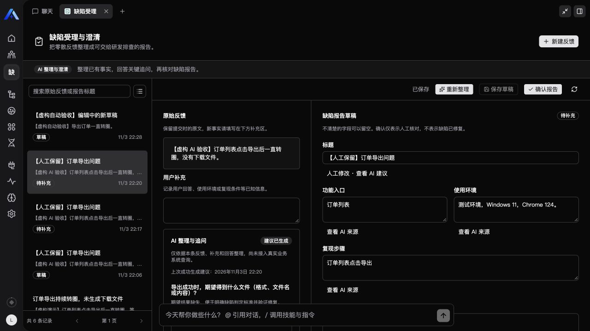
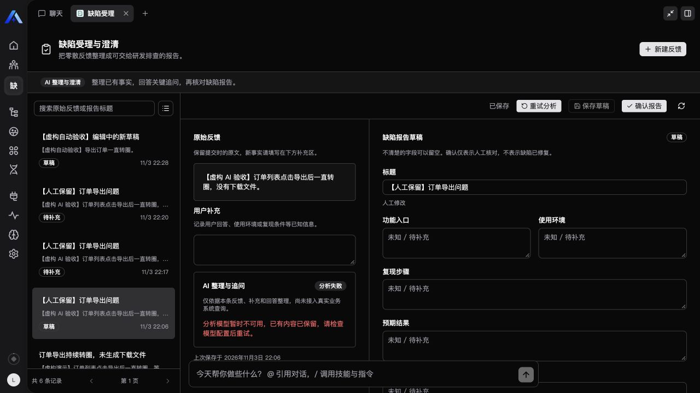

# 第二阶段：AI 整理与澄清

版本 0.2.0，验收日期 2026-11-03。独立插件运行在本机真实 Xpert，使用平台模型运行时与托管队列；演示输入均为明确标记的虚构反馈。

## 使用闭环

新建反馈后点击“AI 整理”。模型从原文、补充、已有人工字段和保存的回答中提取报告字段，并提出最多三条追问。建议附带来源片段；服务端验证引用来自本次输入，拒绝不存在的来源、重复字段和超额追问。该校验保证引用存在，不能证明引用必然支持模型的语义判断，因此结果仍需人工核对。

回答后保存草稿，再点击“重新整理”。回答与对应问题一并保存，下一轮可使用这些事实。服务端拒绝原样重复已回答的问题；提示词要求避免重复追问已有信息，但语义相近的改写仍需人工判断。没有真实业务系统查询、日志诊断或自动根因结论。

人工修改的字段（包括有意清空）不会被后续建议覆盖，可单独展开查看 AI 的不同建议。分析期间仍可编辑报告，精确对应当前分析的返回结果只合并未修改的字段。问题回答在分析期间暂停编辑；跨页面版本冲突保留本地草稿并提示重新加载，避免将回答关联到已更换的问题。

## 后台任务与重试

每次分析保存独立 attempt、输入快照、源 revision 与状态。队列仅传 attempt ID；处理时由平台重新授权原用户、组织和助手能力，再通过已授权模型连接创建客户端。没有将密钥写入插件或任务。

状态依次为排队、分析中、成功或失败。模型输出必须通过严格结构和引用校验才可应用。一次逻辑任务不配置自动重跑，模型调用限时 90 秒，记录的任务期限为 180 秒。工作台轮询和重新打开时执行状态修复：排队投递缺口可补投，终止或超时任务变为明确失败。恢复读取是触发点，未打开记录不会凭空产生实时状态刷新。

失败保留原文、草稿、回答及上次成功建议，点击“重试分析”创建新 attempt。重复启动请求和仍活跃的任务会去重。写回同时检查当前 attempt 与源 revision；保存新草稿或新任务后，旧结果不能覆盖当前记录。确认时保存独立快照，分析期间不能确认，领域工具也不提供人工确认操作。

## 已执行的验证

| 验证 | 结果与证据范围 |
| --- | --- |
| 构建、双端类型检查、正式资产新鲜度 | 通过 |
| 13 项测试 | 通过，含 nullable 模型选项、引用、人工清空、回答、过期写回、版本合并和安全失败码；事务测试使用显式替身 |
| dist-first 插件生命周期 | 通过；harness 基础设施 mock 不作为数据库证据 |
| 真实平台两轮模型脚本 | DeepSeek 官方连接的 deepseek-flash 成功；同请求去重、缺失环境留空、最多三条追问、回答进入下一轮、人工标题和实际结果保留 |
| 真实浏览器同记录失败重试 | 初始配置失败保留草稿，绑定修复后点击重试成功，显示三条具体问题 |
| 真实浏览器回答、重新整理与刷新 | 保存环境、频率、影响范围的回答后再次分析，排队时完整刷新，最终恢复成功结果；已知三项进入报告，追问转向期望文件、筛选条件和时间，人工字段保留 |
| 最终 API 重启后的人工闭环回归 | 真实接口通过空白校验、原文保留、身份字段拒绝、创建去重、保存恢复、过期写入拒绝、确认重试和独立快照；浏览器重新打开后恢复既有 AI 结果 |
| 模拟宿主生产资产交互 | 分析期间未保存标题保留；回答保存；注入失败后原报告及回答保留，重试成功。此项不代表真实模型或数据库验证 |

在第二阶段结束时，尚未完成双真实用户隔离矩阵、真实队列中断故障注入、长上下文压缩效果及多浏览器系统测试。后续双用户与完整聊天验证见 [第三阶段记录](phase-three.md)。权限边界与过期写回有代码和单元覆盖，不能据此宣称其他集成场景全部通过。原有持久化、确认与 API 重启恢复的验收见第一阶段记录。

## 集成中发现的问题

宿主发布的模型配置允许 `options: null`，初始插件校验过严，真实调用暴露该问题后已接受空值并增加回归测试。专用助手通过平台规范导出、现有实例 managed import 和正常发布更新分析模型绑定，保留实例身份与已有图结构。没有修改组织或租户默认模型。

现有模板升级接口对自定义领域中间件的适配范围有限，因此不能将专用实例更新过程等同于所有模板的通用升级支持。插件模板本身不携带本机连接 ID，其他安装者需选择自己的模型。
