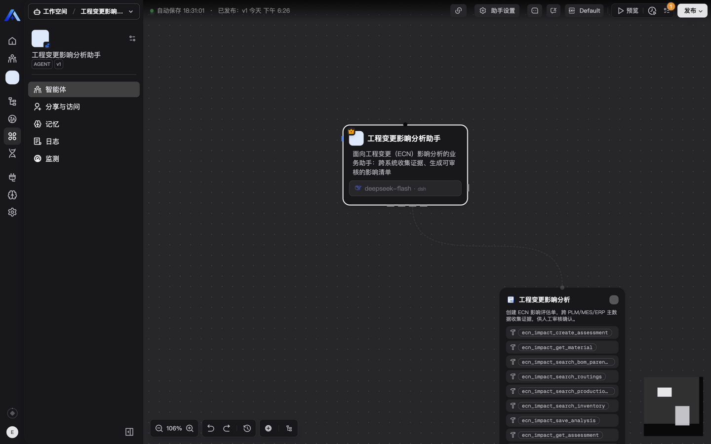
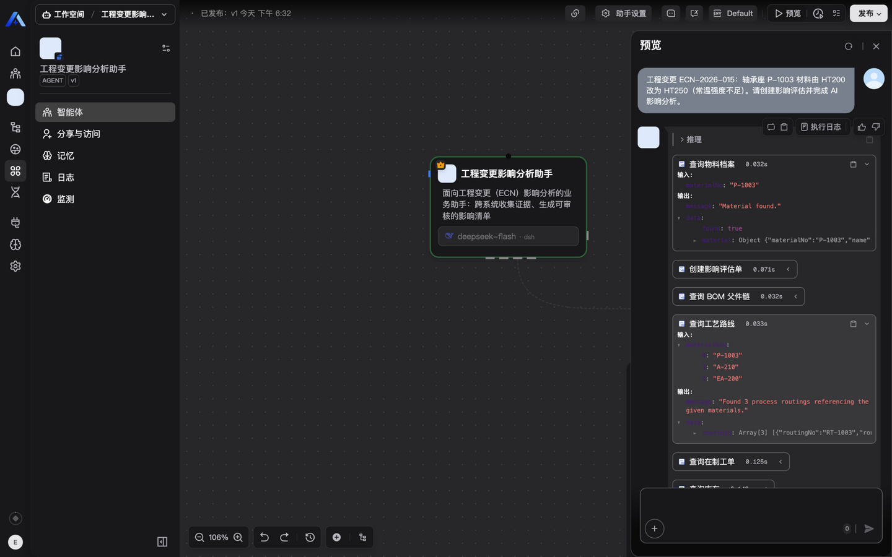
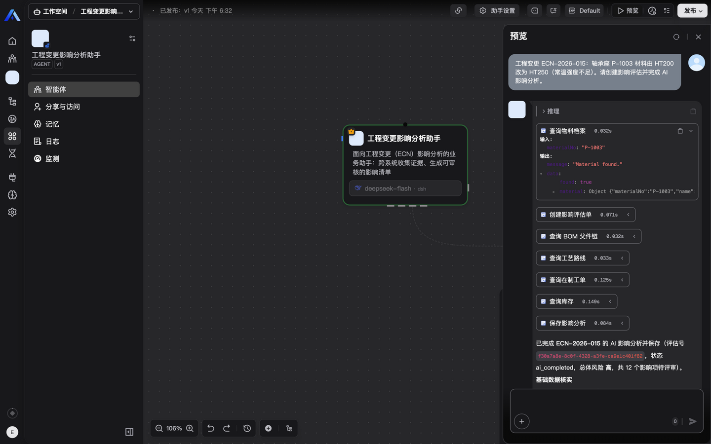
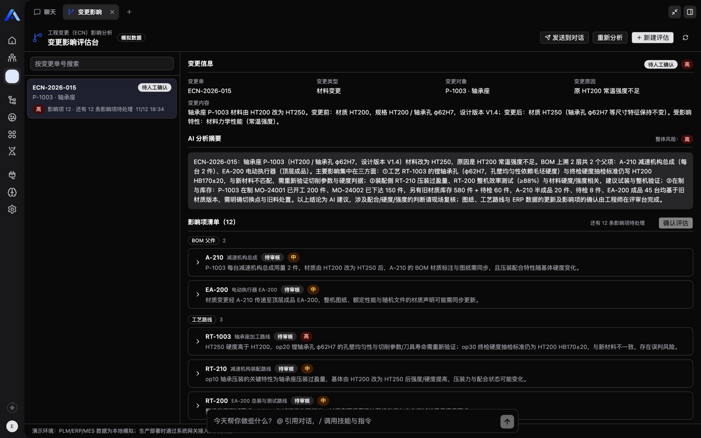
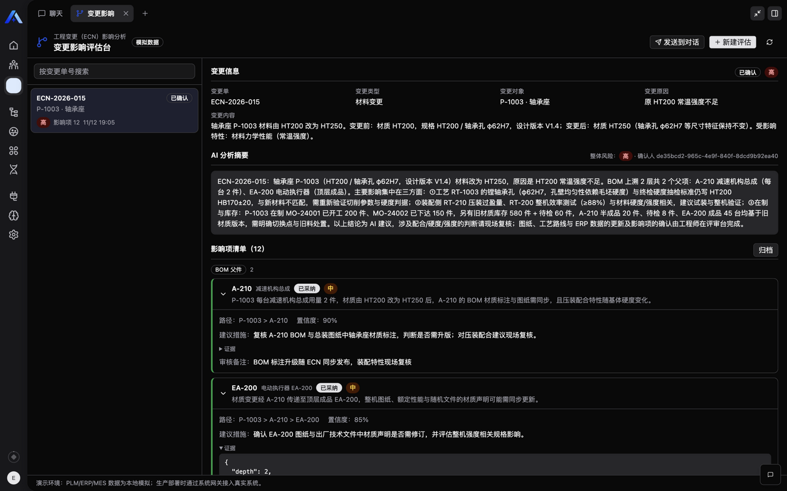
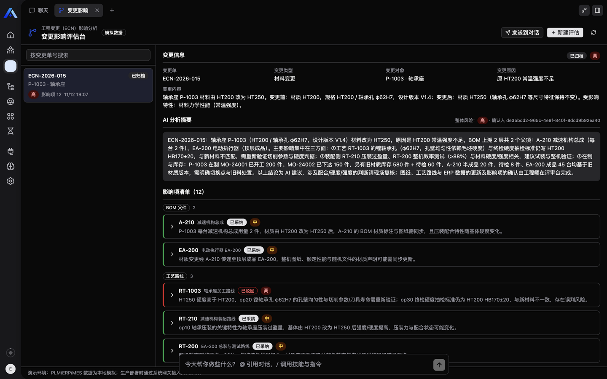

# ECN Impact Analysis（工程变更影响分析助手）

> Xpert Agentic App 业务应用插件 · AI 辅助工程变更（ECN）影响分析 + 人工确认闭环


## 它解决什么问题

制造业企业发布工程变更（ECN）后，工程师需要人工在 **PLM（物料/BOM）、MES（工艺路线/在制工单）、ERP（库存/在途）** 中逐项排查受影响对象：

- 一次变更的影响排查耗时数小时到数天，跨系统遗漏风险高
- 改一个零件的材料，可能漏掉：上层组件的装配校核、在制工单的返工处置、库存旧料的清理
- 排查结果散落在邮件/Excel 中，无结构化沉淀，难以追溯

**AI 的作用**：解析变更内容 → 调用插件工具跨"系统"收集证据 → 生成带证据链的影响清单、风险等级与建议措施。**AI 只做初筛与建议，采纳/驳回/归档由工程师在评估台人工完成**（human-in-the-loop）。

演示环境使用本地模拟的 PLM/ERP/MES 数据集（见 [mock 数据集说明](#mock-数据集)）；生产部署时通过 `EcnSystemGateway` 接口接入真实系统，工具层与服务层无需改动。

## 业务闭环（最小完成范围对应）

| 笔试要求 | 本插件的实现 |
|---|---|
| 一个明确用户 | 制造业工艺工程师 / PLM 工程师（工程变更管理员） |
| 一条核心流程 | 录入变更 → AI 收集证据生成影响项 → 工程师逐条采纳/驳回 → 确认评估 → 归档 |
| 一个可操作界面 | 变更影响评估台（Workbench 远程组件：列表 + 详情 + 审核操作） |
| 一次真实 AI 处理 | 助手经 9 个中间件工具完成真实模型调用（见[工具清单](#agent-中间件工具)） |
| 结果保存与恢复 | 评估单/影响项/操作日志持久化于插件自有表，刷新/重进可恢复 |
| 失败重试场景 | 模拟 ERP 瞬态故障（工具级重试）+ 分析失败上报（评估单级重试），人工结论永不覆盖 |

## Agent 中间件工具

| 工具 | 意图 | 模拟系统 |
|---|---|---|
| `ecn_impact_create_assessment` | 创建评估单（changeNo 幂等查重） | — |
| `ecn_impact_get_material` | 物料档案精确查询/关键字搜索 | PLM |
| `ecn_impact_search_bom_parents` | BOM 父件链（≤3 跳，带 relationPath 证据） | PLM |
| `ecn_impact_search_routings` | 引用物料的工艺路线（含关键特性） | MES |
| `ecn_impact_search_production_orders` | 在制/已下达工单 | MES |
| `ecn_impact_search_inventory` | 库存（在库/在途/待检） | ERP |
| `ecn_impact_save_analysis` | 保存影响项+摘要+风险（impactKey 幂等 upsert） | — |
| `ecn_impact_get_assessment` | 查询评估单状态（恢复上下文） | — |
| `ecn_impact_report_analysis_failure` | 证据不足时上报失败原因（逃逸通道） | — |

工具 schema 全部 `.strict()` + `verboseParsingErrors`，返回紧凑 DTO；人工审核（采纳/驳回/确认/归档）只暴露为 Workbench 视图动作，不对 Agent 开放。

## 业务状态机

```
draft(待分析) → ai_completed(AI 完成，待人工确认) → confirmed(人工已确认) → closed(归档)
      ↑  └────── report_analysis_failure / 工具失败（记录原因，可重试）┘
      └──────────────── 重新分析（retryCount++，幂等 upsert）───────────────┘
```

## 数据存放

插件自有 TypeORM 表（organization 隔离，含 `tenantId`/`organizationId` 列与组合索引）：

- `plugin_ecn_impact_assessment` — 评估单主数据（变更信息、AI 摘要、风险、失败原因、重试计数、人工确认留痕）
- `plugin_ecn_impact_item` — 影响项（证据、置信度、建议措施、人工审核状态，`(tenant, org, assessment, impactKey)` 唯一索引保证幂等）
- `plugin_ecn_impact_log` — 操作日志（创建/AI 保存/人工采纳/驳回/确认/归档/失败/重试全留痕）

## Mock 数据集

代码内置一套自洽的制造业数据集：电动执行器 EA-200（成品）→ 4 个组件 → 零件/原材料共 24 个物料、BOM 21 条边（3 层）、工艺路线 6 条、在制工单 5 张、库存 12 条。演示脚本（见 `examples/`）推荐使用变更场景：**P-1003 轴承座材料 HT200 → HT250**，该场景能自然带出 BOM 父件、压装工艺、两张在制工单、零库存毛坯+采购在途等完整证据链。

失败模拟：插件配置 `failureSimulation` 开启后，第一次库存查询抛出模拟瞬态错误（`ERP 库存接口连接超时`），重试即恢复——用于演示"失败呈现可理解的原因，重试不重复产生业务结果"。

## 界面

变更影响评估台（Workbench 视图，iframe 远程组件）：

- 左侧评估单列表（状态/风险/待审数徽章），右侧详情
- 详情：变更信息、AI 摘要与整体风险、影响项清单（按 BOM/工艺/在制/库存分组，逐条采纳/驳回 + 备注，证据可展开）、操作日志
- 顶部动作：新建评估、发送到对话、重新分析；确认评估、归档
- 空状态引导、失败原因 + 一键重试
- 订阅 `assistant.tool.completed` 事件，AI 保存分析后评估台自动刷新

（运行截图见下方"运行截图"章节）

## 复用与参考声明

- 工程骨架与桥接协议参考官方示例 `community/apps/smart-maintenance`（AGPL-3.0）与 `community/apps/material-identity-governance`：插件注册结构、ViewExtensionProvider/AgentMiddlewareStrategy 模式、remote bridge 协议、esbuild+tailwind 构建脚本、React host-runtime shims。业务域、数据模型、工具集、视图交互、mock 数据全部为本选题重写。
- 遵循 xpert-skills 官方规范：`xpert-agentic-app-developer`、`xpert-plugin-development`（tool-contract-design、agent-tool-parameter-design、middleware-view-role-boundaries、i18n、database-access-and-transactions）。

## 开发

```sh
# community/ 工作区内
corepack pnpm --filter @xpert-ai/plugin-ecn-impact-analysis install
corepack pnpm --filter @xpert-ai/plugin-ecn-impact-analysis typecheck
corepack pnpm --filter @xpert-ai/plugin-ecn-impact-analysis test
corepack pnpm --filter @xpert-ai/plugin-ecn-impact-analysis build   # 生成远程组件 + tsc + copy-assets + verify:dist
```

## 运行截图

> 以下截图来自真实运行环境：Xpert 开源版 main（source-hybrid 本地部署）+ DeepSeek 模型，完整走通「安装 → 模板创建助手 → 真实模型调用 → 人工确认 → 归档」闭环。

### 画布：Agent 节点 + 中间件（9 个工具）

助手从模板创建后，Agent 已连接 ECN 中间件，9 个 `ecn_impact_*` 工具全部暴露给模型；模型绑定 deepseek-flash。



### 对话：真实 AI 调用全链路

对话录入变更后，模型按标准流程依次调用 7 个工具（查物料 → 建评估单 → 查 BOM 父件链 → 查工艺路线 → 查在制工单 → 查库存 → 保存分析），过程约 38 秒：



### 工具调用明细（紧凑 DTO 输入输出）

每个工具调用可展开查看输入/输出。注意"查询工艺路线"的入参 `materialNos: ["P-1003","A-210","EA-200"]` 是模型从 BOM 父件链结果中自主组合的——体现 Agentic 行为：



### 变更影响评估台（Workbench 视图）

AI 保存的评估单（12 条影响项、总体风险高）从插件表加载渲染；影响项按 BOM 父件/工艺路线/在制工单/库存分组，逐条带证据、置信度与建议措施：



### 人工确认完成

工程师逐条采纳/驳回（可附审核备注），全部处理后「确认评估」，状态流转为已确认，记录确认人：



### 保存与恢复

刷新/重进后评估单、审核结论、操作日志完整保留（数据持久化于插件自有表，非页面内存）：



## 运行说明

环境要求：Xpert 开源版（main 分支）、Node 22+、pnpm（corepack）、PostgreSQL/Redis（平台基础设施）。

```sh
# 在平台根目录执行（凭证通过 macOS 钥匙串或环境变量提供，勿写入文件）
corepack pnpm plugin:deploy:local \
  --plugin-dir <plugin-repo-root>/community/apps/ecn-impact-analysis \
  --api-url http://localhost:3000 \
  --scope organization --org-id <organization-id>
```

1. 构建并部署插件（level=organization，按组织范围安装）
2. 如提示需要重启，重启平台 API 后确认插件已加载（详情对话框显示 currentVersion 与 loaded 状态）
3. 从助手模板「工程变更影响分析助手」创建助手，连接 EcnImpactMiddleware 中间件
4. 配置模型供应商（如 DeepSeek），发布助手
5. 在对话中描述变更，或在评估台新建评估后「发送到对话」
6. 在评估台审核影响项 → 确认评估 → 归档

## 已知限制

- PLM/ERP/MES 为本地模拟数据（`MockEcnSystemGateway`），未接入真实系统；生产集成需实现 `EcnSystemGateway` 接口（物料/BOM/工艺/工单/库存五类查询）
- 单 Agent 单间闭环；未做多级审批流、通知推送、变更执行跟踪、多智能体编排
- 不含市场 appConfig 卡片与 MCP surface（范围取舍，见设计文档）

## 测试与验证

### 已执行的测试与结果

| 层 | 内容 | 结果 |
|---|---|---|
| 1. 单元/构建 | 37 个 vitest 断言：状态机流转、impactKey 幂等 upsert、人工结论不被 AI 重试覆盖、跨租户 not_found 不泄露存在性、mock 数据集自洽（BOM relationPath/物料一致性）、ERP 瞬态故障一次失败+重试恢复、工具 schema"自然 payload 一次通过"契约 | ✅ 全部通过 |
| 1. 构建 | typecheck（lib+remote）、build、verify:dist、实体名检查（community check:entity-names）、入口加载与元信息对齐 | ✅ 全部通过 |
| 2. 生命周期 | plugin-dev-harness：入口加载 → meta/register 校验 → Nest 容器 → onPluginBootstrap/onStart → onPluginDestroy/onStop | ✅ 全过 |
| 3. 界面集成 | 真实 dist 在 View Host 渲染：评估台列表/详情/审核按钮/证据展开/日志，hostEvents 工具完成事件自动刷新，requestData/executeAction 桥接 | ✅ 通过（见截图） |
| 4. 平台业务流程 | 六步：plugin:deploy:local 安装 → API 重启 → loadStatus=loaded → 模板创建助手 → 工具与工作台绑定（画布可见 9 工具）→ **真实模型调用**（deepseek-flash，7 工具全链路 38 秒）→ **人工确认**（12 条逐条采纳 10/驳回 1/驳回 1，含备注留痕）→ 归档 | ✅ 全部通过 |
| 4. 保存与恢复 | 刷新/重进后评估单、12 条审核结论、操作日志完整保留 | ✅ 通过（见截图） |
| 4. 失败与重试 | 机制层：瞬态故障模拟（单测）、report_analysis_failure 状态回退+lastError 留痕（单测）、save_analysis 幂等不覆盖人工结论（单测）；对话级失败上报流程因模型深度思考时长未在本次录屏中完整演示，未验证部分如实说明 | ⚠️ 机制已验证，对话级演示见面试现场 |

### 测试命令

```sh
cd community
corepack pnpm --filter @xpert-ai/plugin-ecn-impact-analysis typecheck
corepack pnpm --filter @xpert-ai/plugin-ecn-impact-analysis test
corepack pnpm --filter @xpert-ai/plugin-ecn-impact-analysis build   # 含 verify:dist
# 生命周期（仓库根目录）
node plugin-dev-harness/dist/index.js --workspace ./community --plugin @xpert-ai/plugin-ecn-impact-analysis
```

### 基线与实际测试版本

- xpert-ai/xpert main @ `ba8736c897474f7db9a261aa5f64d95860bb9f60`（2026-11-06）
- xpert-ai/xpert-plugins main @ `6f7b7b68b2ffd5632cdcb5a5311838978d23eb83`（2026-11-11，本分支基线）
- 实际测试：上述 xpert checkout 本地 source-hybrid 运行（API :3000 / Cloud :4200 / Compose 项目 xpert-6f0d47fd），模型 deepseek-flash

