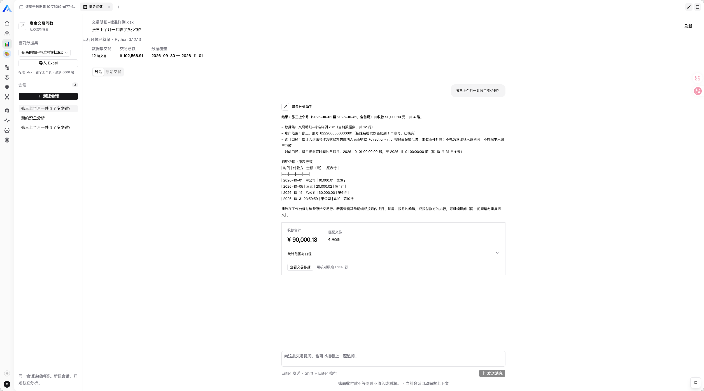
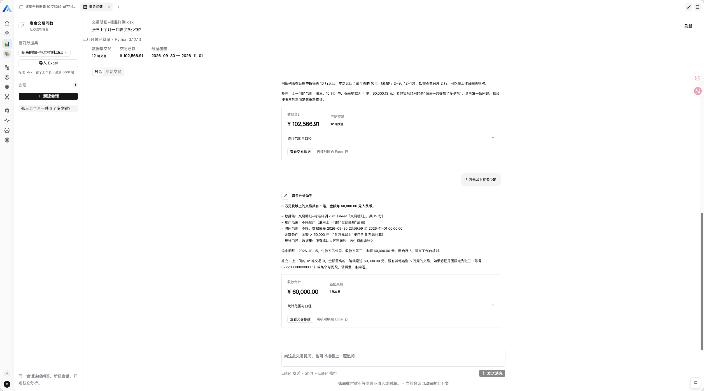
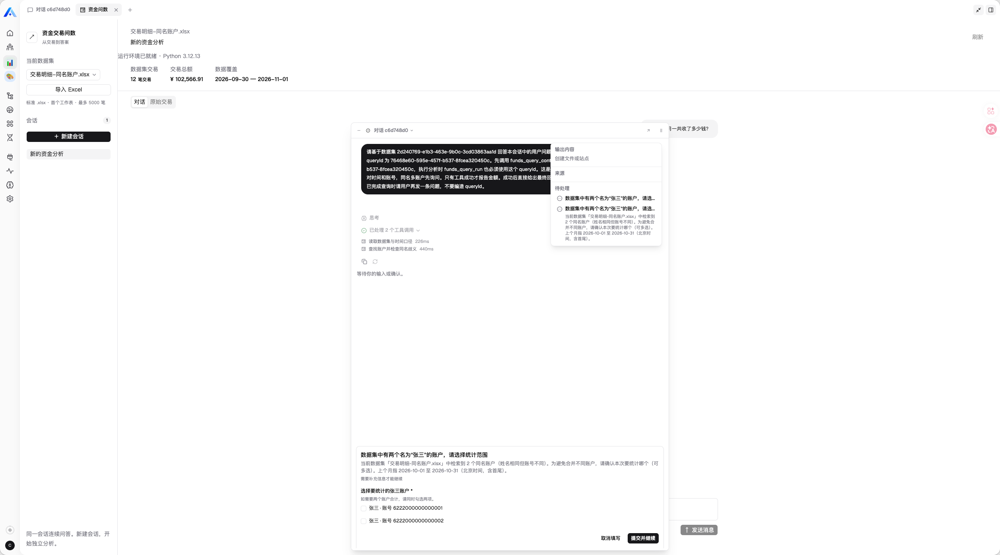
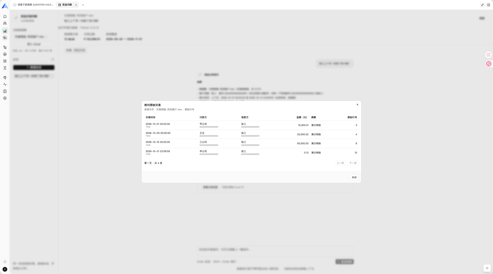
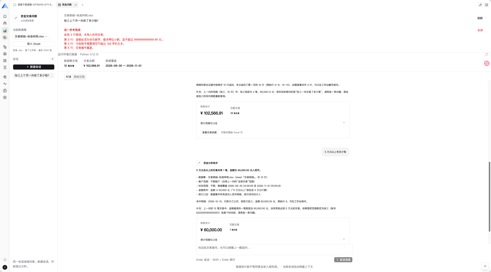

# 资金交易问数

当前版本 **0.2.4**。通过 Xpert 插件管理页面上传 `funds-query-0.2.4.zip` 安装。

面向需要核对标准交易明细的财务与业务运营人员。用户导入 Excel，在同一会话连续问数。AI 选择查询条件、处理账户歧义及追问，Python 精确计算，Vue 展示结果、图表和原始交易依据。每个数据集可建立多个独立会话。

## 数据导入范围

**当前问数系统仅支持标准格式的 .xlsx 交易明细导入。** 文件首个工作表应使用固定表头和列顺序，其他来源的数据需先整理为本项目提供的模板。

| 列顺序 | 字段 | 格式 |
| --- | --- | --- |
| 1 | 交易编号 | 非空文本，文件内唯一 |
| 2 | 交易时间 | 北京时间，yyyy-MM-dd HH:mm:ss |
| 3 | 付款账号 | 文本格式，保留完整账号 |
| 4 | 付款方名称 | 非空文本 |
| 5 | 收款账号 | 文本格式，保留完整账号 |
| 6 | 收款方名称 | 非空文本 |
| 7 | 交易金额 | 大于零的人民币金额，最多两位小数 |
| 8 | 交易摘要 | 可选文本 |

前七列必填，摘要列可选。每行表示一笔成功交易，单文件最多 5000 笔、10 MiB。

## 核心业务闭环

导入标准交易文件 → 校验并保存数据集 → 提问并确认账号 → AI 调用精确统计 → 查看金额与原始交易依据 → 保存结果并连续追问。刷新后可恢复记录，错误文件按具体行号修正后重试。

## 实际运行截图

以下截图由候选人在真实 Xpert 中操作并提供，使用合成交易样例。候选人已报告 0.2.4 人工测试通过。

### 工作台首问与 AI 结果

用户提问“张三上个月一共收了多少钱”，助手将日期明确为 2026 年 10 月，核对账号后返回 90000.13 元、4 笔，并保存结构化结果。



### 连续问数与结构化结果

数据集包含 12 笔交易，总额 102566.91 元。在已有“全部交易”范围上继续询问五万元以上的笔数，得到 60000.00 元、1 笔。



### 同名账户人工确认

同名账户样例包含两个名为张三的账号，助手调用账户检索后请求用户选择统计范围。



### 原始交易依据

对应答案打开四条收款依据，展示交易时间、付款方、收款方、金额及 Excel 原始行号。图中包含 T002、T003、T005 和 T009。



### 错误文件处理

错误样例返回 Excel 第 3、4、5 行的具体原因，原有数据集和问答继续保留。



五张真实运行图覆盖首问、追问、人工确认、证据和异常处理，详见[截图清单](docs/screenshots.mdx)。

## 产品与协作材料

- [产品说明与交互原型](docs/product.mdx)
- [AI 开发协作说明](docs/ai-collaboration.mdx)
- [复用来源与许可](docs/reuse.mdx)
- [基线与平台依赖](docs/compatibility.mdx)

## 使用文档

- [页面上传安装](docs/installation.mdx)
- [完整测试流程](docs/acceptance.mdx)
- [架构与统计口径](docs/architecture.mdx)
- [验证记录](docs/validation.mdx)
- [助手提示词](docs/assistant-prompt.txt)

服务器需要 Python 3.11+。安装包提供 openpyxl、defusedxml 和 et-xmlfile 依赖，工作台自动检查 Python 及数据目录。默认解释器为 auto，可在插件配置页面调整。

当前真实运行依赖配套的 Xpert / ChatKit 接入补丁。基线、补丁和待招聘方确认事项见[平台依赖说明](docs/compatibility.mdx)。配套前端版本为 ChatKit 0.21.1+funds.2。部署范围为 tenant，业务数据按租户、组织和上传用户隔离。默认数据目录位于服务器用户目录下的 .local/share/xpert-funds-query。

## 招聘方测试数据

以下文件均已随插件源码提交到 [examples 目录](examples/)，上传安装包和开发源码包也包含这些文件。全部人员、账号和交易均为合成数据，可供招聘方复现测试。

| 文件 | 用途 |
| --- | --- |
| [标准导入模板.xlsx](examples/标准导入模板.xlsx) | 空白标准模板，供整理自有数据时参考 |
| [交易明细-标准样例.xlsx](examples/交易明细-标准样例.xlsx) | 12 笔交易，用于首问、追问、排行、趋势及证据测试 |
| [交易明细-同名账户.xlsx](examples/交易明细-同名账户.xlsx) | 两个张三账号，用于人工确认统计账户 |
| [交易明细-错误样例.xlsx](examples/交易明细-错误样例.xlsx) | 第 3、4、5 行校验错误，用于异常和恢复测试 |
| [expected-results.json](examples/expected-results.json) | 独立核算的预期金额、笔数、交易编号和 Excel 行号 |

在 GitHub 打开 Excel 文件后，可使用文件页的下载按钮保存，再到工作台导入。固定分析月份为 **2026 年 10 月**。

建议先导入标准样例并在同一会话依次提问。

| 问题 | 预期结果 |
| --- | --- |
| 张三在2026年10月一共收了多少钱，有几笔？ | 90000.13 元，4 笔 |
| 只看超过5万元的 | 60000.00 元，1 笔 |
| 全部收款呢 | 90000.13 元，4 笔 |

完整操作见[测试流程](docs/acceptance.mdx)。

## 开发

源码位于同版本 xpert-plugins 仓库的 community/apps/funds-query，构建使用仓库根目录 packages/shadcn-vue。在 community 中安装工作区依赖后，进入本插件目录执行开发命令。

```bash
# 在仓库的 community 目录安装工作区依赖。
corepack pnpm --filter @xpert-ai/plugin-funds-query... install --frozen-lockfile
cd apps/funds-query
volta run --node 22 node scripts/prepare-runtime.mjs
source .runtime/use-env.sh
corepack pnpm run build
corepack pnpm run test
corepack pnpm run test:python
corepack pnpm run test:ui
corepack pnpm run package
```

build 将固定版本的纯 Python 依赖和许可证打入 python/vendor。package 在 release 目录分别生成可上传安装包和开发源码包，也可指定 --output-dir。上传包只包含运行所需内容，Vue 已打入远程页面资源，Node 原生依赖通过平台 peer 包提供。

元信息和生命周期检查在插件仓库根目录执行。

```bash
node scripts/check-plugin-metadata.mjs --package community/apps/funds-query
node plugin-dev-harness/dist/index.js --workspace community/apps/funds-query --plugin @xpert-ai/plugin-funds-query
```

## 配置与验证

环境变量示例见 [env.example](env.example)，图形配置与服务器要求见安装文档。元信息、生命周期与业务验证分别记录，当前插件检查共 112 项通过，配套启动脚本 16 项通过，Community 工作区依赖与锁文件通过 pnpm 8.15.8 冻结校验。真实模型历史联调、用户人工验收和实际截图证据见[验证记录](docs/validation.mdx)。

## 已知限制

- 标准人民币交易模板，单文件最多 5000 笔，金额精度为分。
- 当前聚焦问数与证据核对，多跳归因和会计核销属于后续范围。
- 数据按上传用户和组织隔离，协作共享需要另行设计。
- 平台接入补丁是当前复现条件，招聘方对补丁接受方式的确认尚待完成。

## 许可

插件使用 [AGPL-3.0](LICENSE)。Python 依赖的许可证与发行元信息包含在 python/vendor 对应 dist-info 目录中。Xpert SDK、Vue 和 shadcn-vue 等依赖遵循各自许可证。
