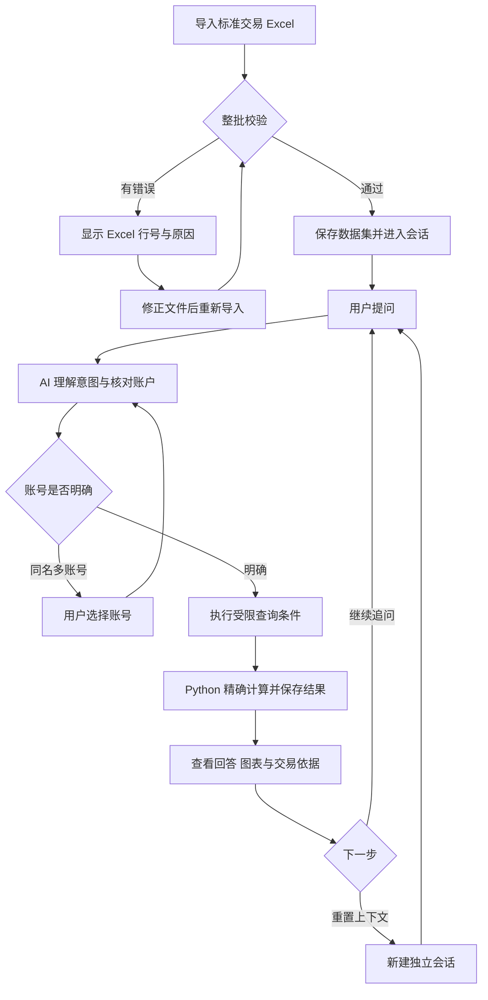
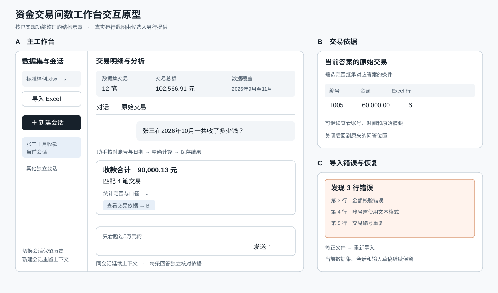

## 用户与问题

本应用面向需要核对标准交易明细的财务与业务运营人员。该定位已由候选人确认。

用户通常在 Excel 中按账号、日期及对手筛选，分别计算收付款、净收支及排行。连续核对不同条件时，需要反复修改筛选并记录结果，容易遗漏日期边界或沿用上一次条件。统计数字还需要回到原始行才能核实。

应用把这一流程组织为数据集、会话、问题和可核验的分析结果。用户通过自然语言提出业务问题，查看明确的统计范围、金额、笔数和原始交易依据，后续直接追问。

## 核心流程

## AI 的作用

AI 将“张三十月收了多少钱”“只看超过5万元的”“全部收款呢”等表达转为受限条件，识别账户歧义，并结合原会话决定继承或清除筛选条件。统计由工具执行，回答引用已保存的结果和依据。

AI 的可观察输出包括选定账号、日期窗口、方向、金额门槛及最终解释。用户通过“统计范围与口径”和原始行核对这些选择。

## 业务对象与状态

| 对象 | 内容与行为 |
| --- | --- |
| 数据集 | 原文件、规范化交易、导入摘要和所属用户 |
| 会话 | 数据集内的独立上下文及真实平台线程绑定 |
| 问题 | 用户原文、执行状态、继承来源和发送回执 |
| 分析结果 | 筛选条件、金额、笔数、排行或趋势及证据引用 |

提问经历提交、读取上下文、核对账户、计算、回复及完成阶段。统计与最终文字回复分别保存。校验、连接或模型失败会显示恢复提示，已保存结果继续可查。

## 关键页面原型

以下原型根据已实现交互整理，用于说明布局和操作关系。

| 页面状态 | 用户操作 | 结果 |
| --- | --- | --- |
| 空工作台 | 导入标准文件 | 显示校验进度或进入数据集 |
| 主工作台 | 提问、追问、切换会话 | 问答按时间线保存，数据摘要持续可见 |
| 交易依据 | 打开某条答案的依据 | 按该答案条件查看交易编号和 Excel 行号 |
| 导入失败 | 查看错误、修正文件后重试 | 显示具体行号，保留当前数据集和会话 |

## MVP 取舍

本版聚焦一个用户对一份标准人民币交易明细的问数与证据核对。支持收付款汇总、净收支、金额筛选、交易对手排行及时间趋势。

多跳资金来源归因、任意银行表格识别、多币种、会计核销和团队协作列为后续范围。它们需要新增数据规则、交互与验证，当前优先完成可复现的小闭环。

## 完成标准

1. 导入标准样例后显示 12 笔交易。
2. 十月收款、超过5万元、清除金额筛选分别得到 90000.13/4、60000.00/1、90000.13/4。
3. 每条答案可核对对应交易依据，刷新后可恢复数据与问答。
4. 同名账户需要用户确认，新会话使用独立上下文。
5. 错误样例提供具体行号，修正或重新选择文件后可以继续操作。
