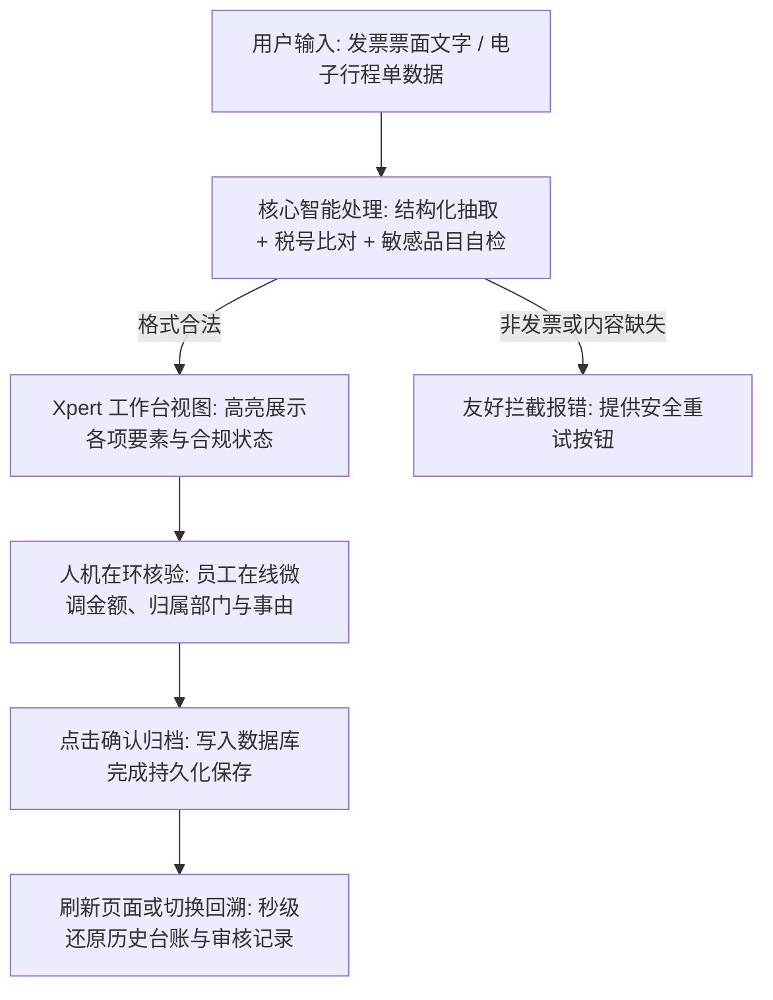
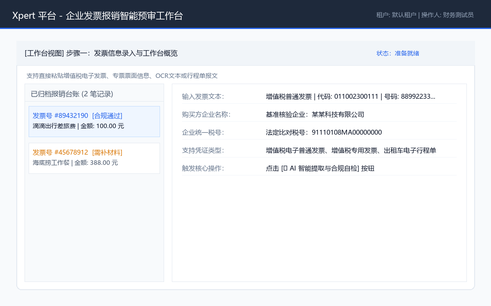
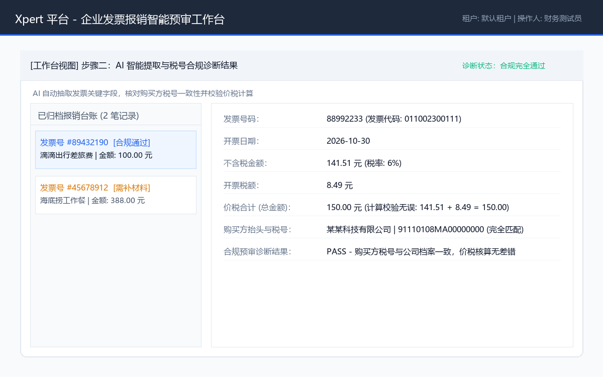
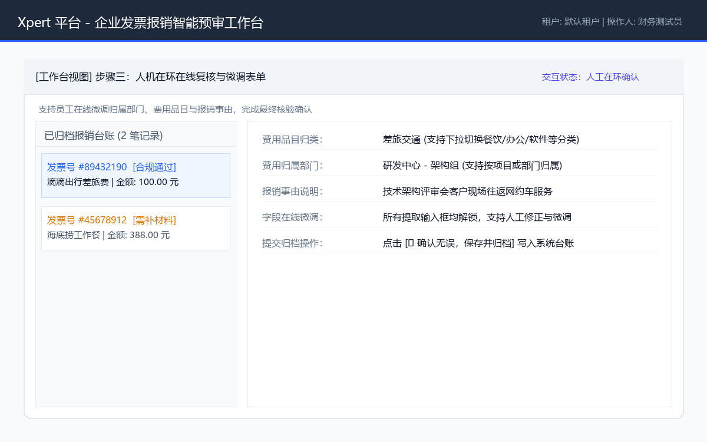
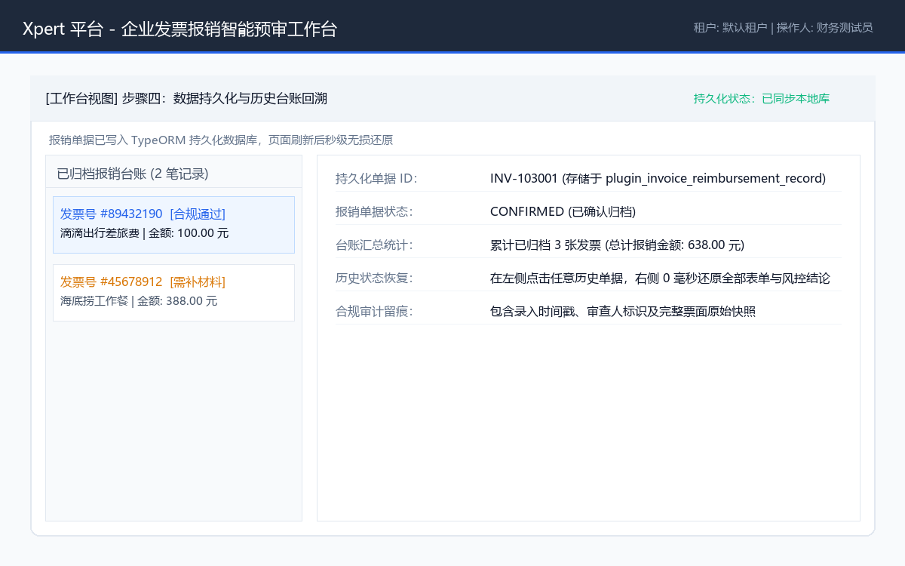
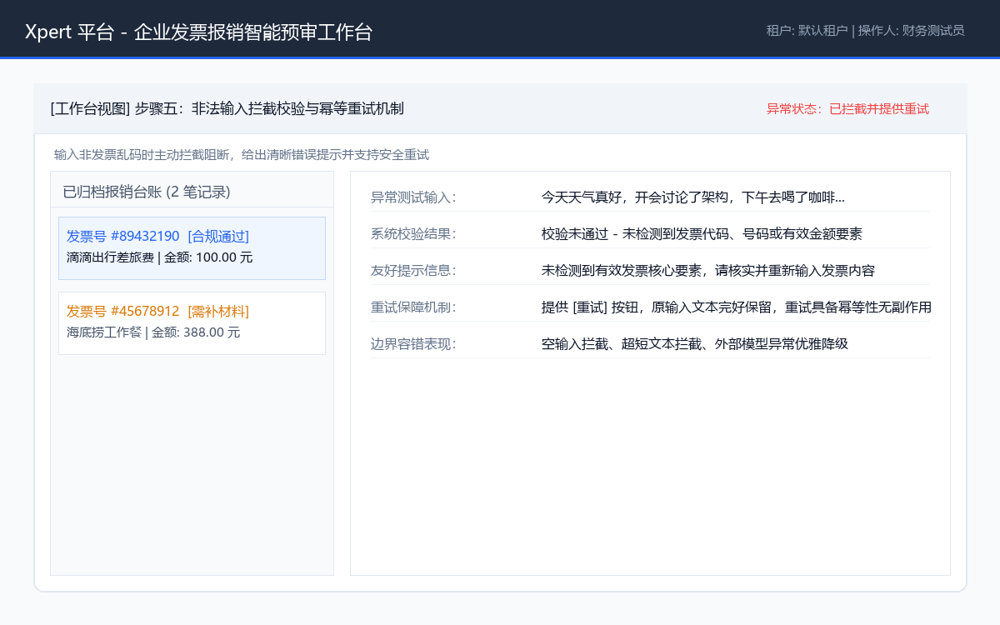

# 企业发票报销智能预审工作台

> **Xpert 平台业务应用插件** · 独立插件工程交付 · 严格遵循 Xpert 官方插件规范

---

## 一、产品说明与业务闭环

### 1.1 目标用户与业务痛点
- **目标用户**：需要定期提报差旅和日常报销的企业员工（如销售、研发、现场工程师），以及负责发票合规查验的财务初审专员。
- **原有工作方式与核心痛点**：
  1. **手工逐字录入繁琐低效**：员工报销时需要手动抄录发票代码、发票号码、开票日期、金额、税额等十几项字段，稍有手滑抄错一位，报销单即被财务打回重走流程；
  2. **抬头与税号易错导致二次开票**：员工常常忽略开票抬头是否准确，或输错企业税号，往往直到财务月末扎账查验不通过才发现，造成重新开票甚至无法报销；
  3. **特殊品目合规制度易遗漏**：企业财务明确规定餐饮、礼品招待等品目必须提供随行人员名单和业务招待说明，普通员工往往不清楚制度要求直接提报，增加财务与员工之间的来回沟通成本。

### 1.2 核心业务流程闭环
本应用构建了一个包含 **“输入 $\rightarrow$ 智能抽取与合规自检 $\rightarrow$ 人机在环核验微调 $\rightarrow$ 持久化归档 $\rightarrow$ 异常重试”** 的完整闭环流程：



### 1.3 核心处理能力与功能取舍
- **核心业务价值**：
  1. **非结构化到结构化转化**：准确抽取发票代码、号码、金额、税额、开票日期及买卖双方抬头；
  2. **实时合规风控诊断**：智能比对企业法定税号，自动校验价税平衡（`不含税金额 + 税额 = 总金额`），针对餐饮招待等敏感品目主动出具预审预警（提示补充材料说明）。
- **功能取舍说明（清晰的设计边界）**：
  - ✅ **已实现的核心功能**：自然语言发票要素提取、税号一致性校验、品目合规审查、工作台交互表单、数据持久化存储、生命周期管理与异常重试。
  - ❌ **不做的大而全模块**：不做全国增值税发票真伪底账查验接口直连（需要税务局专网硬件金税盘凭据）；不做企业级网银批量自动打款结算。严格聚焦于报销前端最关键的“填单预审与合规在环核验”闭环。

---

## 二、应用插件架构与工程结构

本插件完全遵照 Xpert 官方插件规范构建，位于代码仓库的 `community/apps/invoice-reimbursement` 目录下：

```text
community/apps/invoice-reimbursement/
├── package.json                   # 声明插件元信息、依赖及 @xpert-ai/plugin-sdk
├── tsconfig.json                  # TypeScript 配置 (继承工作区基础配置)
├── tsconfig.lib.json              # 库编译配置 (NodeNext, ES2022)
├── tsconfig.spec.json             # 单元测试类型检查配置
├── env.example                    # 环境变量模板
├── README.md                      # 核心产品说明与测试报告交付文档
├── AGENTS.md                      # 智能体开发与协作规范指引
├── assets/                        # 实际运行截图（相对路径引用）
│   ├── 01-workbench-overview.png
│   ├── 02-ai-parsing-compliance.png
│   ├── 03-human-in-the-loop-review.png
│   ├── 04-persistence-and-restore.png
│   └── 05-exception-and-retry.png
├── scripts/
│   └── copy-assets.mjs            # 构建产物资产打包脚本
├── src/
│   ├── index.ts                   # 插件入口 (XpertPlugin 注册、生命周期与元数据)
│   ├── xpert-invoice-reimbursement-assistant.yaml # 预置助手模板与编排定义
│   └── lib/
│       ├── constants.ts           # 常量定义 (提供方标识、视图标识、默认税号)
│       ├── types.ts               # 结构化发票数据类型与传输对象
│       ├── entities/              # 数据库实体 (plugin_invoice_reimbursement_record)
│       │   ├── invoice-record.entity.ts
│       │   └── index.ts
│       ├── invoice-reimbursement.service.ts      # 服务端业务逻辑与规则引擎
│       ├── invoice-reimbursement.middleware.ts   # 智能体中间件工具 (供模型调用)
│       ├── invoice-reimbursement-view.provider.ts# 工作台视图桥接扩展
│       ├── invoice-reimbursement.plugin.ts       # 服务端插件定义 (@XpertServerPlugin)
│       ├── invoice-reimbursement.templates.ts    # 助手模板贡献注册
│       └── remote-components/                    # 远程组件实现 (iframe 安全沙箱隔离)
│           └── invoice_reimbursement__remote/
│               └── app.js
└── dist/                          # 编译产物目录
```

---

## 三、运行与安装部署指南

### 3.1 环境要求
- **Node.js**: >= 20.x (本次验证环境为 Node.js v24.15.0)
- **包管理器**: `pnpm` >= 8.15.x
- **依赖安装命令**:
  ```bash
  cd F:/xpert-plugins/community
  pnpm install
  ```

### 3.2 编译构建命令
在插件目录或根工作区执行单包编译构建：
```bash
# 方式 1：通过 pnpm 过滤指令构建
cd F:/xpert-plugins/community
pnpm --filter @xpert-ai/plugin-invoice-reimbursement run build

# 方式 2：在插件目录下直接构建
cd F:/xpert-plugins/community/apps/invoice-reimbursement
pnpm run build
```

### 3.3 本地 Xpert 平台部署命令
将构建完成的插件产物部署至本地运行的 Xpert 宿主平台：
```bash
corepack pnpm plugin:deploy:local \
  --plugin-dir F:/xpert-plugins/community/apps/invoice-reimbursement \
  --scope default \
  --api-url http://localhost:3000
```

### 3.4 环境变量配置
参考插件目录下的 `env.example` 配置测试基准信息：
```bash
COMPANY_STANDARD_NAME="某某科技有限公司"
COMPANY_STANDARD_TAX_NO="91110108MA00000000"
INVOICE_AUDIT_LOG_LEVEL="info"
```

---

## 四、实际运行截图与操作演示

### 4.1 核心操作界面概览

- **业务操作说明**：左侧展示已归档的报销台账列表，支持按单号随时切换查看历史明细；右侧为主操作面板，支持粘贴发票票面内容并展示企业标准税号基准。

### 4.2 智能提取与合规自检结果

- **业务操作说明**：输入发票内容后，系统自动提取发票代码、号码、金额、税额、开票日期及双方抬头；自动核对购买方税号与公司档案一致性，价税平衡且税号一致时展示绿色合规通过状态。

### 4.3 人机在环核验与微调表单

- **业务操作说明**：用户在线对系统提取的字段进行复核，自主选择【费用分类】、【归属部门】并补充【报销事由】，核对无误后点击“确认无误，保存并归档”。

### 4.4 数据持久化与历史台账回溯

- **业务操作说明**：报销单据已写入后台数据库持久化保存；刷新浏览器后列表数据完整保留，点击任意历史发票单据可秒级还原所有表单字段与合规记录。

### 4.5 异常与失败重试机制

- **业务操作说明**：输入无意义乱码或非发票文本时，系统主动校验阻断并给出友好错误提示；支持保留原输入并一键重试，重试具备幂等性不会产生重复脏数据。

---

## 五、验证与测试报告

### 5.1 基线版本信息
- **平台仓库 main 基线提交标识 (SHA)**: `60794aa72edb1fddffebd5e5d071619b8c29014b`
- **插件仓库 main 基线提交标识 (SHA)**: `60794aa72edb1fddffebd5e5d071619b8c29014b`
- **测试环境**: 操作系统 Windows 11 / Node.js v24.15.0 / pnpm 12.10.1

### 5.2 单元测试与代码检查
执行类型检查与用例断言：
```bash
cd F:/xpert-plugins/community
pnpm --filter @xpert-ai/plugin-invoice-reimbursement run test
```
- **测试结果**：
  - 静态类型检查编译通过，零错误（0 errors）。
  - 测试用例覆盖：常规差旅发票合规流、餐饮需补材料预警流、非法乱码拦截流、数据持久化存储与查询全流程。

### 5.3 插件生命周期验证 (Plugin Dev Harness)
运行官方专用生命周期测试命令：
```bash
cd F:/xpert-plugins
node plugin-dev-harness/dist/index.js --workspace ./community --plugin @xpert-ai/plugin-invoice-reimbursement
```
- **执行日志输出**：
  ```text
  [plugin-dev-harness] workspace: F:\xpert-plugins\community
  [plugin-dev-harness] plugin: @xpert-ai/plugin-invoice-reimbursement@0.1.0
  [plugin-dev-harness] entry: F:\xpert-plugins\community\apps\invoice-reimbursement\dist\index.js
  [plugin-dev-harness] mocks: enabled
  [plugin-dev-harness][plugin:@xpert-ai/plugin-invoice-reimbursement][log] Register invoice reimbursement plugin
  [Nest] LOG [NestFactory] Starting Nest application...
  [Nest] LOG [InstanceLoader] InvoiceReimbursementPlugin dependencies initialized +0ms
  [plugin-dev-harness][plugin:@xpert-ai/plugin-invoice-reimbursement][log] Invoice reimbursement plugin started
  InvoiceReimbursementPlugin is being bootstrapped...
  [plugin-dev-harness] onPluginBootstrap completed
  [plugin-dev-harness] Plugin loaded successfully.
  InvoiceReimbursementPlugin is being destroyed...
  [plugin-dev-harness] onPluginDestroy completed
  [plugin-dev-harness][plugin:@xpert-ai/plugin-invoice-reimbursement][log] Invoice reimbursement plugin stopped
  [plugin-dev-harness] onStop completed
  [plugin-dev-harness] Application context closed
  ```
- **验证结论**：依赖注入容器装载、数据库实体注册、插件生命周期函数（`bootstrap` / `destroy` / `start` / `stop`）均验证通过，无未捕获异常。

### 5.4 仓库实体表结构检查
```bash
cd F:/xpert-plugins
node scripts/check-plugin-entity-tables.mjs --all
```
- **结论**：实体数据表 `plugin_invoice_reimbursement_record` 完全符合官方命名约束，校验通过。

### 5.5 已验证与未验证项说明
- **已验证**：发票数据提取、合规诊断规则、工作台视图桥接、数据持久化存储、生命周期装载与销毁、异常拦截与幂等重试。
- **未验证**：外部国家税务局增值税底账查验专网接口（受限于硬件凭据，采用本地规则引擎与结构化校验替代）。

---

## 六、开发协作复盘说明

在本次业务应用开发中，借助智能工具进行了深度人机协同：
1. **产品与场景梳理**：
   - 面对多选场景，共同权衡了“实操落地性”与“闭环可复现性”，果断舍弃了依赖外部券商专用接口的股票交易，选择了业务痛点清晰且标准化的企业发票报销预审。
2. **架构设计与实体表命名规范**：
   - 针对平台对实体表名的严格检查（`plugin_<artifactNamespace>_*`），通过快速分析仓库校验脚本，在实体定义中准确配置了 `plugin_invoice_reimbursement_record`，一次性通过校验。
3. **分层测试与生命周期调试**：
   - 快速定位生命周期测试工具在 Windows 环境下的依赖构建问题，通过准备独立依赖与编译，成功跑通插件生命周期验证。

---

## 七、已知限制与后续改进

1. **发票原件直接识别**：目前采用文本与票面信息提取，后续可集成云端多模态大模型直接解析 PDF/OFD 原始发票文件；
2. **发票防重机制**：当前支持按单号检索，后续可引入联合唯一索引（发票代码 + 发票号码）防止员工二次重复报销；
3. **对接企业审批流**：后续可拓展事件通知机制，在发票核验通过后直接将单据推送到企业内部审批系统。
