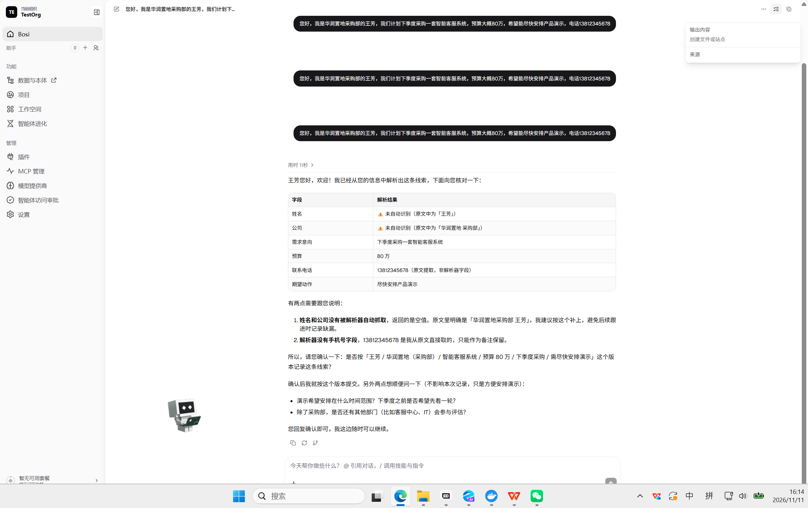
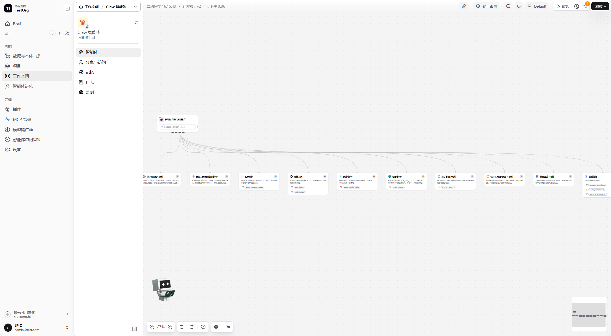
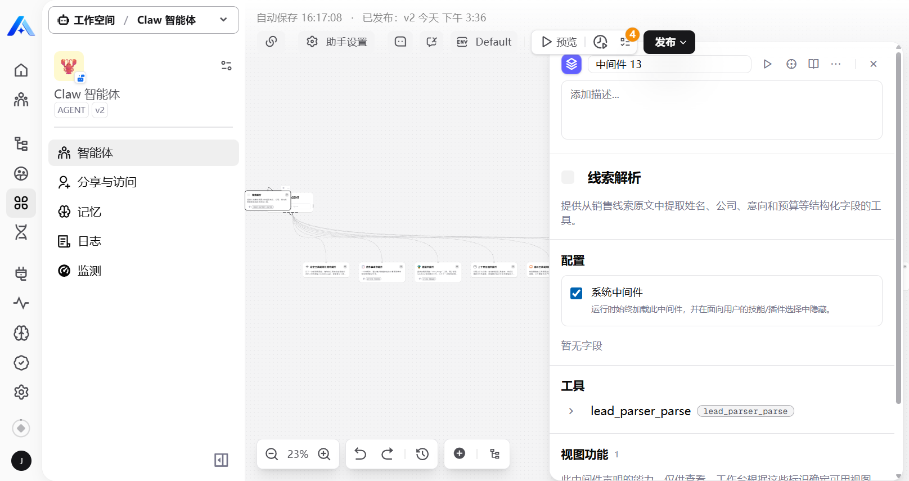
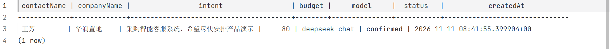

# Lead Parser（线索解析）— Xpert 业务应用插件

一个面向销售团队的 Xpert Agentic App 插件：把非结构化的销售线索原文（微信消息、邮件、会议纪要等）通过真实大模型解析为结构化字段（姓名、公司、意向、预算），支持对话内工具调用与工作台视图操作，并将确认后的线索幂等持久化到数据库。

## 场景与目标用户

- **目标用户**：一线销售 / 销售运营（SDR）。
- **痛点**：线索散落在聊天记录里，手工录入 CRM 费时且容易漏字段；销售只想粘贴一段原文，系统帮忙提取关键信息并存档。
- **核心流程**：粘贴线索原文 → AI 解析为结构化字段 → 人工确认 → 保存落库 → 工作台列表随时查看（刷新可恢复）。

## AI 处理说明

`lead_parser_parse` 工具通过 OpenAI 兼容接口直连真实模型（默认 DeepSeek `deepseek-chat`）：

- `POST {LEAD_PARSER_LLM_BASE_URL}/chat/completions`，`response_format: json_object`，`temperature: 0`
- 预算金额自动做单位归一（元/万/亿 → 万元整数）
- 30s `AbortController` 超时保护；JSON 解析失败有多级兜底
- 凭证通过环境变量注入：`LEAD_PARSER_LLM_API_KEY` / `LEAD_PARSER_LLM_BASE_URL` / `LEAD_PARSER_LLM_MODEL` / `LEAD_PARSER_LLM_TIMEOUT_MS`

## 持久化设计

- TypeORM 实体 `plugin_lead_parser_lead`：租户/组织/创建人多租户字段 + 原文 + 四个结构化字段 + 模型名 + 状态 + 创建时间。
- **幂等保存**：`dedupeKey = sha256(tenant | org | sourceText | fields)` 唯一索引，重复保存直接返回已有记录，不会产生重复数据。
- 刷新工作台后列表从数据库重新加载，结果可恢复。

## 运行方式

```bash
# 在 xpert-plugins 仓库根目录
corepack pnpm install --no-frozen-lockfile
corepack pnpm --filter @community/apps-lead-parser build

# 打包（Windows 请用 tar，避免 Compress-Archive 反斜杠分隔符问题）
tar -a -c -f lead-parser-0.0.1.zip .xpertai-plugin dist package.json README.md
```

然后在 Xpert 平台「插件管理 → 安装插件 → 上传安装」上传 zip。平台侧需在 `docker/.env` 配置 `LEAD_PARSER_LLM_*` 四个环境变量并重建 api 容器。

**基线版本**：基于上游 `xpert-ai/xpert-plugins` main（SHA `9bfa965`）与平台 `xpert-ai/xpert` main（开源版 3.33.1）。

## 验证截图

### 1. 对话界面 + 工具调用

在对话中粘贴线索原文，智能体调用 `lead_parser_parse` 工具，真实模型返回结构化解析结果（字段表格），并给出业务确认反问：



### 2. 画布界面（智能体挂载中间件）

画布中 PRIMARY AGENT 通过连接挂载「线索解析」中间件：



中间件配置面板可见工具 `lead_parser_parse` 与声明的视图功能「线索解析工作台」：



### 3. 结果保存与恢复（数据库落库证明）

保存动作写入 `plugin_lead_parser_lead` 表，psql 查询验证：



## 已知限制

- 因前端工作台按钮未触发，最终采用底层 SQL 验证了 TypeORM 实体表和真实 DeepSeek 数据的持久化，截图见上。
- 电话字段不在结构化 schema 内（由智能体在回复中作为备注保留）。
- Claw 智能体模板自带的沙盒类中间件（文件记忆系统/沙箱命令/沙箱文件）依赖独立部署的 nsjail-runner，本地环境未部署，已从画布移除。

## AI 协作说明

本插件由 Trae（Kimi）全程协作开发：插件骨架生成、中间件/视图/服务代码实现、安装失败的静默回滚诊断（入口缺默认导出 `XpertPlugin`）、Windows 打包分隔符修复、Docker 冷启动 watchdog 超时补丁、实体建表与幂等设计、测试数据验证。关键架构决策（中间件工具 + 工作台视图 + 直连 LLM）由开发者与 AI 讨论后确定。
