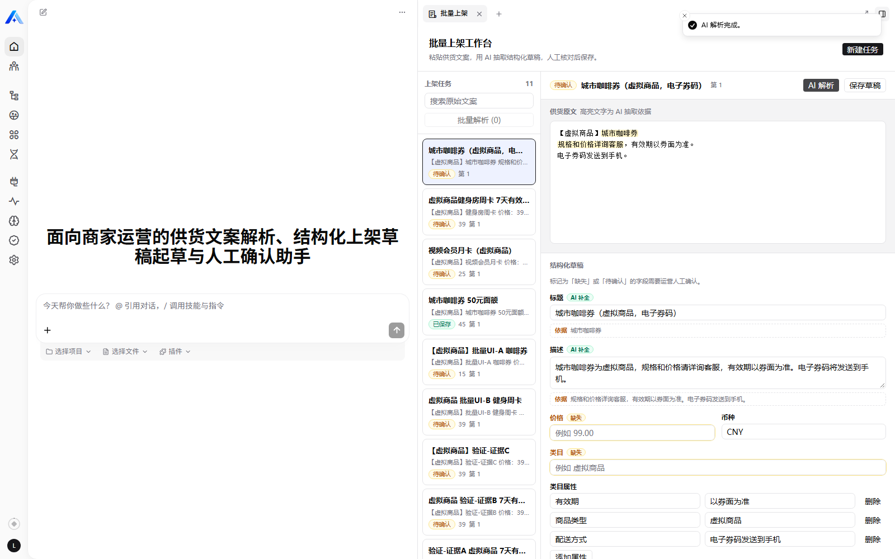
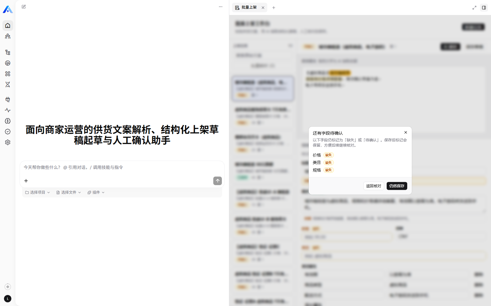
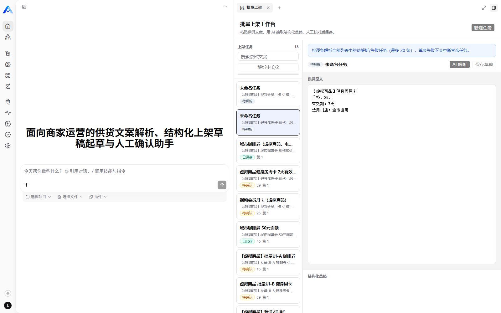
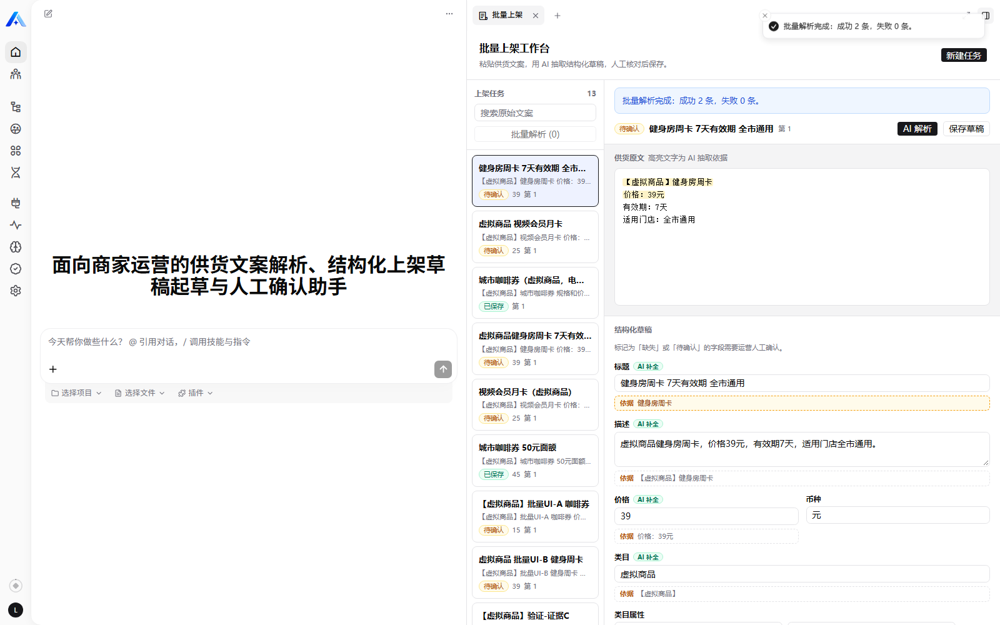

# 批量上架助手（Bulk Listing Assistant）

> 面向商家运营的 Xpert 业务应用插件：粘贴一段供货文案，AI 抽出结构化商品字段并起草标题描述，运营核对修改后保存上架草稿；失败可重试，且不会重复产生业务结果。

- 插件包名：`@xpert-ai/plugin-listing-assistant`
- 安装级别：`tenant`（含实体与服务端模块，安装到租户域）
- 产物标识命名空间：`listing_assistant`

---

## 1. 解决什么问题

**使用者**：店铺运营专员 / 商家运营，在 PC 后台批量录入商品。

**原来的做法**：收到供货素材（一段文案，可能还有图片），逐条手填标题、卖点描述、价格、类目属性、多规格 SKU。格式不统一、容易漏字段，常被内容审核驳回返工。

**这个应用做什么**：把「粘贴文案 → 结构化抽取 → 人工核对 → 保存草稿」固化成一个工作台流程。AI 只做**抽取 + 起草 + 缺失检测**，最后一步必须由人确认。

---

## 2. 核心流程

```
① 新建任务（粘贴供货文案）
        │
        ▼
② AI 抽取 + 起草  ── 缺失字段标「缺失」、拿不准的标「待确认」
        │
        ▼
③ 运营在工作台里核对、修改、补全
        │
        ▼
④ 人工确认 → 保存草稿（状态：已保存）
        │
        ▼
⑤ 刷新 / 重新进入应用 → 任务与结果仍在（落库，不在内存）
        │
        └─ ⑥ 失败分支：模型超时 / 返回非法 JSON / 网络不可用
                 → 展示可理解原因 → 在同一任务内重试
                 → 不新建任务、不重复产生业务结果
```

任务状态机：`待解析(draft) → 解析中(parsing) → 待确认(review) → 已保存(saved)`，任一步失败进入 `失败(failed)`。

---

## 3. 界面

工作台以**远程组件（React + shadcn/ui）**挂载在助手的 Workbench 面板里，不是聊天框。左侧任务列表，右侧「供货原文 / 结构化草稿」双栏。

### 3.1 空状态与新建任务

| 空状态 | 新建任务（用户输入） |
|---|---|
|  |  |

### 3.2 AI 抽取结果（人工核对）

被 AI 补全的字段带「AI 补全」标记；缺失或不确定的字段会高亮并标「缺失 / 待确认」。

**字段级证据**：模型为每个抽取字段回引原文片段。左侧原文中高亮显示依据，右侧字段下方显示「依据」；点击依据可定位到原文位置，运营不必在长文案里手动查找。



### 3.3 保存前二次确认

如果仍存在「缺失 / 待确认」的字段，点「保存草稿」会先弹出确认框，列出这些字段；可以选择返回核对，或明确选择「仍然保存」。保存并不会抹掉标记，后续仍可继续核对。



### 3.4 批量解析

任务列表上方提供「批量解析」入口：把当前列表中「待解析 / 失败」的任务逐条送入 AI（最多 20 条），实时显示进度；单条失败只计数，不会中断其余任务。

| 解析中 | 完成 |
|---|---|
|  |  |

### 3.5 异常场景：失败与重试

失败时展示可理解的原因，重试按钮始终在**同一个任务**内操作。

| 失败 | 同一任务重试成功（第 2 次） |
|---|---|
|  |  |

### 3.6 保存草稿


### 3.7 批量创建

多条供货文案用单独一行 `---` 分隔，一次创建多条任务。

| 批量输入 | 创建结果 |
|---|---|
|  |  |

### 3.8 助手与工具绑定

基于模板创建的助手已绑定模型（DeepSeek）与 4 个 Agent 工具：


---

## 4. 功能范围

**做**
- 任务创建 / AI 抽取 / 表单核对 / 保存与恢复
- **字段级证据**：每个抽取字段回引原文片段，左侧高亮、右侧展示，可点击定位
- **保存前二次确认**：仍有「缺失 / 待确认」字段时先确认，标记不会被静默清除
- **批量创建**：多条供货文案用单独一行 `---` 分隔，一次创建多条任务（上限 20 条）
- **批量解析**：对列表中「待解析 / 失败」的任务逐条解析（上限 20 条），进度可见、单条失败不中断
- 失败原因展示与同任务重试（幂等）
- **错误码 + 前端本地化**：后端只返回语言中立的错误码，工作台按宿主语言显示文案
- 空状态引导
- 中英文界面（跟随宿主 locale）
- Agent 工具：助手对话里也能创建、解析、读取、保存任务

**不做**（明确取舍）
- 真实内容审核流、真实商品库对接
- 图片 OCR（只处理文本）
- 多用户权限精细化管理
- 自动发布上架（最后一步永远是人）

---

## 5. 技术实现

### 5.1 工程结构

```
community/apps/listing-assistant/
├── src/
│   ├── index.ts                         # XpertPlugin 运行时清单
│   ├── xpert-listing-assistant-assistant.yaml  # 助手模板 DSL
│   └── lib/
│       ├── constants.ts                 # 命名空间、表名、工具名、视图 key
│       ├── types.ts                     # DTO / Zod 校验
│       ├── entities/                    # 4 个 TypeORM 实体
│       ├── listing-assistant.plugin.ts  # @XpertServerPlugin 注册
│       ├── listing-assistant.service.ts # 领域服务（状态机、幂等、落库）
│       ├── listing-assistant.mapper.ts  # 纯函数：字段标记、草稿归一化（可单测）
│       ├── listing-ai.service.ts        # 调用宿主默认模型 + 结构化解析
│       ├── listing-assistant.middleware.ts      # Agent 中间件工具
│       ├── listing-assistant-view.provider.ts   # Workbench 视图与动作
│       ├── listing-assistant.templates.ts       # 助手模板贡献
│       └── remote-components/listing_assistant__remote/
│           ├── src/main.tsx             # 应用编排与数据/动作
│           ├── src/workbench-utils.ts   # 前端纯工具（标记、批量选择、校验）
│           ├── src/evidence.ts          # 原文证据区间计算
│           └── src/components/          # TaskList / DraftForm / NewTaskDialog
├── tests/mapper.test.mjs                # node:test 单元测试
├── scripts/build-remote-components.mjs  # esbuild 打包 UI
├── scripts/copy-assets.mjs              # 拷贝模板与 UI 产物到 dist
└── docs/                                # 截图与面试问答
```

### 5.2 数据模型（表全部以 `plugin_listing_assistant_` 前缀）

| 表 | 作用 |
|---|---|
| `plugin_listing_assistant_task` | 上架任务：原始文案、状态、尝试次数、错误信息、解析/保存时间 |
| `plugin_listing_assistant_draft` | 结构化草稿：标题、描述、价格、币种、类目、属性 JSON、字段标记、原文证据 JSON；每任务唯一 |
| `plugin_listing_assistant_spec` | 多规格：规格名、价格、库存、排序 |
| `plugin_listing_assistant_ai_run` | 每次 AI 调用记录：attempt、状态、原始输出、错误码、起止时间 |

所有查询都带 `tenantId` 与 `organizationId` 过滤，不同组织的数据互不可见。

### 5.3 AI 处理

- 通过插件 SDK 的 `XPERT_AGENT_MIDDLEWARE_RUNTIME_TOKEN` 获取当前作用域的**默认对话模型**（本机配置为 DeepSeek `deepseek-flash`），不把任何模型 Key 写进代码。
- 强约束 System Prompt：只依据原文、不得编造、缺失/不确定字段要单独列出；为每个字段回引最短的原文片段作为证据；只返回 JSON。
- 90 秒超时 + `AbortController` 取消；返回内容去 Markdown 围栏后用 Zod 校验，非法 JSON / 字段不合格会转成可读错误。
- 错误以**语言中立错误码**返回（`AI_TIMEOUT`、`AI_INVALID_JSON`、`BUSY_PARSING` 等），工作台按宿主 locale 映射为中文/英文；后端不再把界面文案写进业务逻辑。

### 5.4 Agent 工具（中间件）

| 工具 | 说明 |
|---|---|
| `listing_create_task` | 从供货文案创建上架任务 |
| `listing_get_task` | 读取任务、草稿、规格与运行记录 |
| `listing_parse_task` | 执行 AI 抽取（幂等：已有草稿的任务不会再次调用模型） |
| `listing_save_draft` | 保存人工确认后的草稿 |

助手模板 `xpert-listing-assistant-assistant.yaml` 把 Agent 与 `ListingAssistantMiddleware` 连线，安装后自动完成工具绑定。

### 5.5 Workbench 视图

- 注册在 `agent.workbench.fixed` 与 `agent.workbench.main` 两个槽位，作为助手工作台菜单出现。
- 数据与动作走视图协议：`getViewData` / `executeViewAction`，动作包括 `create_task`、`create_task_batch`、`parse_task`、`retry_parse`、`save_draft`。
- 批量解析由工作台按任务串行调用 `parse_task`：复用同一条幂等、原子认领路径，不需要额外的服务端队列；单个任务失败只影响该条。
- 远程组件通过 iframe bridge 的 `requestData` / `executeAction` 与宿主通信；订阅 `assistant.tool.completed` 事件，助手在对话里改数据时工作台自动刷新。

---

## 6. 失败与幂等设计

1. **原子认领再调模型**：用一条带条件的 `UPDATE ... RETURNING` 把任务从 `draft/failed`（或超过 5 分钟的滞留 `parsing`）原子地切到 `parsing` 并递增尝试次数；只有一个请求能认领成功，避免并发下写入相同 attempt。
2. **每次尝试一条记录**：`(taskId, attempt)` 唯一，重试只是 attempt + 1，**不新建任务**。
3. **中断的运行记录自动回收**：认领成功后，把该任务遗留的 `running` 运行记录标记为 `failed`（`AI_RUN_INTERRUPTED`），不会永远悬挂。
4. **成功才覆盖草稿**：草稿按 `taskId` 唯一，成功时在同一事务里 upsert 草稿、替换规格、更新状态与运行记录。
4.1 **滞留解析懒回收**：工作台加载时，把超过 10 分钟仍处于 `parsing` 的任务与其 `running` 运行记录标记为失败（`AI_RUN_INTERRUPTED`），运营可直接重试。
5. **重试保护的两种情形**：
   - 任务已保存 → 重试直接返回「已有解析结果」，不再调用模型；
   - 已存在成功运行记录 → 同样不重复调用，因此不会产生第二份业务结果。
6. **批量解析复用同一条路径**：工作台按任务串行调用 `parse_task`，每条仍经过原子认领与幂等判断；单条失败只计入失败数，不会新建任务或影响其他条目。

> 演示失败路径：任务原文包含 `[SIMULATE_MODEL_FAILURE]` 时，**第一次**解析会强制失败（模拟外部模型服务故障）；同一任务重试即可成功。这是可逆、局部、不改动任何共享配置的测试开关。

---

## 7. 安装与配置

前提：本机 Xpert 平台已启动（API 与 Cloud UI 可用），已登录 `SUPER_ADMIN`。

```bash
# 1) 构建（会构建 shadcn-ui、打包远程组件、编译服务端）
cd community
corepack pnpm --filter @xpert-ai/plugin-listing-assistant build

# 2) 部署到本地平台（插件声明为 tenant 级别）
cd <xpert-platform-root>
corepack pnpm plugin:deploy:local \
  --plugin-dir <plugin-repo>/community/apps/listing-assistant \
  --scope tenant \
  --tenant-id <tenant-id> \
  --api-url http://localhost:3000/api
```

- 认证复用宿主 CLI 的 `XPERT_USERNAME` / `XPERT_PASSWORD` 环境变量，不要在命令参数或仓库里写凭证；示例见 [`.env.example`](.env.example)。
- 插件本身**不读取环境变量**：模型 Key 只存在于平台的模型提供商配置中。
- 部署完成后按提示**重启 API**，插件才会加载。
- 模型：在平台的「模型提供商」中配置一个可用连接并设为 Primary 默认模型；助手模板内置 `deepseek-flash`，其他环境创建助手时请选择自己的可用模型。
- 助手模板：平台「助手模板」目录中会出现「批量上架助手」，基于模板创建并发布助手后即可在对话页打开工作台。

---

## 8. 验证记录

### 基线版本

| 仓库 | 基线 SHA |
|---|---|
| `xpert-ai/xpert`（开发与实测） | `16633312fcf4c29c328ec19e7f5d496c88975bd0` |
| `xpert-ai/xpert-plugins`（开始开发时） | `dfad5423205811b3251628ee9bf59a79a4bcbd87` |
| `xpert-ai/xpert-plugins`（PR base） | `8996a1a4c996354d8d92cae4ea4be034c87c57d3` |

> 开发期间上游 main 前进，提交 PR 前已将分支 rebase 到当时的 main `8996a1a`，因此 PR 的 base 是 `8996a1a`；`dfad542` 是开始开发时的基线。

实测环境：Ubuntu 22.04 / Node `v22.20.0` / pnpm `8.15.8`（community 工作区）/ `@xpert-ai/plugin-sdk` `3.31.0` / Cloud UI `3.31.0`；插件版本 `0.1.0`，PR head 见 PR 页面。

### 已验证（本机真实运行）

| 验收项 | 结果 |
|---|---|
| 构建 | `tsc`、esbuild 远程组件、远程类型检查均通过 |
| 单元测试 | `node:test` 8 条（字段标记、缺失/不确定、草稿归一化、人工确认清除标记、批量分隔、单条不拆分、证据字段过滤、非法证据输入）全部通过 |
| 并发认领 | 同任务同时两个解析请求：一个成功、一个被拒，仅 1 条成功运行记录 |
| 批量创建 | 两条文案以 `---` 分隔，一次创建出 2 条任务 |
| 错误码本地化 | 模拟失败返回 `AI_SIMULATED_FAILURE`，界面按语言显示中文提示 |
| harness 生命周期 | `plugin-dev-harness` 通过：register → Nest 初始化 → onStart → bootstrap → destroy → onStop |
| 插件安装与加载 | `loadStatus: loaded`，`currentVersion: 0.1.0` |
| 实体自动建表 | 4 张 `plugin_listing_assistant_*` 表已创建 |
| 助手模板 | 模板目录可见，可基于模板创建并发布助手（v1） |
| 工具与视图绑定 | 助手图中可见 `ListingAssistantMiddleware` 与 4 个工具；Workbench 视图出现在两个槽位 |
| 真实模型调用 | 通过平台默认模型完成抽取，返回合法结构化结果 |
| 保存与恢复 | 保存后状态 `saved`；刷新/重进应用后任务与草稿仍在（数据库可查） |
| 空状态 | 无任务时展示引导与新建入口 |
| 失败与重试 | 首次失败展示原因 → 同任务重试成功；AI 运行记录 `attempt 1 failed / attempt 2 succeeded`，任务数不增加 |
| 幂等 | 已保存任务再次解析返回「已有解析结果」，仅 1 条成功运行记录 |
| 字段证据（真实模型） | 抽取结果返回 `evidence` 并落库；UI 左侧原文出现 2 处高亮，右侧 3 个字段显示「依据」；点击依据后对应高亮变为激活态 |
| 保存前二次确认 | 存在「缺失」字段时点保存，弹出确认框列出价格/类目/规格；选择「返回核对」可取消，选择「仍然保存」后状态变为已保存 |
| 批量解析 | 列表含 2 条待解析任务，点击「批量解析 (2)」；界面实时显示进度，完成后提示「成功 2 条，失败 0 条」，两条任务均进入待确认 |

### 平台内六步验证路径

| 步骤 | 结果与证据 |
|---|---|
| 1. 安装插件 | `plugin:deploy:local --scope tenant --tenant-id …` 执行成功，提示 refreshed and staged |
| 2. 重启测试平台并验证已加载 | 重启 API 后日志出现 `listing assistant plugin started`、`onPluginBootstrap completed`；草稿表自动新增 `evidence` 列 |
| 3. 展示助手模板 | 平台「助手模板」目录可见「批量上架助手」 |
| 4. 基于模板创建助手 | 基于模板创建并发布助手（v1） |
| 5. 绑定工具与工作台 | 助手工作流图可见 `ListingAssistantMiddleware` 与 4 个工具；Workbench 视图出现在两个槽位（见 `assistant-graph.png`） |
| 6. 真实模型调用、人工确认并保存 | 真实模型抽取 → 字段证据/缺失标记 → 保存前确认 → 保存为已保存；见第 3 节截图与第 8 节记录 |

### 未验证 / 已知限制

- NsJail 沙箱在本机未启用（本应用不依赖沙箱）。
- 仅以超级管理员单账号验证；多用户/组织权限只保证了数据按租户与组织隔离。
- 未做图片 OCR、真实内容审核与真实商品库对接。
- 批量解析是前端串行调度，没有服务端队列/并发控制；20 条的上限下总耗时可能较长，刷新页面会中断剩余队列（已解析的结果不受影响）。
- 字段证据依赖模型按提示返回原文片段；模型未返回或片段与原文不完全一致时，该字段不显示高亮，但字段本身与标记不受影响。
- **演示数据均为自造**（虚拟商品/电子券/健身卡），未使用任何真实商家数据、真实截图或真实凭证。

---

## 9. 面试演示脚本（约 3 分钟）

1. 打开「批量上架助手」对话 → 点右上角「打开视图」进入批量上架工作台（空状态 → 新建任务）。
2. 粘贴一段**信息不全**的供货文案 → 创建任务 → **AI 解析**；指出哪些字段带「AI 补全」、哪些被标「缺失 / 待确认」。
3. 点某个字段下方的「依据」→ 左侧原文对应片段高亮，说明 AI 的抽取有出处。
4. 直接点 **保存草稿** → 弹出「还有字段待确认」，可返回核对；补一个字段后再保存 → 状态变为「已保存」。
5. **刷新页面 / 重新打开工作台** → 任务还在，状态仍是已保存。
6. 批量创建 2 条任务 → 点 **批量解析** → 观察进度与完成提示；两条分别进入待确认。
7. 新建一个带 `[SIMULATE_MODEL_FAILURE]` 的任务 → **AI 解析失败**，展示错误原因 → **重试**成功。
8. 强调：重试是同一个任务（第 2 次运行），没有产生第二条任务 / 第二份业务结果。

> 详细技术追问与标准回答见 [docs/interview-qa.md](docs/interview-qa.md)。

---

## 10. 复用来源与原创范围

- **运行框架与 SDK**：`@xpert-ai/plugin-sdk`、`@xpert-ai/contracts`（宿主提供，AGPL-3.0），本插件只使用其公开扩展点。
- **界面组件**：`@xpert-ai/plugin-shadcn-ui`（本仓库 workspace 包）、React 18、shadcn/ui 风格组件；代码中按需直接使用，未修改其源码。
- **工程结构参考**：参考 `community/apps/procurement-quote-comparison`、`crm`、`factory-operations` 的插件入口、视图 Provider、远程组件 bridge 与助手模板写法；未复制其业务代码或数据。
- **第三方库**：TypeORM、Zod、LangChain（`@langchain/core`）、esbuild，均按各自许可证使用。
- **本项目原创**：业务模型与状态机、幂等认领与重试策略、提示词与 Zod 结构、字段证据与缺失检测、批量解析调度、工作台界面与单元测试。
- **AI 生成代码**：大部分实现由 AI 开发工具辅助生成，经人工逐段审查、修改并通过构建、测试和平台实测；未复用任何真实商家代码、数据或截图。

---

## 11. AI 协作说明

- **工具与模型**：主要在 Claude Code 终端中开发（读取 skills、改代码、跑构建/测试、部署和排查）；插件调用平台配置的 DeepSeek 默认模型完成抽取。
- **如何介绍需求**：先给出业务闭环与边界（一个用户、一条流程、AI 只做抽取/起草/缺失检测），再给出数据模型、状态机、验收场景，避免一上来就让 AI 铺功能。
- **代表性协作过程**：
  - 环境与平台：借助 `xpert-platform-local-environment` 搭本地平台，定位 Cloud UI 构建 OOM、插件安装 scope、模型连接需设为 Primary 等问题。
  - 并发认领：与 AI 一起把「先查后改」改成带条件的原子 `UPDATE…RETURNING`，并补并发验证。
  - 错误码本地化：先返回界面文案，讨论后改为语言中立错误码 + 前端映射。
  - 本轮增强：把「原文证据」「保存前确认」「批量解析」拆成可验证的小步，先定数据结构与失败语义，再实现和截图验收。
- **做过的取舍**：工作台而非聊天框；JSON + Zod 而非绑定某家的 function calling；批量解析用前端串行复用单任务路径，而不是新造服务端队列；证据只做「回引原文」，不承诺自动修正。
- **如何验证**：单元测试 → 构建 → harness → 平台部署加载 → 真实模型调用 → 数据库核对 → 浏览器端到端与截图；不把「构建通过」当成「用户可用」。
- **遇到的限制**：本地 6G 内存下 Angular 构建与 API 同跑会 OOM（已加 swap 并先停 API 再构建）；harness 使用 mock，不能代替真实数据库与业务流程；模型输出存在随机性，因此用 Zod 约束、缺失/不确定数组和字段证据来兜底。

---

## 12. 许可证

AGPL-3.0（与本仓库一致）。
