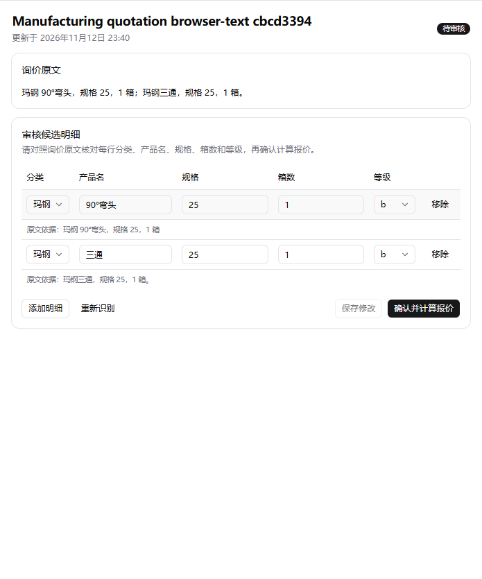
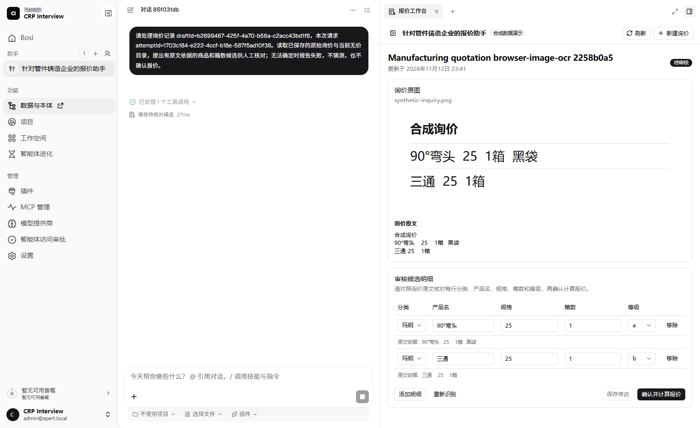
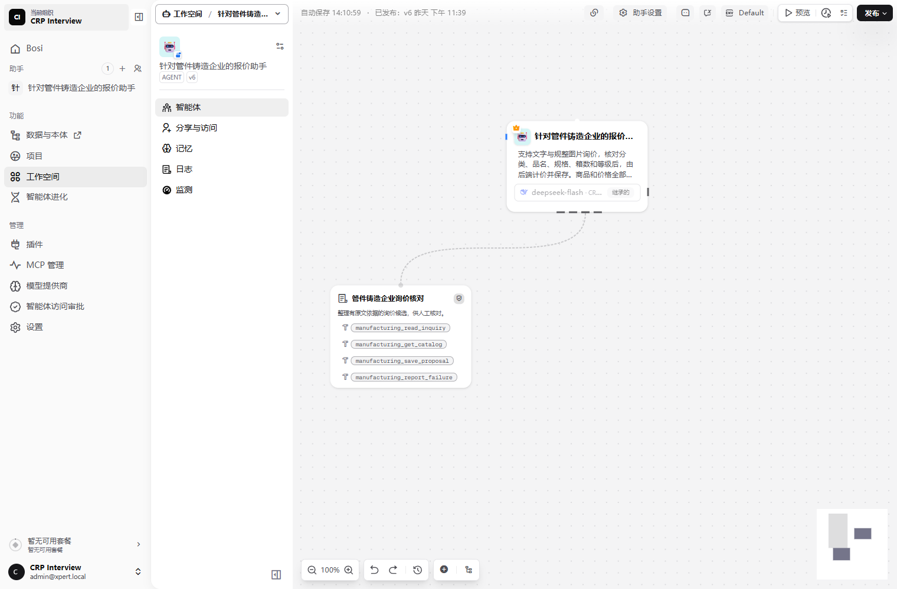
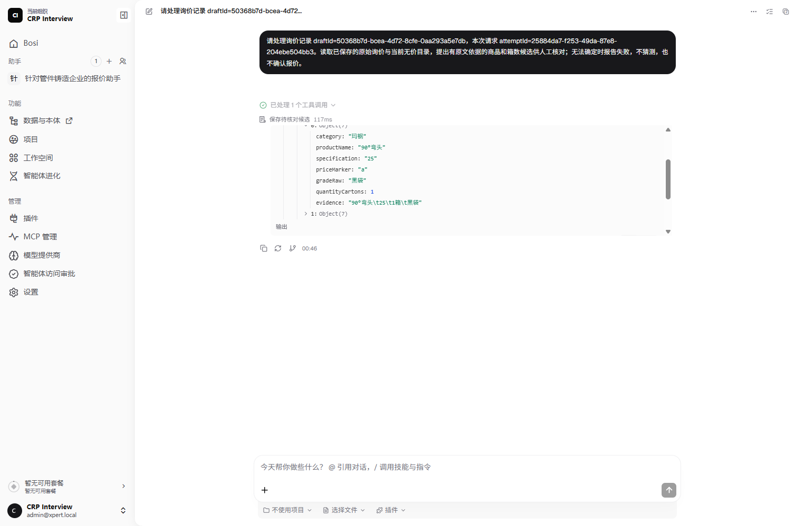
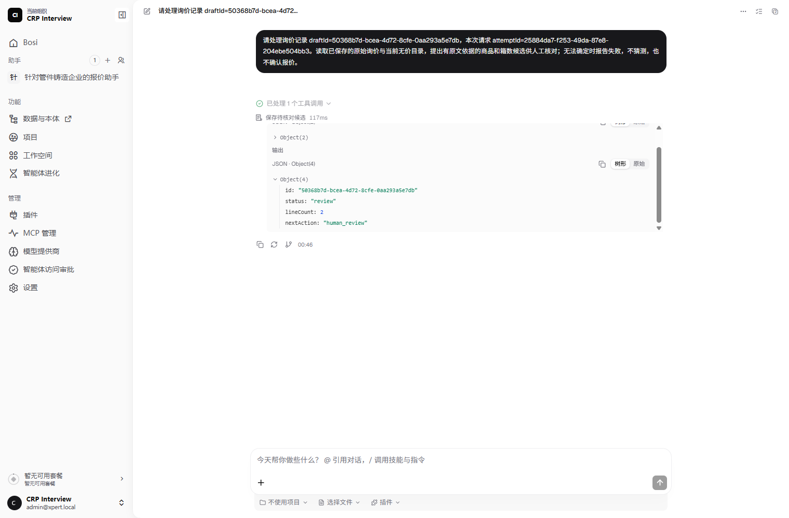
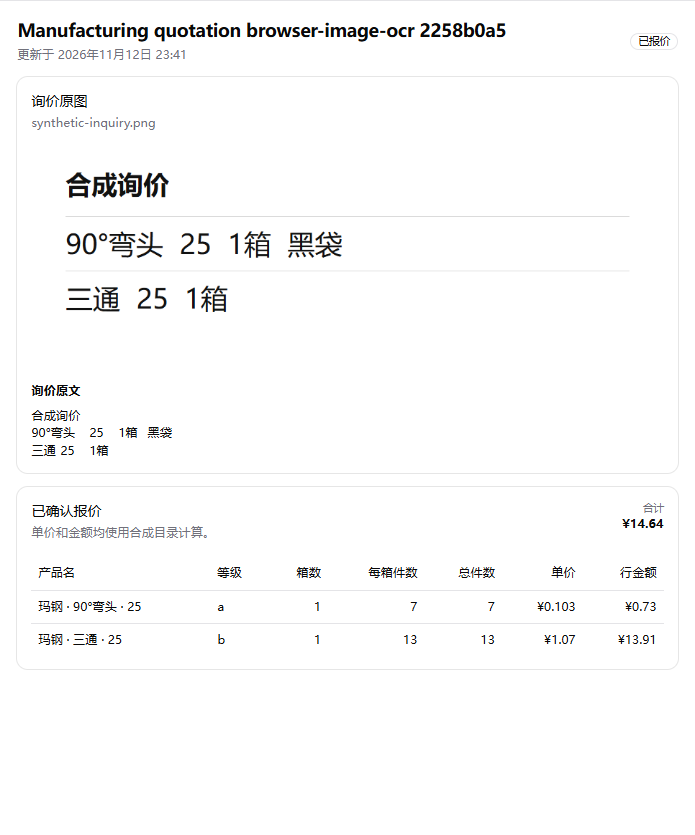
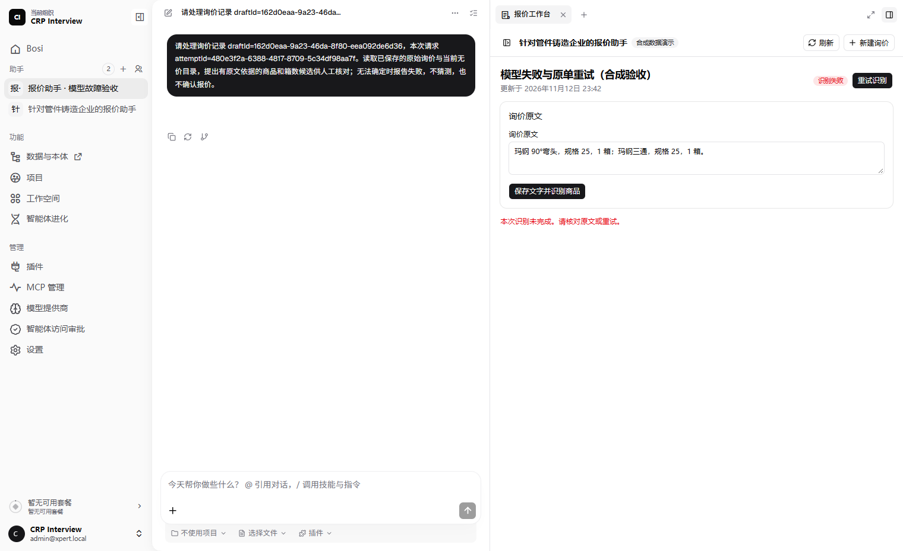
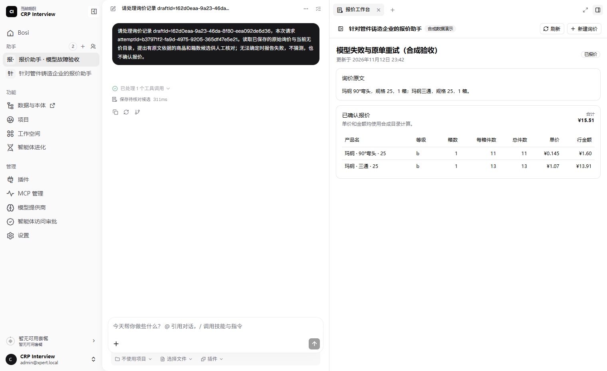

# 管件铸造企业报价助手

Xpert 业务插件，面向需要整理文字或图片询价、查询商品目录并逐项核价的报价员。DeepSeek 整理候选，报价员核对分类、品名、规格、箱数和等级，后端确定性计价并保存。

报价员需要从文字或截图逐行整理品名、规格、箱数和等级，再查包装与单价；简称和图片行列容易导致漏项或抄错。

本版使用六条合成商品记录，支持文字和规整图片输入、人工审核、失败重试和刷新恢复。包名 `@xpert-ai/plugin-manufacturing-quotation`，版本 `0.1.0`。

## 使用流程

按[安装说明](docs/setup.md)加载插件、配置 DeepSeek 并发布模板助手，登录后切换到助手所在组织。未将该助手设为个人默认绑定时，在左侧「助手」列表点击「针对管件铸造企业的报价助手」，默认进入报价工作台；子菜单「报价工作台」可最大化打开。对话页仍可点击「请打开询价报价工作台，创建一条演示询价。」。

未安装宿主补丁、已个人绑定该助手而看不到侧栏入口时，可使用[安装说明中的助手直达地址](docs/setup.md#3-配置-deepseek-并发布测试助手)。

1. 新建询价，输入 `90°弯头 25 1箱；三通 25 1箱`，点击「保存并识别商品」。图片先上传并核对 OCR 文字。
2. 对照原文核对五个字段，修正候选后点击「确认并计算报价」。模型不能直接确认或报价。
3. 后端读取目录中的包装和单价，保存报价；刷新后可打开同一记录。识别失败时保留原文或原图，可修正并重试。

上述文字示例默认 b 档为 **15.51 CNY**；弯头标明黑袋 a 时为 **14.64 CNY**。a/A/b 严格区分，未知等级不套默认。

## 关键页面原型

以下为工作台线框示意。分栏时，左侧 Xpert 对话显示识别请求与工具结果，右侧工作台可展开历史记录并切换下列内容。

```text
┌─ 新建询价
│  询价标题 [____________________]
│  [文字] [图片]
│  [粘贴询价原文] 或 [选择图片文件]
└─ [保存并识别商品] 或 [上传并识别文字]

┌─ 询价标题 · 待审核
│  询价原文，或原图及核对后的 OCR 文字
│  分类 | 产品名 | 规格 | 箱数 | 等级
│  每行显示原文依据，候选字段可编辑
└─ [重新识别] [保存修改] [确认并计算报价]

┌─ 询价标题 · 已报价
│  询价原文及原图（如有）
│  产品 | 等级 | 箱数 | 每箱件数 | 总件数 | 单价 | 行金额
└─ 已确认报价 · 合计 / 已计算小计
```

## 实际运行截图

截图来自使用侧栏补丁的本地 Xpert，询价均为合成数据。原生侧栏与直达入口也已单独复验。[入口与复验说明](docs/setup.md#3-配置-deepseek-并发布测试助手)

**文字候选与人工审核**



**Xpert 对话、图片输入、工作台和保存候选工具调用**



**Xpert Studio 画布**

由模板发布的 v6 助手使用 `deepseek-flash`。画布展示主 Agent、询价核对中间件及其四个工具。



**展开「保存待核对候选」工具调用**

重新打开 2026-11-13 00:46 的合成 PNG 询价对话，展开同一次实际调用。宿主工具面板可滚动，输入与输出分别截图。





**确认后刷新，恢复原图与 14.64 CNY 报价**



**模型输出不完整时保留原文；恢复配置后在原单重试并确认 15.51 CNY**





## 验证与范围

已在本地 Xpert 验证文字和 PNG 询价、人工确认、刷新恢复及模型失败后同单重试。版本、命令和结果见[验证记录](docs/verification.md)。

图片限清晰单栏或规整单表，支持 PNG/JPEG/WebP，最大 5 MiB。真实模型验收使用 PNG；JPEG/WebP 只验证格式校验。没有接入企业主数据、批量/PDF/Excel 输入、销售单导出或生产环境，未做生产压测、真实网络/数据库故障注入或 Cloud 托管版本验收。

询价及报价保存在 Xpert PostgreSQL，按租户、组织、用户和助手隔离。图片和询价内容会发送给组织配置的 DeepSeek；价格与包装由后端读取，凭据由平台管理。模型负责转录与候选，确定性规则和人工确认负责报价正确性。

- [安装与复验](docs/setup.md)
- [架构、业务规则与开发说明](docs/design.md)
- [验证结果与边界](docs/verification.md)
