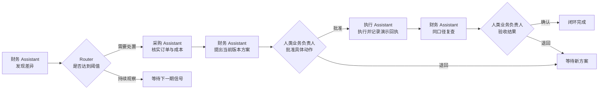

# 经营偏差闭环

把经营差异变成有证据、有批准、有回执、可复查的项目任务。应用使用平台原生 Project Type、Assistants Pipeline 和任务视图；财务 Assistant 另提供 Live Dashboard 能力。

## 演示流程

协调 Assistant 只启动流水线。平台持有调度、轮次、等待、重试、取消和执行履历；插件保存领域证据与不可变验收结果。没有第二套调度器或自制流水线 UI。

四个独立 Assistant 均带头像。财务负责分析、方案、复查和看板；采购负责核实；执行只处理获批动作。能力使用权、能力维护权和业务批准权相互分离。

## 数据与边界

`fixtures/manufacturing-demo.sql` 创建独立的合成数据 schema；`fixtures/ontology-schema.json` 保留本次已发布模型的 schema（不含实例 ID 或凭据）。在目标环境创建 SQL 语义模型、选择自己的演示数据源，将该结构用于模型 schema 后验证并发布；资源与角色授权仍由管理员明确配置。两个本体对象为经营毛利与采购事实，经过 Data Xpert 已发布 SQL 语义模型、受控动作和 `data-xpert.ontology` Analytics Provider 查询。没有文件表替代通道，没有真实 SAP 写回。

该模型的百分比度量只用于本样本的单一产品、工厂及选定期间，不可直接把多产品或跨期间的简单平均解释为整体毛利率。

样本中，苏州一厂 M200 的 11 月毛利率为 17%，预算为 24%；两笔采购的价差合计 10.5 万元。复查样本毛利率为 21%，仅用于展示同口径对比，**不是实际改善效果或动作因果证据**。执行节点只持久化 `DEMO-ACTION-…` 本地演示任务回执。

`fixtures/m200-margin-dashboard.html` 保留实际验证后的看板源稿，只有声明式绑定名称，不内嵌业务数据或凭据。复用时先为 `margin_trend`、`margin_comparison`、`purchase_facts` 完成目标环境的真实查询验证，再经 Live Dashboard 保存为草稿，并使用 `echarts`、`trend-workspace` 图库。HTML 文件本身不等于已保存看板。

## 安装与配置

包：`@xpert-ai/plugin-margin-improvement`，租户级安装，公共 SDK/contracts 3.37.2。可复用 Assistant 套件位于 `blueprints/assistant-suite.json`，不包含实例 ID 或凭据。

1. 依照平台本地环境流程更新代码、安装依赖并验证健康状态。
2. `pnpm build`、`pnpm test`、`pnpm verify:dist`，再通过 `plugin-dev-harness` 验证加载。
3. 使用平台 `plugin:deploy:local` 安装，按实际 `pending_restart` 状态重启 API。
4. 使用 `assistant:suite:init` 发布四个角色；在 Data Xpert 将所需本体资源授权给财务和采购角色，并配置当前演示者的精确只读动作策略。
5. 经真实 discovery/query 验证后配置 `analysisBinding`、`factsBinding`、`reviewBinding`，均须采用 `data-xpert.ontology`。`actualField`、`budgetField` 指向规范化结果中的实际、预算毛利率字段；`threshold` 单位为百分点。将套件发布回执中的角色 ID 明确配置到 `assistants.finance/procurement/execution`；启动时检查项目类型和实际成员，移除的角色不会自动补回。
6. 在协调 Assistant 中创建“经营改善项目”并启动流程。在原生项目任务 Pipeline 中跟踪和批准。财务 Assistant 可在同一项目制作看板；看板保存草稿后由人决定正式发布。

实例配置、安装回执、模型查询凭据与截图保存在仓库外的本地交付目录，不纳入可复用插件。

## 验收要求

检查数据源授权、完整查询与追溯信息、已发布角色及项目成员、Router 的处置/观察分支、人工批准与拒绝、确切方案版本、重复提交、取消/过期执行拒绝、真实执行记录及看板刷新。运行成功不等于业务验收。构建、插件加载、套件发布与端到端运行分别留证。

当前只支持创建一个固定输入配置的演示轮次。新增数据版本/新一轮业务调整需要明确的领域更新入口；不能修改历史证据或用原轮次伪装新输入。

## 应用展示与封面

`src/app-config.ts` 是 App 展示与初始化声明的唯一维护入口，包含中英文介绍、功能亮点、使用场景、数据范围和初始化说明。封面位于 `assets/brand/`；卡片标题由宿主展示，图中只保留八字描述。

构建时 `scripts/manifest.mjs` 从实际运行元数据生成 `.xpertai-plugin/plugin.json`，同步声明封面资源。`verify:dist` 检查模板关联、manifest 一致性、PNG 格式、5 MiB 限制和打包目录。部署新版插件并按回执重启后，Explore 卡片、详情页和初始化面板使用同一张封面。

初始化应用不会自动完成业务数据接入、项目成员和业务批准人的配置；运行演示前仍需完成上文所列步骤。
