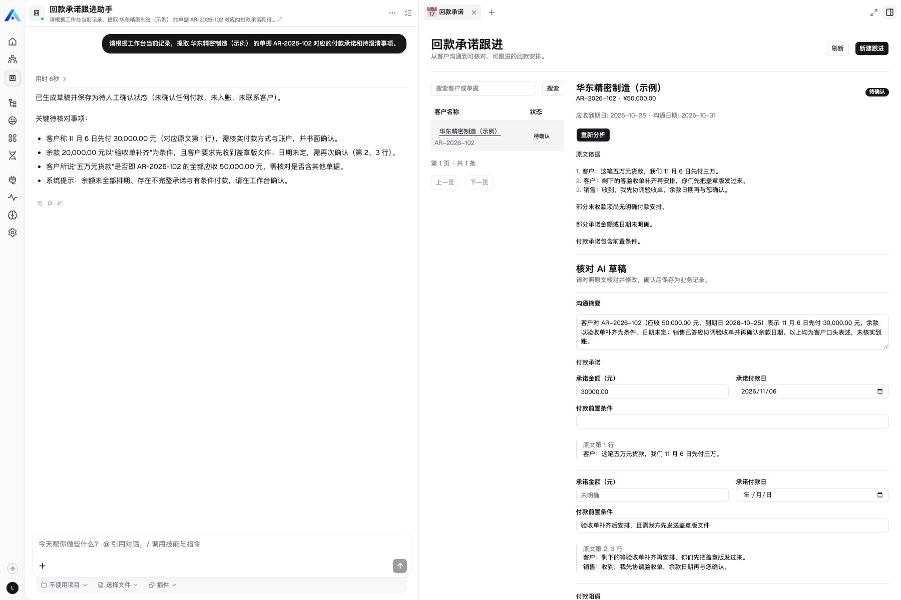
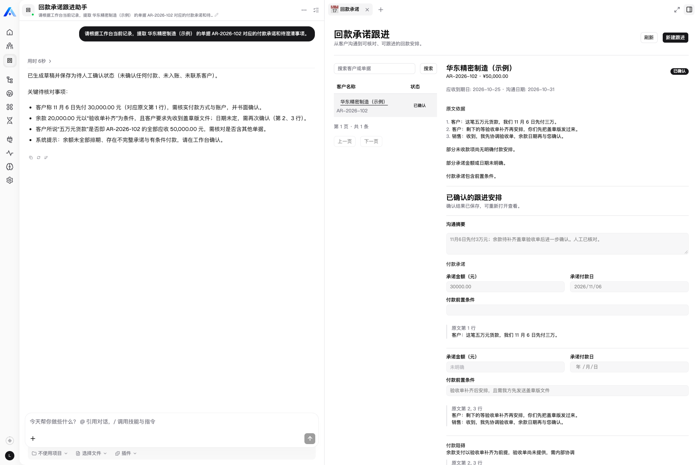
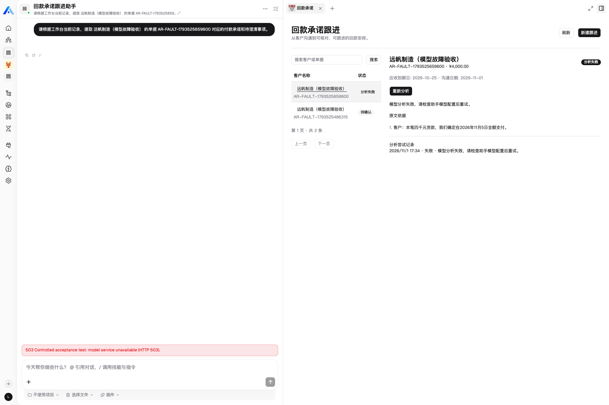
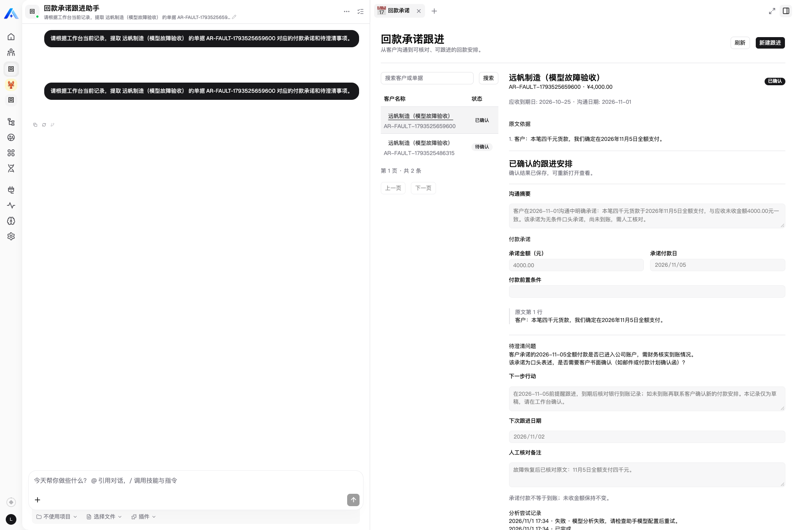

# feat(payment-followup): add evidence-backed payment promise workbench

## 产品价值

销售内勤把一笔应收单据和客户原话转为可核对的付款承诺与跟进安排。例如“五万元货款，11 月 6 日先付三万，余款等验收”会生成带原文行号、金额、日期和条件的草稿，人工确认后可重新打开。承诺不作为实际到账，不修改应收余额。

## 关键实现

- Xpert Assistant 模板、三个 middleware tools、React 共享组件工作台；模型及凭证由平台配置。
- PostgreSQL JSONB 持久化，tenant/organization/user/assistant 四层隔离。
- 整数分、模糊值 null、原文证据、AI 原稿与人工确认稿分离。
- attemptId 隔离重试，revision 防止并发覆盖，行锁串行化同一记录操作。
- 宿主视图状态恢复与新对话 iframe 重建适配；真实平台发现的 view key 和 runtime context 问题有回归测试。

## 验证

- [x] strict 类型检查、完整构建及 verify:dist。
- [x] 45 项 Node 检查通过，无跳过：27 项规则、2 项平台契约、6 项模型失败保护、真实 PostgreSQL 父测试及 9 个子场景。
- [x] 官方 plugin-dev-harness 加载与关闭；harness 使用数据库 mock，另有上述真实数据库验证。
- [x] 模拟宿主浏览器表单、桥接、金额修订、刷新恢复及中英界面。
- [x] Mintlify 文档构建与校验。
- [x] 真实平台安装、模板创建/同步/发布，DeepSeek Flash 实际工具调用。
- [x] 人工修订、确认、顶层页面重载恢复、模糊承诺及取消后重试。
- [x] 按任务书附录二实际注入模型 HTTP 503：显示并持久化失败、刷新保留原文、恢复真实 DeepSeek、同记录重试、人工确认及再次恢复；未重复创建记录。

已执行的主要命令（路径、数据库及登录凭证由本地环境提供）：

```bash
# 在 community/apps/payment-followup 中
corepack pnpm build
NODE_PATH="$XPERT_PLATFORM_ROOT/node_modules" corepack pnpm test
corepack pnpm verify:dist
NODE_PATH="$XPERT_PLATFORM_ROOT/node_modules" PLAYWRIGHT_CHANNEL=chrome corepack pnpm test:ui
# 独立测试助手/代理及浏览器状态按 docs/fault-injection.mdx 配好后
PLAYWRIGHT_CHANNEL=chrome corepack pnpm test:platform-failure
# 在 xpert-plugins 根目录，harness 已安装并构建
NODE_PATH="$XPERT_PLATFORM_ROOT/node_modules" node plugin-dev-harness/dist/index.js \
  --workspace community/apps/payment-followup --plugin @community/apps-payment-followup
# 在插件 docs 目录
corepack pnpm dlx mint validate
```

45 项测试报告是在设置专用 `PAYMENT_TEST_DATABASE_URL` 时产生；不设置时数据库场景会跳过。环境变量示例、初始化和安装步骤见 README。

本地 solumbe review_gate 为 **WARN**：范围契约与密钥检查通过；新增服务、依赖和构建入口被标为需维护者显式审阅的范围。它仅发现依赖审计命令可用，未执行漏洞审计；GitHub 审批和 CI 尚未检查。

测试输入均为虚构；真实模型和组件固定结果分开记录。详细证据见 [README](../README.md)、[验收说明](acceptance.mdx) 和 [持久化验收数据](acceptance-receipt.json)。模型输出字句不作为精确断言，业务状态与关键字段已核对。

## 基线与范围

- xpert-plugins: `60794aa72edb1fddffebd5e5d071619b8c29014b`。
- Xpert: `83e0d4ce9462996e7a4c24517f63559bedf23b7e`。
- 实际测试：上述平台 SHA，插件包 `@community/apps-payment-followup@0.1.0` 的本地功能分支构建；Node 22.15.0、插件 pnpm 8.15.8、平台 pnpm 10.24.0；模型 DeepSeek `deepseek-flash`。
- 实际测试源码为本功能分支；最终业务提交 SHA 与固定版本的证据链接见 GitHub PR 正文。
- 仅新增 `community/apps/payment-followup`，未发布 npm 包。
- 文档结构参照 [#668](https://github.com/xpert-ai/xpert-plugins/pull/668)，实现和运行证据来自本插件。
- 本文保留仓库内相对链接；GitHub PR 正文使用固定到功能提交的完整链接。

开发使用 Codex（GPT-6），业务运行使用平台 DeepSeek Flash。产品取舍、三段代表性 AI 协作过程、许可及复用范围见 README。界面复用同仓库共享组件；#668 主要作为架构和文档组织参考。

## 运行截图与限制






[故障注入复现步骤](fault-injection.mdx)及[脱敏阶段数据与 HTTP 审计](fault-acceptance-receipt.json)：失败响应为主动注入，恢复为真实 DeepSeek，不替换工具结果或直接写业务数据库。

仅支持人民币、单笔应收、单次确认；不含实际到账核销、外发催款、定时提醒或跨用户共享。原文引用存在不等于语义正确，仍需人工核对；超时在读写时恢复，中止不保证停止模型计费。
