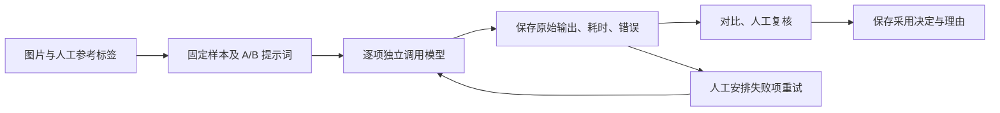
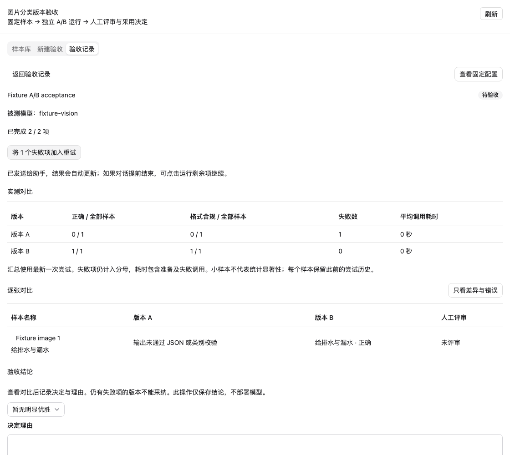
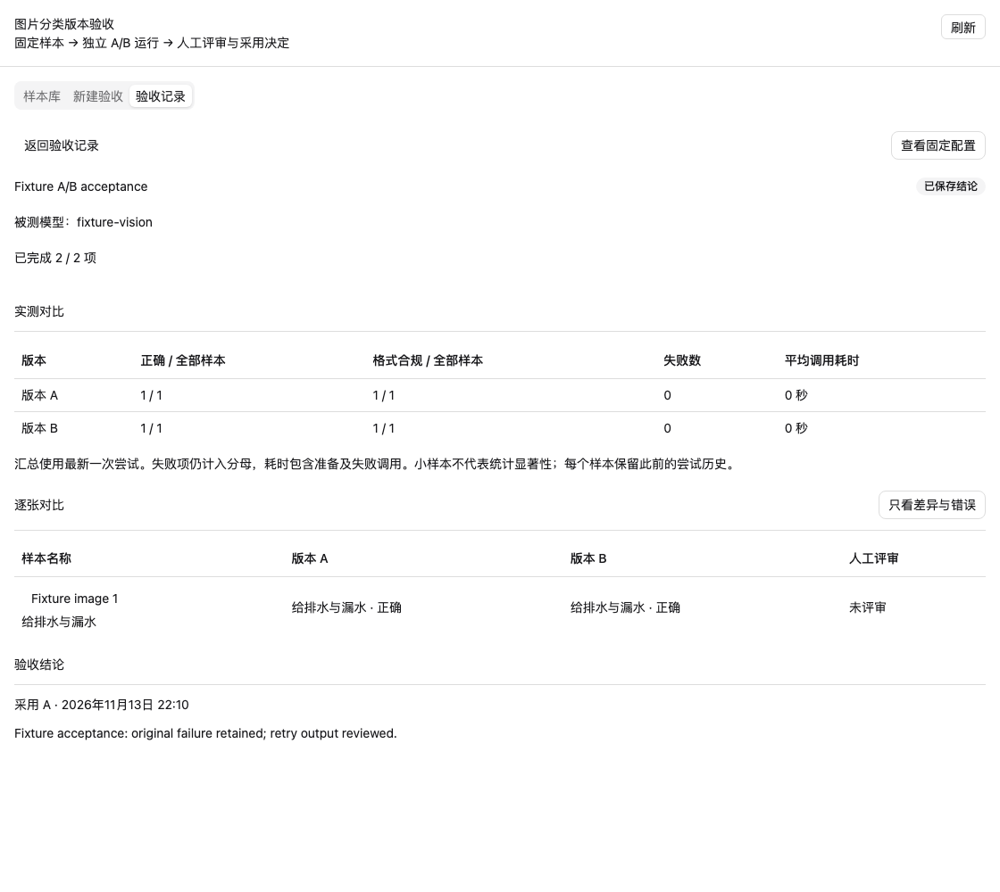

# 图片分类助手的版本验收工作台

运行在 Xpert 开源版上的 Agentic App。面向维护图片分类助手的开发者与测试人员，解决“修改提示词后，哪些样本变好了、哪些退步了，这一版是否值得采用”的问题。

**0.3.0 开发版**：固定图片与人工标签 → 保存 A/B 提示词 → 独立模型调用 → 查看实测差异与历史 → 人工评审 → 保存采用决定。包名保留 `@community/apps-photo-intake`，数据命名空间仍为 `photo_intake`，以兼容此前的照片记录。本版本尚需完成真实 Xpert 安装验收；下文明确区分模拟验证与平台验证。

## 用户与业务闭环

用户原来需要在对话窗口里逐张试图片、复制输出到表格，再人工核对不同版本。样本与模型配置可能不一致，失败调用容易被漏掉，结论缺少可回查的依据。

工作台把一次版本验收保存为一个业务对象：固定样本、两版提示词、模型选择、逐项结果和人的决定。首版使用自行编写的设施问题分类表作为具体任务，包括给排水、电路、空调、门窗、家具、表面、电器、安全隐患及无法判断。它不是实际报修派单系统，也不声称已有客户使用。

- **AI**：读取图片并独立给出类别与可见证据；助手启动已授权的运行并解释保存的指标。
- **服务端**：调用模型、保存原始输出和计时、校验 JSON、按人工标签计算正确数、维护重试历史。
- **人**：提供参考标签、选择待评测图片与两版提示词、审查差异、决定是否采用。助手没有写入评审或验收结论的工具。
- **交付结果**：可以重新打开的验收记录。保存采用决定不会发布提示词、切换生产模型或产生真实派单。



页面包含三个入口：**样本库**（上传、预览、设置参考类别）、**新建验收**（选择样本并编辑 A/B）、**验收记录**（运行进度、对比、证据及决定）。主要对比表可只看差异和错误，原始输出与历史在样本详情中查看。

## 操作步骤

1. 在样本库上传 JPG、PNG 或 WebP，填写名称并选择人工参考类别。上传前浏览器会缩至最长边 1280 像素；服务端校验 MIME、文件头和 4 MiB 大小上限。
2. 新建验收，选择 1–10 张不同图片，填写两版提示词。保存配置不会触发模型调用。每个验收最多安排 20 次首次图片调用，另有助手编排调用。
3. 在验收详情点击“运行剩余项”。工作台通过宿主的聊天命令请求助手执行。一个工具调用只处理一个图片/版本，助手根据剩余数继续；对话提前结束时，可以继续未完成项。
4. 查看正确数、格式合规数、失败数与平均调用耗时。点样本名称可查看图片、固定标签、原始响应及所有尝试；逐张评审可选。
5. 失败项可显式加入重试，每个图片/版本最多三次尝试。旧结果与旧人工备注保留；旧评审不会冒充对重试后输出的评审。
6. 记录采用 A、采用 B、暂无明显优胜或两版均不采纳，并填写理由。仍有失败项的版本不能被采纳。定稿后本次验收不能继续运行或改写；需要新的实验时新建验收。

## 评测规则与边界

- 样本名称、人工标签、其他版本的响应、聊天历史、人工评审均不传给被测模型。模型只收到本版提示词、固定类别定义、统一输出约束与图片。
- A/B 使用同一个已授权的默认主模型，在第一次运行时固定 `model` 和 `copilotId`。运行不接收用户或助手自行提交的 provider 凭证。现阶段不提供跨模型对比。
- 请求参数固定为 `temperature: 0`、`max_tokens: 512`、`maxRetries: 0`，实际参数支持由提供商决定。模型别名背后的供应商版本变化不在插件控制范围内。
- 结果必须是包含 `categoryId` 与 `reason` 的 JSON 对象，未知类别、额外字段、Markdown 包装均判定格式失败。文本内容块按明确的 `type: text` 提取，完整内容仍保留。
- **正确数 / 全部样本数**：最新一次尝试格式合规且类别等于固定人工标签才计为正确；失败和未完成项不从分母中移除。格式正确但类别错误是有效的错误预测，不自动重试。
- 耗时由服务端计时，包括客户端准备、调用和失败等待；token 用量只记录提供商或宿主返回值，估算值明确标识，不凭空计算成本。
- 每项超时 60 秒，运行占用 90 秒后允许人工恢复。迟到响应不能覆盖被恢复或已重试的记录。取消可能无法阻止供应商继续计费，不承诺外部调用恰好一次。
- 保存、占用、完成、评审、定稿均使用受身份范围约束的 ORM 操作与版本条件更新。单个有界验收聚合保存全部状态，避免跨模型调用持有数据库事务。
- 样本引用保存图片 SHA-256 并在调用前校验；参考类别变更只影响后续验收。相同图片字节不允许在一次验收中重复计数。
- 汇总显示最新尝试；应结合历史识别重试带来的选择偏差。小样本不能证明泛化能力、显著性或稳定领先。
- 首版不接 RAG、向量数据库、LLM 裁判、后台任务队列、自动上线或多智能体。

## 本地构建和测试

环境：Node 20，`community` 工作区使用 pnpm 8.15.8。宿主使用其自己声明的 pnpm 版本。以下从 `community/` 执行：

```sh
corepack pnpm install --frozen-lockfile
corepack pnpm --filter @xpert-ai/plugin-shadcn-ui build
corepack pnpm --filter @community/apps-photo-intake typecheck
corepack pnpm --filter @community/apps-photo-intake test
```

浏览器验收使用 Playwright、真实构建的 iframe、实际 View provider 及 SQL.js 数据库服务，**仅宿主传输和模型响应为测试替身**：

```sh
cd apps/photo-intake
corepack pnpm exec playwright-core install chromium
WORKBENCH_E2E_SCREENSHOTS=/tmp/photo-evaluation-e2e corepack pnpm test:e2e
```

已有兼容 Chromium 时可设置 `CHROMIUM_EXECUTABLE` 指向可执行文件。测试覆盖真实文件输入与浏览器压缩、语言切换保留草稿、A/B 调用、失败重试、人工评审、验收定稿、刷新恢复和窄屏主题。测试图片为代码生成的示意像素，模型结果为明确的模拟输出。

仓库根目录检查：

```sh
node community/scripts/check-entity-names.mjs
NODE_PATH=community/apps/photo-intake/node_modules node scripts/check-plugin-metadata.mjs --package community/apps/photo-intake
node plugin-dev-harness/dist/index.js --workspace ./community --plugin @community/apps-photo-intake
```

## 安装到真实 Xpert

1. 按平台说明启动开源版 API、Cloud UI 与数据库，确认 `/api/health/ready` 可用。
2. 按 `community/env.example` 准备本地 `community/.env`。使用本插件的环境变量示例 [env.example](env.example)；不要复用其他插件的配置、提交 token 或从数据库构造身份。
3. 在终端设置两个仓库的绝对路径，加载上述环境文件，再从宿主目录部署。`tenant` 级安装与本插件声明一致，应用内部数据继续按组织、工作空间、用户、助手隔离。

```sh
PLUGIN_REPO=/absolute/path/to/xpert-plugins
XPERT_HOST_REPO=/absolute/path/to/xpert
set -a
source "$PLUGIN_REPO/community/.env"
set +a
cd "$XPERT_HOST_REPO"
corepack pnpm plugin:deploy:local \
  --plugin-dir "$PLUGIN_REPO/community/apps/photo-intake" \
  --api-url "$XPERT_API_URL" \
  --scope tenant --tenant-id "$XPERT_TENANT_ID" --no-keychain
```

部署脚本通过环境变量读取 `XPERT_TOKEN`，不要把凭证写入提交或截图。如果返回 `restartRequired`，重启 API 并确认插件的 `loadStatus` 为 `loaded`。

4. 首次使用时从应用初始化助手；升级既有 photo-intake 助手时，在助手设置选择“从模板更新”并发布，保留原助手身份与照片。**安装插件不会自动更新已发布助手**。新模板仍使用同一中间件标识，工具变为查看记录、读取进度和逐项评测。
5. 在当前组织配置有权限使用、支持图片输入的默认主模型。被测模型取自该默认配置，可能与聊天助手自身所选模型不同。
6. 从助手对话页打开工作台，先用一张无敏感信息的测试图片完成两次 A/B 调用，再验证失败重试与刷新恢复。记录实际调用次数、错误、模型、版本与截图。

## 验证记录（2026-11-13）

| 检查 | 状态与证据边界 |
|---|---|
| TypeScript 服务端与工作台检查、生产构建 | 已通过 |
| 单元与 ORM 集成测试 | **27 / 27 通过**，包括输入、身份隔离、快照、并发、超时、迟到结果、重试历史、人工决定与数据库重新加载 |
| 数据表命名、运行时元数据检查 | 已通过 |
| plugin-dev-harness 加载与关闭 | 已通过，使用默认宿主与数据库模拟，不能代替平台验收 |
| 浏览器工作流 | **通过**，Chromium 149（Playwright 配套版本）；覆盖上传/压缩、A/B、失败重试、评审、定稿、刷新恢复与中英文/窄屏深色主题；[模拟验收回执](docs/preview/receipt.json) |
| 0.3.0 真实 Xpert + 真实模型 | **未验证**：尚未部署本次改造，需配置本地安装环境后执行 |
| 提交要求的真实平台截图 | **未完成**：需覆盖对话、工作台、画布及中间件、工具调用、失败与重试 |

基线：

- 插件仓库 main：`9bfa96594a3debbb33f0ba25c7ade49e7d360c8b`
- 平台仓库 main：`ba8736c897474f7db9a261aa5f64d95860bb9f60`
- 本轮测试对象：本目录的 0.3.0 实现，开发基于提交 `445826169d4cc9832fe129621331ec1fdbeb4fae`。真实平台验收时需另行记录被测提交 SHA，并补全安装验收记录。

历史 0.2.0 的平台看图成功记录不能证明本次独立模型运行器已经验证。

## 界面预览（模拟宿主与模拟模型）

以下截图由 `tests/workbench.e2e.mjs` 加载实际构建资源生成。图片与输出均为测试夹具，**不是已安装 Xpert 或真实模型效果截图，不能替代笔试要求的平台截图**。

失败项与 A/B 实测口径：



重试后保存的人工结论：



另外检查了[原始输出与历史](docs/preview/attempt-history.png)及[窄屏深色主题](docs/preview/comparison-narrow-dark.png)。

## 实现索引

| 责任 | 文件 |
|---|---|
| 运行 DTO、输入校验与指标定义 | `src/lib/domain/evaluation.ts` |
| 验收快照、占用、重试、人工记录 | `src/lib/evaluation.service.ts`、`evaluation-run.entity.ts` |
| 真实模型调用、无参考标签的请求构造 | `src/lib/evaluation.runner.ts` |
| 助手可调用工具 | `src/lib/intake.middleware.ts` |
| 受宿主身份约束的界面查询与动作 | `src/lib/intake-view.provider.ts` |
| 样本上传与原有照片数据 | `src/lib/intake.service.ts`、`intake-case.entity.ts`、`intake-photo.entity.ts` |
| 样本/配置/结果界面 | `src/lib/remote-components/workbench/src/` |
| 助手图与职责 | `src/photo-intake-assistant.yaml` |

## 复用与 AI 协作

许可沿用仓库的 AGPL-3.0。共享组件 `@xpert-ai/plugin-shadcn-ui`、React 适配和构建方式来自本仓库；原 photo-intake 的上传、宿主桥接和照片持久化被复用。此次新增评测聚合、独立调用器、参考标签与评分、人工决定和对应测试；不包含雇主代码、真实客户数据或专有类别表。

本轮使用 Codex 辅助阅读既有实现、设计状态与测试、实现工作台及验证；既有 photo-intake 基础由用户与 Claude Code 协作完成。用户作出的产品选择包括：收紧为一次具体版本验收、保留图片场景以复用已有进度、首版不引入 RAG/向量库、以真实输出和人工结论形成闭环。没有把完整聊天记录或私人凭证放入公开交付。

## 已知限制和后续优先级

- 首要待办是完成真实宿主安装、模板升级和真实模型验收，再补实际平台截图。
- 仅支持一个默认模型的两版提示词，单次 1–10 张图片；样本库只展示最近 50 条，验收历史每页 20 条。
- 图片以 Base64 保存于插件表，未接平台文件库；服务端只验证文件签名，完整图片解码在浏览器和提供商处理。
- 单项最长等待 60 秒，每项最多三次尝试；每次验收最多 100 条人工评审历史，超出需要新建验收。
- 原始模型内容超过 65,536 字符会明确标为截断并判为格式失败；不记录提供商错误的原始文本，以避免夹带密钥或请求头。
- 无持久后台调度：助手停止或服务重启后，用户从保存的状态继续。无法保证供应商在超时或取消后不计费。
- 0.2.0 照片表与历史建议保留；原分析服务保留兼容测试，新模板不再提供旧的“模型提交建议”工具。旧助手需更新模板。
- 不自动删除图片和验收记录，不做组织内共享或跨用户评审；权限隔离并不等于完整的企业审核角色体系。
