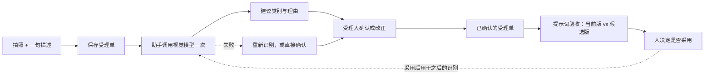
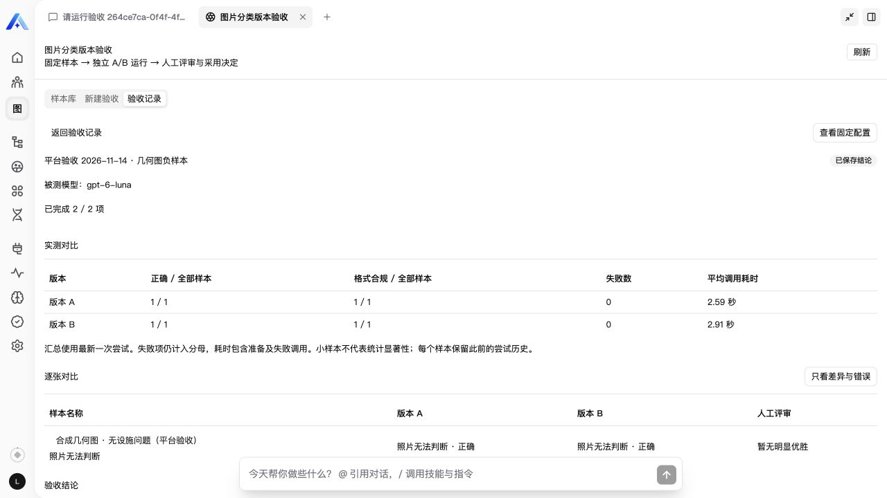
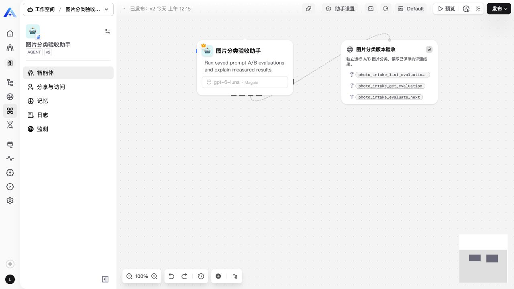
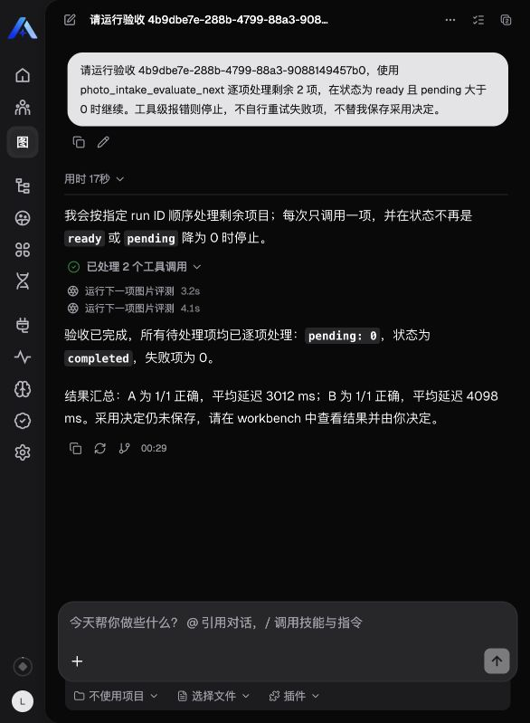
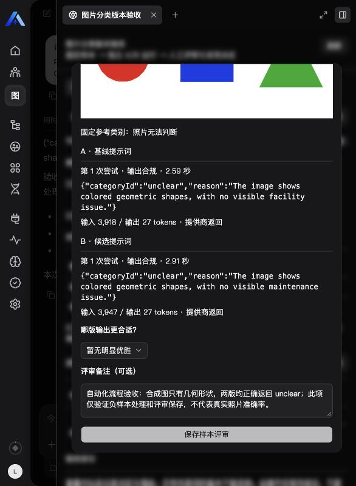
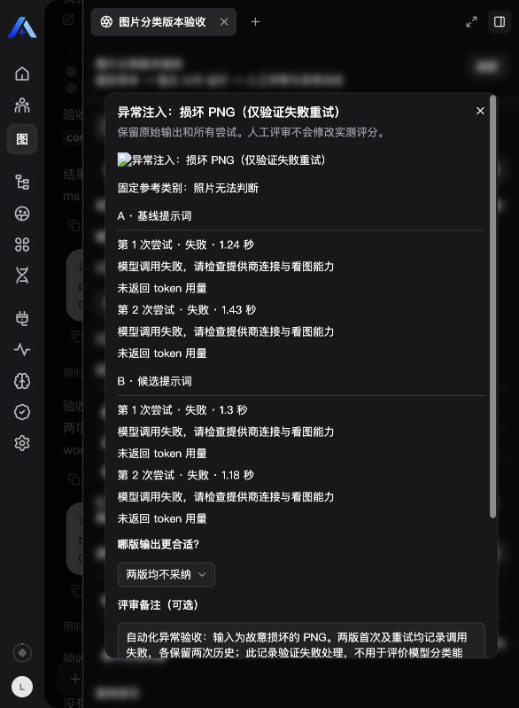
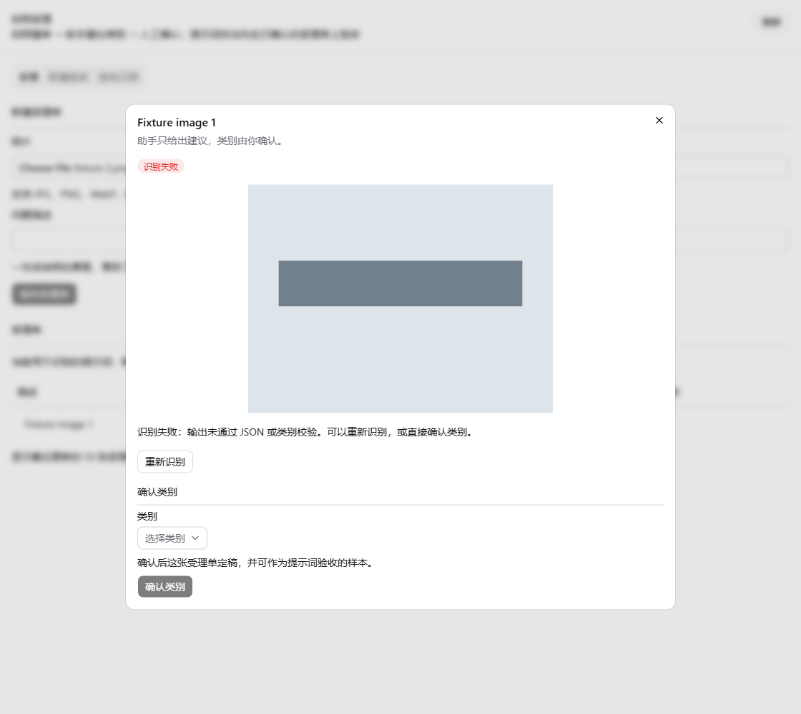
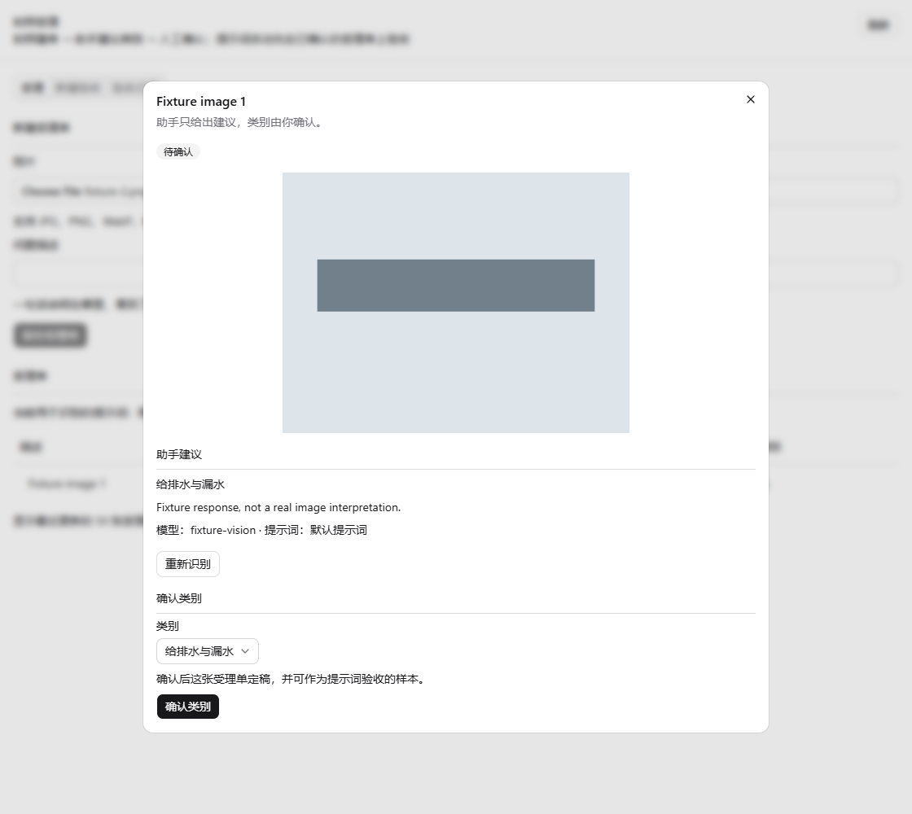
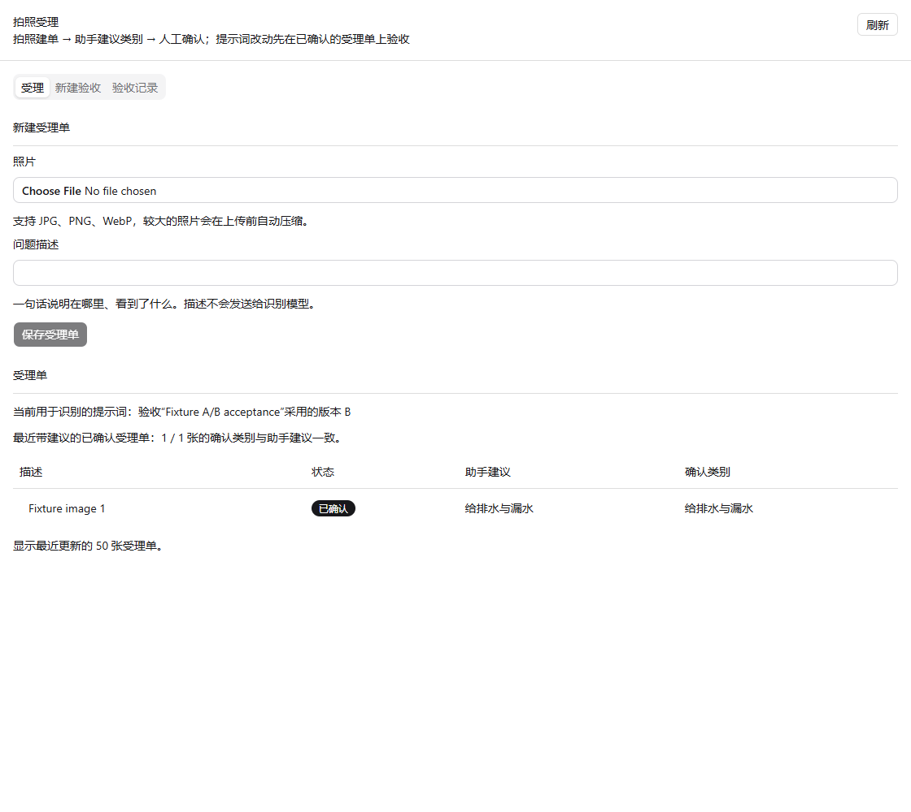

# 拍照受理

运行在 Xpert 开源版上的 Agentic App。面向设施服务台的受理人：现场问题由报修人拍照送来，受理人要给每张照片定一个问题类别，后面的人才知道找谁处理。

**0.4.0 开发版**。包名 `@community/apps-photo-intake`，数据命名空间 `photo_intake`，`tenant` 级插件。

## 用户与业务闭环

受理人原来的做法是逐张看照片、凭经验选类别。类别选错，工单就会被派给不对口的班组再退回来；而当有人想改进识别用的提示词时，又没有办法知道改完之后是变好了还是变差了。

应用把这两件事接在一起：



- **AI 做什么**：服务端把保存的照片交给视觉模型，得到一个类别和一段可见证据的理由。助手负责触发这次识别、转述结果、按请求逐项执行验收；它看不到照片，也没有确认类别、评审或保存结论的工具。
- **人做什么**：建受理单、确认或改正类别、挑选验收样本、决定是否采用候选提示词。
- **保存什么**：受理单（照片、描述、助手建议及其所用模型和提示词来源、人确认的类别、失败原因）和验收记录（固定的样本与提示词、每次调用的原始输出与耗时、评审、采用决定）。
- **验收与受理的关系**：验收样本只能是人已确认的受理单，参考答案就是确认的类别。结论为“采用 A”或“采用 B”时，该版提示词成为之后受理识别使用的提示词；“暂无明显优胜”和“两版均不采用”不改变当前提示词。

类别表为自行编写的九类设施问题（给排水与漏水、电路与照明、空调与通风、门窗与门锁、家具、墙面地面等表面、电器、安全隐患、照片无法判断）。应用不派单、不通知、不对接工单系统，也没有真实客户在使用。

页面有三个入口：**受理**（建单、列表、打开受理单识别与确认）、**新建验收**、**验收记录**。接手开发先读[当前进度与 TODO](docs/TODO.md)，展示可参考[五分钟演示提纲](docs/demo.md)。

## 操作步骤

1. 在“受理”上传 JPG、PNG 或 WebP，写一句描述，保存。浏览器先把照片缩到最长边 1280 像素；服务端校验 MIME、文件头和 4 MiB 上限。保存不会调用模型。
2. 保存后受理单自动打开。点“让助手识别”，工作台通过宿主的聊天命令请助手调用 `photo_intake_analyze_case`。一次请求对应一次图片模型调用，结果自动刷新到受理单上。
3. 查看建议类别、理由、所用模型和提示词来源。类别下拉默认是助手的建议，可以改成别的再点“确认类别”。确认后受理单定稿。
4. 识别失败时受理单显示原因（模型不可用、调用失败、超时、输出不合规、调用中断）。可以“重新识别”，也可以不等模型直接确认类别。照片丢失的受理单不能识别，但仍可直接确认。
5. 想改提示词时到“新建验收”：A 预填当前生效的提示词，B 填候选提示词，勾选 1–10 张已确认的受理单。保存配置不调用模型。
6. 在验收详情点“运行剩余项”，助手逐项调用 `photo_intake_evaluate_next`，每次只处理一张图的一个版本。失败项可以显式加入重试（每项最多三次尝试，旧结果保留）。
7. 对照“与确认类别一致 / 全部样本”、格式合规数、失败数和耗时，点样本名看照片、原始输出和全部尝试，再保存结论与理由。仍有失败项的版本不能采用。

## 规则与边界

- 模型只收到提示词、类别定义、输出约束和照片。受理单描述、人确认的类别、另一版的输出、聊天历史都不传给模型。
- 识别与验收走同一段调用代码（`src/lib/classification.ts`）：`temperature: 0`、`max_tokens: 512`、`maxRetries: 0`，单次最长等待 60 秒，结果必须是只含 `categoryId` 与 `reason` 的 JSON 对象。未知类别、多余字段、Markdown 包装都算输出不合规，不会被“尽量理解”成一个类别。
- 模型取当前组织已授权的默认主模型，需支持图片输入。工具不接收用户或助手提交的模型凭证。验收在第一次运行时固定 `model` 与 `copilotId`。
- 同一张受理单同时只有一次识别在进行；第二个请求被拒绝，不会多调一次模型。识别超过 3 分钟没有结果时，受理单重新允许识别和确认，迟到的结果被拒绝，不会覆盖人已经做出的确认。
- 所有状态变更都带版本号条件更新；创建操作按请求键幂等。数据按租户、组织、工作空间、用户、助手隔离，范围只取自宿主提供的可信上下文。
- 验收的“一致”指最新一次尝试格式合规且类别等于确认类别；失败和未完成项留在分母里。小样本不能说明统计显著性或泛化能力。
- 采用决定只改变本应用之后识别所用的提示词，按当前用户与助手的数据范围生效；不部署、不更换模型。
- 不记录提供商错误的原始文本（可能夹带密钥或请求头），只保存失败类别。受理识别不保存模型原始输出；验收保存，上限 65,536 字符。
- 首版不接 RAG、向量库、LLM 裁判、后台任务队列或多智能体。

## 本地构建和测试

环境：Node 20 及以上，`community` 工作区使用 pnpm 8.15.8。以下从 `community/` 执行：

```sh
corepack pnpm install --frozen-lockfile
corepack pnpm --filter @xpert-ai/plugin-shadcn-ui build
corepack pnpm --filter @community/apps-photo-intake typecheck
corepack pnpm --filter @community/apps-photo-intake test
```

界面集成测试加载真实构建的 iframe、实际 View provider 和 SQL.js 上的真实服务，**宿主传输与模型响应是测试替身**：

```sh
cd apps/photo-intake
corepack pnpm exec playwright-core install chromium
WORKBENCH_E2E_SCREENSHOTS=/tmp/photo-intake-e2e corepack pnpm test:e2e
```

已有兼容 Chromium 时设置 `CHROMIUM_EXECUTABLE` 指向可执行文件。Windows 上 npm 脚本内嵌套的 `pnpm` 可能找不到，可改为分步执行 `corepack pnpm run build`，再 `node --import tsx --test tests/*.test.ts` 或 `node tests/workbench.e2e.mjs`。

仓库根目录检查：

```sh
node community/scripts/check-entity-names.mjs
NODE_PATH=community/apps/photo-intake/node_modules node scripts/check-plugin-metadata.mjs --package community/apps/photo-intake
node plugin-dev-harness/dist/index.js --workspace ./community --plugin @community/apps-photo-intake
```

## 安装到真实 Xpert

1. 按平台说明启动开源版 API、Cloud UI 与数据库，确认 `/api/health/ready` 可用。
2. 按 `community/env.example` 准备本地 `community/.env`，本插件的变量示例见 [env.example](env.example)。不要复用其他插件的配置、提交 token 或从数据库构造身份。
3. 设置两个仓库的绝对路径，加载环境文件，从宿主目录部署：

```sh
PLUGIN_REPO=/absolute/path/to/xpert-plugins
XPERT_HOST_REPO=/absolute/path/to/xpert
set -a
source "$PLUGIN_REPO/community/.env"
set +a
cd "$XPERT_HOST_REPO"
corepack pnpm plugin:deploy:local \
  --plugin-dir "$PLUGIN_REPO/community/apps/photo-intake" \
  --api-url "$XPERT_API_URL" \
  --scope tenant --tenant-id "$XPERT_TENANT_ID" --no-keychain
```

部署脚本从环境变量读取 `XPERT_TOKEN`，凭证不要写进提交或截图。返回 `restartRequired` 时重启 API，确认插件 `loadStatus` 为 `loaded`。

4. 首次使用时从应用初始化助手。已有 photo-intake 助手需在助手设置里“从模板更新”并发布；**安装插件不会自动更新已发布的助手**。模板的中间件提供五个工具：查看受理单、识别受理单、查看验收列表、读取验收、逐项评测。
5. 在当前组织配置有权使用、支持图片输入的默认主模型。识别用的是这个默认模型，可能与聊天助手自己选的模型不同。
6. 从助手对话页打开工作台，用一张无敏感信息的照片走一遍建单、识别、确认。

模板关闭了助手内置的文件理解：照片由插件保存并直接交给视觉模型，不需要嵌入模型或向量检索。图片模型调用带 `langsmith:nostream` 标签，分类 JSON 不会混进助手的聊天流。

## 验证结果

### 0.4.0（2026-11-17，开发机，无 Xpert 平台）

| 层 | 结果 | 说明 |
|---|---|---|
| 单元 / 构建 | 通过 | TypeScript 服务端与工作台检查、生产构建；单元与 ORM 集成测试 **34 / 34**；数据表命名与运行时元数据检查 |
| 插件生命周期 | 通过 | `plugin-dev-harness` 加载 0.4.0 并关闭；使用其默认的宿主与数据库模拟 |
| 界面集成 | 通过（模拟宿主） | Microsoft Edge 157 驱动真实构建的 iframe；宿主传输与模型为替身。[回执](docs/preview/receipt.json) |
| 平台业务流程 | **未验证** | 0.4.0 尚未部署到真实 Xpert。受理流程的对话、视图、画布、工具调用和异常截图需在装有平台的环境补做 |

另有一次不经过 Xpert 的真实模型运行，用来确认服务层在真实视觉模型下的表现：`docs/local-model/intake-flow.mjs` 驱动真实的受理、识别、验收服务（SQL.js），模型为本地 Ollama 上的 `qwen3.8`，图片是代码绘制的三张示意图。

- 三张受理单各调用一次，均得到合规输出，建议类别与随后确认的类别一致（约 0.8–1.5 秒 / 次，模型已预热）。
- 默认提示词与候选提示词在这三张上都是 3 / 3，按“无失败且严格更好才采用”的固定规则记为暂无明显优胜，当前提示词不变。
- 为走通采用路径，另建一次验收并记为采用 B；之后新建的受理单用 B 识别，建议里记录了该来源。
- 把模型地址指向无人监听的端口，受理单记为“模型调用失败”且可重试、可直接确认；恢复地址后重新识别成功。
- 导出数据库再打开，五张受理单与当前提示词读回一致。

结果见[本地模型回执](docs/local-model/receipt.json)。这不是平台验证：宿主运行时被一个只负责提供模型客户端的适配器代替，脚本代替人做了确认和决定；三张示意图也不能说明真实照片上的准确率。

各场景在 0.4.0 上的覆盖：

| 场景 | 单元 / ORM | 界面集成（模拟宿主） | 真实平台 |
|---|---|---|---|
| 完整业务流程（建单 → 识别 → 确认 → 验收 → 采用） | 覆盖 | 覆盖 | 未验证 |
| 保存与恢复 | 数据库重开后读回受理单、照片、验收与决定 | 页面刷新后恢复受理单、当前提示词与验收记录 | 未验证 |
| 输入与空状态 | 非法照片、缺字段、未知类别在保存前被拒绝 | 非图片文件被拒绝、必填未齐时按钮禁用；空列表文案未做断言 | 未验证 |
| 失败与重试 | 输出不合规、调用失败、模型不可用、超时、迟到结果、并发、中断后恢复 | 识别失败后重新识别成功；验收失败项重试并保留历史 | 未验证 |
| 权限与数据范围 | 其他用户不能列出、读取、确认受理单或打开照片，也读不到别人采用的提示词 | 未覆盖 | 未验证 |

### 0.3.0 的真实平台记录（2026-11-14）

下面的记录来自 0.3.0，当时界面标题为“图片分类版本验收”，入口是样本库、新建验收、验收记录，中间件提供三个工具。它们对应 0.4.0 中的**验收部分**：验收的服务、调用、重试与定稿逻辑沿用，调用代码在 0.4.0 中抽到了与受理识别共用的 `classification.ts`。**受理识别、人工确认和“采用后生效”没有真实平台记录。**

环境为本地开源 Xpert、PostgreSQL、默认模型 `gpt-6-luna`；插件描述符 0.3.0 / loaded，助手更新模板后发布为 v2。[平台回执](docs/platform/receipt.json)记录了源码与部署产物的 SHA-256。

视图：合成几何图样本，两版均输出合规 JSON 并命中 `unclear`（A 2,587 ms，B 2,908 ms）；保存评审与结论后刷新，从 PostgreSQL 恢复。



画布：助手模板、插件中间件与工具。



对话与工具调用：用户请求执行已保存的验收，助手完成两次工具调用后说明结果。



样本详情：两版原始输出、提供商返回的用量和评审备注（评审标注为自动化验收记录）。



异常：通过 API 注入一张故意损坏的 PNG，两版各失败两次，四次尝试全部保留；服务端拒绝采用仍有失败项的版本，最终保存“两版均不采用”。[重试前的状态](docs/platform/failure-before-retry.png)另有截图。这组记录没有验证故障恢复后的重试成功。



同日用一张管道滴水示意图补做了一次正样本：两次 `gpt-6-luna` 调用均命中 `plumbing`（A 3,345 ms，B 2,777 ms），刷新后恢复，见[正样本回执](docs/platform/positive-sample-receipt.json)与[截图](docs/platform/positive-sample-restored.png)。两轮合计 10 次图片调用（6 次成功、4 次预期失败），成功调用报告 25,856 tokens，不含助手编排，实际金额未取得。

0.3.0 平台记录的已知缺口：实际宿主页面的文件选择与压缩未验证（样本经真实 View action API 上传）；输入校验、空状态、跨用户隔离没有平台层记录；正样本详情首次打开曾显示无照片、重开后恢复，原因未定位。

### 基线与实测版本

- 插件仓库 main（开发起点）：`9bfa96594a3debbb33f0ba25c7ade49e7d360c8b`
- 平台仓库 main（开发起点，也是 0.3.0 实测的平台版本）：`ba8736c897474f7db9a261aa5f64d95860bb9f60`
- 0.3.0 真实平台实测的插件代码：`7d0f0c3ba8c561049c52b9185d8f2b877a1096b2`
- 0.4.0：通过上表前三层与本地模型运行；尚未在真实平台上实测。

## 界面预览（模拟宿主与模拟模型）

以下截图由 `tests/workbench.e2e.mjs` 用 0.4.0 的构建产物生成。照片是代码生成的色块，模型输出是测试夹具，**不是已安装 Xpert 或真实模型的截图，不能替代平台截图**。

识别失败后的受理单，可以重新识别或直接确认：



重新识别后得到建议，等待人确认：



采用 B 之后的受理列表，显示当前生效的提示词来源：



验收部分另有[失败项与对比](docs/preview/comparison-failure.png)、[保存的结论](docs/preview/comparison-reviewed.png)、[尝试历史](docs/preview/attempt-history.png)和[窄屏深色主题](docs/preview/comparison-narrow-dark.png)。

## 实现索引

| 责任 | 文件 |
|---|---|
| 受理单状态、输入校验、DTO | `src/lib/domain/case.ts`、`contracts.ts`、`categories.ts` |
| 受理单保存、识别占用、确认 | `src/lib/intake.service.ts`、`intake-case.entity.ts`、`intake-photo.entity.ts` |
| 一次识别：取当前提示词、调用、保存建议或失败 | `src/lib/intake.analyzer.ts` |
| 模型请求构造、超时、输出校验（识别与验收共用） | `src/lib/classification.ts` |
| 验收快照、占用、重试、评审、决定、当前生效提示词 | `src/lib/evaluation.service.ts`、`evaluation.runner.ts`、`domain/evaluation.ts` |
| 助手可调用的工具 | `src/lib/intake.middleware.ts` |
| 受宿主身份约束的界面查询与动作 | `src/lib/intake-view.provider.ts` |
| 工作台界面与中英文文案 | `src/lib/remote-components/workbench/` |
| 助手模板 | `src/photo-intake-assistant.yaml` |

## 复用与 AI 协作

许可沿用仓库的 AGPL-3.0。共享组件 `@xpert-ai/plugin-shadcn-ui`、它的 i18n 适配和远程视图的构建方式来自本仓库；宿主消息桥的形状参照了 `community/apps/dockyard` 与 `community/apps/material-identity-governance`。不包含雇主代码、真实客户数据或专有类别表。

使用的工具与模型：

- **Claude Code**：0.4.0 的受理识别与确认、识别和验收共用的调用代码、界面、测试与本文档，使用 Claude Fable 5.2。更早的上传、宿主桥接和照片持久化基础也由 Claude Code 协作完成。
- **Codex**：0.3.0 的验收工作台及其真实平台验证。

产品范围由用户决定：以拍照受理为主流程，提示词验收作为受理的质量环节；保留图片场景；首版不引入 RAG 和向量库；类别由人确认，助手不能代为确认。完整聊天记录和私人凭证没有放进交付。

几处有代表性的协作过程：

- **环境判断被纠正**：AI 曾把浏览器没有登录态判断为必须由用户先登录。用户指出此前并没有亲自登录过，回查发现本地已有测试账号的建立记录，随后用正常认证完成部署。
- **模拟通过不等于平台通过**：0.3.0 的模拟测试全部通过后，真实平台联调仍然暴露了两个问题：助手内置的文件理解要求嵌入模型、内部分类 JSON 混进了助手聊天。分别通过模板开关和调用流标签解决，再用实际发布和对话确认。
- **看截图而不只看断言**：0.4.0 的界面测试通过后，查看生成的截图发现识别完成后“已发送给助手”的提示仍留在受理单上，修正并补了断言；同一次检查还发现截图抓到了徽标换色的中间帧，改为等待稳定后再截。
- **不为好看调整结论**：本地模型运行中两版提示词打平，按规则记为暂无明显优胜；采用路径用另一次单独标明目的的验收来走通，没有改规则或样本去制造差异。

## 已知限制和后续优先级

- **首要待办是真实平台上的 0.4.0 验证与截图**：受理流程的对话、视图、画布、工具调用和至少一个异常。在此之前，受理部分只有单元、模拟宿主和本地模型三类证据。
- 已确认的受理单是定稿，不能撤销或改类别；确认错了只能另建一张。
- 每张受理单只保留最近一次建议，重新识别会替换它；受理识别不保存模型原始输出。
- 采用的提示词按当前用户与助手的数据范围生效，不在组织内共享；没有“恢复默认提示词”的操作，只能再做一次验收并采用想要的版本。
- 列表显示最近更新的 50 张受理单，“确认类别与助手建议一致”的统计只算这 50 张里带建议的已确认单；验收记录每页 20 条。
- 只用一个默认模型，不做跨模型对比；模型别名背后的供应商版本变化不在插件控制范围内。
- 照片以 Base64 存在插件表里，未接平台文件库；服务端只校验文件签名，完整解码在浏览器和提供商处进行。
- 没有后台调度：助手停下或服务重启后，由人从保存的状态继续。超时或取消后供应商可能仍然计费，不承诺外部调用恰好一次。
- 早期版本保存的受理单仍可读取；旧格式的建议和失败原因读作“无建议”“未记录原因”，可重新识别或直接确认。
- 实际宿主页面的文件选择与压缩、真实照片上的准确率、真实平台故障恢复后的重试成功都还没有验证。
- 不自动删除照片和记录，不做跨用户协作或审核角色。
