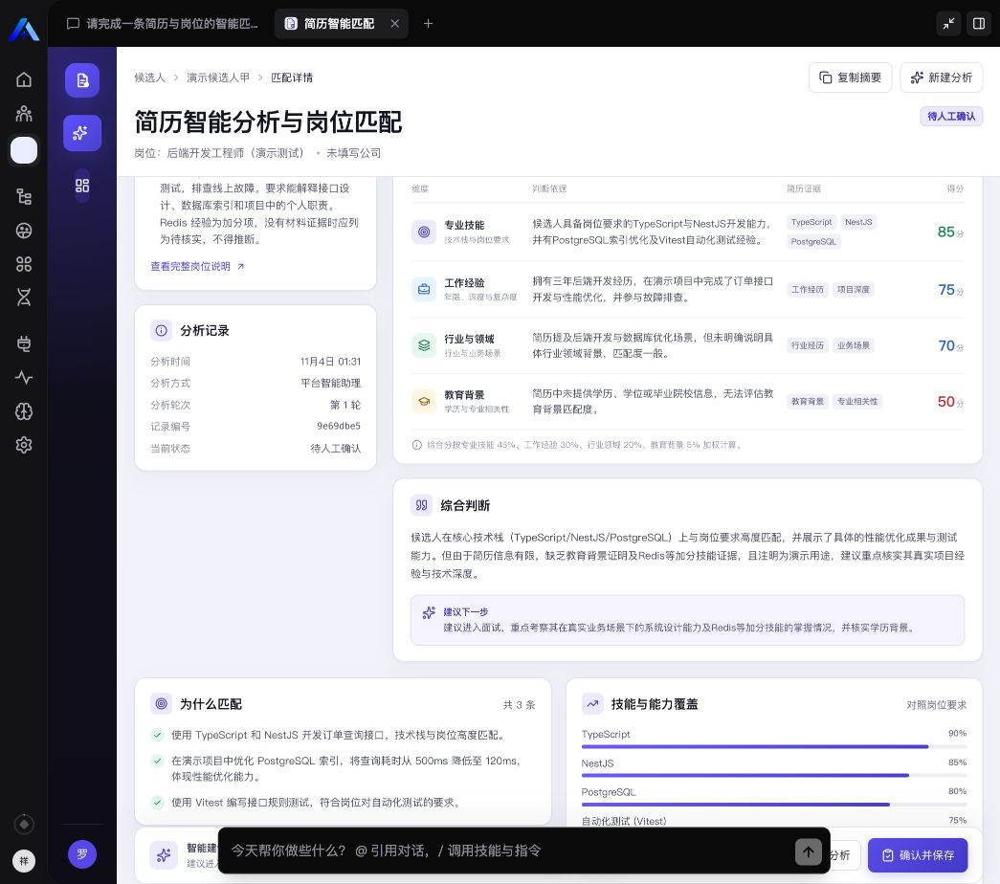
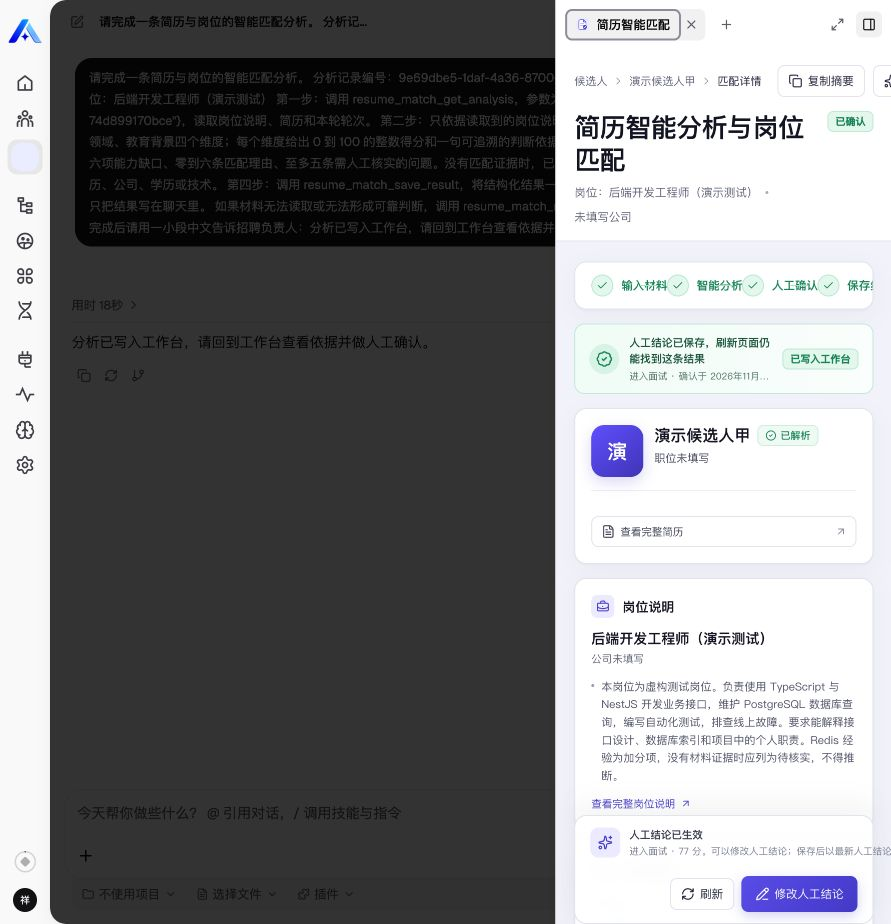

# 简历分析与岗位匹配工作台

面向招聘负责人，把一份岗位说明与一份简历整理成可追溯的分析草稿，人工复核、修改并确认后保存。AI 帮助阅读自由文本、整理匹配依据和待核实问题，最终决定由人完成。

## 业务流程

输入岗位与简历 → 保存原文快照 → Assistant 调用模型分析 → 工具写入结构化草稿 → 人工修改和确认 → 历史回看。

核心状态为 `waiting_ai`、`review`、`confirmed`、`failed`。重新分析复用原业务记录并开启新 `attempt`；修订检查防止旧页面或迟到结果覆盖新状态。重复的同一草稿写入与相同人工确认返回已有结果。

不包含批量导入、OCR、外部招聘系统对接、自动录用或淘汰、对外发送信息。所有示例均用于演示；工作量与节省时间尚未经过用户调研或测量。

## 实现

- TypeORM 实体保存岗位、简历、分析草稿、失败原因、轮次及人工结论。
- 中间件工具：`resume_match_get_analysis`、`resume_match_save_result`、`resume_match_mark_failed`。
- Workbench 通过 View provider 和宿主桥接查询及执行动作；人工确认只属于视图操作。
- Assistant 模板负责模型和业务工具编排。插件安装与 Assistant 创建、绑定、发布是独立步骤。
- 所有数据查询与更新限定可信上下文中的租户、组织和用户范围。

详见 [产品和验收说明](docs/requirements.md) 与 [验证记录](docs/verification.md)。

## 开发与构建

在 `community/` 工作区执行，使用该工作区声明的包管理器。平台仓库另有自己的包管理器版本。

```sh
corepack pnpm install --frozen-lockfile
corepack pnpm --filter @xpert-ai/plugin-resume-match typecheck
corepack pnpm --filter @xpert-ai/plugin-resume-match test
corepack pnpm --filter @xpert-ai/plugin-resume-match build
corepack pnpm --filter @xpert-ai/plugin-resume-match verify:dist
```

该插件没有独立 lint 脚本。`test` 执行真实业务规则与输入边界测试，不是占位脚本。

需要真实数据库验证时，先构建，再将隔离测试库连接通过 `RESUME_MATCH_TEST_DATABASE_URL` 注入当前进程，执行 `corepack pnpm --filter @xpert-ai/plugin-resume-match test:integration`。测试库必须为空且名字以 `resume_match_test_` 开头；不能使用平台业务库。

服务端编译为 CommonJS，包入口为 `index.cjs`。分发资源包含 `dist` 下的服务端、Remote View JS/CSS 和 Assistant YAML。界面维护源为 TSX，生成资源应通过构建更新。

## 安装与使用

先准备与插件 SDK 兼容的 Xpert 开源版源码环境、数据库、模型配置和有安装权限的测试账号。当前插件声明 `system` 级别，安装于 Default 租户的 tenant scope；不能按 organization scope 安装。

确认宿主允许加载插件路径，然后在平台根目录查看实际命令：

```sh
corepack pnpm plugin:deploy:local --help
corepack pnpm plugin:deploy:local \
  --plugin-dir <plugin-repo-root>/community/apps/resume-match \
  --scope tenant --api-url <api-origin>
```

凭证使用平台支持的登录凭证存储，不能写进命令示例或提交文件。按实际宿主要求补充租户标识；部署返回需要重启时，重启选定宿主并验证插件已运行。

非敏感连接项示例见 [env.example](env.example)。模型服务及其凭证在 Xpert 中配置，本插件不直接保存模型 API Key。

本次实际通过 UI 安装：切换到默认租户治理 → 插件 → 安装插件 → 本地工作区，填写包名及插件目录，预安装后重启 API；回到业务组织，从插件“初始化”选择组织工作空间和可用模型。

随后从插件模板创建 Assistant，选择已配置且可调用的模型，确认中间件和工作台绑定，保存并发布。新建分析、查看草稿、修改人工结论、确认后刷新验证恢复。已有 Assistant 应从模板更新，避免反复创建重复实例。

## 真实平台验证

2026-11-04 在本地 Xpert 开源版内完成插件安装、Assistant 发布、通义千问 / 百炼真实调用、人工改写保存、整页刷新恢复、材料不足失败与同记录第 2 轮重试。全部候选人与岗位材料为虚构测试数据。






[输入页面](docs/screenshots/input.jpg) · [Assistant 安装完成](docs/screenshots/assistant-installed.jpg)

这组失败证据来自真实模型判断“材料不足”，不代表模拟了供应商断网或限流。独立 PostgreSQL 集成测试另覆盖模拟模型超时、并发与数据范围边界，详见验证记录。`assets/workbench*.png` 是早期模拟预览，不作为平台验收证据。

人工结论允许使用当前 revision 显式修改，旧版本修改被拒绝；只保存最新人工结论，保留 AI 原文，不提供完整人工编辑历史。评分权重尚未经业务样本校准，不代表录用概率。

## 复用与许可

插件基于 Xpert community 包骨架，复用宿主 SDK、React、共享 shadcn UI 与 Lucide 图标；结构参考仓库中的业务应用。应用声明 AGPL-3.0，第三方依赖保留各自许可证。具体复用范围、版本与本次改动见 [产品和验收说明](docs/requirements.md)。
