# 简历初筛 Agentic App

面向 HR 和招聘负责人的 Xpert 业务插件。将岗位要求、简历材料、AI 评分依据和人工结论放在同一工作台，减少重复阅读，统一初筛标准，并保留可追溯的复核结果。

原有工作方式是逐份对照 JD 阅读简历，再在表格中手工记录分数和理由；材料与结论分散，重复复核成本高，也难追溯人工调整。

## 产品流程

创建筛查单 → 录入岗位要求和文本简历 → 选择候选人 → AI 读取材料、预筛并保存五维评分 → 人工查看依据、确认或调整 → 保存并恢复结果。

- 筛查单列表支持查询、查看、编辑和关联简历数量展示。
- 候选人支持资料查看与编辑、技能标签去重、单人或勾选评分。
- AI 原始分、人工调整、复核备注、材料快照与历史评分分别保留。
- 当前评分明确区分 AI 原始分和人工调整；历史评分不含当前结果，并显示已记录的评分时间，旧记录缺失时间时显示“未记录”。
- 简历修改后提示重新评分；重评保留历史，人工结论需重新复核。
- 模型只提供评分建议，人工确认通过工作台完成。

使用 TypeScript、Xpert SDK、NestJS/TypeORM、React、LangChain/Zod 和共享 shadcn UI。工程结构参考同仓 procurement-quote-comparison，适用 AGPL-3.0；复用范围与 AI 协作说明见交付手册。

## 构建与运行

在插件仓库的 `community` 目录执行：

```powershell
corepack pnpm install --filter @xpert-ai/plugin-resume-screening... --frozen-lockfile
corepack pnpm --filter @xpert-ai/plugin-resume-screening lint
corepack pnpm --filter @xpert-ai/plugin-resume-screening test
corepack pnpm --filter @xpert-ai/plugin-resume-screening verify:dist
```

在 Xpert 宿主根目录通过官方命令安装：

```powershell
corepack pnpm plugin:deploy:local `
  --plugin-dir <plugin-repo-root>/community/apps/resume-screening `
  --scope tenant --api-url <api-origin>
```

插件声明为 system level，安装在 Default tenant，凭据使用管理员登录身份，通过安全环境变量提供。按安装回执重启并确认 `loaded` 后，再从插件模板创建、发布助手，验证工具和工作台。

- [交付与运行手册](docs/DELIVERY.md)：环境与版本、六步安装、使用和实现；[AI 协作与复用](docs/DELIVERY.md#7-ai协作与复用)、[已知限制](docs/DELIVERY.md#8-已知限制)。
- [验收清单](docs/CHECKLIST.md)：验收标准、已执行检查、结果和证据。
- [配置示例](env.example)：环境变量名称与空值示例。

## 实际运行截图

以下为应用在 Xpert 中的真实截图，岗位与候选人均为虚构。截图中的分数用于展示功能，不是每次模型调用的固定预期。

### 插件安装与助手创建

安装并重启后，平台显示已加载的插件。模板提供助手及中间件依赖，可直接用于创建助手。

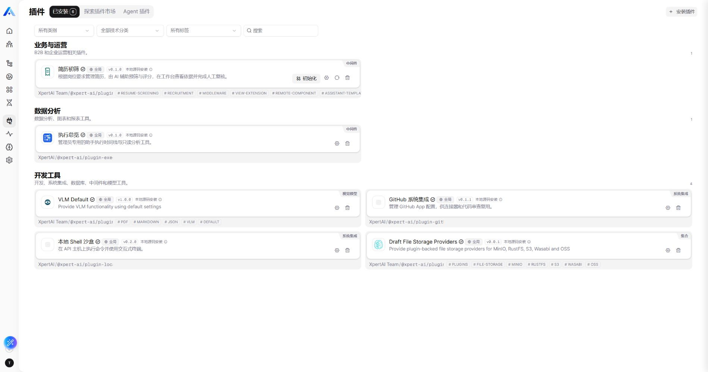


使用模板安装向导创建并发布助手，完成后进入助手画布检查绑定。

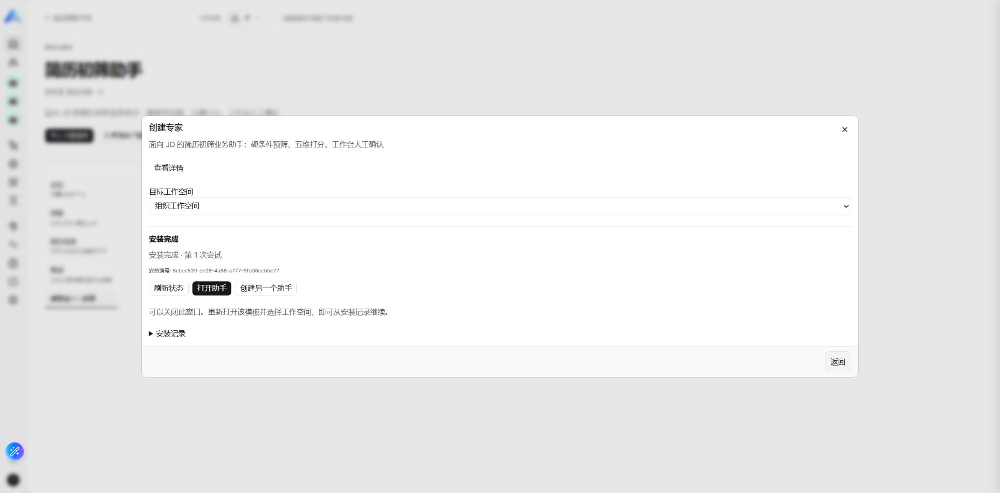

发布画布展示模型、ResumeScreeningMiddleware 和五个简历工具；助手通过工作台处理业务记录。

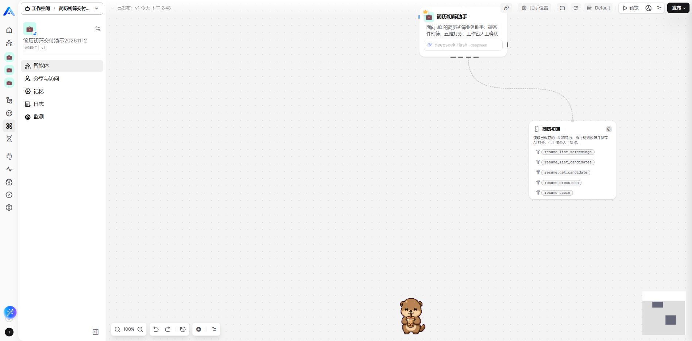

### 业务界面与用户输入

筛查单列表按岗位组织业务记录，展示关联简历数，支持查看、编辑和进入。

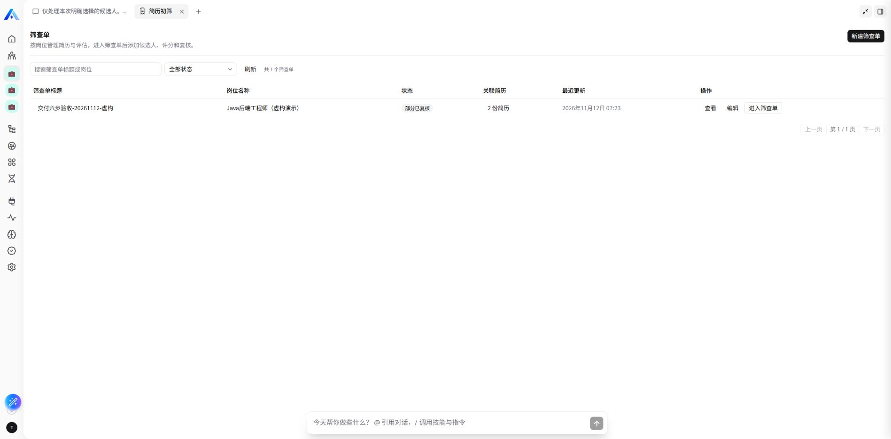

进入筛查单后，候选人列表提供查询、添加、选择评分、简历详情和人工确认入口。简历录入包含技能标签、正文提纲和评分证据提示。

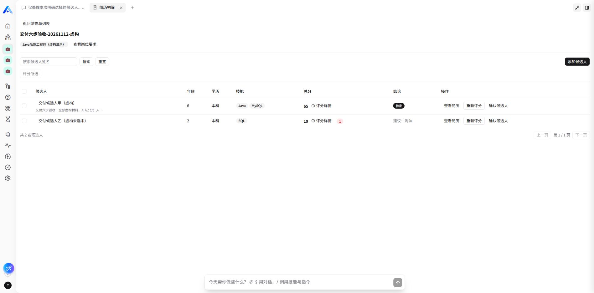
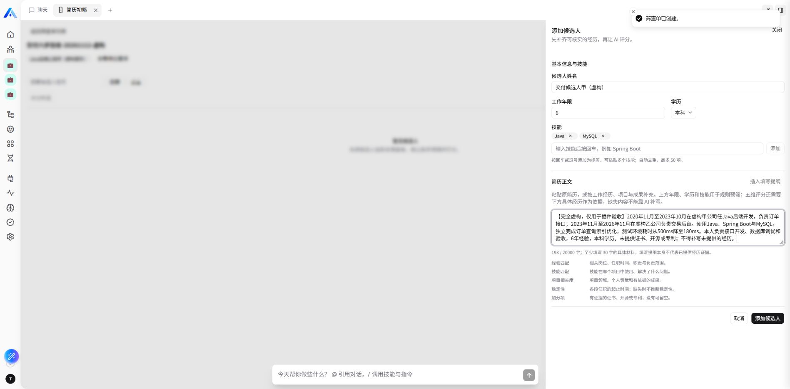

### AI 对话与工具调用

助手只处理明确选择的人选，读取已保存材料、执行规则预筛并保存五维评分。

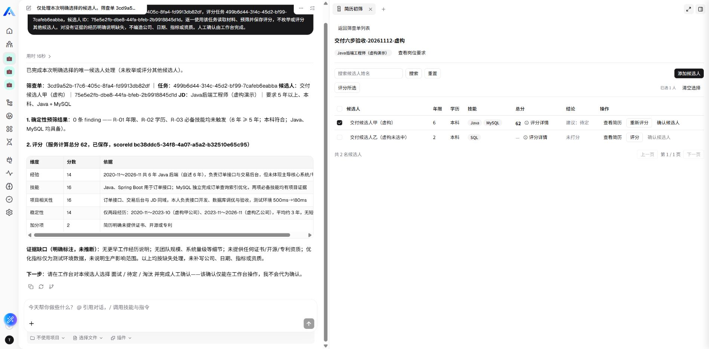
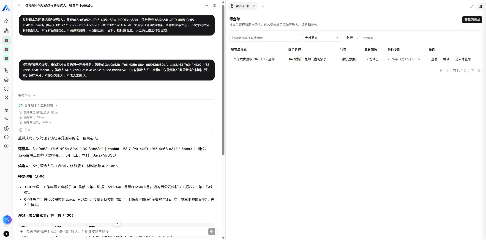

### 当前评分与历史记录

评分详情区分 AI 原始分与人工调整后的分数，展示五维依据、人工结论和备注。清空调整值可恢复 AI 原始分；刷新后仍可查看已保存结果。

以下两图来自更新后的 Xpert 实际页面，展示同一虚构候选人的当前结果与历史记录：当前 AI 分为19，尚未人工确认；历史中保留了此前人工调整到30分的版本，以及更早的22分版本。不同版本的分数和理由可以不同。

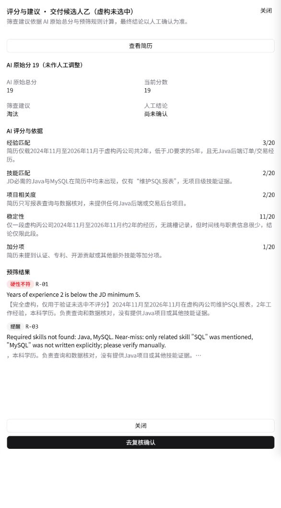

“历史评分（不含当前）”注明旧结果的范围，并区分 AI 分与当时的人工调整。旧记录没有保存评分时间时显示“未记录”，不补造日期；新评分会记录实际保存时间。

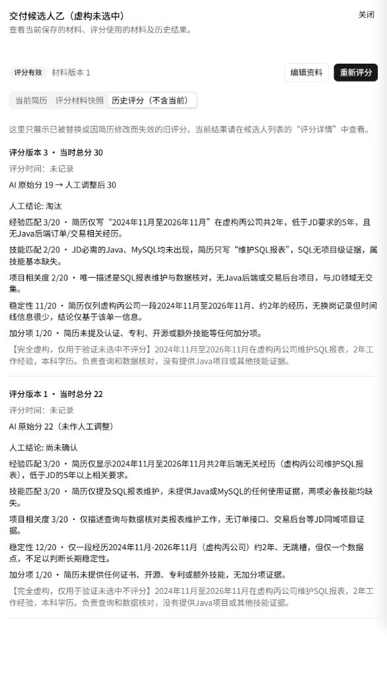

### 校验与失败重试

必填缺失和非法年限会显示明确提示。模型不可用时保留业务结果，恢复配置后可以重试同一任务。

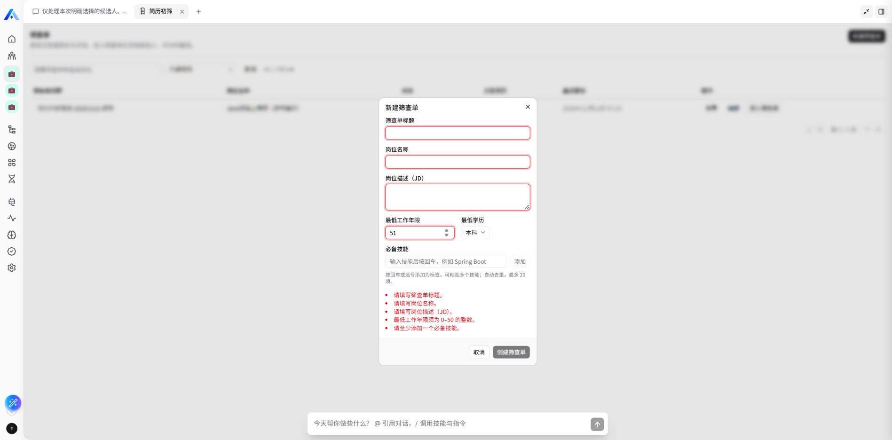
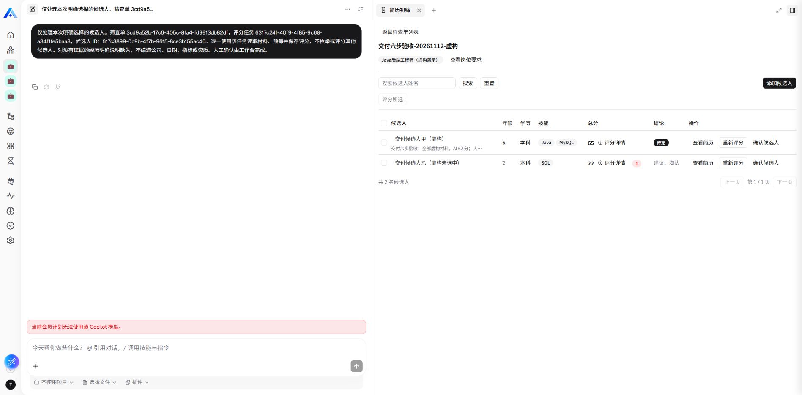
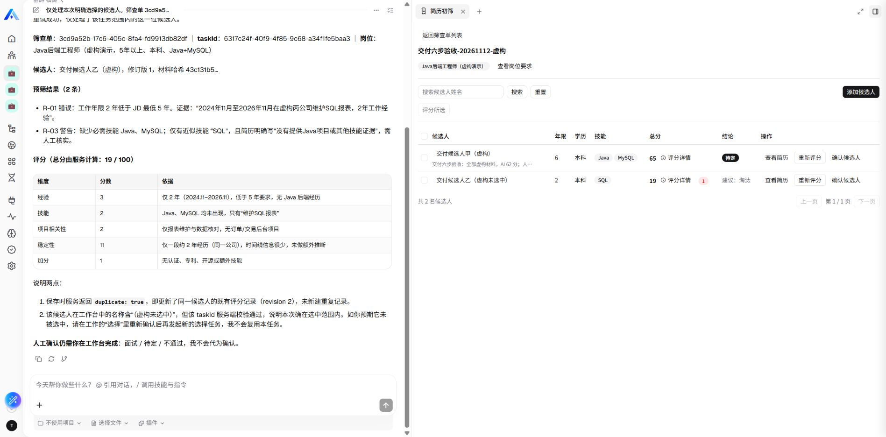

## 验证结果与限制

默认测试 64 项：63 通过、1 项 PostgreSQL opt-in 跳过、0 失败；PostgreSQL 单独集成测试 1/1 通过。类型检查、构建、产物一致性、元信息和生命周期检查通过。真实平台已验证业务闭环、保存恢复、输入校验、模型失败重试及指定账号权限范围。评分标识和旧历史时间提示已在重新部署、重启及完整刷新后的 Xpert 页面复验，已有业务数据保持一致，详见验收清单。

支持文本 JD 和简历，不包含 PDF/OCR、批量文件导入或完整招聘管理。尚未覆盖供应商真实429/超时、长批次任务取消和全部角色/设备组合。宿主版本及兼容补丁要求见运行手册；未验证全新机器和所有操作系统的完整部署。
