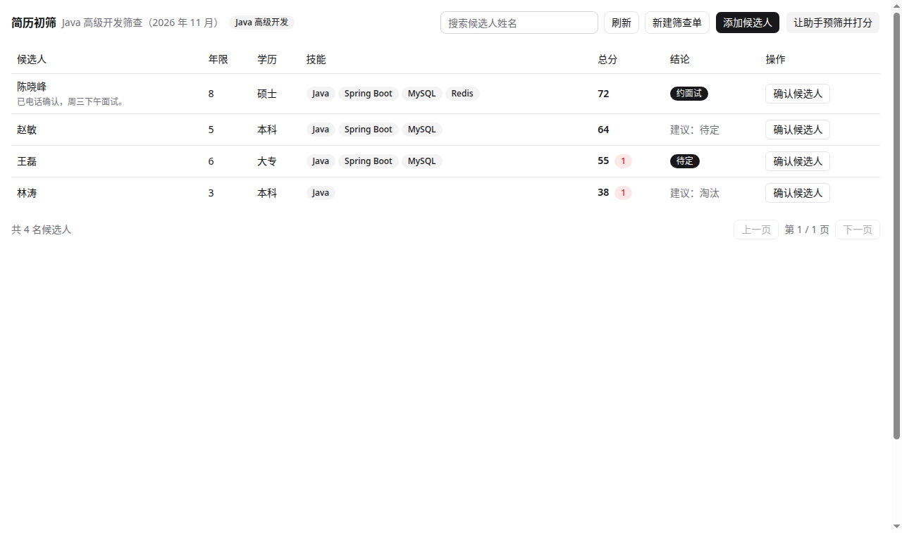
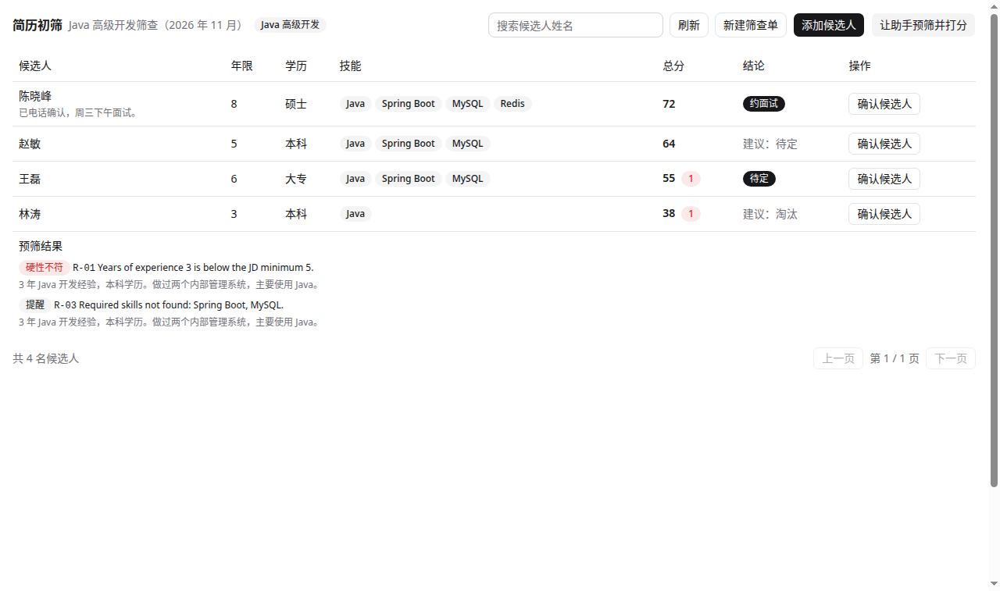
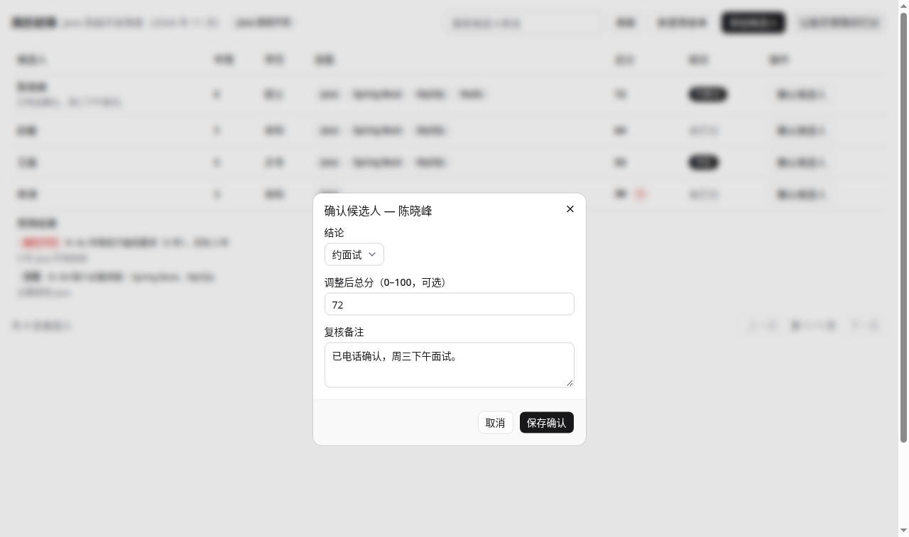
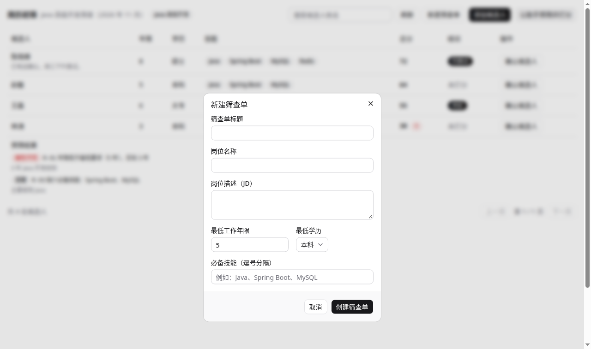

# Resume Screening

简历初筛 Agentic App 插件（Xpert 面试作品，开发中）。

> 状态：选题已定为简历初筛，骨架尚未实现。本分支 `feat/resume-screening` 仅含本文档，
> 后续提交按“骨架 → 规则预筛 → AI 打分 → Workbench 确认保存 → 测试与真平台验证”递进。
> 此前 Listing 选题已暂停，分支由 `feat/listing-compliance-check` 改名而来，旧说明已替换。

## 选题：为什么是它

- **目标用户**：中小公司 HR / 招聘负责人，一次收到几十上百份简历，要先筛出一批约面试的人。
- **原有工作方式与痛点**：一份一份打开简历，对着 JD（Job Description，岗位要求）逐条核对，
  慢、标准不统一、筛完的理由没留下来，换个人复核要重来一遍。
- **AI 的作用**：确定性规则先筛硬条件（年限、学历、必备技能缺失等），
  模型只做判断与打分（按 JD 的 5 个维度给分、每维一句话理由、总分排序），
  最终由人在 Workbench 确认“约面试 / 待定 / 淘汰”，可改分、可写备注。
- **为什么 2–6 小时做得完**：只做一条闭环、一个岗位、只做文本简历，
  不做图片简历解析、多岗位、多智能体、自动发面试邀请。
- **为什么是我能讲的题**：做过招聘系统从 0 到 1（需求发起至入职闭环，Moka 历史全量迁移），
  知道 HR 真正的筛人动作是什么，不是从外面猜的。

## 核心流程（最小完成范围）

1. 创建筛查单：输入岗位名称、JD 文本（职责 + 任职要求）、上传或粘贴 2–3 份演示简历（均为虚构数据）。
2. 规则预筛：服务端确定性检查硬条件，不符合的先标出（附规则编号与原文证据），不直接淘汰，只降权。
3. AI 处理：助手调用工具，逐份简历按 5 个维度打分（经验匹配、技能匹配、项目相关度、稳定性、加分项），
   每维 0–20 分，总分 100 分，附每维一句话理由，输出结构化 JSON。
4. 人工确认：Workbench 里按总分排序，逐份确认 / 改分 / 写备注 / 改结论（约面试 / 待定 / 淘汰）。
5. 保存与恢复：保存后刷新或重新进入，能找回筛查单、JD、每份简历的分数与确认结论。
6. 失败重试：模型或保存失败时显示可理解的原因，重试不重复建单、不重复保存（按 screeningId + candidateId 幂等）。

## 筛查口径（打分刻度、过线标准、同义词）

### 打分刻度

5 个维度各 0–20 分，每维分 4 档，模型必须按简历证据落在对应档内打分，不许虚高
（刻度唯一来源是 `src/lib/types.ts` 的 `SCORE_RUBRIC`，工具描述与助手模板引用同一份）：

| 维度 | 16–20 强 | 11–15 较强 | 6–10 一般 | 0–5 弱 |
| --- | --- | --- | --- | --- |
| 经验匹配 | 8 年以上相关经验，且主导过核心模块/系统 | 5–8 年相关经验，明确负责过主要功能 | 2–5 年相关经验，多为辅助角色 | 2 年以下相关经验，或经验与 JD 无关 |
| 技能匹配 | 必备技能齐全且有项目实证 | 大部分必备技能有项目实证，缺一项次要技能 | 约一半必备技能，或实证单薄 | 必备技能大多缺失，或只提到没实证 |
| 项目相关度 | 主导过与 JD 同领域核心项目 | 在相近项目里担任可见角色 | 项目领域与 JD 弱相关 | 无 JD 领域项目 |
| 稳定性 | 平均在职 4 年以上，无短期跳槽 | 平均 2–4 年，最多一次短期跳槽 | 平均 1–2 年，或两次短期跳槽 | 频繁跳槽，平均不足 1 年 |
| 加分项 | 有证据的稀缺区分项：开源维护、专利、领域证书 | 一项扎实的加分项，如相关证书或亮眼副项目 | 轻微加分，如相关工具或次要技能 | 无加分项 |

### 过线标准（建议结论，非自动决策）

总分满分 100，建议结论由 `suggestDecision` 按总分与预筛结果算出，人在 Workbench 里仍可改：

| 条件 | 建议结论 |
| --- | --- |
| 总分 ≥ 70，且无 error 级预筛发现（R-01/R-02） | 约面试 |
| 总分 ≥ 70，但有 error 级预筛发现 | 待定（只降权，不直接淘汰） |
| 总分 50–69 | 待定 |
| 总分 < 50 | 淘汰 |
| 未打分 | 无建议 |

### 同义词与近似匹配（R-03）

- 技能比较先归一化（小写、去掉空格/连字符/下划线），`spring-boot`、`SpringBoot` 与 `Spring Boot` 是同一技能。
- 别名表（`SKILL_ALIASES`，有意的等价口径）：`Spring Boot` 接受 `Spring` 与 `Spring Framework`；
  `MySQL` **不接受** `SQL`——SQL 是上位技能，不是 MySQL 的证据。
- 近似提到（互为子串但不等，如简历只写 `SQL` 而要求是 `MySQL`）算 near-miss：
  仍报 R-03 warning，并在 message 里写明“仅提到相关技能 X，未明确写出 Y，请人工复核”。
- R-03 合并成一条 finding，列出全部缺失技能（如 `Required skills not found: Spring Boot, MySQL.`），
  不再缺一个报一条。

## 功能取舍

- 做：文本 JD + 文本简历、5 维打分、排序、人工确认、保存恢复、失败重试。
- 不做：PDF/图片简历解析、自动发面试邀请、人才库、多岗位对比、权限分级。
- 演示数据全部虚构，不含真实个人信息；JD 以 Java 高级开发为例（5 年以上、JVM、Spring、MySQL 等）。

## 成本：Token 测算

一份简历约输入 3400 token（JD 约 800 + 简历约 1800 + 提示词与工具定义约 800）、输出约 500 token。
按 DeepSeek Flash（非高峰输入 $0.15、输出 $0.60 每百万 token）约 $0.0008，合 0.006 元；
高峰约 $0.0016，合 0.012 元。100 份约 0.6–1.2 元。省 token 的做法：
一份一份调、不把历史简历留在对话里、输出只出分数与一句话理由、硬条件先用规则筛。

## 实现计划（脚手架 + 最小模板参照）

- 先用仓库脚手架生成骨架：`pnpm create:package --scope apps --name resume-screening`
  （注意：该脚本只生成通用占位包，仍需按业务应用补齐能力），再参照全仓最小的 Agentic App
  `community/apps/procurement-quote-comparison`（340K）补齐业务能力，不直接复制其业务代码。
- `src/index.ts`：`XpertPlugin` 入口，`level: 'system'`，`targetApps: ['data-xpert']`，
  `artifactNamespace: 'resume_screening'`（同时写进 `package.json` 的
  `xpert.plugin.artifactNamespace`，`meta.version/level/artifactNamespace` 从 `package.json` 派生，
  按仓库 `AGENTS.md` 跑 `node scripts/check-plugin-metadata.mjs --package` 核对），
  `types: ['workbench-view', 'assistant-tool', 'business-app']`。
- `src/lib/resume-screening.plugin.ts`：`@XpertServerPlugin` 注册实体、服务、中间件、视图。
- `src/lib/resume-screening.middleware.ts`：助手工具（zod 严格 schema）：
  `prescreenResume`（确定性硬条件）、`scoreResume`（AI 打分保存）、`confirmScreening`（人工确认）。
- `src/lib/resume-screening.service.ts`：业务服务与持久化，失败状态与重试幂等。
- `src/lib/entities/`：`ResumeScreening`、`ResumeCandidate`、`ResumeScore`
  （表名经 `pluginArtifactTableName` 生成，`plugin_resume_screening_*`）。
- `src/lib/resume-screening-view.provider.ts` + Remote Component：Workbench 确认视图，
  用 `@xpert-ai/plugin-shadcn-ui` 共享组件，文案放 `remote/locales/<locale>.json`，
  不用原生控件、不在 JSX 里写双语文案分支（仓库 `AGENTS.md`）。
- `src/xpert-resume-screening-assistant.yaml` + templates：助手模板（工具、提示词、starter 问题）。
- `tests`：规则单测（硬条件边界）、打分保存/恢复、失败重试不重复。

## 基线版本（开始开发时 main）

- 插件仓库 `xpert-ai/xpert-plugins` main：`9bfa96594a3debbb33f0ba25c7ade49e7d360c8b`
- 平台仓库 `xpert-ai/xpert` main：`ba8736c897474f7db9a261aa5f64d95860bb9f60`
- Skills 仓库 `xpert-ai/xpert-skills` main：`4ad12dcc9292d9b05021d4f5b93f24865c99e811`

## 界面截图（本地预览渲染，2026-11-10 更新：含建议结论列与合并后的 R-03）

用仓库自带的 `tools/remote-view-preview` 渲染真实远程组件（`dist` 产物 + shadcn 共享组件），
数据为虚构候选人（mock host），**不是 Xpert 真平台截图**；真平台截图待平台环境就绪后补。
本地预览配置已随代码提交：`src/lib/remote-components/resume_screening__remote/preview.config.mjs`
（`node tools/remote-view-preview/cli.mjs --config <该文件>`）。

## 验证结果（2026-11-10，提交 5e90e6ce，父代理独立复验）

- [x] `pnpm --filter @xpert-ai/plugin-resume-screening build`：全绿（远程 vite 构建 + tsc lib + copy-assets）
- [x] `pnpm --filter @xpert-ai/plugin-resume-screening test`：**16/16 通过**（预筛边界 10、保存/恢复 3、重试不重复 3；2026-11-10 晚筛查完善后由 13 增至 16）
- [x] `pnpm --filter @xpert-ai/plugin-resume-screening lint`：通过（spec typecheck + remote:typecheck）

### 筛查完善（2026-11-10 晚，已验证并推送）

- 新增打分刻度 `SCORE_RUBRIC`（每维 16–20 / 11–15 / 6–10 / 0–5 四档锚点），已写进
  `resume_score` 工具描述、维度 score 的 zod 描述与助手模板第 3 步；README 有中文对照表。
- 新增过线标准 `suggestDecision`（≥70 约面试、50–69 待定、<50 淘汰；有 error 级预筛发现时最高待定；
  未打分无建议），Workbench 结论列未确认时显示“建议：约面试/待定/淘汰”。
- 同义词与近似匹配：技能归一化去空格/连字符/下划线；`Spring Boot` 接受 `Spring`/`Spring Framework`
  （有意的等价口径）；`MySQL` 不接受 `SQL`，仅提到相关技能算 near-miss，R-03 内注明人工复核；
  R-03 合并成一条，列出全部缺失技能。
- 新增本地预览配置 `preview.config.mjs`（4 名虚构候选人）；冒烟验证：preview-host 启动成功，
  `requestData` 按总分倒序返回、`confirm_candidate` 按 `baseRevision` 校验并更新、state 随之变化。
  渲染截图已重截：主表与预筛展开两张已更新为含建议结论列、合并后 R-03 的新界面（父代理独立复验）。
- [x] `plugin-dev-harness` 生命周期测试：通过（register → onStart → onPluginBootstrap → onPluginDestroy → onStop）；harness 用 mock，不能据此宣称真实数据库或业务流程已通过
- [ ] `node scripts/check-plugin-metadata.mjs --package`：本机跑不起来（`Cannot find module 'typescript'`，`xpertai/node_modules` 未安装）；已手动核验替代：`dist/index.js` 的 meta 与 package.json 一致
- [ ] 本地 Xpert 真平台验证：完整流程 + 保存恢复 + 失败重试截图（待平台环境就绪；本机无 Docker）
- [ ] PR 描述附基线 SHA、测试结果、截图（相对路径放本目录 README）

备注：`verify:dist` 首次曾报过期，重跑一次完整 build 后通过，根因未完全定位；
助手模板的 `copilotModel: qwen3.6-plus` 是仓内多应用共用的示例模型（factory、sales、valve 等均用同一值），非新编模型名。

## 已知限制 / 待核验

- 本机暂无 Docker，Xpert source-hybrid 本地平台尚未跑通，真平台验证待补。
- 模型不由平台免费提供：平台只提供“模型提供商”配置入口，模型本身与费用需自带 Key
  （候选：已在用的 DeepSeek Flash，需确认测试实例支持该提供商）。
- pnpm 已按仓库要求装为 8.15.8。
- 演示简历全部虚构；只做文本，不做 PDF/图片解析。

## 复用说明

- 结构参照 `procurement-quote-comparison`（AGPL-3.0，同仓），按本选题重写业务逻辑、实体与文案。
- 不复用已在仓内的 `dockyard`（0.4.1，他人面试作品，未完成最终验收且依赖宿主改动）。
- 开发工具：Muse + Codex/Claude Code 按需选用，过程与选择见 PR 描述的 AI 协作说明。
