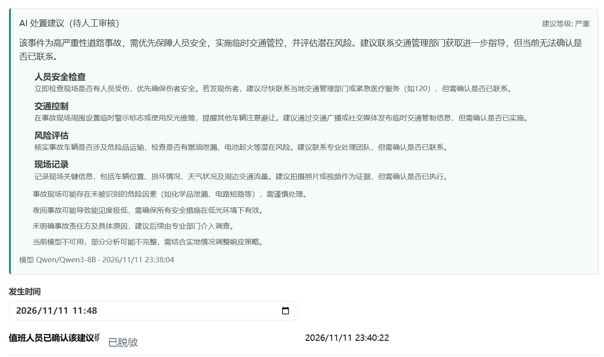

# 道路事件智能指挥中心

面向道路事件值班人员的 Xpert 业务应用插件。值班人员在工作台登记道路事件、在地图上标注位置，由当前 Assistant 调用其已配置的模型生成结构化处置建议；值班人员可审核确认。草稿、建议状态及确认记录由插件服务持久化，重新打开或刷新后可恢复。

## 业务流程

1. 从 Xpert 的智能体模板创建“道路事件草稿助手”，打开其“道路事件”工作台。
2. 填写事件标题、类型、严重程度、地点、事件描述和发生时间；在天地图上选点或手动填写坐标。地图不可用时仍可手动输入坐标。
3. 保存草稿。插件服务按宿主提供的租户、组织、工作区、用户及 Assistant 上下文隔离数据，并使用乐观锁避免旧页面覆盖新版本。
4. 在 Assistant 对话中请求生成处置建议。工具使用当前 Assistant 的模型配置，返回结构化摘要、等级、行动项及注意事项，并与草稿一起保存。
5. 模型调用失败时，保留已保存事件并记录可重试状态；值班人员可在对话中再次请求。建议生成后，可在工作台记录人工确认者和确认时间。修改事件内容会清除过期建议及确认状态。

该项目不自动派单，也不执行外部处置操作；AI 建议仅供人工审核。

## 技术与结构

- 前端：Vue 3、TypeScript、OpenLayers；通过 Xpert Remote Component 宿主桥接访问工作台数据与动作，不在 iframe 中直接请求平台 API。
- 插件服务：Xpert 插件运行时、TypeORM；草稿与建议写入 Xpert 插件数据库，并按可信宿主上下文隔离。
- 地图：天地图矢量底图与中文注记；生产使用的 Token 通过本地环境配置注入，不提交到仓库。
- 目录：`src/lib/` 插件、服务和 Assistant 工具；`src/lib/remote/` Vue 工作台；`tests/` 自动化测试。

## 本地检查

要求 Node.js 22、Corepack 和 pnpm。于仓库根目录执行：

```bash
corepack pnpm -C community --filter @community/apps-road-event-command-center typecheck
corepack pnpm -C community --filter @community/apps-road-event-command-center test
node plugin-dev-harness/dist/index.js --workspace ./community --plugin @community/apps-road-event-command-center
```

`typecheck` 覆盖插件服务和 Vue Remote View 类型检查；`test` 执行生产构建和自动化测试。`plugin-dev-harness` 用于检查插件生命周期能否加载和关闭；它不替代真实 Xpert 业务验收。

仅预览界面时，在插件目录复制 `.env.example` 为 `.env.local`，填写 `VITE_TIANDITU_TOKEN`，然后运行 `corepack pnpm run dev:preview`，访问 `http://localhost:4175/preview.html`。本地预览使用浏览器存储模拟宿主，不能证明 Xpert 数据库持久化或模型调用成功。

## 验证记录

截至 2026-11-11：插件类型检查、生产构建、12 项自动化测试均通过；`plugin-dev-harness` 插件加载与关闭通过。测试平台源码 SHA：`ba8736c897474f7db9a261aa5f64d95860bb9f60`；插件上游克隆基线 SHA：`9bfa96594a3debbb33f0ba25c7ade49e7d360c8b`。

已在本地 Xpert Cloud 验证草稿保存和刷新恢复、天地图选点及坐标恢复、Assistant 使用真实模型 `Qwen/Qwen3-8B` 生成结构化建议并在工作台读取，以及人工确认后刷新仍恢复确认状态。以下截图来自实际 Xpert 工作台；确认人标识已脱敏。



自动化测试覆盖数据隔离、模型失败状态和保留草稿的重试语义；真实 Cloud 中的模型失败后由 Assistant 明确重试尚未完成端到端验收，不将模拟测试表述为平台运行结果。当前截图证明 AI 建议与人工确认状态，不覆盖失败提示/重试，也不替代完整演示。

## 复现与交付

在已运行的 Xpert 实例中安装此插件后，从智能体模板创建 Assistant，确保已配置可用聊天模型，再进入其“道路事件”工作台。保存事件并刷新验证恢复；通过 Assistant 生成建议，在工作台确认后刷新验证确认记录恢复。真实 Cloud 的模型失败与明确重试仍待验收，失败状态及重试语义目前由自动化测试覆盖。提交前应补充实际工作台输入与失败/重试截图；不得用本地预览或模拟测试截图替代 Xpert 运行证据。

本项目基于 `xpert-ai/xpert-plugins` 仓库的插件约定和现有 Remote Component / Assistant 工具模式实现；上游仓库许可为 AGPL-3.0，具体复用代码及归属应以对应源文件和仓库声明为准。开发中使用 OpenAI Codex（GPT-5）辅助需求拆解、实现草稿、测试补充和错误排查；开发者检查了 Xpert 宿主桥接、插件可信上下文与持久化实现，依据实际 Cloud 行为修订了助手提示及验收范围，并通过构建、自动化测试和平台手动操作核验结果。业务处置建议由测试平台当前配置的 `Qwen/Qwen3-8B` 生成。最终行为、接口上下文、测试结果与限制由开发者核对。

## 已知限制

- 需要 Xpert 插件安装权限、已配置的 Assistant 聊天模型及可用的天地图 Token。
- 天地图不可用时可手动输入坐标；底图的跨域、网络和 Token 配额受外部服务影响。
- 当前不包含自动派单、实时路况接入、多部门协同或真实应急指挥联动。
- 真实 Cloud 的人工确认刷新恢复已验收；模型失败后的 Assistant 重试端到端验收、工作台输入和失败/重试截图仍待补齐。
