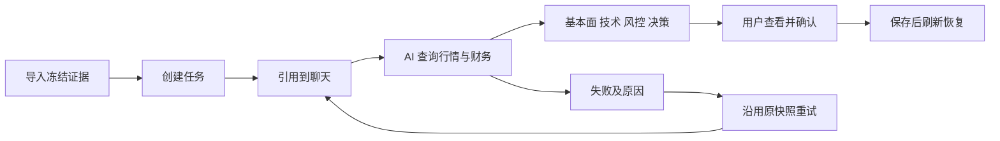
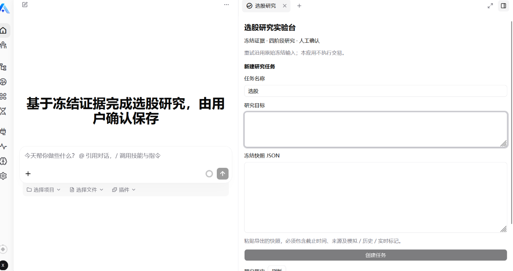
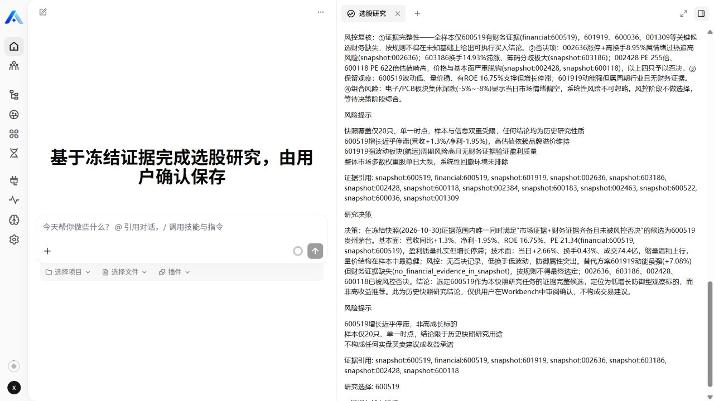
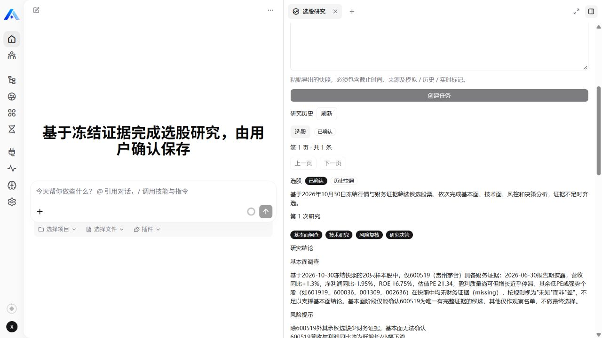
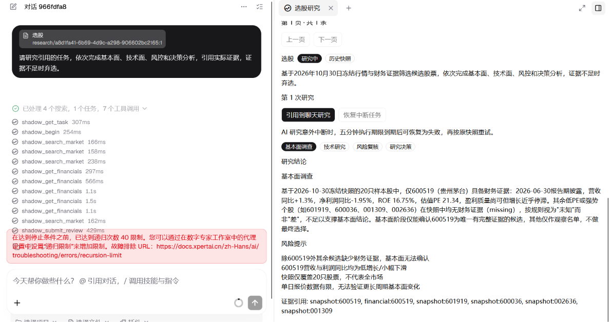
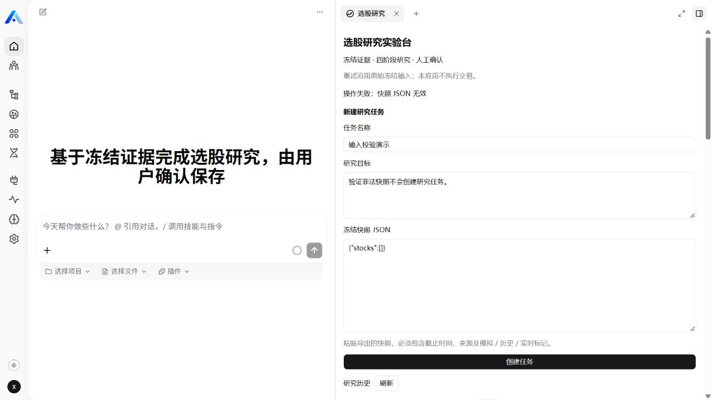

# 选股研究实验台

为需要整理候选股票与研究依据的研究者提供一个 Xpert Agentic App：导入冻结行情和财务快照，创建独立任务，由 Assistant 查阅证据、保存四阶段判断，再由用户确认。研究记录可刷新恢复，失败后沿用原快照重试。

本项目从既有影子实验流程拆出，原系统的正式推荐、私有评分、交易和回测数据库均不参与插件运行。首版只做历史证据研究，不提供收益保证或自动交易。

## 用户流程和 AI 的作用

原来的研究输入、判断与最终确认分散在实验输出中，难以作为独立任务复查。本应用把这些内容放在同一任务中，并通过固定输入指纹、阶段记录和修订号关联。



AI 根据工具返回的证据提出判断、风险和候选选择，服务端负责时间边界、状态顺序、证据引用、风险否决与持久化。人工确认不暴露为 Agent 工具。一个 Assistant 分四阶段研究，不宣称四个独立模型或子 Agent。

可观测指标是任务是否完成、四阶段是否保存、确认后是否可恢复、重试是否保持同一任务和输入。当前没有测量节省工时或投资收益。

## 在真实 Xpert 中运行

2026-11-04 已在开源 Xpert main 提交 `3ddc380ca20373f9113a77411090de3c3da75e37` 上安装运行。通义千问 `qwen3.8-flash` 实际调用了选股工具并保存四阶段结果；用户已人工确认，刷新和重新进入后结果仍在。工作台和结果截图如下。

输入入口：JSON 应粘贴到右侧工作台，而非聊天附件。



真实运行的决策与证据引用。截图是历史研究的模型原始输出，结论仍需人工核对，不代表收益效果或所有表述均已通过事实审计。



用户确认后重新进入页面，已确认状态与四阶段结果可恢复。



实际遇到过递归上限 40 导致中断，基本面已保存而后续阶段未完成。修复为 120 次预算，并限制重复查询；后续真实运行完成四阶段。这张是修复前故障记录，不冒充当前成功状态。



非法快照在工作台中显示明确错误，不创建任务。



完整验证范围和未验证项见 [验证记录](docs/validation.md)。原 `preview-*.png` 是模拟宿主与模拟模型测试素材，不作为真实模型验收证明。

## 技术与边界

| 层 | 实现 |
| --- | --- |
| 插件 | tenant 安装级别，稳定 namespace，NestJS 服务与 TypeORM 实体 |
| 业务 | 带 revision 的原子更新，创建幂等，五分钟执行租约，最多三次尝试 |
| Agent | ShadowResearchMiddleware，六个严格 Zod 工具，LangChain 原生调用 |
| 界面 | React，官方共享 shadcn 组件，隔离 iframe 和宿主数据动作桥接 |
| 持久化 | 宿主数据库，按 tenant、organization、workspace、user、Assistant 约束 |
| 模板 | Assistant YAML，四阶段研究、证据边界与人工确认 |

工具参数不接受用户自行指定安全范围。最终选择必须有已返回的市场与财务证据，且不能被风险阶段否决；证据不足可以弃选。程序校验引用和状态，不保证模型每一句自然语言解释都正确。

## 构建与测试

插件位于官方 `xpert-plugins/community/apps/shadow-research`。使用仓库 community 的 pnpm 版本；本次交付分支是 pnpm 8.15.8，Node 22.23.4。平台源码使用 pnpm 10.24.0，二者分别按各自仓库配置运行，不要混用锁文件。

从插件仓库根目录执行：

```sh
corepack pnpm@8.15.8 -C community install --frozen-lockfile --filter @community/apps-shadow-research
corepack pnpm@8.15.8 -C community --filter @community/apps-shadow-research run typecheck
corepack pnpm@8.15.8 -C community --filter @community/apps-shadow-research run build
corepack pnpm@8.15.8 -C community --filter @community/apps-shadow-research run test
python community/apps/shadow-research/tests/test_exporter.py
```

先按官方 `plugin-dev-harness/README.md` 安装并构建 Harness，再执行：

```sh
node plugin-dev-harness/dist/index.js --workspace ./community --plugin @community/apps-shadow-research
```

生命周期工具默认使用 Mock 基础设施，不能替代真实平台验收。独立源码目录也可用其包目录作为 `--workspace` 验证 dist 入口。部署与配置见 [安装说明](docs/installation.md)。

## 快照与演示

- [五只候选历史快照](examples/historical-2026-10-30.json)：从原 2026-10-30 导出数据中筛出五只有三项财务指标的候选，不补造数据；这是受限样本，不是全市场。
- [模拟快照](examples/synthetic-snapshot.json)：明确标记 synthetic，用于可重复测试，不代表真实公司数据。
- 原 20 只候选快照仅有五条财务记录；未知代表缺少证据，不代表公司业绩差。

原系统可选导出，不是运行依赖：

```sh
python scripts/export-shadow.py --db /path/to/experiments.db --day YYYY-MM-DD --limit 20 --output /path/to/new-snapshot.json
```

导出采用只读 SQLite，只允许公开行情和财务字段，不包含私有评分、提示词或凭据。日期型披露时间按次日可见处理。来源真实性及历史修订仍依赖导入方，时间校验不能证明供应商未修订数据。

[演示步骤](docs/demo.md) · [AI 协作说明](docs/ai-collaboration.md) · [版本来源](docs/provenance.json) · [复用与许可](THIRD_PARTY_NOTICES.md)

## 已知限制

无实时联网补财务、无历史 K 线序列、无交易与收益评测。五分钟租约和三次尝试是首版边界，复杂模型调用可能超时。已有真实输出出现过在单时点数据上使用“缩量”等超出证据的措辞；引用校验不能替代语义审计，用户应核对原始证据。多人跨组织的真实平台隔离尚未双账号验收；业务测试已覆盖用户及租户隔离，真实 API 已验证匿名访问被拒绝。
