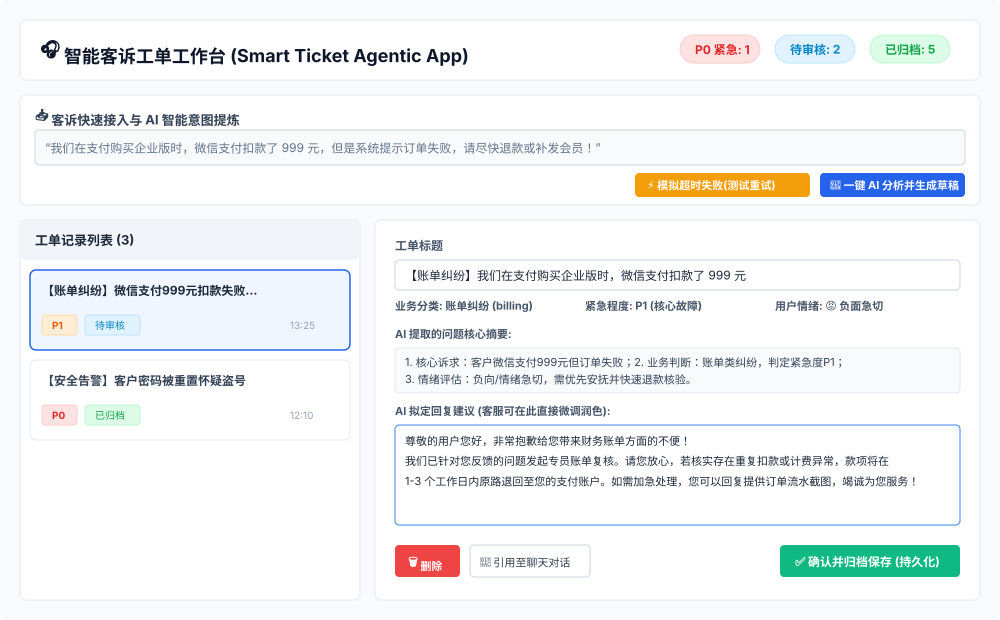
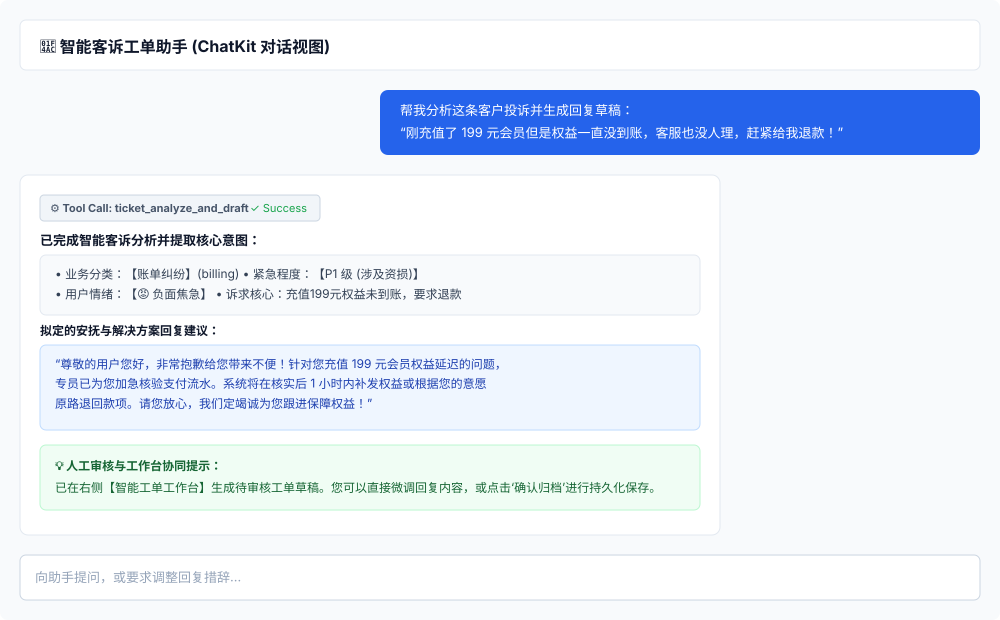
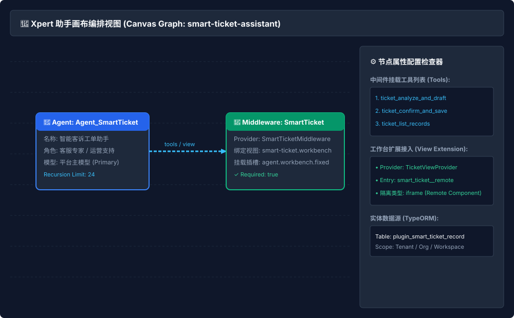

# 智能客诉工单工作台 (Smart Ticket Agentic App)

> **Xpert 业务应用开发面试实作作品**  
> 运行在 Xpert 平台上的业务应用插件，为客户成功、售后技术支持与运营团队打造从**客诉输入 $\to$ 意图/情绪/紧急度提炼 $\to$ 回复建议拟定 $\to$ 工作台人工核验微调（Human-in-the-loop） $\to$ 确认归档落库 $\to$ 数据恢复与幂等重试**的端到端业务闭环。

---

## 📑 面试材料与全套技术文档

| 序号 | 交付文档 | 核心内容概述 |
| :---: | :--- | :--- |
| **01** | [产品说明与范围](docs/interview/01-product.md) | 目标用户、原有工作方式与痛点、完整业务流程、功能取舍与工作台页面结构原型。 |
| **02** | [运行与部署说明](docs/interview/02-runbook.md) | 环境基线、构建指令、本地安装步骤、官方六步核对规范与环境变量示例。 |
| **03** | [验证记录与结果](docs/interview/03-validation.md) | 四层分级测试报告（9 项测试全绿）、真实测试用例报文证据与数据持久化验证。 |
| **04** | [AI 开发协作复盘](docs/interview/04-ai-collaboration.md) | AI 工具/模型选型、5 项代表性工程决策、实体正则排错、Node 20 环境定位与经验收获。 |
| **05** | [来源许可与 Git 交付](docs/interview/05-sources.md) | 平台与插件 main 基线 SHA、AGPL-3.0 许可声明、独立功能分支与 PR 规范。 |
| **06** | [面试要求逐项对照表](docs/interview/06-gaps-and-pr.md) | 任务书各项标准逐条核对清单、已知限制与可直接提交的 GitHub PR 描述模版。 |

---

## 🖼️ 实际运行与架构视图 (五大核心界面)

> 所有图片随插件源码一起提交，采用 Markdown 相对路径引用，确保在 GitHub 仓库及 PR 中可直接清晰显示。

### 1. 视图界面：智能客诉工单工作台 (Workbench)
双栏响应式工作台，支持工单记录按状态筛选（全部 / 待审核 / 已归档）、紧急度标签展示（P0-P3）、工单详情核验、AI 摘要查看及回复建议编辑。



### 2. 对话界面：ChatKit 对话与 AI 意图提取
客服在对话框输入原始客诉，智能体自动调用 `ticket_analyze_and_draft` 工具完成分析，提炼问题分类、紧急度与安抚回复草稿，并引导客服至工作台确认。



### 3. 画布界面：助手模板与中间件连接 (Canvas Graph)
展示由 `smart-ticket-assistant.yaml` 初始化的助手编排画布：包含 `Agent_SmartTicket` 节点、`SmartTicketMiddleware` 中间件节点，以及右侧挂载的工作台扩展与 TypeORM 实体数据源配置。



### 4. 工具调用截图：入参出参报文审查 (Tool Call Inspector)
展示 `ticket_analyze_and_draft` 工具被智能体调用的真实参数输入与输出结构化 JSON，清晰定义 Schema，无幻觉与冗余字段。


### 5. 异常拦截与一键重试机制 (Exception & Idempotent Retry)
模拟上游大模型/API 超时故障（`SIMULATED_SERVICE_TIMEOUT`）及短文本拦截（`CONTENT_TOO_SHORT`）。界面给出友好的错误提示，并支持**一键原地重试**，保证幂等性，不产生任何脏数据。


---

## 🛠️ 快速上手与本地验证

### 1. 本地构建与自动化测试
```bash
# 切换至插件目录
cd community/apps/smart-ticket

# 严格类型检查 (TypeCheck)
pnpm run typecheck

# 产物构建 (Clean -> Compile -> Copy Assets)
pnpm run build

# 运行自动化测试 (9 项单元与集成测试)
pnpm run test
```

### 2. 本地部署至 Xpert 平台
```bash
corepack pnpm plugin:deploy:local \
  --plugin-dir community/apps/smart-ticket \
  --scope tenant \
  --api-url http://localhost:3000/api \
  --no-keychain
```

---

## 📊 平台基线与测试版本说明

* **Xpert 宿主仓库基线 SHA**：`ba8736c897474f7db9a261aa5f64d95860bb9f60`
* **Xpert 插件仓库基线 SHA**：`9bfa96594a3debbb33f0ba25c7ade49e7d360c8b`
* **Node.js 运行时**：`v20.20.0`
* **包管理器**：`pnpm 12.18.0` / `pnpm 8.15.8`
* **实体类规范检查**：通过官方 `check-entity-names.mjs` 检查（表名：`plugin_smart_ticket_record`）。
