# 供应商交期跟单（@community/apps-supplier-delivery-followup）

给采购跟单员用的 Xpert 业务应用。供应商在微信、邮件里回复交期，往往是一段口语：不写订单号、说「晚一周」「提前三天」、几个物料混在一条消息里，还夹着发票之类的无关事项。跟单员把这段话粘进工作台，助手调用插件工具对上订单行、算出新交期，并为每个字段标出原文出处；跟单员逐条采纳、修改或驳回后确认，订单交期才会更新，同时留下一条可追溯的变更记录。

- 一条核心流程：粘贴回复 → AI 解析 → 人工确认 → 订单更新并留痕
- AI 只提议，不改单：助手的工具不能写订单；出处不在原文里、订单不存在、日期不合法的提议，服务端直接拒收
- 失败可恢复：模型报错几秒内就会显示出来；在对话里结束执行、需跟进、超时、订单已被改过也都有明确提示和重试入口。重试按订单行覆盖，不会多出重复的提议

## 先看这里

| 想了解 | 看哪里 |
|---|---|
| 两分钟看完主流程 | 下面的截图 4–7：对话和工具调用、带出处的审核、确认后的时间线 |
| 失败时怎么处理 | 截图 10–15：需跟进、订单被改过、结束执行、模型报错和重试、平台拒绝运行 |
| 自己跑一遍 | [运行说明](#运行说明)，从安装依赖到平台上的端到端检查 |
| 读代码 | [主要实现](#主要实现)；建议先读服务里的 `confirmReply` 和中间件里的 5 个工具 |
| 为什么这样取舍 | [产品说明](docs/product.md) · [已知限制](docs/limitations.md) |
| 怎么验证的、怎么和 AI 协作的 | [验证结果](docs/validation.md) · [AI 协作说明](docs/ai-collaboration.md) |

## 运行截图

以下截图都来自本地 Xpert 开源版（`ba8736c`）的真实运行，模型为智谱 glm-5.3-flash，订单是插件自带的虚构示例数据。

截图 13–15 由 e2e 脚本拍摄：脚本会在回复原文末尾加「(e2e 时间戳)」标记，避免同一天的相同内容被去重；列表里因此会有几封重复的测试回复。左侧栏的两个「故」是故障注入用的两个测试助手。

**1. 空状态。** 第一次打开工作台，回复页签提示把供应商的回复粘贴进来，「新建供应商回复」是主按钮；订单页签提供「导入示例订单」。

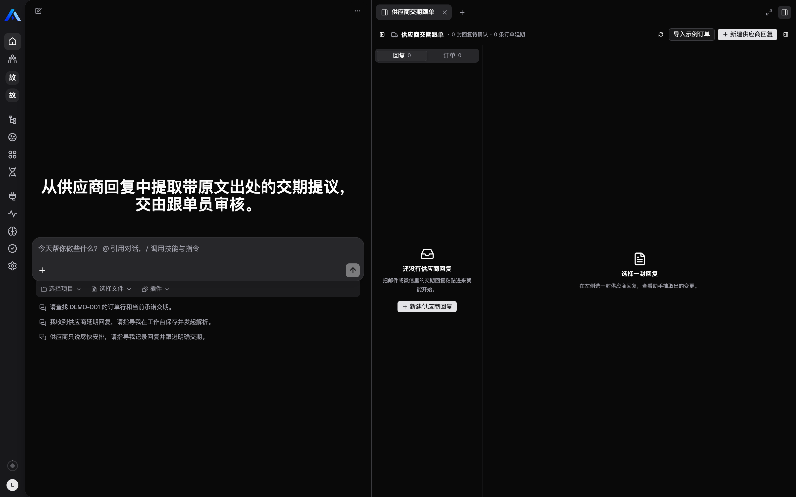

**2. 用户输入。** 新建回复时粘贴供应商原话。这条周报不写订单号，用的是相对日期，还混着发票事项。

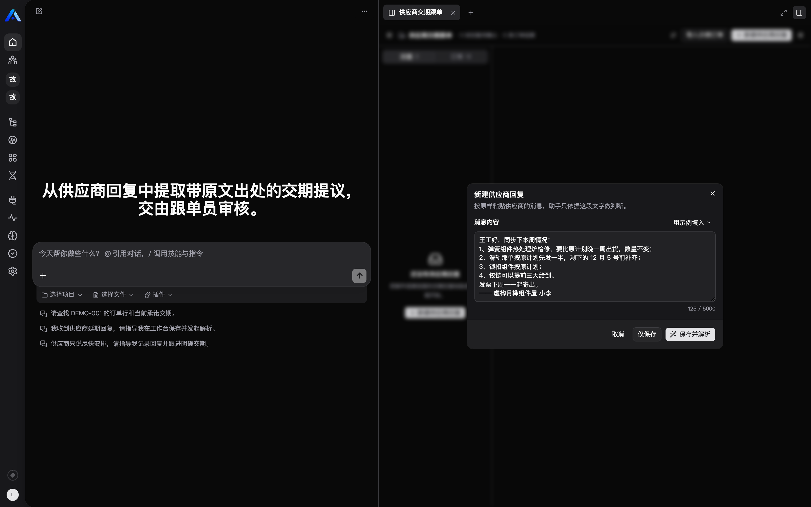

**3. 解析中。** 点「保存并解析」后，工作台给助手发一条消息：第一行是能读懂的「解析供应商回复（11月11日 12:09 收到，第 1 次）」，运行结束后也会成为对话标题；第二行是给助手和工具用的回复编号。对话里开始调用工具。工作台的横幅显示已用时间和已保存的提议数，存下的提议先以只读卡片出现。如果 150 秒里既没有工具调用也没有新提议，横幅会变成「已经 X 没有新的工具调用」，提醒先看对话：还在「正在思考」就继续等，对话已经停住再点「重新发送给助手」（见截图 15）。

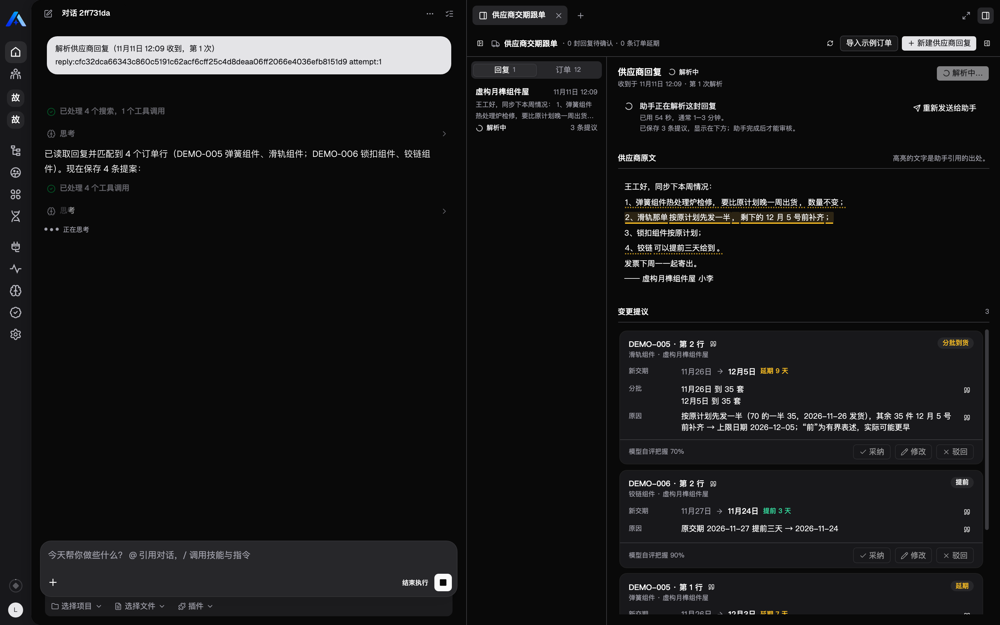

**4. 对话 + 视图。** 解析完成，助手在对话里汇总 4 条提议，说明发票不是交期事项、没有为它建提议；工作台里这封回复进入「待确认」。

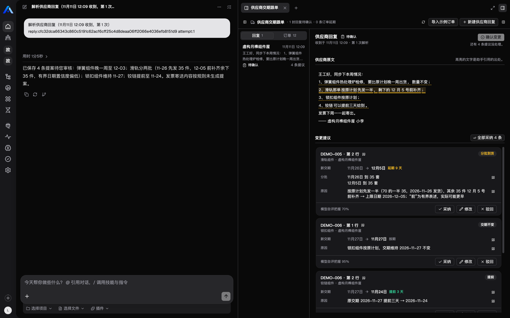

**5. 工具调用。** 展开后能看到助手先 `读取供应商回复`，在同一轮里并行 `查找订单行` 4 次，下一轮并行 `保存交期提议` 并 `完成回复解析`，最后用一两句话总结。保存时服务端会校验每个字段的出处，缺出处的保存会被拒收并返回原因，助手按原因补上后重试；早一轮的周报解析里出现过，见验证结果。

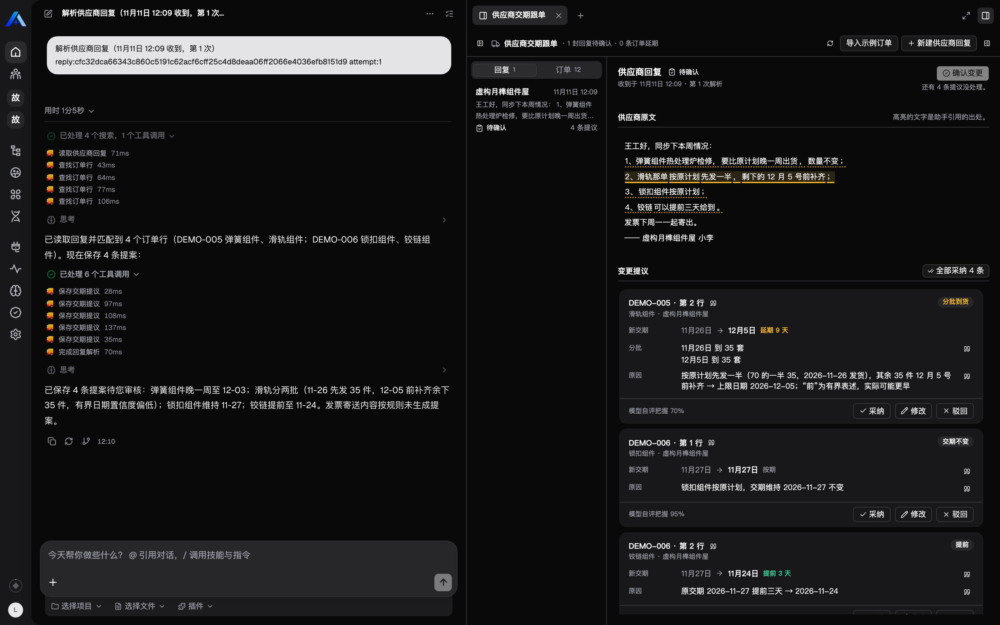

**6. 审核（AI 处理结果）。** 左边是原文，被引用的片段高亮；中间每条提议都给出新旧交期、延期天数和推算过程（例如「原交期 2026-11-26 晚一周 → 2026-12-03」），分批到货单独列出；右边是订单详情和交期时间线。

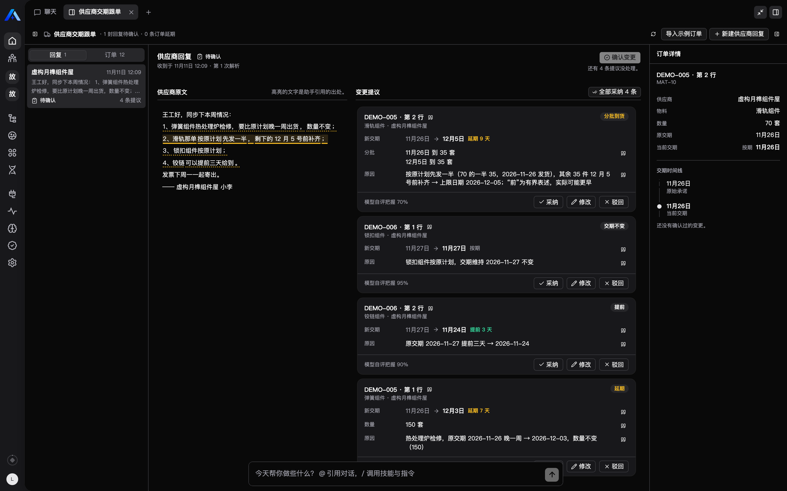

**7. 确认并保存。** 有两条以上待处理的提议时，可以先点「全部采纳」，再逐条核对后确认（第一张图）。4 条提议都落到了订单上：3 条交期改了，锁扣组件是确认「交期不变」（界面提示「已更新 4 条」也把它算在内）；时间线记下每次改动的确认时间和确认人；分批到货的订单行还会列出分批明细（截图里选中的是分两批到货的滑轨组件）。刷新页面或重启 API 后，这些数据都还在。

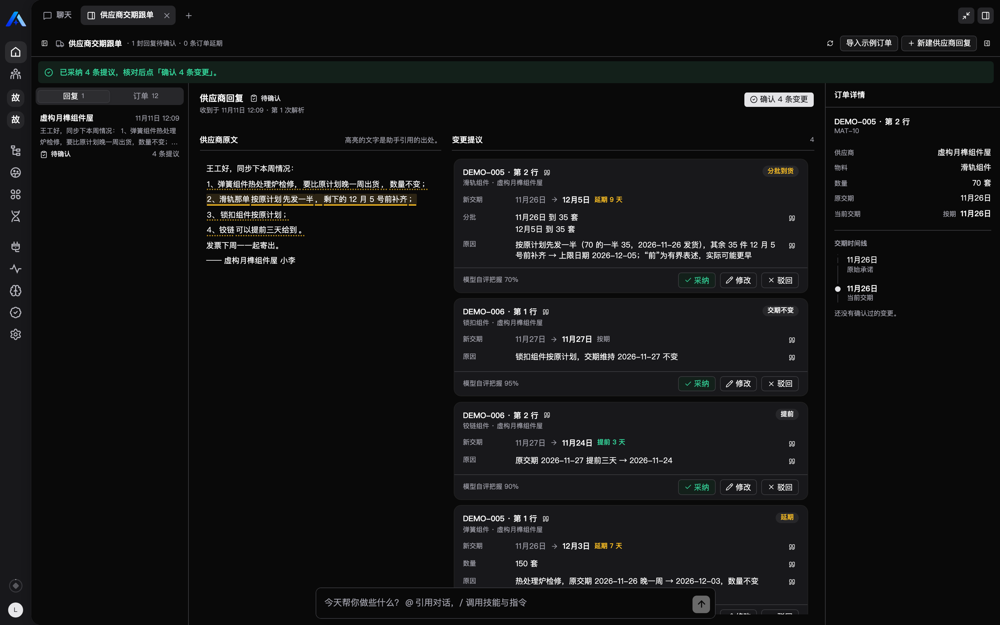

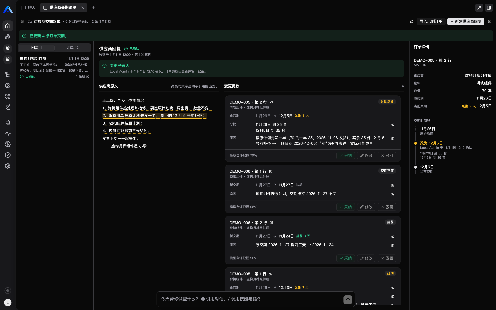

**8. 画布（助手模板 + 中间件）。** 用插件模板创建的助手，挂了 3 个中间件：上下文压缩、待办事项、交期跟单工具（5 个工具）。

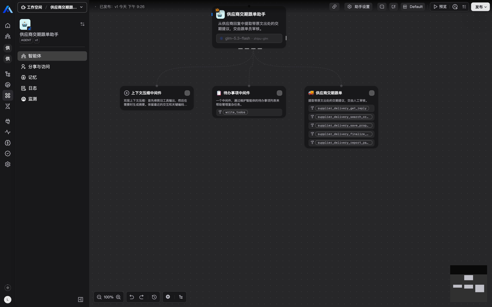

**9. 助手模板。** 插件安装后，在模板列表里出现「供应商交期跟单助手」。

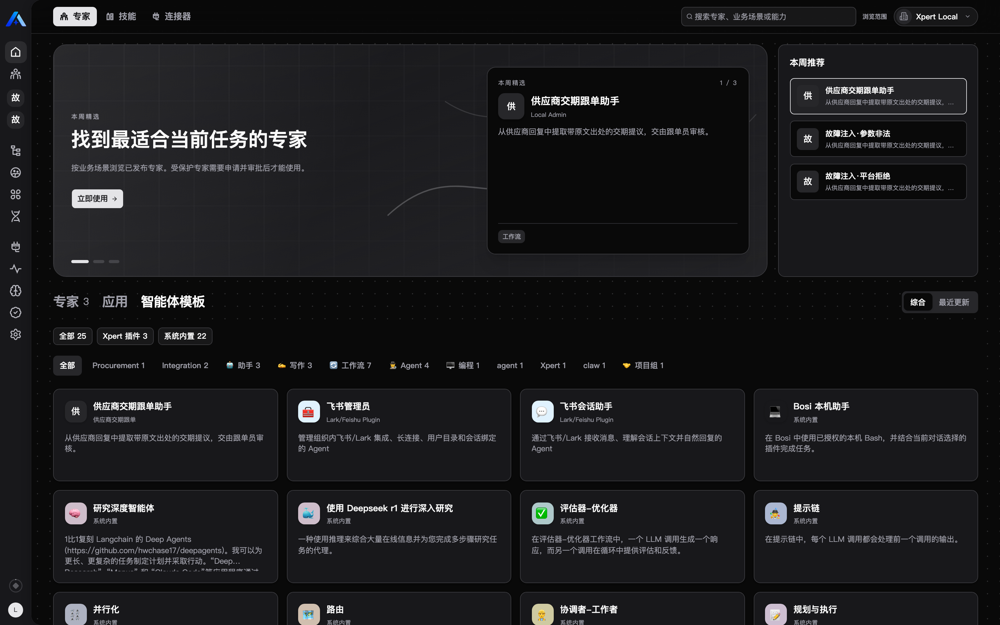

**10. 异常：需跟进。** 供应商只说「尽快安排」，助手不编造日期，调用失败上报工具，回复进入「需跟进」并写明原因。

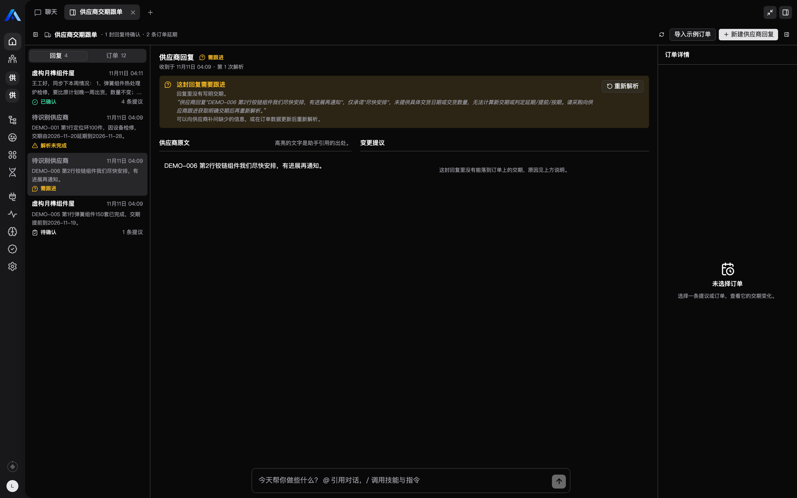

**11. 异常：订单在解析后被改过。** 这条提议生成之后，另一封回复的确认改动了同一条订单。提议被标为基于旧数据，必须重新解析或驳回后才能确认。

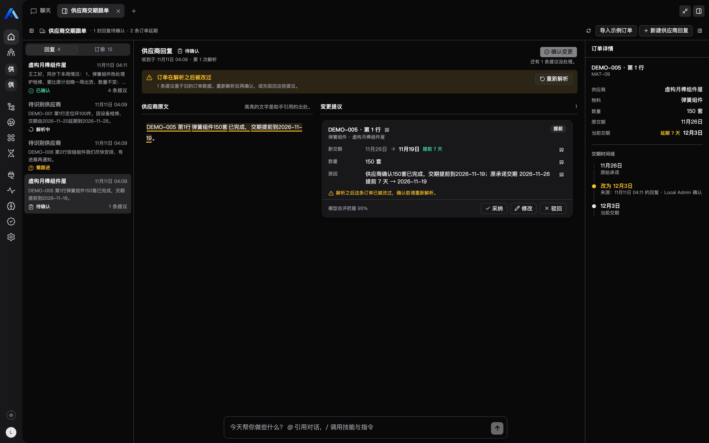

**12. 异常：在对话里结束执行。** 解析中途在对话里点「结束执行」，结果取决于停在哪一步：
- 助手正在等模型回复时，模型调用被中止，几秒内回复变为「解析失败：解析在对话里被中止了」，可以直接重新解析（第一张图）。
- 停在两步之间时，平台只把对话暂停，不会报错，插件收不到信号。工作台 150 秒没有工具调用后提示「没有新的工具调用」，主按钮换成「重新发送给助手」，点了会开新对话重新解析（第二张图）；不点的话 5 分钟后超时转为可重试。

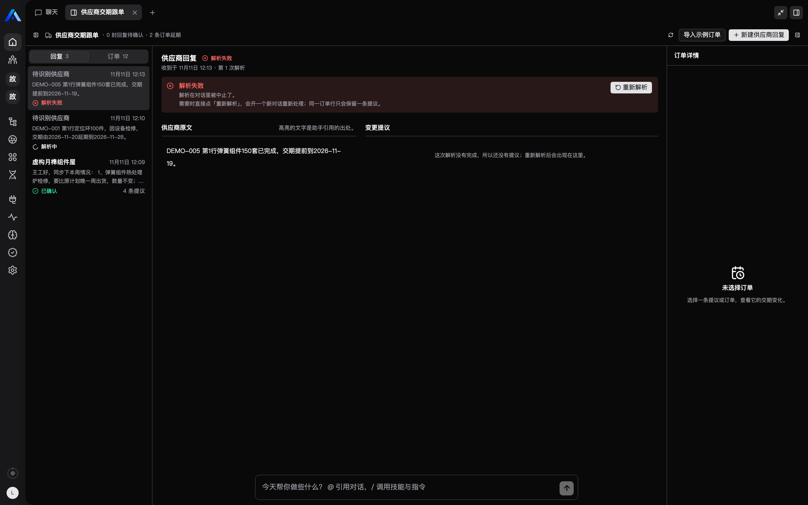

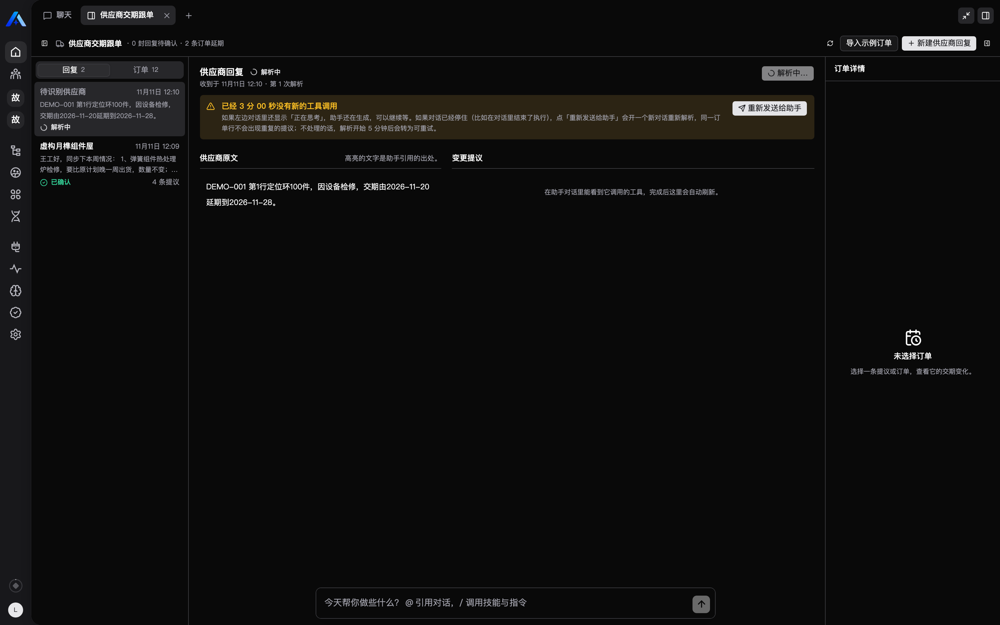

**13. 异常：模型调用报错（真实故障注入）。** 把助手的模型参数设成智谱不接受的值，模型调用真的返回了 HTTP 400。插件中间件的 `wrapModelCall` 钩子拦到这个错误后，几秒内把回复标为「解析失败」：横幅里写明原因，附上脱敏后的原始错误摘要和处理建议，「重新解析」按钮就在横幅里。

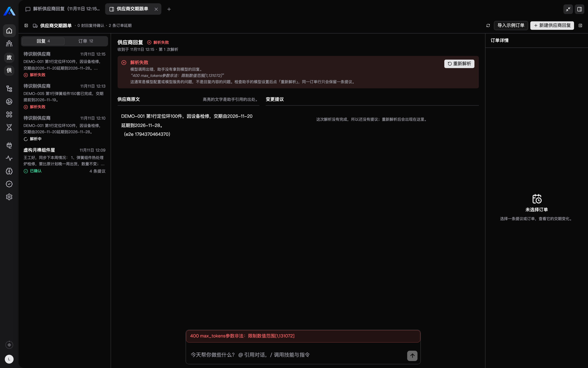

**14. 失败后重试。** 换回正常模型后，在同一封回复上点「重新解析」：第 2 次解析成功，同一订单行仍然只有 1 条提议。

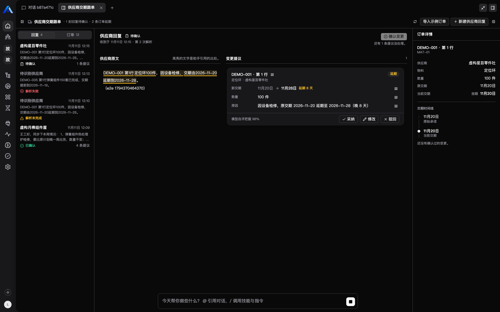

**15. 异常：平台拒绝运行。** 助手配置了平台不允许使用的模型时（测试里用不存在的模型名触发），平台在启动对话前就拒绝了，助手没有发起模型调用，插件拦不到。150 秒没有工具调用后，工作台提示「没有新的工具调用」，可以直接重新发送（第一张图）；放着不管的话，5 分钟超时兜底，回复变为「解析未完成」，并说明可能的原因（第二张图）。

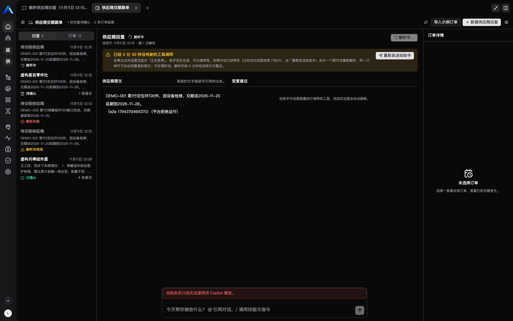

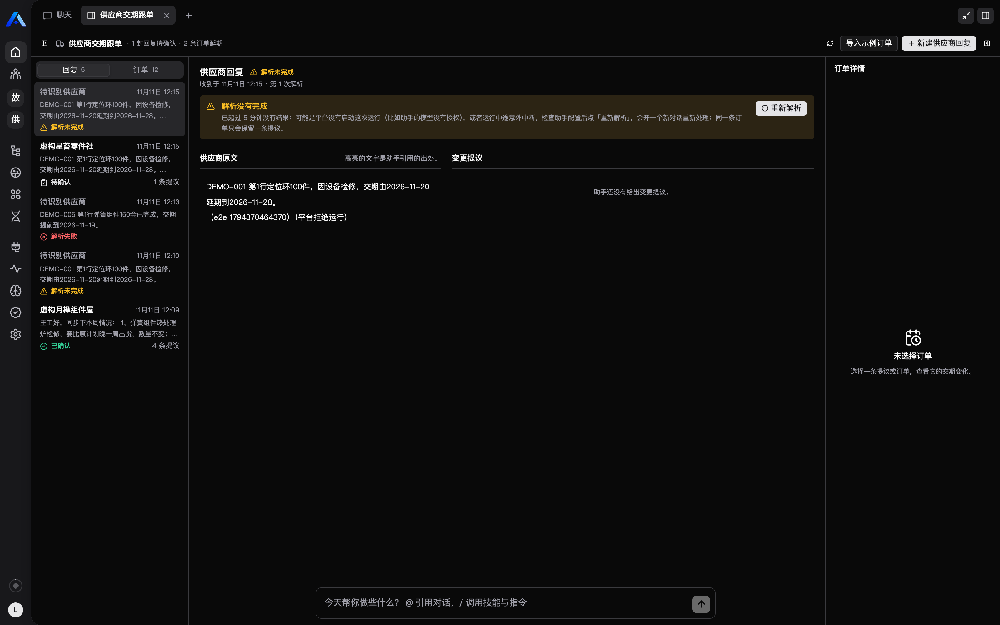

截图里出现的数据（供应商、订单、回复）全部虚构，不含真实密钥或个人信息。

## 运行说明

### 环境要求

| 项 | 测试时的版本 |
|---|---|
| Xpert 平台 | 开源版 main `ba8736c`，source-hybrid（PostgreSQL、Redis 用 Docker，API 和 Cloud UI 从源码运行） |
| 插件仓库 | 基线 main `9bfa965` |
| Node.js | v22.22.0 |
| pnpm | community 工作区声明的 8.15.8（用 corepack） |
| 模型 | 在平台里配置任一对话模型；测试用的是智谱 glm-5.3-flash |
| 账号 | 有插件安装权限的租户管理员 |

插件本身不需要额外配置，也没有自己的凭证。模型 Key 填在 Xpert 平台的模型设置里，不进插件。

### 构建与测试

在插件仓库的 `community` 目录执行：

```sh
cd community
corepack pnpm install --frozen-lockfile
corepack pnpm -C apps/supplier-delivery-followup build:ui   # 共享的 shadcn-ui，只需第一次
corepack pnpm -C apps/supplier-delivery-followup build
corepack pnpm -C apps/supplier-delivery-followup test
corepack pnpm -C apps/supplier-delivery-followup typecheck
```

同一套测试也可以跑在真实 PostgreSQL 上。要用一个单独的测试库，库名必须包含 `test`，否则测试会拒绝运行，因为每次都会清空这个库：

```sh
SUPPLIER_DELIVERY_TEST_PG_URL=postgres://<用户>:<密码>@localhost:5432/<名字带 test 的库> \
  corepack pnpm -C apps/supplier-delivery-followup test:pg
```

生命周期检查（插件仓库根目录，harness 的构建方法见 [plugin-dev-harness](../../../plugin-dev-harness/README.md)）：

```sh
node plugin-dev-harness/dist/index.js --workspace ./community --plugin @community/apps-supplier-delivery-followup
```

### 安装到 Xpert

部署脚本在 Xpert 平台仓库里。凭证通过环境变量传入，不要写进文件或提交。环境变量示例：

```sh
# deploy.env 示例：用 `set -a; source deploy.env; set +a` 加载，用完删除
XPERT_API_URL=http://localhost:3000        # API 地址；本地改过端口就跟着改
XPERT_SCOPE=tenant                         # 插件声明的级别是 tenant
XPERT_TENANT_ID=<你的租户 id>
XPERT_USERNAME=<有插件安装权限的账号>
XPERT_PASSWORD=<密码>                      # 也可以改用 XPERT_TOKEN
```

在 Xpert 平台仓库根目录执行：

```sh
corepack pnpm plugin:deploy:local \
  --plugin-dir <插件仓库>/community/apps/supplier-delivery-followup \
  --no-keychain --skip-test
```

脚本提示需要重启时，重启 Xpert API；插件的四张表（`plugin_supplier_delivery_*`）在启动时自动创建。

### 使用步骤

1. 「探索 → 模板」里找到「供应商交期跟单助手」，用它创建助手并发布。模板已经配好中间件、5 个工具和默认工作台。
2. 打开 ClawXpert，在概览页菜单里选「更换 ClawXpert」，选中刚发布的助手。
3. 在对话页右侧打开「供应商交期跟单」视图，点「导入示例订单」，导入 12 条虚构订单行。
4. 点「新建供应商回复」，粘贴供应商原话（也可以「用示例填入」），再点「保存并解析」。
5. 在对话里看助手调用工具；完成后，工作台自动刷新出提议。
6. 逐条采纳、修改或驳回，然后点「确认 N 条变更」。

插件升级后，已经建好的助手不会自动换成新的提示词。在助手的编排页点「从模版更新」，再发布，就能用上新版本。

### 端到端检查（可选）

`e2e/platform-e2e.mjs` 用 Playwright 驱动真实的 Xpert 页面，把上面的流程和多组织隔离自动跑一遍，逐项打印 PASS / FAIL。它会调用真实模型，并确认变更，所以会改写当前组织的示例订单，只在测试环境里跑。Playwright 不是本插件的依赖，从 Xpert 平台仓库加载。

```sh
# 在插件目录执行；凭证只用环境变量传入
export XPERT_REPO=<Xpert 平台仓库> XPERT_URL=http://localhost:4200
export XPERT_EMAIL=<账号> XPERT_PASSWORD=<密码> XPERT_ORG_ID=<组织 id>
corepack pnpm e2e:platform flow                  # 导入、空输入、解析、去重、确认、刷新后恢复、需跟进
corepack pnpm e2e:platform flow --with-stop      # 再加一个「在对话里结束执行」的场景
XPERT_ORG_ID_B=<第二个组织 id> corepack pnpm e2e:platform isolation
XPERT_ASSISTANT_ID=<正常助手> XPERT_FAULT_ASSISTANT_ID=<故障助手> corepack pnpm e2e:platform fault
```

`isolation` 需要第二个组织里也有一个用本模板创建、并绑定到 ClawXpert 的助手。它用组织 A 的回复、提议和订单 id，在组织 B 里尝试读取、审核、确认和重新解析，并确认组织 A 的数据没有变化。

`fault` 需要另一个用本模板创建的「故障助手」，它的模型参数是供应商会拒绝的值（测试时用的是 `max_tokens: 99999999`）。脚本临时把 ClawXpert 切到故障助手，检查回复在一分钟内被标为 `model_failed`；然后切回正常助手，在同一封回复上重新解析，检查成功且没有重复提议。再设置 `XPERT_REFUSED_ASSISTANT_ID`（一个配置了平台不允许使用的模型、平台会拒绝运行的助手，测试时用的是不存在的模型名），还会多等 5 分钟，检查超时兜底。不管结果如何，最后都会恢复原来的绑定。

## 主要实现

| 部分 | 位置 |
|---|---|
| 数据与业务规则（4 张表、状态流转、可重做的确认、按租户和组织隔离） | `src/lib/supplier-delivery-followup.service.ts`、`entities.ts` |
| 助手工具（中间件，zod 参数，出处校验，带 `nextAction` 的错误） | `src/lib/supplier-delivery-followup.middleware.ts` |
| 工作台视图提供者（数据查询、7 个动作、发给对话的客户端命令） | `src/lib/supplier-delivery-followup-view.provider.ts` |
| 工作台界面（Remote Component，React + shadcn-ui） | `src/lib/remote-components/supplier-delivery-workbench/src/` |
| 助手模板（YAML DSL） | `src/xpert-supplier-delivery-followup-assistant.yaml` |
| 模型失败落盘（`wrapModelCall` 钩子，只改「同一次解析」的回复） | `src/lib/supplier-delivery-followup.middleware.ts`、`service.ts` 的 `reportModelFailure` |
| 测试（9 个文件，162 个用例；sql.js 和真实 PostgreSQL 两种模式） | `src/**/*.spec.ts`、`src/testing/` |

`remote-components/supplier-delivery-workbench/app.js` 和 `app.css` 是界面的构建产物，按仓库惯例随代码提交；`check:remote` 会检查它们和源码是否一致。

## 已知限制

最重要的五条如下，完整清单（范围取舍、平台限制、设计取舍、小缺口）和下一步见 [docs/limitations.md](docs/limitations.md)。正常流程里没有已知的功能缺陷。

- **输入和数据**：只支持粘贴文本，不读附件，不接邮箱、微信和 ERP；订单是插件自带的示例数据。
- **状态粒度**：一封回复要么整体可审核，要么整体「需跟进」，不能按订单行区分。
- **失败发现**：模型报错和进行中被结束执行，几秒内就能显示。平台在运行前拒绝、停在两步之间、API 崩溃这三种情况插件收不到信号，靠 150 秒无工具调用的提示和 5 分钟超时兜底。
- **确认的原子性**：平台不给插件跨多行的原子写入，确认由几步可重做的单行操作组成，中断后再点一次接着做完。还剩一个毫秒级的竞争窗口没有封住，怎么封、为什么这次没做，写在完整清单里。
- **解析速度**：glm-5.3-flash 解析一条 4 个物料的消息一般要 1–3 分钟。

## 复用来源

| 来源 | 许可 | 复用范围与改动 |
|---|---|---|
| `community/apps/valve-business-workbench`（本仓库） | AGPL-3.0 | React 运行时 shim、`vendor.ts` 原样复用；宿主桥接 `bridge.ts`、界面构建脚本 `scripts/build-remote-components.mjs` 和 `react-dom-client-shim.ts` 在它的基础上修改 |
| `@xpert-ai/plugin-shadcn-ui`（本仓库 `packages/shadcn-ui`） | AGPL-3.0 | 作为依赖使用其中的 shadcn/ui 组件，没有修改 |
| `procurement-quote-comparison`、`smart-maintenance`、`dockyard` 示例 | AGPL-3.0 | 只参考做法：用客户端命令把任务发给助手；确认、驳回只做成工作台按钮；tenant 级插件加 artifactNamespace |
| AI 生成代码 | — | 由 Claude Code 和 Codex 生成，人工审查和测试后提交，过程见 [AI 协作说明](docs/ai-collaboration.md) |

本插件许可证为 AGPL-3.0，与插件仓库一致。
