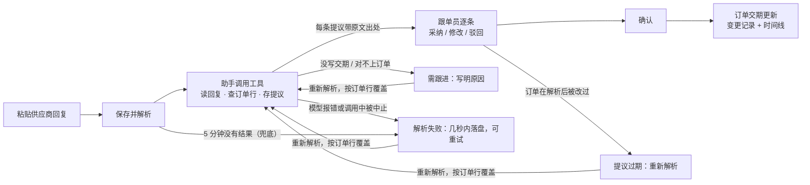

# 产品说明

## 目标用户

制造企业的采购跟单员。每人盯着几十到上百条采购订单行，每天要处理供应商发来的交期回复，并把变化同步到订单上，作为生产排程和缺料预警的依据。

## 原来怎么做，痛在哪

供应商的回复大多来自微信或邮件，是口语化的一段话：

```
王工好，同步下本周情况：
1、弹簧组件热处理炉检修，要比原计划晚一周出货，数量不变；
2、滑轨那单按原计划先发一半，剩下的 12 月 5 号前补齐；
3、锁扣组件按原计划；
4、铰链可以提前三天给到。
发票下周一一起寄出。
```

跟单员要逐句读，再到 ERP 或表格里找出对应的订单行，自己换算「晚一周」「提前三天」，然后改交期、写备注。问题在于：

- **对单慢**：供应商常常不写订单号，只说物料名或「那单」，要靠供应商、物料、数量去反查。
- **换算易错**：相对日期要以原交期为基准（「晚一周」），或者以收到消息的那天为基准（「下周五」），口算容易差一天。
- **一条消息多件事**：几个物料混在一起，还夹着发票、付款等无关内容，容易漏掉某一条。
- **改了说不清依据**：交期改了，事后很难回答「依据的是哪句话、谁确认的、原来是哪天」。

## 业务流程



回复的状态：`待解析 → 解析中 → 待确认 → 已确认`，失败分支是 `需跟进`、`解析失败` 和超时导致的「解析未完成」。已确认的回复不能再解析，也不能再写入提议。确认一旦开始，这封回复就不能再解析或修改；中途断掉时，工作台显示「确认还没完成」，点「继续确认」写完剩下的。如果这期间某条订单被别的回复改过，只能驳回那几条提议后再继续。

## 关键页面

只有一个工作台，挂在助手对话的右侧，可以最大化。布局分三栏：

```
┌ 工具栏：N 封待确认 · M 条延期 ·············· [导入示例订单] [新建供应商回复] ┐
├──────────────┬──────────────────────────────────────────┬──────────────────┤
│ 回复 | 订单   │ 供应商回复  状态   第 n 次解析     [确认 N 条变更] │ 订单详情          │
│ ─────────── │ ┌ 状态横幅：解析中 / 需跟进 / 超时 / 已确认 ┐   │ 供应商 物料 数量   │
│ 供应商  时间  │ 供应商原文（引用片段高亮） │ 变更提议卡片          │ 原交期 → 当前交期  │
│ 摘要        │                         │  订单 · 行 · 物料      │ ─────────────── │
│ 状态  N条提议 │                         │  新交期 / 数量 / 分批   │ 交期时间线         │
│ ...         │                         │  原因（含推算过程）     │  原始承诺          │
│             │                         │  [采纳][修改][驳回]    │  改为 X（来源、确认人）│
└──────────────┴─────────────────────────┴───────────────────────┴──────────────────┘
```

点提议里的任意字段（订单号、新交期、数量、原因），左边原文中对应的那句话会高亮。

解析一般要 1–3 分钟，状态横幅会显示已用时间和已保存的提议数。如果 150 秒里既没有工具调用也没有新提议，横幅会变成「没有新的工具调用」，提醒先看对话还在不在思考，并把「重新发送给助手」设为主按钮。有两条以上待处理的提议时，提议区上方会出现「全部采纳」。失败和超时的横幅里直接带着「重新解析」按钮，并写明原文已保存、重试不会产生重复提议。窄屏时左右两栏变成浮层，用工具栏按钮展开。实际效果见 [README 的截图](../README.md#运行截图)。

## AI 在流程里做什么

| AI 负责 | 规则和人负责 |
|---|---|
| 读懂口语，拆出每个物料各自的交期变化 | 服务端校验：每个关键字段的出处必须是原文里的一段 |
| 不写订单号时，按供应商、物料、数量对上订单行 | 订单行必须真实存在；同一封回复里，一条订单行最多一条提议 |
| 换算相对日期，并在原因里写出推算过程 | 相对日期的基准由工具给出：原交期，或回复的收到日期和星期 |
| 区分交期事项和无关事项（发票、付款、寒暄） | 交期只有在人确认时才会改写；助手的工具没有写订单的能力 |
| 信息不足时，说明缺了什么，交给人跟进 | 确认可以重复点，只生效一次；订单改过之后，旧提议会被拦下 |

短消息（「DEMO-001 第 1 行延期到 11-28」）用规则也能处理，AI 的价值主要在长的、不规范的消息：不写单号、相对日期、多件事混在一起。见截图 4、6 的周报样例：一条消息里 4 个物料，没有一个订单号，结果全部对上，日期也都算对了。

## 功能取舍

| 决定 | 选择 | 放弃的选项及原因 |
|---|---|---|
| 分批到货 | 作为一种提议类型：订单交期取最后一批，分批明细记进变更记录 | 拆成交货计划行：要多一张表和一套界面，工作量大约翻倍 |
| 从哪里触发 AI | 工作台按钮，把解析任务发给助手，对话里可以看到全过程；消息第一行是能读懂的说明，第二行是回复编号 | 在对话框里粘贴：工作台会退化成只读看板 |
| 消息怎么进系统 | 一键「保存并解析」（方案 B） | 接邮箱、企业微信自动收取（方案 A）：要接外部系统，列为下一步 |
| 可视化 | 订单行的交期时间线、延期天数 | 总览看板：偏离「把一条流程做扎实」 |
| 失败怎么发现 | 三层：助手主动上报看不懂的回复；中间件用 `wrapModelCall` 拦截模型报错和模型调用中的中止，几秒内落盘；平台拒绝运行、两步之间被暂停这类插件看不到的情况，工作台在 150 秒没有工具调用时提示「重新发送给助手」，5 分钟超时兜底 | 只靠助手上报：模型直接挂掉时，回复会一直卡在解析中 |
| 插件级别 | tenant 级，命名空间 `supplier_delivery` | system 级：只能装在 Default 租户 |

明确不做：接真实 ERP、邮箱或微信，多智能体，复杂权限，多端适配，npm 发布，修改 Xpert 平台本身。

## 用什么开发，遇到了什么问题

- **平台与插件**：Xpert 开源版 main（NestJS + LangGraph + Angular），插件是 NestJS 模块，加上 TypeORM 实体、Agent 中间件、Remote Component 视图（React + shadcn-ui），以及 Assistant YAML 模板。
- **AI 开发工具**：Claude Code 负责需求、拆分、界面和真实平台验证，Codex CLI 负责后端实现。分工和过程见 [AI 协作说明](ai-collaboration.md)。
- **遇到的问题**（细节见 [验证结果](validation.md)）：
  - 修改模板提示词后，已经建好的助手不生效：助手创建时复制了一份提示词。一开始以为只能重建助手，后来做平台能力审计时发现平台有「从模版更新」，实测可用。
  - 模型在对话里被中途暂停后，重新解析会被平台拒绝（409）。先加了「重新发送给助手」，后来改成每次解析都开新对话（`newThread`），从根上避开了这个问题。
  - 模型报错要等 5 分钟才发现。做平台能力审计时才知道，中间件可以直接拦截模型调用的报错，改了之后几秒内就能显示。
  - 含糊的措辞（「先发一半」但不说日期）会让模型斟酌很久。于是在提示词里写明「按原计划」的含义，示例文本也改得更明确。
  - 4 个物料的消息实测要 2 分钟左右，原来的 3 分钟超时偏紧，改成了 5 分钟。
