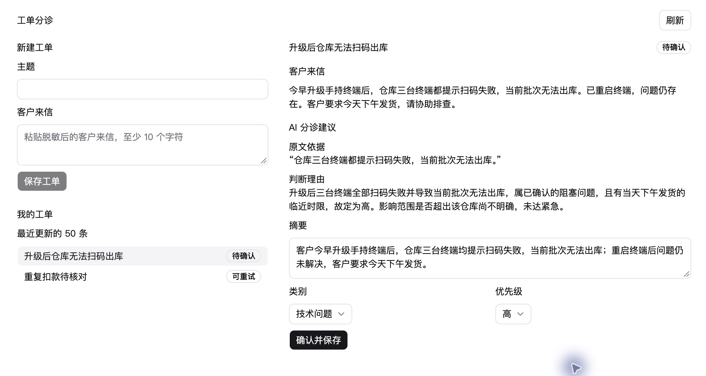
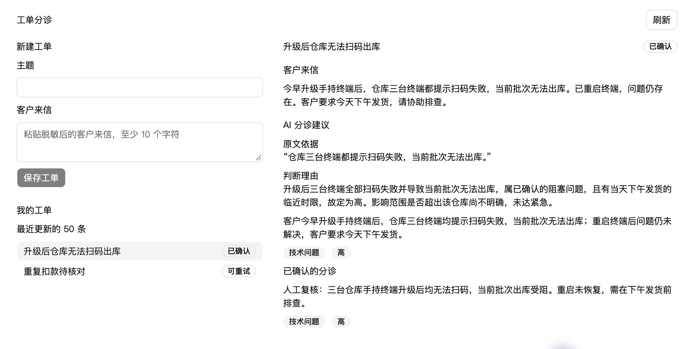
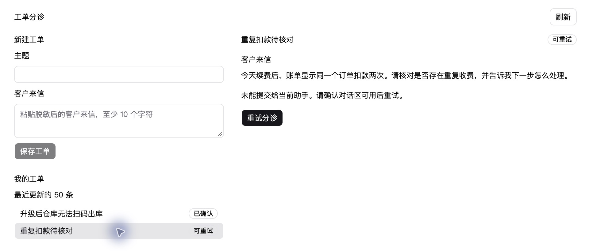
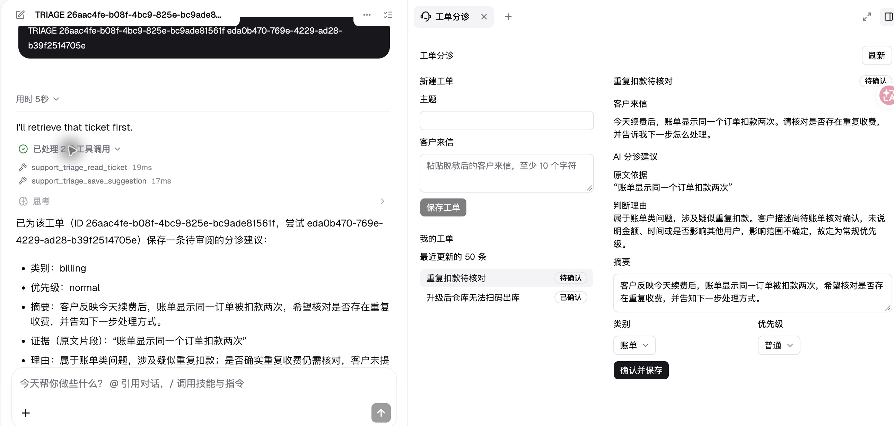
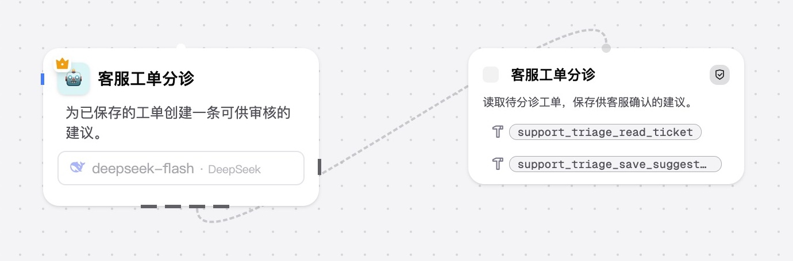

# 客服工单分诊

客服收到报障或咨询时，需要从来信中摘取关键信息，再决定工单归类和处理顺序。本插件用 Xpert 助手生成摘要、类别和优先级建议，并保留来信原文与判断依据。客服在工作台复核、调整并确认。确认后的工单和模型原建议都可在下次打开工作台时查看。

## 界面与流程

```text
工单分诊工作台
┌─────────────────────┬──────────────────────────┐
│ 主题                 │ 当前工单和原始来信         │
│ 客户来信             │ AI 摘要、引用和判断理由    │
│ 保存工单             │ 可修改类别、优先级、摘要   │
│ 我的工单与当前状态   │ 确认并保存 / 失败后重试   │
└─────────────────────┴──────────────────────────┘
Xpert 助手对话显示模型处理与工具调用。
```

1. 在助手工作台打开 **工单分诊**，使用 [虚构样例](examples/ticket.txt) 新建工单。
2. 选择 **交给 AI 分诊**。工作台将该工单的处理请求发送给当前助手。助手通过中间件读取来信，再把建议写回同一工单。
3. 在 **待确认** 状态查看来信、原文引用和判断理由。可修改摘要、类别和优先级，然后选择 **确认并保存**。
4. 刷新页面或重新打开工作台，选中原工单，查看 AI 建议和最终确认结果。
5. 如果模型调用失败或助手提前结束，工作台显示失败原因。恢复模型后在同一工单选择 **重试分诊**。

数据通过宿主 PostgreSQL 保存，按租户、组织、工作空间、用户和助手隔离。每次尝试都有独立标识和两分钟期限，旧尝试不能覆盖新尝试或已确认的结果。所有状态更新验证记录版本。本范围覆盖文字工单和最近 50 条记录，暂未接入客服系统、附件处理或团队队列。

## 构建与部署

使用 Xpert 开源版和插件仓库各自声明的 Node.js 与 pnpm 环境。开发基线如下。

| 仓库 | 开发开始时的 main SHA |
| --- | --- |
| xpert-ai/xpert | `c856a31cf2f060006c8e689d7adaf74946792cfa` |
| xpert-ai/xpert-plugins | `7f12f3525464454b546f1df133b051255e121d8d` |

从插件仓库根目录运行下列命令。

```sh
cd community
corepack pnpm --filter @community/apps-support-ticket-triage... install --frozen-lockfile
corepack pnpm --filter @xpert-ai/plugin-shadcn-ui build
corepack pnpm --filter @community/apps-support-ticket-triage typecheck
corepack pnpm --filter @community/apps-support-ticket-triage test
corepack pnpm --filter @community/apps-support-ticket-triage build
```

按 [Xpert 本地源代码指南](https://docs.xpertai.cn/zh-Hans/ai/getting-started/community/local-source-code) 启动宿主。确保 API 进程的 PATH 包含 npm，并将宿主自带插件和本插件工作区加入路径允许列表。下面是本地验收和部署 CLI 的环境变量示例。真实凭证放在本地忽略文件或平台凭证库。

```dotenv
# Xpert host
PLUGIN_WORKSPACE_ROOTS="/absolute/path/to/xpert/packages/plugins;/absolute/path/to/xpert-plugins/community"
PLUGINS=@xpert-ai/plugin-deepseek
# Local deployment CLI
XPERT_API_URL=http://localhost:3000
XPERT_TENANT_ID=<test-tenant-id>
XPERT_TOKEN=<test-admin-login-token>
```

从平台仓库根目录执行。安装范围为 tenant，因为插件注册了数据库实体。

```sh
corepack pnpm plugin:deploy:local --help
corepack pnpm plugin:deploy:local \
  --plugin-dir /absolute/path/to/xpert-plugins/community/apps/support-ticket-triage \
  --scope tenant --api-url "$XPERT_API_URL"
```

按部署结果重启平台并验证插件已加载。在 Xpert 启用 DeepSeek，在验收工作空间所属组织的模型供应商设置中添加凭证，并启用支持工具调用的模型，例如 `deepseek-flash`。从 **客服工单分诊** 模板创建助手，检查画布上已连接分诊中间件，选择 DeepSeek 作为助手模型后发布，再在该助手的对话中打开 **工单分诊**。工作台由中间件的 Feature 激活，并使用助手所选模型。

## 验收

从插件仓库根目录执行生命周期检查。

```sh
cd plugin-dev-harness
corepack pnpm install --ignore-workspace --frozen-lockfile --ignore-scripts
corepack pnpm build
cd ..
node plugin-dev-harness/dist/index.js --workspace ./community \
  --plugin @community/apps-support-ticket-triage
```

业务测试使用虚构来信、内存 SQL 数据库和预设建议，覆盖确认、重新读取、无结果、输入校验、权限、失败重试、超时及并发。实际验收运行于上述 Xpert 源码基线，使用 Node.js 24.22.3、宿主 PostgreSQL、分诊插件 0.1.0、DeepSeek 插件 0.1.5 和 DeepSeek V4.1 Flash（`deepseek-flash`）。验收中的客户来信均为虚构。

| 检查 | 结果 |
| --- | --- |
| 服务端和远程工作台类型检查 | 通过 |
| 工单业务测试 | 6 项通过 |
| 插件构建和打包 | 通过，包含服务入口、助手 YAML 和工作台 JS/CSS |
| 官方生命周期工具 | 通过，使用工具提供的数据库和平台模拟对象。可选静态检查器无法解析运行时校验的元数据，构建后的元数据由生命周期工具和 Xpert 加载验证 |
| Xpert 安装、重启和发布 | 通过。两个插件均已加载，从目录安装模板并发布助手 |
| 真实模型调用 | 仓库扫码样例被归为高优先级的技术问题。助手读取工单并保存建议，引用逐字匹配来信 |
| 人工确认及恢复 | 编辑摘要并确认。整页刷新后，同一工单仍显示原模型建议与已确认的人工摘要 |
| 失败与重试 | 使用插件的 `report_dispatch_failure` 动作模拟助手提交失败。点击 **重试分诊** 后，原工单自动更新为待确认，并显示 DeepSeek 生成的建议。记录 ID 保持一致 |

复现异常时，先在测试助手创建独立的虚构工单，通过该视图的 `start_triage` 动作传入工单 `id` 和当前 `revision`，再将返回的 `id` 和 `attemptId` 传给 `report_dispatch_failure`。刷新视图查看 **可重试**，随后用界面发起实际分诊。

### Xpert 运行截图

工作台显示客户来信、DeepSeek 建议、原文依据和可编辑的确认表单。



重新加载后仍可查看模型建议和人工确认结果。



模拟提交失败时，工单显示失败原因和重试入口。



重试成功后，左侧对话显示读取工单和保存建议的工具调用，右侧视图显示原工单的新建议。



助手画布展示 DeepSeek 模型及已连接的插件中间件。



### 已知限制与后续方向

实机验收使用一个组织和一个测试账号。跨用户、跨组织的隔离由业务测试覆盖，尚未在 Xpert 上用多个账号和组织实测。若进一步推广给多个客服团队，优先补做跨组织和跨账号的读取、确认权限验收，再扩展团队队列。

## 复用与 AI 协作

插件采用 AGPL-3.0。参考同仓库 Dockyard 的助手模板、租户工作台、表命名和中间件注册方式，以及 EV Motor Lifecycle 的远程 React 接入方式。界面复用仓库的 `@xpert-ai/plugin-shadcn-ui` 组件及主题适配。工单状态、处理尝试、引用校验和人工确认流程为本插件实现。

开发使用 Codex（GPT-6）阅读 SDK 和相邻插件、生成实现并运行检查。我选择用平台原生对话发起分诊，用记录版本拦截重复和过期写入，并保留模型建议作为人工复核依据。联调时根据宿主日志补齐插件部署所需的 npm，增加模板执行步数上限，让助手能在写回建议后正常收尾，并将人工确认请求限定为可编辑字段。
