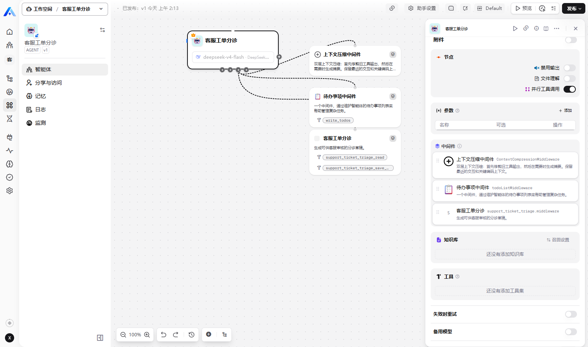
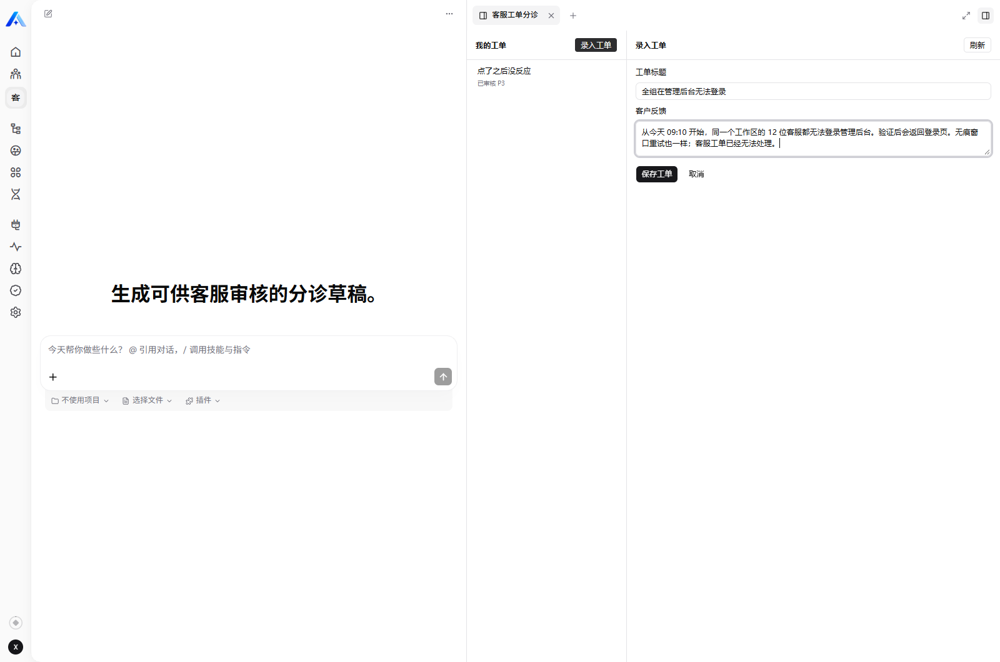
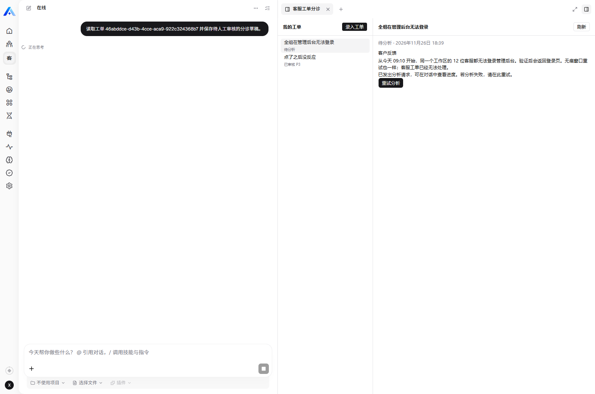
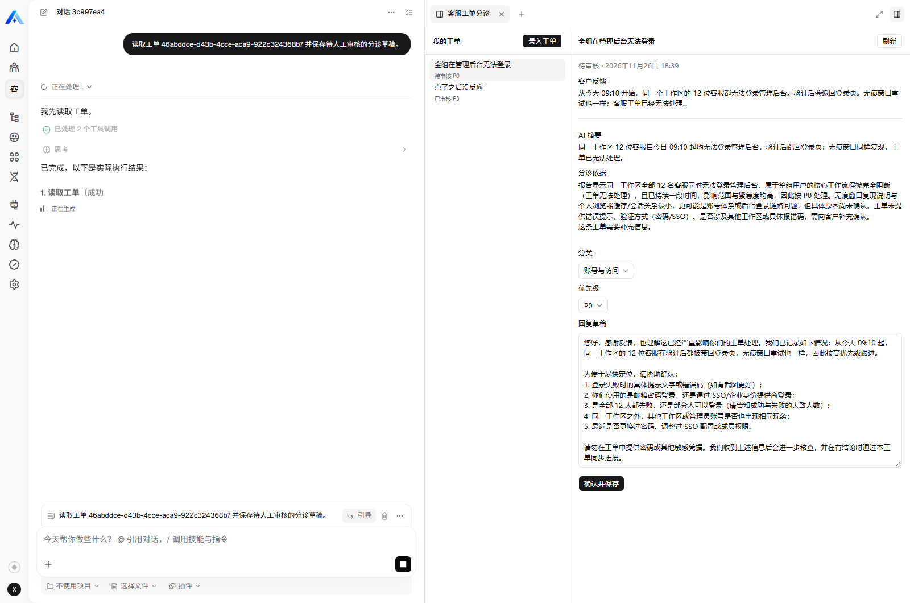
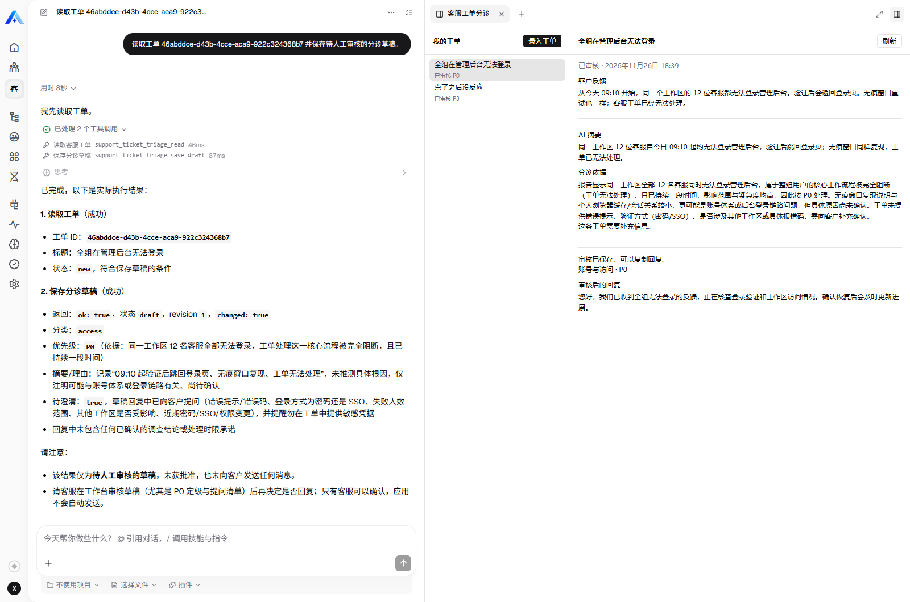
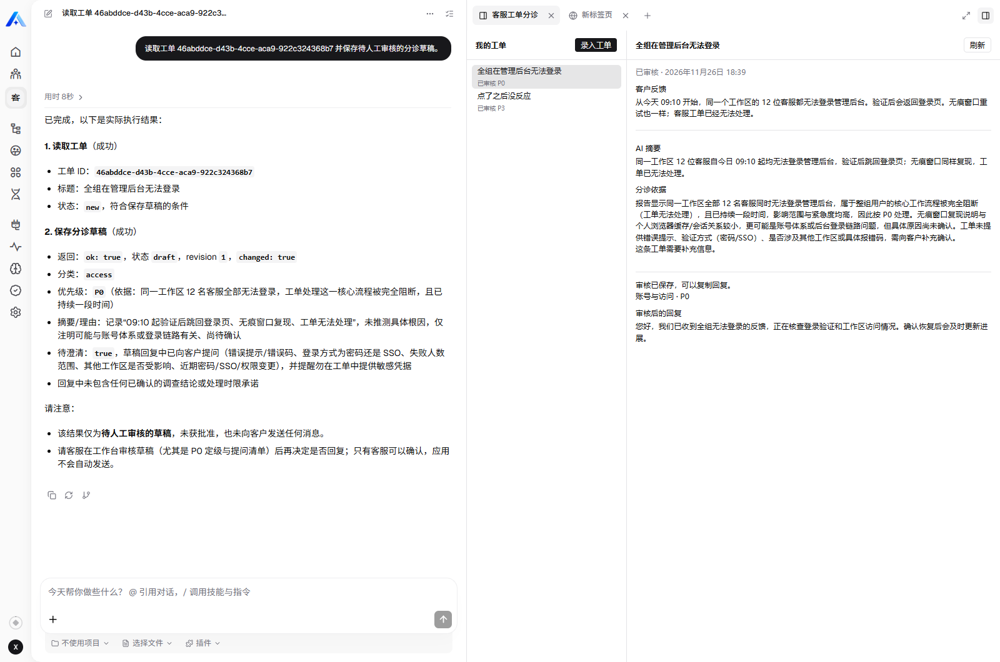

# 客服工单分诊

客服在 Xpert 工作台录入一条工单，Assistant 根据客户描述生成分诊草稿。客服核对分诊理由，可修改分类、优先级和回复，再确认保存。工作台保留原始反馈、AI 草稿和审核后的内容，便于再次查阅。

## 安装

需要 Xpert 开源版、具备插件安装权限的 Default 租户管理员，以及一个在目标组织中可用、支持工具调用的对话模型。插件通过 Xpert 的模型设置调用模型。可选用 DeepSeek，并在测试环境中配置自己的凭据。

在插件仓库的 `community` 工作区构建：

```sh
corepack pnpm install --frozen-lockfile
corepack pnpm --filter @xpert-ai/plugin-shadcn-ui build
corepack pnpm --filter @xpert-ai/plugin-support-ticket-triage build
corepack pnpm --filter @xpert-ai/plugin-support-ticket-triage test
corepack pnpm --filter @xpert-ai/plugin-support-ticket-triage verify:dist
```

生命周期测试使用仓库的 `plugin-dev-harness`。准备并构建该工具后，在插件仓库根目录执行：

```sh
node plugin-dev-harness/dist/index.js --workspace community --plugin @xpert-ai/plugin-support-ticket-triage
```

若要运行 PostgreSQL 集成测试，请在当前进程设置 `XPERT_TRIAGE_TEST_DATABASE_URL`，指向允许创建测试 schema 的隔离数据库，再执行插件的 `test` 脚本。测试会删除自己创建的临时 schema。

在 Xpert 平台仓库中使用本地部署命令。安装前将插件仓库加入平台的 `PLUGIN_WORKSPACE_ROOTS`。通过当前进程环境或本机凭据管理器提供 `XPERT_USERNAME`、`XPERT_PASSWORD` 和 API 地址。以下示例请用自己的路径和本地服务地址：

```sh
corepack pnpm plugin:deploy:local --plugin-dir <plugin-checkout>/community/apps/support-ticket-triage --scope tenant --api-url http://localhost:3000
```

如果部署命令报告需要重启，重启本地 API 并确认插件已加载。在数字专家页面通过“客服工单分诊”模板创建助手，在目标组织选择支持工具调用的模型，然后发布。用同一组织中的账号打开已发布助手的对话，从工作台菜单打开“客服工单分诊”。本地安装和运行使用 Xpert 开源版，模型凭据在 Xpert 中配置。

## 复测

1. 从 [测试数据](tickets/README.md) 选择 TKT-001。录入标题和客户反馈，保存工单。
2. 选择“生成分诊草稿”。在对话里检查“读取客服工单”和“保存分诊草稿”的实际工具记录。回到工作台核对摘要、分诊依据、分类和优先级。
3. 修改回复并选择“确认并保存”。刷新或重新打开助手，找到同一条工单并核对人工修改。应用只保存回复，客服可以自行复制。
4. 录入一条新工单。在隔离测试环境中断开首次分析的 ChatKit 请求，恢复连接后选择“重试分析”。核对重试使用同一工单 ID，并且列表仍只有一条对应工单。
5. 用 TKT-008 验证缺少页面、操作和报错信息时，草稿会提示客服补问，并允许客服调整优先级。
6. 在另一测试账号下打开工作台，确认其看不到第一位客服的工单。

## 运行截图

以下截图来自本地开源 Xpert。全部工单均为合成数据。

**助手画布。** 工单模板已发布，画布显示 DeepSeek 模型和提供两项工具的客服工单分诊中间件。



**录入工单。** 客服在对话旁的工作台中录入 TKT-001。



**失败后重试。** 浏览器测试中断首次 ChatKit 请求，已保存工单保留为待分析，客服可对同一条工单重试。



**AI 草稿。** 重试成功后，对话报告工具运行结果。工作台显示账号与访问、P0、分析依据和可编辑回复。



**两项工具调用。** 在对话中展开执行记录，可见“读取客服工单”和“保存分诊草稿”的工具名与耗时。



**人工审核与保存。** 客服确认人工修改，刷新并重新打开该工单后可以看到已审核状态和最终回复。



## 设计

- 工单按租户、组织和录入人隔离，工作台分页读取。客服在当前助手里可查阅和审核自己的工单。
- 模型只能读取工单和为待分析工单写入第一份草稿。写入用工单状态和版本作条件，重复分析不会覆盖已保存草稿或人工结果。
- 人工审核绑定已读草稿版本，并保存最终分类、优先级和回复。原始工单与 AI 草稿均保留。
- 本次范围为单条文本工单。批量导入、团队分配和外部发送留作后续扩展。

更多细节见 [设计说明](docs/design.mdx)。

## 验证记录

- 本地环境基线为 Xpert 开源版 `518b89537dc9a17a8c28165e95d942c6bcd51bd9`，插件分支基线为 `7f12f3525464454b546f1df133b051255e121d8d`。
- 使用 Node.js 24.14.1 与 community 锁定的 pnpm 8.15.8，验证插件构建、资源一致性和仓库生命周期工具加载。
- 本地 5 项测试通过。PostgreSQL 测试覆盖重复录入、账号与组织隔离、重复草稿、提交版本冲突和重新读取已审核工单。
- 实测插件业务代码为 `51fffcdb6a1e027457a7e5f530132ee38a52f94e`。在 Windows 上运行上述 Xpert 源码时，对本地宿主做了 npm 和 Tailwind 进程启动、模型描述文件路径以及 Angular 登录和弹窗模块加载的兼容性调整。宿主源码与插件仓库分别管理。
- 在已发布的助手上使用 DeepSeek（Xpert 模型配置 `deepseek-v4-flash`）和 PostgreSQL 实测 TKT-001。验证录入、ChatKit 请求中断、同一工单重试、账号与访问 P0 草稿、人工修改并保存，以及刷新后重新读取。故障由浏览器测试主动注入。
- 通过 Xpert 的 Workbench 和 Assistant API 验证 TKT-008。模型标记了缺少关键信息，并准备补问回复。模型初评为 P3，样例参考值为 P2。人工编辑后再次读取，回复内容与保存时一致。
- 账户与组织隔离由 PostgreSQL 集成测试验证。正式多人浏览器回归和生产环境性能仍待验证。

实现参考了仓库现有 Workbench、插件模板和生命周期工具的公开接口。业务逻辑和测试工单为本项目编写，界面组件使用仓库自带的 AGPL-3.0 共享组件库。开发过程中用 Codex 检查接口、生成初稿和定位 iframe 构建问题，通过真实数据库测试和浏览器交互复核。
