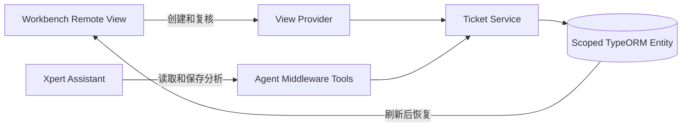

# Support Ticket Triage

Support Ticket Triage 是一个面向客服主管的 Xpert Agentic App。它把零散售后描述转成可审核的业务记录：客户提交问题，Assistant 读取已保存工单，生成分类、优先级、摘要、证据和回复草稿，人工批准或驳回后形成最终状态。模型不直接承诺退款、换货或赔偿。

## 产品闭环

1. 客服在 Workbench 创建工单，记录立即持久化为 `pending_ai`。
2. 点击“让 AI 分析”，Assistant 读取工单并调用中间件工具保存分析结果。
3. 分析结果进入 `awaiting_review`，人工查看证据与回复草稿。
4. 人工批准或驳回，结果保存为终态。
5. 可以模拟模型超时，失败原因持久化；点击重试后工单重新进入 AI 队列。
6. 刷新或重新进入 Workbench 后，工单和处理结果仍可恢复。

## 为什么 AI 有实际作用

AI 负责理解自然语言投诉、抽取关键事实、分类、判断优先级并生成回复草稿；人工保留对外承诺和最终发送内容的决定权。插件要求模型附带简短证据，并把置信度和失败原因保存下来，便于复核与追踪。

## 架构



- 插件级别：`system`
- 稳定命名空间：`support_ticket_triage`
- 隔离维度：`tenantId + organizationId`
- Assistant 工具：创建、读取、列出待处理、保存分析、保存失败
- Workbench 动作：创建、批准、驳回、模拟失败、重试
- 状态机：`pending_ai → awaiting_review → approved/rejected`，失败路径为 `pending_ai/awaiting_review → failed → pending_ai`

## 目录

```text
src/index.ts                                  插件入口与市场元数据
src/lib/support-ticket.plugin.ts              NestJS 插件模块
src/lib/support-ticket.middleware.ts          Agent 中间件工具
src/lib/support-ticket-view.provider.ts       Workbench View Provider
src/lib/support-ticket.service.ts             业务服务与持久化
src/lib/entities/support-ticket.entity.ts     TypeORM 实体
src/lib/remote-components/ticket-workbench    React Remote View
src/support-ticket-triage-assistant.yaml      Assistant 模板
src/domain                                    可独立测试的状态机和 AI 输出规范化
docs                                          演示、验证和 PR 材料
```

## 接入上游工作区

将本目录复制到 `xpert-plugins/community/apps/support-ticket-triage`。随后在 `community` 工作区安装依赖并执行：

```bash
corepack pnpm --filter @community/apps-support-ticket-triage test
corepack pnpm --filter @community/apps-support-ticket-triage typecheck
corepack pnpm --filter @community/apps-support-ticket-triage build
```

按上游 `plugin-dev-harness/README.md` 完成生命周期测试。安装到本地 Xpert 前，在 `community/.env` 配置 `XPERT_API_URL`、`XPERT_TOKEN` 和安装范围；不要提交真实 Token。

## Xpert 验收步骤

1. 构建插件并检查 `dist` 内包含 Assistant YAML 和 Remote View `app.js`。
2. 使用平台支持的本地插件安装命令部署插件，按返回结果处理 `restartRequired`。
3. 重启后确认插件 descriptor、Middleware、View Provider 和 Assistant 模板均已注册。
4. 基于模板创建 Assistant，并选择可用模型。
5. 打开售后工单分诊台，新建一条“重复扣款”工单。
6. 让 Assistant 分析，确认工具调用保存了分类、优先级、摘要、证据和回复草稿。
7. 在 Workbench 批准回复，刷新页面确认记录仍存在。
8. 新建另一条工单，模拟失败，刷新确认失败原因仍存在，再执行重试并重新分析。

## 已执行验证

本交付已执行纯业务逻辑测试，覆盖正常审批、失败重试、终态防重复操作、置信度归一化和不完整模型输出拒绝。详见 [验证记录](docs/VERIFICATION.md)。

当前机器没有已验证可用的 Xpert 测试实例，也没有安装所需上游工作区依赖，因此尚未声称 TypeScript 全量构建、插件生命周期加载或平台内真实模型调用已通过。平台验证完成后，应将真实命令输出和截图放入 `evidence/`，再提交 PR。

## 安全与边界

- 不在仓库保存模型密钥、平台 Token 或客户敏感信息。
- 所有读写均按租户和组织作用域查询。
- AI 结果必须进入人工审核状态，不直接执行退款或赔偿。
- 工具返回紧凑 DTO，不回传完整历史或隐藏上下文。
- 失败原因可见且可重试，终态不允许重复批准。

## 面试材料

- [演示脚本](docs/DEMO.md)
- [验证记录](docs/VERIFICATION.md)
- [PR 描述草稿](docs/PR_DESCRIPTION.md)
- [AI 协作说明](docs/AI_COLLABORATION.md)
- [上游接入检查表](docs/UPSTREAM_CHECKLIST.md)
- [官方实现参考](docs/SOURCES.md)
