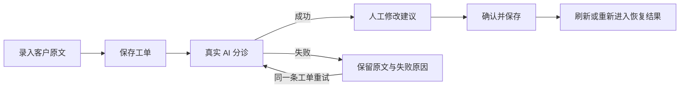
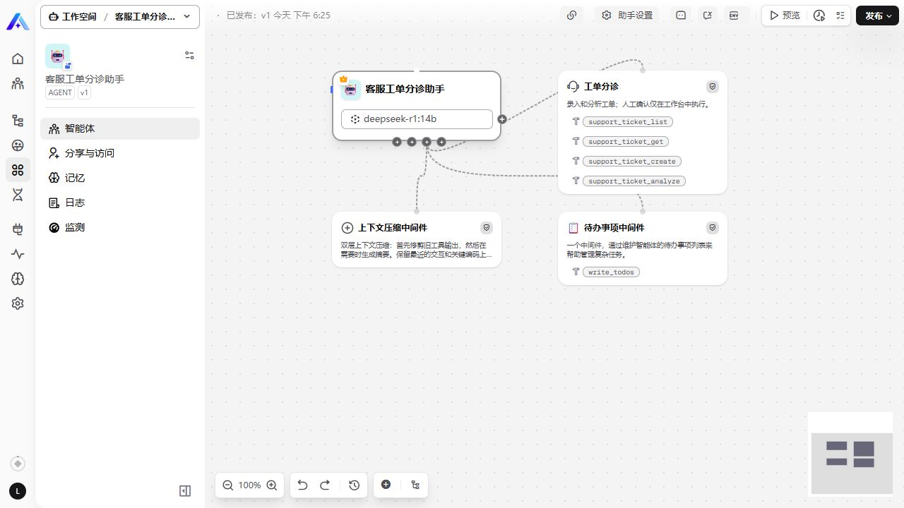
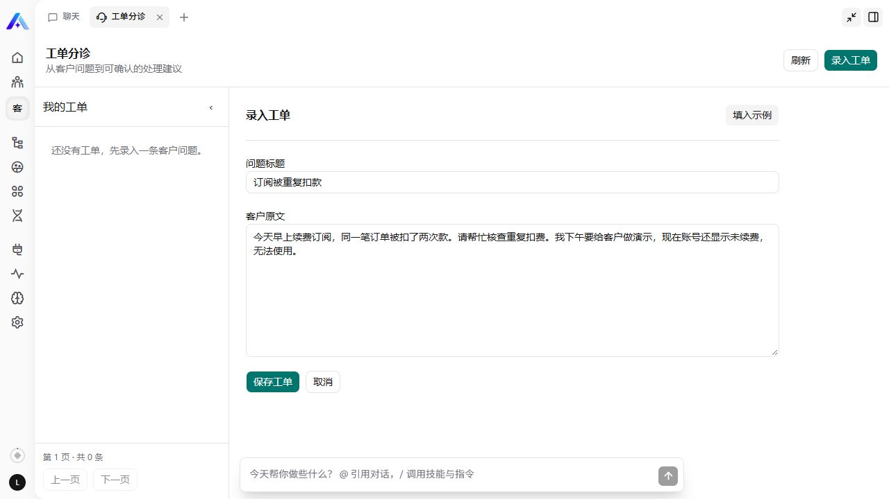
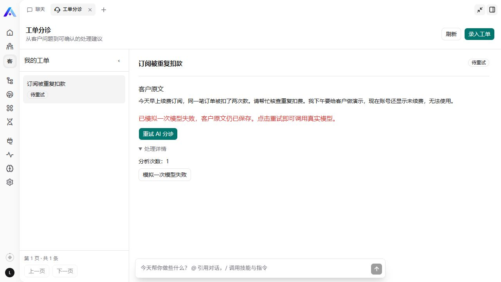
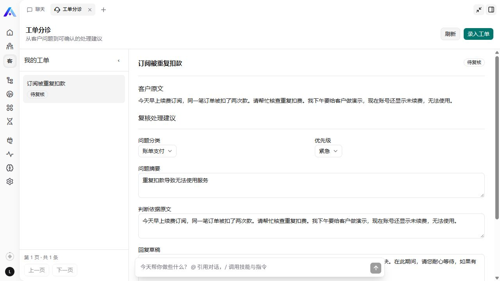
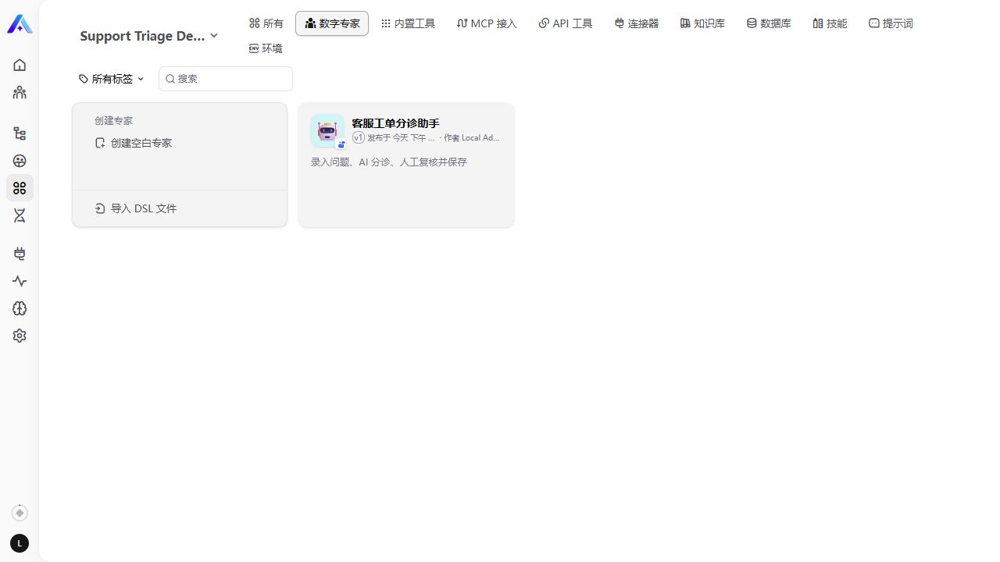
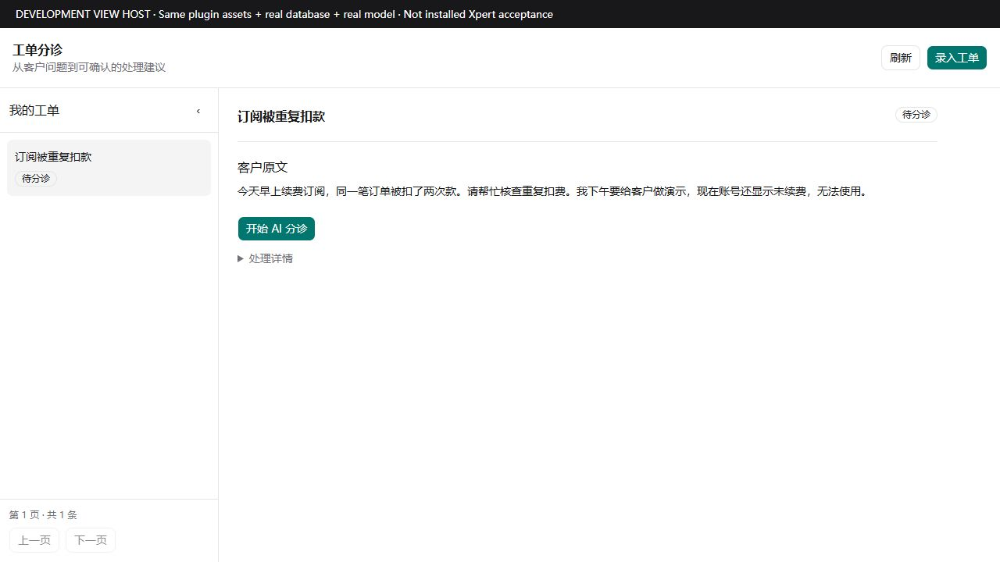
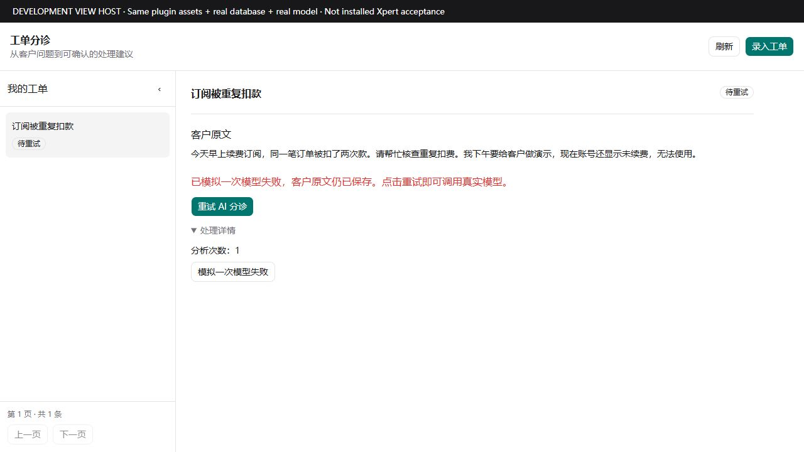
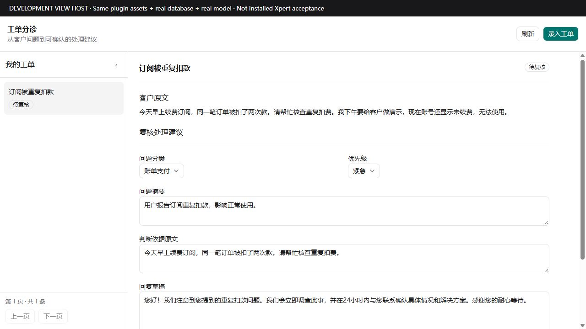
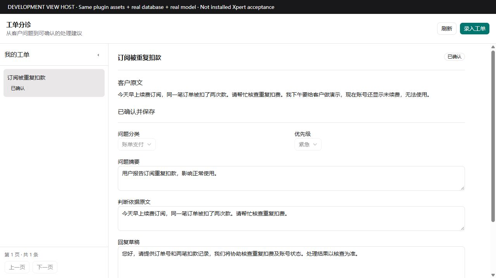

# 客服工单分诊

面向小型 SaaS 团队的一线客服，把客户问题变成可复核、可恢复的处理记录。客服录入原文，AI 提出分类、优先级、依据和回复草稿，客服修改后确认保存。应用不会发送回复、退款或操作外部客服系统。

## 用户与产品取舍

原来客服在聊天记录、表格和文档之间复制问题，逐条判断优先级、整理摘要和起草回复，后续也难以区分 AI 草稿与最终结论。本应用集中完成一条工单的分诊与复核，保留原文、AI 建议和人工确认三个版本。

AI 的具体作用是压缩阅读与起草工作。分类仅有账号、账单、技术、其他四种，优先级仅有低、普通、紧急三种。输出必须通过结构校验，判断依据必须是原文的精确引用。人工确认仅由 Workbench 动作提供，助手没有确认工具。

本次聚焦一个用户与一条流程，不做渠道导入、团队分派、知识库检索、外发消息和复杂权限。当前数据按租户、组织、用户、Assistant 隔离，适合个人客服工作台。共享客服队列需要另外定义角色与访问策略。



关键页面采用两栏工作台：左侧历史工单及状态，右侧原文与可编辑建议。主操作随状态变化为“保存工单”“开始 AI 分诊”“重试 AI 分诊”“确认并保存”。列表可收起；内容区独立滚动。

```text
┌ 工单分诊                           刷新   录入工单 ┐
│ 我的工单       │ 标题                     状态    │
│ 订阅重复扣款   │ 客户原文                          │
│ 待分诊/待复核  │ 分类         优先级               │
│ 已确认/待重试  │ 摘要   判断依据原文   回复草稿     │
│ 上一页 下一页  │                 确认并保存        │
└───────────────────────────────────────────────────┘
```

## 实现

| 部件 | 职责 |
| --- | --- |
| `src/index.ts` | system 插件入口、命名空间、服务模块和 Assistant 模板注册 |
| `src/service.ts` | 状态机、数据库保存、幂等录入、版本冲突检查和中断恢复 |
| `src/model.ts` | 服务端调用 OpenAI 兼容模型，校验结构和原文依据，屏蔽上游错误内容 |
| `src/view.ts` | Xpert Workbench 声明、范围解析、数据查询和人工动作 |
| `src/middleware.ts` | 助手可调用的录入、查询、分析工具；不暴露人工确认 |
| `src/remote/` | React + 仓库共享 shadcn 控件、双语文案、宿主桥接与主题 |
| `src/ticket.entity.ts` | `plugin_support_triage_ticket` 持久化实体 |

`new → processing → review → confirmed` 是正常路径，`processing → failed → processing` 是重试路径。所有更新都以范围、工单 ID 和 revision 比较后写入；同时分析只有一个请求能取得执行权。宿主动作请求先于慢模型超时时，界面重新读取已保存的状态并轮询 processing 工单。服务进程中断后，超过 150 秒仍处于 processing 的记录会在读取时变为可重试失败。测试演示开关默认关闭。

模型端点由管理员配置，只在服务器使用。iframe 中没有 API 地址、凭证或租户信息，也不读写 Web Storage。用户输入不决定数据所有者。模型输出、确认结果和失败原因存入数据库，页面内存只保存尚未提交的编辑。

## 构建与运行

完整步骤见 [构建与安装](docs/setup.mdx)，环境变量示例见 [env.example](env.example)，插件配置见 [config.example.json](config.example.json)。建议 Node 22；插件声明 pnpm 8.15.8，平台与 harness 使用各自声明的版本。

```sh
# 在 xpert-plugins 仓库中
cd packages/shadcn-ui
corepack pnpm@8.15.8 --ignore-workspace install
corepack pnpm@8.15.8 --ignore-workspace run build
cd ../../community/apps/support-triage
corepack pnpm --ignore-workspace install --frozen-lockfile
corepack pnpm --ignore-workspace run build
corepack pnpm --ignore-workspace test
corepack pnpm --ignore-workspace run verify:dist
```

构建产物包含服务端入口、声明、Assistant YAML 和自包含 iframe HTML。共享 UI 来自同仓库 `packages/shadcn-ui`，构建时打包，不要求宿主安装前端依赖。插件依赖 SDK 3.29.x，与本次平台 main 基线一致；为上游发布包遗漏的依赖提供了局部 `packageExtensions`，没有修改全局解析策略。

在健康的 Xpert 源码目录运行 `corepack pnpm plugin:deploy:local --help`，然后以 Default 租户的系统插件安装权限部署本插件。使用 `--config-file <插件目录>/config.example.json` 指定测试配置；模型在容器外时应调整为容器可访问的地址。真实凭证仅放在环境变量或平台配置。

部署后如要求重启，先重启并验证插件已加载，再从 **Support Triage Assistant** 模板创建助手、配置平台模型、确认 `support_triage.tools` 和工单工作台绑定并发布。安装插件不代表助手已经创建。

## 演示

1. 打开工单分诊，点击录入工单，填入一条标题与客户原文并保存。
2. 点击开始 AI 分诊，检查分类、优先级、摘要、原文依据及草稿。
3. 修改草稿后确认并保存；刷新页面，重新选择工单检查结果。
4. 另建工单，在处理详情中模拟失败，再点击重试。失败演示需要测试配置 `enableFailureDemo=true`，重试调用真实模型。
5. 演示结束后关闭失败演示开关。

## 运行证据与验证边界

以下 `xpert-*.png` 来自本地源码部署的 **真实 Xpert 平台**，使用 PostgreSQL、平台认证与 View Host，以及本机 Ollama。通过官方部署 CLI 安装插件并重启后，从插件模板创建并发布助手。Windows 验收环境的源码补丁与依赖说明见 [本地平台基线](docs/local-platform.md)。

发布后的模型、工单工具及中间件绑定：



在 Xpert Workbench 中录入客户原文：



失败状态保留原文，可在同一工单重试真实模型：



真实 AI 结果待人工复核：



人工修改并确认后，浏览器刷新能重新找到已确认工单；再次重启 API 后，原文、AI 建议和独立的人工结果仍可读取。真实平台检查结果见 [验收记录](docs/platform-verification.json)。最后一次补拍恢复截图时，浏览器控制接口返回 `browser.user is unavailable`，因此未附这张截图。

平台工作空间中的已发布助手：



下列 `preview-*.png` 是补充的 **开发 View Host** 证据，使用生产 iframe、真实领域服务、SQL.js 文件保存和本机 Ollama；顶部明确标注环境。

录入并保存原文：



模型失败与可重试状态：



真实模型生成的分诊建议，等待人工复核：



人工修改、确认保存并刷新恢复：



| 层次 | 已执行检查 | 结果 |
| --- | --- | --- |
| 业务与构建 | 服务端和前端 TypeScript、资源构建 | 通过 |
| 自动化 | 3 个测试组，含状态、幂等、4 维隔离、并发防重、异常输出及中断恢复 | 通过；模型使用明确的 HTTP 夹具 |
| 生命周期 | 官方 plugin-dev-harness 加载、Nest 注入、初始化和关闭 | 通过；数据库与宿主能力为 harness 模拟 |
| 真实 AI | Ollama `deepseek-r1:14b`，虚构重复扣费工单 | 通过；真实请求约 99 秒，分类 billing、优先级 urgent、依据在原文中 |
| 开发界面 | 浏览器录入、模拟失败、真实重试、修改确认、刷新恢复与窄屏收起列表 | 通过；使用生产构建资源 |
| Xpert 实例 | 源码平台构建、官方 CLI 安装与重启、模板创建并发布、平台内录入/失败重试/真实分诊/人工确认/刷新恢复 | 通过；PostgreSQL 和真实宿主 View 通路 |
| 平台补充检查 | API 重启恢复、过期 revision 拒绝写入、第二个已发布助手的列表隔离 | 通过；[脱敏结果](docs/platform-verification.json) |
| 最近界面修复 | 宿主动作超时后读取持久化状态并轮询 | 类型检查、构建和重新部署通过；浏览器接口中断，未重复执行最终界面验收 |
| 上游静态元数据审计 | 仓库源代码审计器 | Zod 边界解析超出其静态识别范围；真实产物测试已断言包版本、级别和命名空间一致 |

更多命令及平台验收步骤见 [验证说明](docs/verification.mdx)。

开发开始时获取的 main 基线：

- Xpert：`ef5125f1f73f6f30b1ca1e5d90e062c65aa4537e`
- xpert-plugins：`60794aa72edb1fddffebd5e5d071619b8c29014b`

## AI 开发协作

使用 Codex（GPT-6 系列开发代理；会话未提供可核实的更细模型标识），结合官方 Xpert Agentic App、插件开发和本地环境技能核对真实接口。

- 先把题目的最低完成范围整理为工单闭环，选择复用宿主 Workbench、数据库和工具机制；没有增加多智能体或外部客服集成。
- 根据官方 Dockyard 示例核对模块、View、桥接和模板形状，并使用当前 SDK 3.29 类型检查约束实现，避免猜测接口。
- 浏览器发现隔离 iframe 中原生表单提交没有执行，改为按钮显式调用桥接动作，并保留服务端校验；实际点击后验证数据库结果。
- 真实模型在草稿中生成了原文未提供的“24 小时内联系”承诺。演示中人工修改为核查后处理的表述，并保存独立的人工结果。这是人工复核的具体用途，也说明结构校验不等于事实正确。
- 环境默认 Node 14，Node 24 无法直接安装 isolated-vm。改用工作区便携 Node 22 的预编译模块，并记录平台 Windows 构建兼容性调整。
- 真实平台验收发现宿主动作请求会先于本地慢模型超时，而分析仍在后台完成。界面据数据库状态恢复 processing 轮询，保持同一工单和尝试次数，避免重复启动分析。

## 已知限制

- 本地 14B 模型响应较慢；结构或引用不合格会明确失败，用户可重试。生产部署宜选择更快且支持 JSON 输出的模型。
- AI 回复可能包含未经证实的承诺，必须人工复核；当前不提供政策知识库或事实核查保证。
- 四维隔离与并发冲突有领域自动化覆盖；本地验收使用单个管理员账号，未覆盖企业 SSO、多租户部署和所有真实角色权限组合。
- 处理在请求内完成，依赖有界超时与过期恢复；若需要长任务、批量分诊或较高并发，应迁移到平台 Managed Queue。
- 未做外发、删除、共享队列、导出或确认后的再编辑；范围内只有一条可演示的工单闭环。

复用范围和许可见 [THIRD_PARTY_NOTICES.md](THIRD_PARTY_NOTICES.md)。
