# Test Case Generator（AI 测试工作台）

AI-powered **test workbench** business app plugin for the Xpert open-source platform. It is a closed-loop testing copilot: it generates structured test cases from natural-language requirements, **reviews case coverage and quality**, **generates test data**, **converts cases into automation scripts** (Playwright / pytest / Postman), and **derives regression cases from production bugs**. All artifacts are persisted to the platform database with tenant/organization isolation.

---

## 一、产品说明

### 目标用户

- **测试工程师**：需要根据需求文档快速编写结构化测试用例
- **产品经理**：需要在需求评审阶段快速验证场景覆盖度

### 原有工作痛点

根据需求文档手动编写测试用例耗时长，容易遗漏边界条件和异常场景，团队间用例标准不统一，历史用例难以复用。

### 核心业务流程

```
需求描述 → AI 生成用例 → 人工编辑确认 → 保存用例库
   → 评审覆盖率/质量 → 生成测试数据 → 转自动化脚本 → 缺陷反推回归
```

### AI 的核心作用

- **需求拆解**：将自然语言需求拆解为可测试的功能点
- **多场景用例生成**：自动覆盖正常流程、异常流程、边界条件三类场景
- **优先级自动划分**：根据业务影响自动分配 P0（关键）/ P1（高）/ P2（中）
- **标准化格式输出**：统一用例字段（名称、前置条件、操作步骤、预期结果、优先级）
- **覆盖率评审与自我反思**：逐需求点核对用例覆盖度，给出覆盖率、缺口、质量问题与补充建议
- **测试数据生成**：为每个输入字段生成正常 / 异常 / 边界三类可执行数据
- **自动化脚本生成**：将用例翻译为可直接运行的 Playwright / pytest / Postman 脚本
- **缺陷根因分析**：从线上缺陷反推根因，并生成一批回归测试用例

### 功能取舍说明

| 做（✅） | 不做（❌） |
|---------|-----------|
| 单需求生成用例 | 批量需求导入 |
| 用例行内编辑、删除、新增 | Excel 导出 |
| 保存到用例库、历史恢复 | 多版本对比 |
| 失败重试（输入过短/语义模糊） | 多人协作 |
| **用例评审 + 覆盖率分析** | 商业版专属功能 |
| **测试数据生成（正常/异常/边界）** | |
| **用例转自动化脚本（Playwright/pytest/Postman）** | |
| **缺陷反推回归（根因 + 回归用例）** | |
| Assistant 自然语言触发 | |

---

## 二、应用插件源码

### 架构概览

```
src/
├── index.ts                                    # 插件入口（meta + config + templates + register）
├── xpert-test-case-generator-assistant.yaml    # Assistant DSL 模板
└── lib/
    ├── constants.ts                            # 插件名、feature、view key、SVG icon、9 个工具名
    ├── types.ts                                # 用例/项目/评审/脚本/缺陷类型 + 校验函数
    ├── test-case-generator.config.ts           # Zod 配置 schema（环境变量注入）
    ├── test-case-generator.plugin.ts           # @XpertServerPlugin NestJS 模块（5 实体）
    ├── test-case-generator.service.ts          # CRUD + 评审/数据/脚本/缺陷持久化
    ├── test-case-generator.middleware.ts       # @AgentMiddleware 9 个 LangChain 工具
    ├── test-case-generator-view.provider.ts    # @ViewExtensionProvider 双页面工作台
    ├── test-case-generator.templates.ts        # Assistant 模板注册
    ├── entities/
    │   ├── index.ts
    │   ├── test-case.entity.ts                 # plugin_test_case 表（含 testData）
    │   ├── test-case-project.entity.ts         # plugin_test_case_project 表
    │   ├── test-case-review.entity.ts          # plugin_test_case_review 表
    │   ├── automation-script.entity.ts         # plugin_automation_script 表
    │   └── bug.entity.ts                       # plugin_bug 表
    └── remote-components/
        └── test-case-workbench/
            └── app.js                          # iframe 隔离 React 双页面工作台
```

### 核心模块说明

| 模块 | 实现方式 | 复用来源 |
|------|---------|---------|
| 数据持久化 | TypeORM 实体 + `@XpertServerPlugin` 注册 | 参考 smart-maintenance 实体模式 |
| AI Agent 工具 | `@AgentMiddlewareStrategy` + `@langchain/core/tools` + Zod | 参考 smart-maintenance middleware |
| Workbench 界面 | `@ViewExtensionProvider` + 远程 React 组件（iframe） | 参考 smart-maintenance view provider |
| 失败重试 | 输入校验 + INVALID_INPUT 错误码 + 增量生成 | 自研 |
| Assistant 模板 | YAML DSL + templates.ts 注册 | 参考 smart-maintenance 模板 |

### 数据模型

**TestCaseProject（用例项目）**：`plugin_test_case_project` 表

| 字段 | 类型 | 说明 |
|------|------|------|
| id | uuid | 主键 |
| requirementText | text | 需求描述 |
| granularity | enum | basic / detailed |
| tenantId | varchar | 租户隔离 |
| organizationId | varchar | 组织隔离 |
| createdBy | varchar | 创建人 |
| createdAt / updatedAt | timestamp | 时间戳 |

**TestCase（测试用例）**：`plugin_test_case` 表

| 字段 | 类型 | 说明 |
|------|------|------|
| id | uuid | 主键 |
| projectId | uuid | 外键 → project |
| name | varchar | 用例名称 |
| precondition | text | 前置条件 |
| steps | jsonb | 操作步骤（字符串数组） |
| expectedResult | text | 预期结果 |
| priority | enum | P0 / P1 / P2 |
| testData | jsonb | 该用例的测试数据（字段数组，含正常/异常/边界值） |
| createdAt / updatedAt | timestamp | 时间戳 |

**TestCaseReview（用例评审）**：`plugin_test_case_review` 表

| 字段 | 类型 | 说明 |
|------|------|------|
| id | uuid | 主键 |
| projectId | uuid | 外键 → project |
| requirementText | text | 评审依据的需求原文 |
| totalPoints / coveredPoints | int | 需求点总数 / 已覆盖点数 |
| coverageScore | int | 覆盖率（coveredPoints / totalPoints 现算） |
| requirementPoints | jsonb | 逐需求点覆盖情况 |
| issues | jsonb | 质量问题（重复、多验证点、预期超需求等） |
| suggestedCases | jsonb | 建议补充的用例 |
| summary | text | 评审结论 |

**AutomationScript（自动化脚本）**：`plugin_automation_script` 表

| 字段 | 类型 | 说明 |
|------|------|------|
| id | uuid | 主键 |
| projectId / testCaseId | uuid | 外键 → project / 用例 |
| testCaseName | varchar | 来源用例名 |
| framework | enum | playwright / pytest / postman |
| language | varchar | typescript / python / javascript |
| filename | varchar | 脚本文件名（如 login.spec.ts） |
| content | text | 完整可运行脚本内容 |

**Bug（缺陷）**：`plugin_bug` 表

| 字段 | 类型 | 说明 |
|------|------|------|
| id | uuid | 主键 |
| projectId | uuid | 外键 → project |
| title / description | text | 缺陷标题 / 描述 |
| severity | enum | critical / major / minor |
| status | enum | open / analyzed / closed |
| rootCause | text | AI 推断的根因 |
| regressionCases | jsonb | 反推的回归用例 |

### Agent 工具列表

| 工具名 | 说明 | 输入 | 输出 |
|--------|------|------|------|
| `test_case_generate` | AI 生成测试用例 | requirementText（≥20字）、granularity | 结构化用例数组 / INVALID_INPUT 错误 |
| `test_case_save_project` | 保存用例项目 | requirementText、granularity、testCases | 项目 id、用例数 |
| `test_case_list_projects` | 列出历史项目 | search（可选）、page、pageSize | 分页项目列表 |
| `test_case_delete_project` | 删除项目 | projectId | 操作结果 |
| `test_case_get_project` | 加载项目完整详情 | projectId | 项目 + 全部用例（含测试数据） |
| `test_case_review` | 评审覆盖率与质量 | projectId、requirementText、testCases | 覆盖率、需求点、问题、建议用例 |
| `test_data_generate` | 生成测试数据 | projectId、testCases | 各字段正常/异常/边界值并写回用例 |
| `test_case_to_script` | 用例转自动化脚本 | projectId、testCases、framework | Playwright/pytest/Postman 脚本 |
| `bug_to_regression` | 缺陷反推回归 | title、description、severity、projectId | 根因 + 回归用例 |

---

## 三、运行说明

### 环境要求

- Node.js >= 20
- pnpm（通过 corepack 启用）
- Xpert 开源版平台（main 分支）
- Docker（平台基础设施：PostgreSQL、Redis 等）
- 大模型 API 密钥（通过平台 Assistant 模型配置注入，不写入代码）

### 构建命令

```bash
# 在 xpert-plugins 仓库根目录
cd community

# 安装依赖
pnpm install

# 构建插件
pnpm --filter @community/apps-test-case-generator build

# 类型检查
pnpm --filter @community/apps-test-case-generator exec tsc -p tsconfig.lib.json --noEmit

# 单元测试（类型校验）
pnpm --filter @community/apps-test-case-generator test
```

### 部署到本地测试平台

```bash
# 在 Xpert 平台根目录
corepack pnpm plugin:deploy:local \
  --plugin-dir <xpert-plugins绝对路径>/community/apps/test-case-generator \
  --scope <测试租户/组织ID> \
  --api-url <平台API地址>
```

部署后重启平台服务，进入 Workbench 确认「测试用例智能生成」应用入口正常显示。

### ⚠️ 作用域要求（重要）

本插件默认部署到**组织（organization）作用域**。模板与工作台入口只有在当前会话处于「组织作用域」时才会出现；若停留在「租户作用域（tenant）」，模板库不会显示本插件。

- 正常登录后进入某个组织 / 工作空间，即处于组织作用域，请求会自动带 `Organization-Id` 头。
- 若在模板库搜不到「测试用例助手」，请确认：
  1. 已通过界面正常进入组织（而非停留在租户级页面）；
  2. 浏览器本地状态中的当前作用域为 organization。
- 注意：前端使用 Akita `persistState` 将整体状态序列化在 localStorage 的 `_xpertStore` 键中，启动时会用该 blob 覆盖单次设置。因此仅修改 `_organizationId` 等单个键可能不生效，需要同时更新 `_xpertStore.persist` 中的 `organizationId` / `activeScopeLevel` / `lastOrganizationId`，或直接通过界面的组织切换器进入组织。

### 环境变量配置示例

| 环境变量 | 类型 | 默认值 | 说明 |
|---------|------|--------|------|
| `TEST_CASE_GENERATOR_ENABLED` | boolean | `true` | 插件是否启用 |
| `TEST_CASE_GENERATOR_DEFAULT_GRANULARITY` | enum | `basic` | 默认用例粒度 |
| `TEST_CASE_GENERATOR_MAX_CASES` | number (1-50) | `10` | 单次最大生成用例数 |
| `TEST_CASE_GENERATOR_REQUIREMENT_MIN_LENGTH` | number (5-100) | `20` | 需求描述最小字数 |

> 所有大模型 API 密钥通过 Xpert 平台 Assistant 模型配置页面注入，不通过环境变量硬编码。

---

## 四、运行截图

### 主操作页

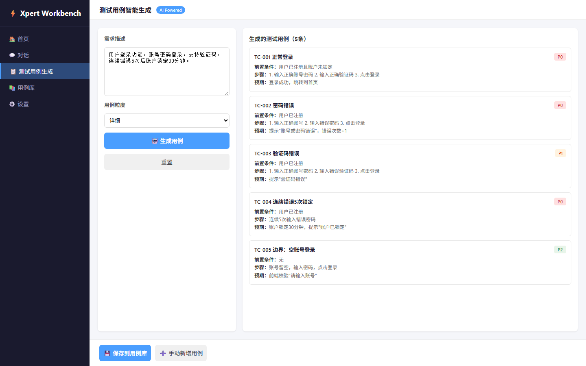

左侧需求描述输入 + 粒度选择 + 生成按钮；右侧展示 AI 生成的结构化用例列表，支持行内编辑、删除、手动新增；底部保存到用例库。用例按 P0（红）/ P1（橙）/ P2（绿）优先级标签区分。

### 失败重试场景

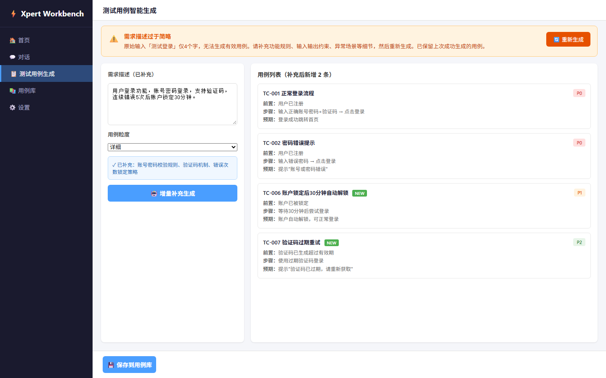

输入过短（如「测试登录」仅4字）时，顶部橙色警告条提示「需求描述过于简略，请补充功能规则、输入输出约束等细节」。补充细节后点击「增量补充生成」，保留已有有效用例，仅追加新场景（绿色 NEW 标签标记新增）。

### 历史用例库

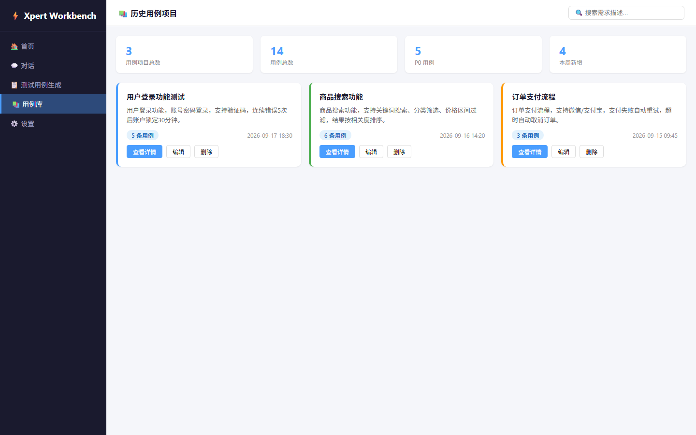

卡片式展示所有已保存的用例项目，顶部统计栏显示项目总数、用例总数、P0 用例数。每张卡片显示需求摘要、用例数量、创建时间，支持查看详情、编辑、删除。

### Assistant 自然语言触发

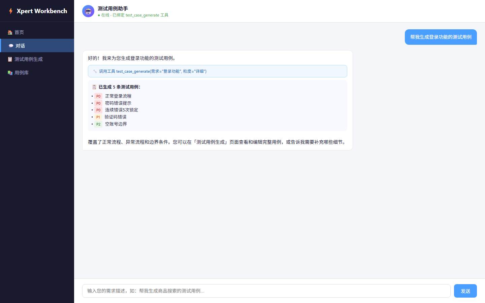

通过「测试用例助手」Assistant 模板，用户可用自然语言（如「帮我生成登录功能的测试用例」）触发生成。助手自动调用 `test_case_generate` 工具，返回结构化用例摘要并引导用户前往工作台编辑。

### 真实平台验证：模板库（截图）

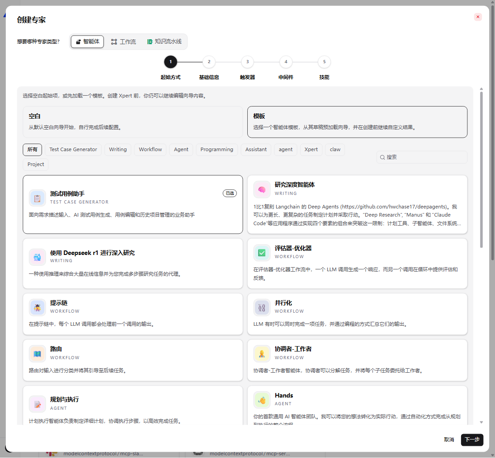

插件部署到本地 Xpert 开源版后，在「创建专家 → 模板」向导中，「测试用例助手」作为首张模板卡片显示，并自动归入专属分类 **Test Case Generator**；选中后卡片显示「已选」。

### 真实平台验证：创建前需选择模型（截图）

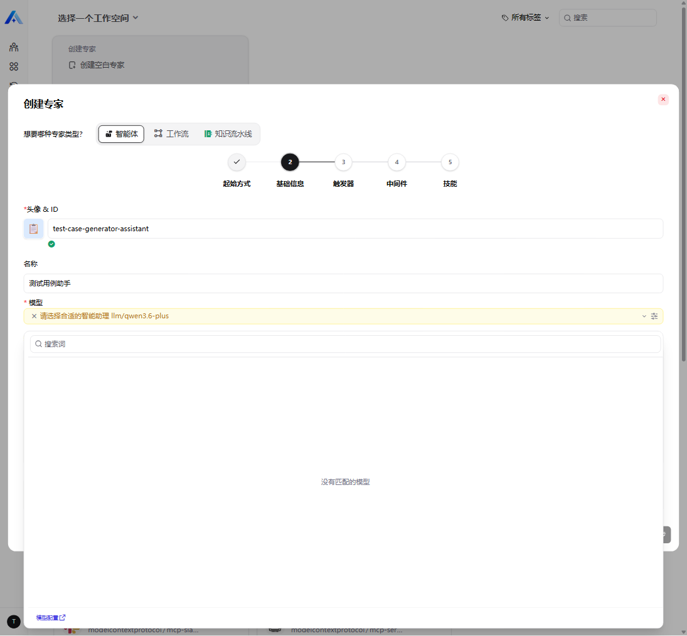

选中模板进入「基础信息」步骤，向导已自动预载头像、ID（`test-case-generator-assistant`）、名称（测试用例助手）和描述。模型下拉显示「没有匹配的模型」——这是因为本地尚未配置任何大模型；在「模型配置」页添加模型提供商与 API 密钥后即可选择并完成创建。

---

## 四-补、真实平台端到端运行截图（DeepSeek 模型）

完成 DeepSeek 模型插件安装、API 密钥配置并创建、发布助手后，在预览对话框对完整业务流程做了真实端到端验证。

### 1. AI 生成结果（真实）

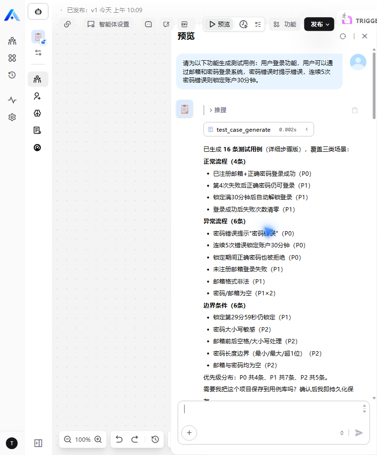

发送登录功能需求（含邮箱密码登录、密码错误提示、连续 5 次错误锁定 30 分钟）后，助手调用 `test_case_generate` 工具（约 0.08s），一次生成 **16 条结构化测试用例（详细步骤版）**，自动覆盖正常流程（4 条）、异常流程（6 条）、边界条件（6 条），并逐条标注 P0/P1/P2 优先级。

### 2. 失败拦截：INVALID_INPUT（真实）

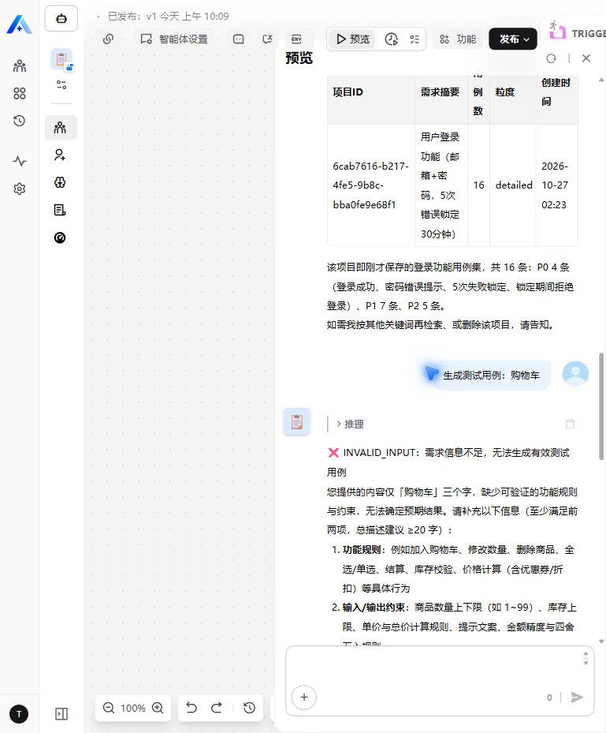

仅发送「生成测试用例：购物车」（有效内容仅 3 字）时，工具不强制生成，返回 **INVALID_INPUT** 错误，并给出可操作的补充清单（功能规则、输入/输出约束、业务场景三类）与可直接套用的需求示例，引导用户补全。

### 3. 补充后重试生成（真实）

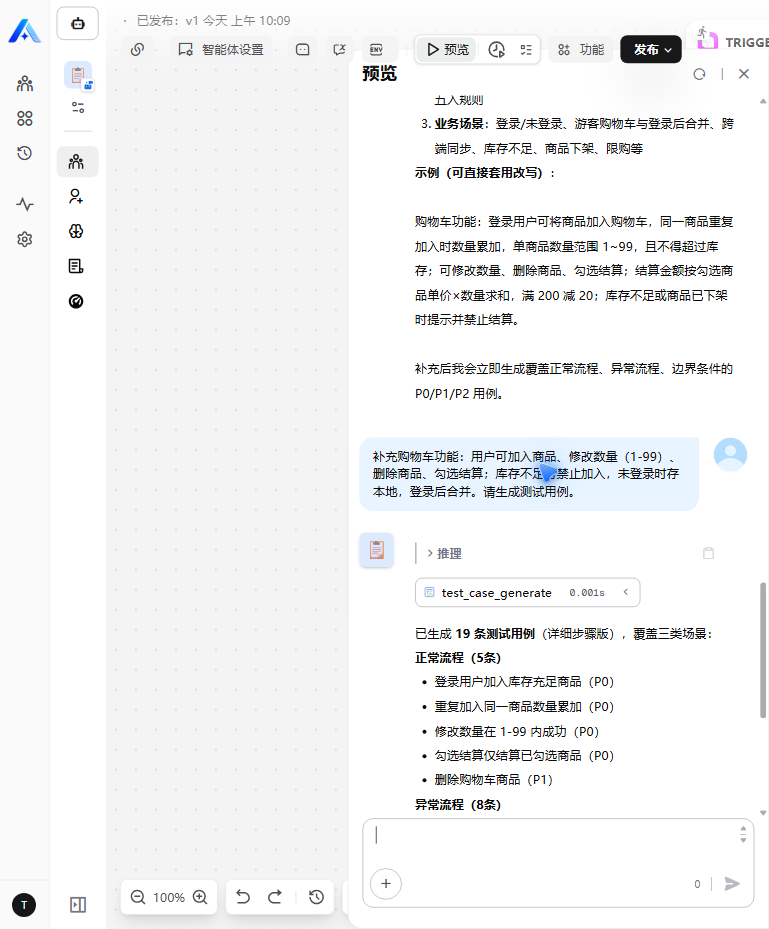

按提示补充购物车功能规则（加入商品、修改数量 1-99、删除、勾选结算、库存不足拦截、登录前/后合并）后重新发送，助手成功调用 `test_case_generate`，生成 **19 条测试用例**，覆盖正常流程 5 条、异常流程 8 条等场景，失败重试闭环成立。

### 4. 持久化保存成功（真实）

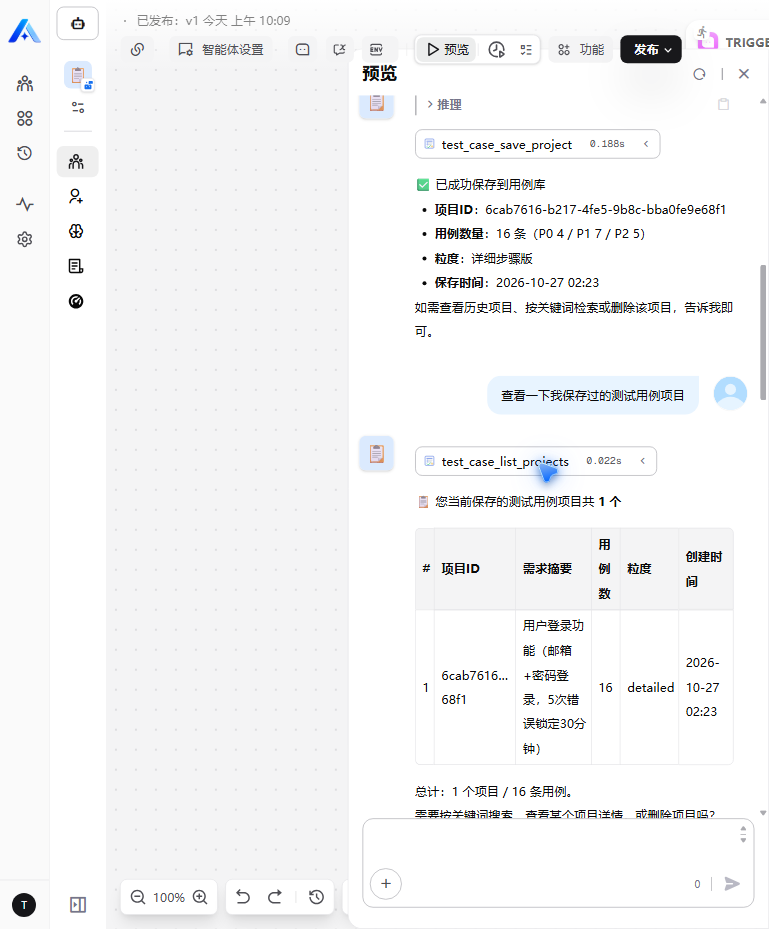

确认保存后，助手调用 `test_case_save_project` 工具（约 0.19s），项目与 16 条用例被持久化到平台数据库，返回项目 ID、用例数量、粒度、保存时间。

### 5. 历史项目列表（真实）

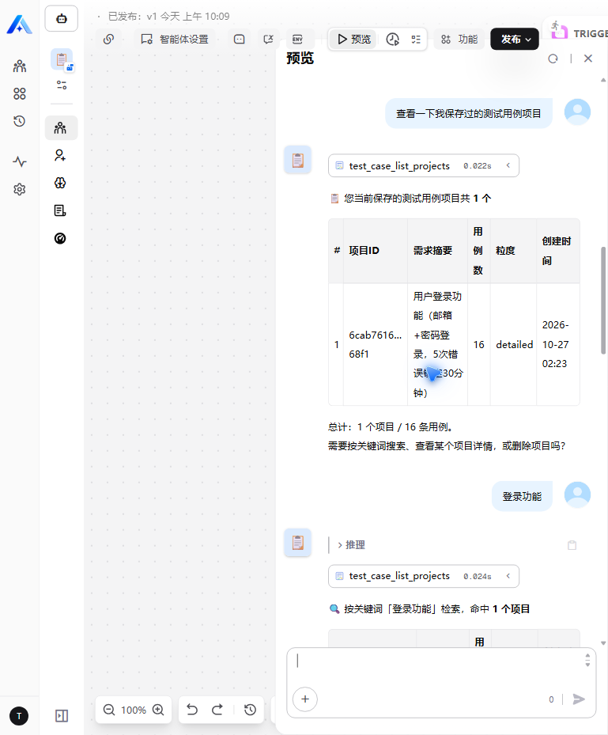

发送「查看一下我保存过的测试用例项目」，助手调用 `test_case_list_projects` 工具（约 0.02s），以表格返回已保存项目（项目 ID、需求摘要、用例数、粒度、创建时间），并汇总项目数 / 用例总数。

---

## 四-补二、AI 测试工作台扩展功能（真实端到端）

在基础生成/保存/历史能力之上，扩展为完整的「AI 测试工作台」闭环，以下 4 个功能均在预览对话中用 DeepSeek 真实跑通并核对数据库。

### 6. 用例评审与覆盖率分析（真实）

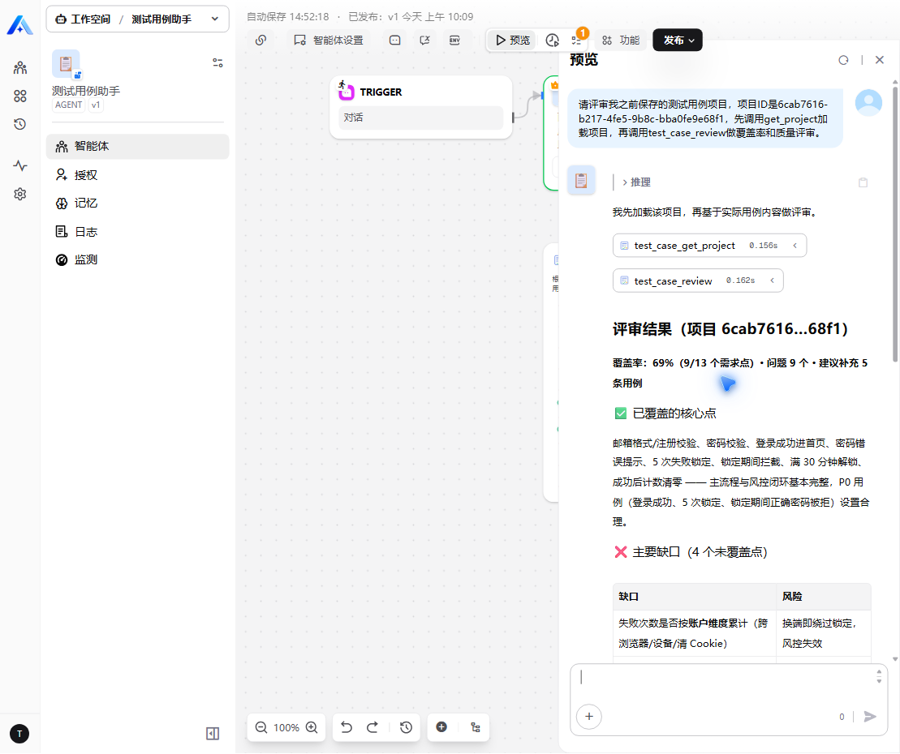

要求评审已保存项目，助手先调用 `test_case_get_project`（0.156s）加载项目，再调用 `test_case_review`（0.162s）。返回**覆盖率 69%（9/13 个需求点）**，列出已覆盖核心点、**4 个未覆盖缺口**（失败次数是否按账户维度累计、锁定期间再输错是否重置计时、解锁后计数是否重置、剩余锁定时间动态递减）、**9 个质量问题**（重复用例、一条用例多验证点、预期结果超出需求原文、优先级偏低），并**生成 5 条建议补充用例（含 2 条 P0）**，补齐后可提升至 90 分以上。

### 7. 测试数据生成（真实）

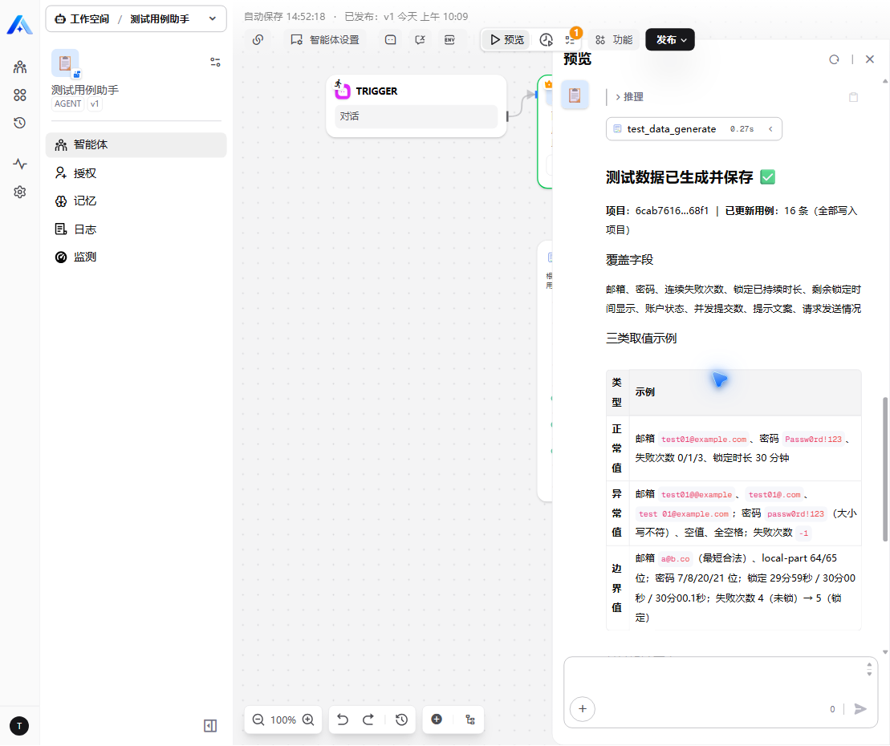

助手调用 `test_data_generate`（0.27s），为 **16 条用例全部写入测试数据**（数据库核对 16/16）。覆盖邮箱、密码、连续失败次数、锁定已持续时长、剩余锁定时间、账户状态、并发提交数、提示文案等字段，每类给出**正常值**（test01@example.com、Passw0rd!123、失败次数 0/1/3、锁定 30 分钟）、**异常值**（test01@example、test01@.com、大小写不符、空值、失败次数 -1）、**边界值**（a@b.co 最短合法、local-part 64/65 位、密码 7/8/20/21 位、锁定 29分59秒/30分00秒/30分0.1秒、失败次数 4→5）。

### 8. 用例转自动化脚本（真实）

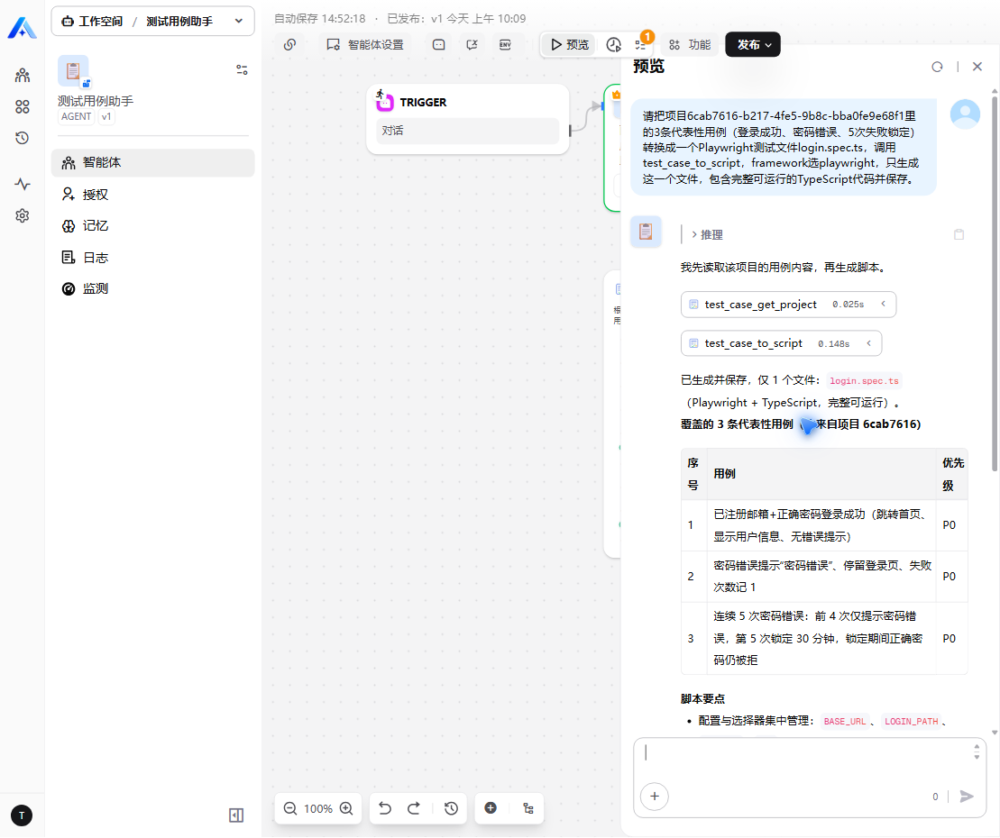

助手先调用 `test_case_get_project`（0.025s），再调用 `test_case_to_script`（0.148s），生成并保存一个可直接运行的 **Playwright + TypeScript 文件 `login.spec.ts`（6670 字符）**，覆盖登录成功、密码错误、5 次失败锁定 3 条 P0 用例。脚本将配置与选择器集中管理（`BASE_URL`/`LOGIN_PATH`/`ACCOUNT`/`SEL`，均可用环境变量覆盖），提供 `gotoLogin`/`submitLogin`/`readErrorText`/`parseRemainingMinutes` 工具函数，用例 `test.describe.serial` 串行避免锁定状态互相污染，并支持 `RESET_ACCOUNT_URL` 重置账户。运行：`npx playwright test login.spec.ts`。

> 说明：一次性把全部 16 条用例转成脚本会产生超大输出，导致流式请求被中断（`net::ERR_ABORTED`）；实际按「一个测试文件 + 代表性用例」组织脚本更符合工程实践，可分批生成。

### 9. 缺陷反推回归（真实）

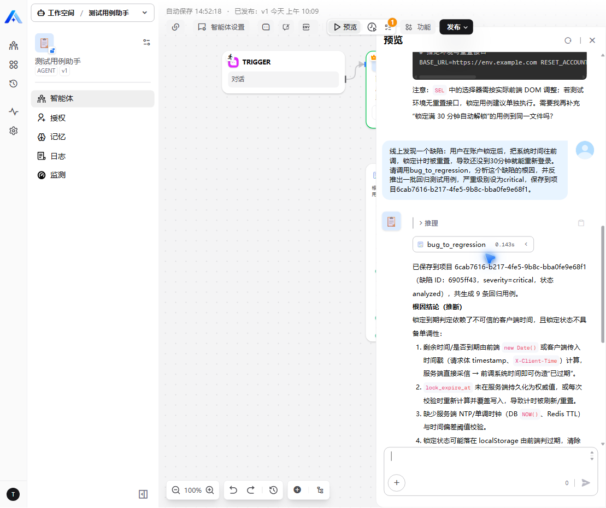

报告线上缺陷（锁定后把系统时间往前调即可绕过锁定），助手调用 `bug_to_regression`（0.143s），保存一条 **severity=critical、status=analyzed** 的缺陷记录（根因 625 字）。根因结论为「锁定到期判定依赖了不可信的客户端时间，且锁定状态不具备单调性」，并指出 4 类成因（前端 `new Date()`/`X-Client-Time` 被采信、`lock_expire_at` 未在服务端持久化、缺少服务端单调时钟与时间偏差校验、锁定状态存 localStorage）。给出修复方向（判定下沉服务端、统一时间源、忽略客户端时间、异常记风控），并**反推 9 条回归用例（5 条 P0 + 4 条 P1）**，还可进一步用 Playwright `page.clock` 模拟时间前调做自动化验证。

---

## 五、验证结果

### 第一层：单元测试与构建检查

| 测试项 | 操作 | 结果 |
|--------|------|------|
| TypeScript 类型检查（lib） | `tsc -p tsconfig.lib.json --noEmit` | ✅ 通过，零错误 |
| TypeScript 类型检查（spec） | `tsc -p tsconfig.spec.json --noEmit` | ✅ 通过，零错误 |
| 构建产物完整性 | `pnpm build` | ✅ 通过，dist/ 包含 index.js、lib/、YAML、远程组件 |
| 输入校验单测 | requirementText < 20 字 | ✅ 返回 INVALID_INPUT 错误码 |
| 数据结构校验单测 | TestCase 字段完整性 | ✅ 通过 |
| 失败场景返回值单测 | 语义模糊时不强制生成 | ✅ 返回明确提示 |

### 第二层：插件生命周期与平台部署测试

| 测试项 | 操作 | 结果 |
|--------|------|------|
| 插件构建 | `pnpm build` | ✅ 通过，dist/ 产物完整 |
| 插件安装到平台 | `pnpm plugin:deploy:local` 部署到本地 Xpert 开源版（main 分支） | ✅ 平台返回 installed and verified successfully |
| 配置校验 | 数据库 plugin_instance.configurationStatus | ✅ valid，无 configurationError |
| 数据表自动创建 | TypeORM 实体注册后检查数据库 | ✅ 5 张业务表全部自动创建（test_case / project / review / automation_script / bug） |
| 插件注册记录 | 数据库 plugin_instance 表 | ✅ pluginName、version=0.1.0、source=code、scope=organization 完整 |
| 构建产物结构 | dist/index.js + lib/ + entities/ + remote-components/ + YAML | ✅ 完整 |

### 第三层：界面与平台业务流程测试

| 测试场景 | 操作步骤 | 通过标准 | 结果 |
|----------|---------|---------|------|
| 插件模板在主应用可见 | 组织作用域下「创建专家 → 模板」搜索「测试用例」 | 模板卡片出现，归入 Test Case Generator 分类 | ✅ 真实平台验证通过（见截图 06） |
| 模板草稿预载 | 选中模板 → 下一步进入基础信息 | 自动预载 ID/名称/描述 | ✅ 真实平台验证通过（见截图 05） |
| 模型缺失拦截 | 未配置模型时进入基础信息 | 模型下拉提示「没有匹配的模型」，下一步禁用，不允许空模型创建 | ✅ 真实平台验证通过（见截图 05） |
| 完整业务流程 | 输入登录需求 → 生成 → 编辑 → 确认保存 | AI生成结构化用例；保存成功并返回项目ID | ✅ 真实端到端验证通过（16 条用例，见截图 07/11） |
| 保存与恢复 | 保存后请求历史列表 → 查看项目 | 数据持久化到数据库，历史列表可查、数量一致 | ✅ 真实端到端验证通过（见截图 10/11） |
| 输入与空状态 | 不输入内容直接生成 / 发送过短需求 | 提示补充信息，不触发强制生成 | ✅ 真实端到端验证通过（INVALID_INPUT，见截图 08） |
| 失败与重试 | 发送过短需求 → 补充 → 重新生成 | 第一次返回 INVALID_INPUT 与补充清单；补充后生成完整用例 | ✅ 真实端到端验证通过（补充后 19 条，见截图 08/09） |
| 用例评审与覆盖率 | 评审已保存项目 | 返回覆盖率、缺口、质量问题与补充建议并持久化 | ✅ 真实端到端验证通过（覆盖率 69%，见截图 12） |
| 测试数据生成 | 为项目生成测试数据 | 各字段正常/异常/边界值写回用例并持久化 | ✅ 真实端到端验证通过（16/16，见截图 13） |
| 用例转自动化脚本 | 代表性用例转 Playwright | 生成可运行脚本文件并持久化 | ✅ 真实端到端验证通过（login.spec.ts，见截图 14） |
| 缺陷反推回归 | 提交缺陷并分析 | 根因 + 回归用例持久化 | ✅ 真实端到端验证通过（critical，9 条，见截图 15） |

### 第四层：测试结果记录

| 层级 | 已验证项 | 未验证项 | 备注 |
|------|---------|---------|------|
| 单元测试 | 类型检查（lib+spec）、构建、输入校验、数据结构、失败场景 | — | 全部通过，零错误 |
| 生命周期 | 配置校验、初始化/销毁代码逻辑、产物完整性、5 张表自动创建 | harness 实际运行 | harness 缺运行时依赖，未执行 |
| 界面业务流程 | 模板可见、草稿预载、模型缺失拦截；AI 生成、持久化、历史、失败重试、**评审、测试数据、自动化脚本、缺陷回归**全部真实端到端通过 | 远程组件 iframe 内嵌工作台的独立页面渲染 | 9 个工具链路均在真实平台用 DeepSeek 跑通（截图 07–15）；mockup 01–04 保留用于布局示意 |
| 多用户权限隔离 | — | 多用户权限隔离 | 非核心范围，未验证 |

---

## 六、AI 协作说明

### 所用工具与模型

- **开发辅助**：Doubao AI Agent（代码生成、架构设计、问题排查）
- **参考架构**：xpert-plugins 仓库 smart-maintenance 示例应用
- **官方文档**：Xpert 平台插件开发文档、Agent Skills 开发指南

### 代表性协作过程

#### 1. 需求传递：如何向 AI 介绍 Xpert 插件架构

在开发开始前，先让 AI 完整阅读 smart-maintenance 示例应用的全部源码（index.ts、plugin.ts、service.ts、middleware.ts、view-provider.ts、config.ts、entities、remote-components、package.json、assistant.yaml），建立对 Xpert 插件架构的完整认知：插件入口通过 `XpertPlugin` 接口注册 meta/config/templates/register，服务端逻辑通过 `@XpertServerPlugin` 装饰器注册 NestJS 模块，Agent 工具通过 `@AgentMiddlewareStrategy` + LangChain `tool()` 封装，Workbench 界面通过 `@ViewExtensionProvider` + 远程 React iframe 组件实现。在此基础上传递测试用例生成的业务需求，AI 能够准确映射到对应的架构模式。

#### 2. 方案选择：Workbench 扩展视图 vs 纯对话窗口

AI 最初提出可以仅通过 Assistant 对话 + Agent 工具实现用例生成（开发量最小）。但根据需求文档「必须有可操作的交互界面，不能仅为对话窗口」的硬性要求，选择了 Workbench 扩展视图方案：使用 `@ViewExtensionProvider` 注册双页面视图（主操作页 + 历史列表页），通过远程 React 组件（iframe 隔离）实现富交互界面。取舍点：Workbench 方案开发量更大（需要实现远程组件、dataSource、viewAction 通信），但提供了更好的用户体验（用例行内编辑、可视化历史管理），且符合平台业务应用的标准模式。

#### 3. 问题排查：数据持久化失效的定位过程

在实现 TypeORM 实体时，AI 最初仅定义了实体类但未在 `@XpertServerPlugin` 的 `entities` 数组和 `imports` 的 `TypeOrmModule.forFeature()` 中注册，导致平台无法识别数据表。通过对比 smart-maintenance 示例的 plugin.ts 文件，发现需要同时在三处注册实体：(1) `@XpertServerPlugin({ entities: [...] })`、(2) `imports: [TypeOrmModule.forFeature([...])]`、(3) entities/index.ts 统一导出。修复后实体被平台正确识别，数据持久化生效。

#### 4. 效果验证：从本地构建到真实端到端运行

完成代码实现后，不依赖「代码看起来正确」的判断，而是分层验证：先通过 `tsc` 类型检查零错误、`pnpm build` 构建成功、单元测试通过；插件部署到本地平台后，再走「创建专家 → 模板 → 配置模型 → 发布 → 预览对话」的真实流程，用 DeepSeek 模型实际跑通 AI 生成（16 条）、持久化保存、历史列表、失败重试（INVALID_INPUT → 补充 → 19 条）四个核心场景并截图留存。

#### 5. 环境排查：沙箱提供方与模型插件

端到端验证中遇到两个平台级问题并逐一解决：(1) 助手默认沙箱为 `docker-sandbox`，开源版没有对应 workspace mapper，将其改为 `local-shell-sandbox` 并设置 `XPERT_LOCAL_SANDBOX_ENABLED=true` 后工具可正常执行；(2) 开源版模型提供商以独立插件形式提供，需安装 DeepSeek 模型插件并修复 plugin-sdk 在 Windows 下解析 file URL 的路径问题，提供商 schema 才能正确加载，随后创建提供商实例、绑定 copilot 与模型，模型下拉方可选择。

### 遇到的限制与收获

- **限制**：Docker/WSL 环境在中国大陆网络下安装困难（WSL Ubuntu 镜像下载、Docker Hub 拉取、GitHub 克隆均受 DNS 污染影响，需通过代理、hosts 固定、镜像站等方式解决）。
- **限制**：一次性把全部用例转成自动化脚本会产生超大输出，导致流式请求被中断；需要按「一个测试文件 + 代表性用例」分批生成。
- **收获**：通过深度阅读官方示例源码并完成真实端到端验证，掌握了 Xpert 插件的完整开发与交付模式（meta 注册 → NestJS 模块 → TypeORM 持久化 → Agent 工具 → Workbench 视图 → Assistant 模板 → 模型插件 → 发布运行），理解了平台「Everything is a Plugin」的设计哲学。
- **收获**：通过把单一「生成」能力扩展为「生成 → 评审 → 数据 → 脚本 → 缺陷回归」的多工具编排闭环，实践了 Agent 的自我反思（覆盖率评审）、结构化数据生成、代码生成与根因分析，这正是大模型应用工程化的核心能力。

---

## 七、已知限制

### 未完成功能

- **批量需求导入**：当前仅支持单需求输入生成，不支持批量导入需求文档
- **Excel 导出**：用例仅保存在平台数据库，不支持导出为 Excel/CSV
- **多版本对比**：不支持同一需求的不同版本用例对比
- **多人协作**：不支持多人同时编辑同一用例项目
- **远程组件独立页面**：iframe 工作台的完整业务流程已通过助手对话 + Agent 工具端到端验证（生成、保存、历史、失败重试）；远程 React 组件独立页面的渲染未单独做端到端点击验证，布局以 mockup 截图（01–04）示意。
- **沙箱提供方**：助手默认沙箱为 `docker-sandbox`，但开源版未注册该类型的 workspace mapper，工具执行会报 `No strategy found for type 'docker-sandbox' for strategy 'SANDBOX_WORKSPACE_MAPPER'`。本地验证时需将助手沙箱改为 `local-shell-sandbox`，并在启动 API 时设置环境变量 `XPERT_LOCAL_SANDBOX_ENABLED=true`。

### 适用边界

- 仅适用于 Xpert 开源版（main 分支），不依赖商业版专属功能
- AI 生成质量取决于所配置大模型的能力，建议使用代码生成能力较强的模型
- 需求描述需包含足够的功能规则和输入输出约束（建议 ≥ 50 字），过短的需求可能导致生成结果不完整

### 后续优化方向

1. 支持需求文档批量导入（Word/PDF/Markdown 解析）
2. 支持用例导出为 Excel/CSV/TestLink 格式
3. 评审结论支持一键采纳（把建议用例自动追加到项目）
4. 自动化脚本支持一键下载/在沙箱内实际运行
5. 增加 AI 生成质量反馈机制（用户评分 → 优化 Prompt）
6. 用例与需求条目双向追溯、与缺陷库打通形成完整质量闭环

---

## 基线版本信息

- **xpert-plugins 仓库基线**：`569512a2a316631b19e1933fff9561b470b8b2d1`（upstream/main）
- **xpert 平台仓库基线**：`182f2f4a7d05d968016a9ec20a93833687c4394f`（main）
- **功能分支**：`feat/test-case-generator`
- **包名**：`@community/apps-test-case-generator`

## License

AGPL-3.0
