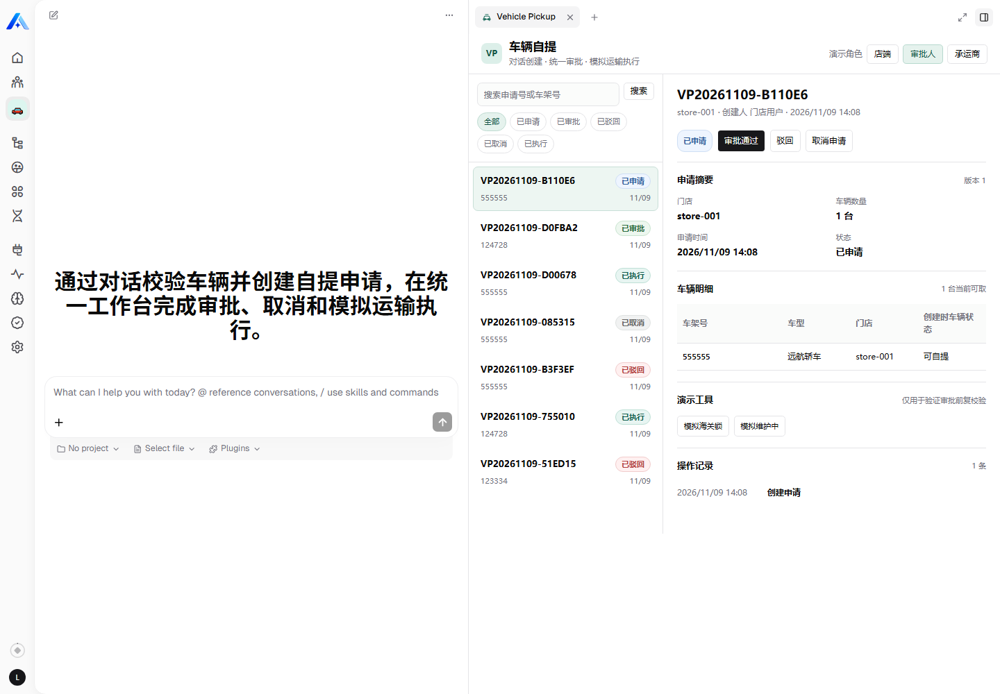
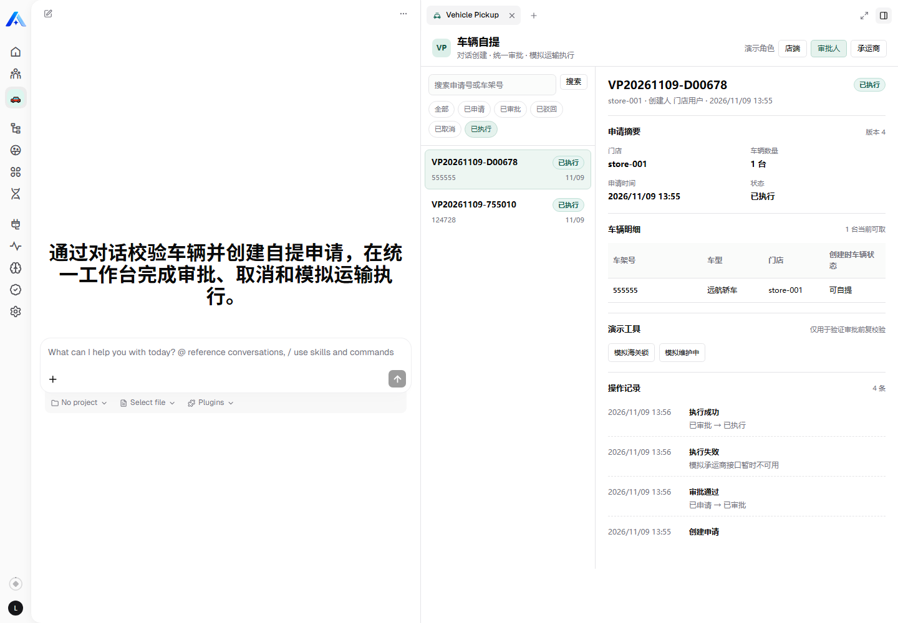
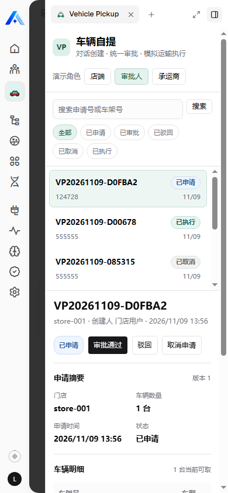

# Vehicle Pickup

车辆自提 Agentic App。店端通过对话校验车辆并直接创建自提申请；审批人和承运商在同一工作台完成审批、驳回、取消和模拟运输执行。

## Product behavior

- 创建申请完全在对话中完成，没有创建页面、提交按钮或二次确认。
- 车辆是否存在、是否属于当前门店、当前状态是否允许自提、是否已有活动申请，全部由服务端判定。
- 审批通过前会重新校验车辆。校验失败时自动转为“已驳回”，理由以“系统驳回：”开头。
- 承运商首次模拟执行失败，第二次执行成功。
- 列表、详情和操作日志共用一个工作台，不拆成独立详情路由。

状态映射：

| Status | UI label |
| --- | --- |
| `applied` | 已申请 |
| `approved` | 已审批 |
| `rejected` | 已驳回 |
| `cancelled` | 已取消 |
| `executed` | 已执行 |

仅 `applied` 和 `approved` 可以取消。

## Roles

| Role | Permissions |
| --- | --- |
| 店端 `store` | 校验车辆、创建申请、查看本门店申请 |
| 审批人 `approver` | 查看申请、审批通过、系统重校验、人工驳回、取消 |
| 承运商 `carrier` | 查看已审批/已执行申请、模拟运输执行 |

AI middleware 的租户、组织和用户身份来自平台可信上下文，不要求模型在工具参数中传递用户或组织 Token。

## AI tools

- `vehicle_pickup_validate_request`
  - 只读校验，用于回答“这辆车能不能自提”。
- `vehicle_pickup_create_request`
  - 创建申请，内部复用服务端校验。
- `vehicle_pickup_query_requests`
  - 统一返回可见申请列表，并包含车辆、状态、审批、执行和日志摘要。

## Mock vehicles

| Vehicle | Store | Initial status |
| --- | --- | --- |
| `123334` | `store-001` | available |
| `124728` | `store-001` | available |
| `555555` | `store-001` | available |
| `777777` | `store-001` | customs locked |
| `888888` | `store-001` | under maintenance |
| `999999` | `store-002` | available, but hidden by store data permission |

管理员可通过工作台演示工具切换车辆为海关锁或维护中。

## Configuration

Runtime environment variables:

- `VEHICLE_PICKUP_STORE_USER_IDS`
- `VEHICLE_PICKUP_APPROVER_USER_IDS`
- `VEHICLE_PICKUP_CARRIER_USER_IDS`
- `VEHICLE_PICKUP_DEMO_SWITCH_USER_IDS`
- `VEHICLE_PICKUP_DEFAULT_STORE_ID`
- `VEHICLE_PICKUP_DEFAULT_CARRIER_ID`
- `VEHICLE_PICKUP_STORE_BY_USER_JSON`
- `VEHICLE_PICKUP_CARRIER_BY_USER_JSON`
- `VEHICLE_PICKUP_SIMULATE_EXECUTION_FAILURE_ONCE`

Secrets must stay in the local runtime credential store or the platform model-provider configuration. Never commit them to this plugin.

## Build and test

```bash
cd /opt/xpert-appdev/plugins/community
corepack pnpm --filter @xpert-ai/plugin-vehicle-pickup test
```

The test command rebuilds the server module, remote React component and verifies the TypeScript contracts before running the rule tests.

## Local deployment

The plugin declares `level=tenant` because it owns TypeORM entities.

```bash
source /opt/xpert-appdev/xpert-env.sh
cd /opt/xpert-appdev/platform
corepack pnpm plugin:deploy:local \
  --plugin-dir /opt/xpert-appdev/plugins/community/apps/vehicle-pickup \
  --api-url "$XPERT_API_URL" \
  --scope tenant \
  --tenant-id "$XPERT_TENANT_ID" \
  --manifest-file /opt/xpert-appdev/.xpert-local-environment/vehicle-pickup-deploy.json
```

If the manifest reports `restartRequired`, restart the API and wait for `/api/health/ready`.

The Assistant uses an OpenAI-compatible model provider. In the local demo environment the provider is configured against DeepSeek with `deepseek-flash`; the API key belongs in the platform credential store and is not part of this repository.

## Verification scripts

The scripts expect the protected server environment from `xpert-env.sh`.

```bash
pnpm verify:api
pnpm install:assistant
pnpm verify:execution-clear
```

`pnpm verify:workflow` covers the full clean-database flow: validation, invalid create blocking, idempotency, approval, system rejection, manual rejection, cancellation, first execution failure and retry success. It expects an empty pickup-request table and should only run against the local demo database.

`pnpm setup:model` configures the OpenAI-compatible provider when `DEEPSEEK_API_KEY` is supplied through the process environment.

## Screenshots







## Known limitations

- Vehicle data comes from an in-memory mock catalog and resets when the API restarts.
- Notifications, ERP synchronization and real transport instructions are intentionally out of scope.
- No OCR or image recognition.
- The platform Assistant and model-provider configuration are environment concerns, not plugin migrations.

## Privacy

See [PRIVACY.md](PRIVACY.md) for stored platform identifiers, business records and model-provider data handling.
