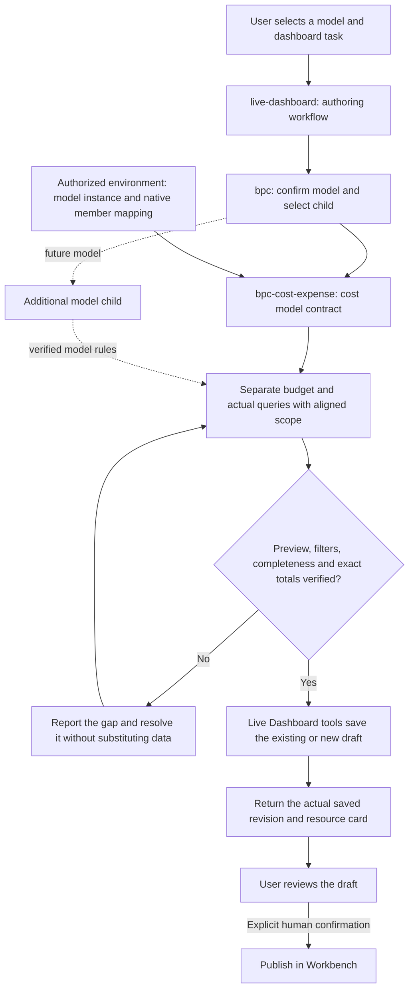

# BPC model workflow in Live Dashboard

The plugin ships three sibling skill components. Their parent/child relationship
is an instruction workflow, not nested installation or an extra Agent runtime.
The default author template explicitly binds all three to `Agent_Dashboard`.

For analysis-only requests, report the verified findings without creating or
editing a dashboard. Style-only edits retain verified bindings. Loading a child
does not restart discovery already completed in the same task.

## Reuse and extension

- Same semantic contract, another company: provide that environment's authorized
  model and member mapping. Reuse the child; amounts and available periods remain
  live data.
- Same model, another month or budget version: change verified query selections.
- Different model contract: add a sibling skill with its own semantic contract,
  mapping guide and focused tests; register its explicit route in
  [model-routing.md](model-routing.md) and its dependency in the plugin author
  template. Validate package discovery and Agent binding together.
- Existing/custom Assistants: enable the required skills through their normal
  configuration workflow. Merely updating the plugin does not migrate them.

The current cost child covers monthly production-cost comparisons. Future
budget, revenue or investment children are extension points, not delivered
capabilities. No customer instance or credential belongs in the plugin package.
