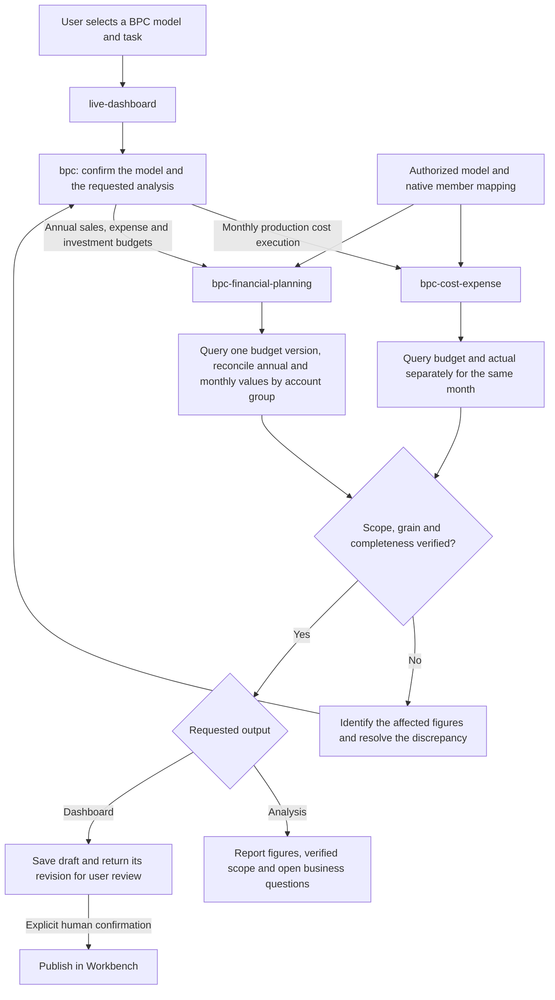

# BPC analysis in Live Dashboard

The default author template binds four sibling skills to `Agent_Dashboard`.
The BPC parent matches the requested analysis to rules supported by the selected model.

A single model instance can support both branches. Changing the version, period
or organization reuses the selected child with fresh bindings. For another
company, resolve authorized model and member identities in that environment.

To add a different business contract, add a sibling skill, register its task and
model requirements in [model-routing.md](model-routing.md) and declare the
dependency in the plugin author template. Verify package discovery and Agent
binding. Existing or custom Assistants enable the skills in their own configuration.
