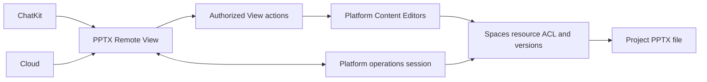

`src/core` contains the extracted OOXML editing projection and package patching code.
`remote` contains the shared React editor, theme/i18n bridge, UI and host lifecycle.
`src/lib` registers file/resource editor descriptors and validates file actions.

The original PPTX package is retained while supported objects and notes are patched.
Unchanged media, themes, masters and layouts are preserved. Rendering support is not a
claim of complete Office feature parity; unsupported effects and objects need fidelity review.

File codecs explicitly declare their catalog model. Spaces exposes scoped codec types through
`ContentCatalogProvider.listTypes`, so no PPT-specific branch is required in Spaces.
The same item ID and path are used by catalog navigation and file persistence.

The Space file collaboration provider authorizes current Project/resource access on session
creation and delivery. It publishes presence and numeric version notifications. Binary writes
remain atomic compare-and-set writes; simultaneous arbitrary object edits are not merged.

View requests use host-derived tenant, organization, user, Project and Assistant context.
The iframe receives neither a platform bearer token nor direct storage credentials.
